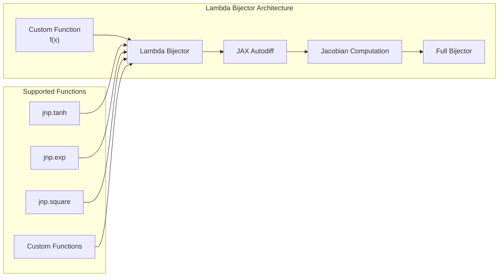
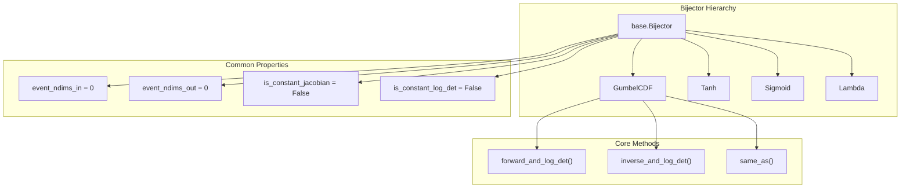
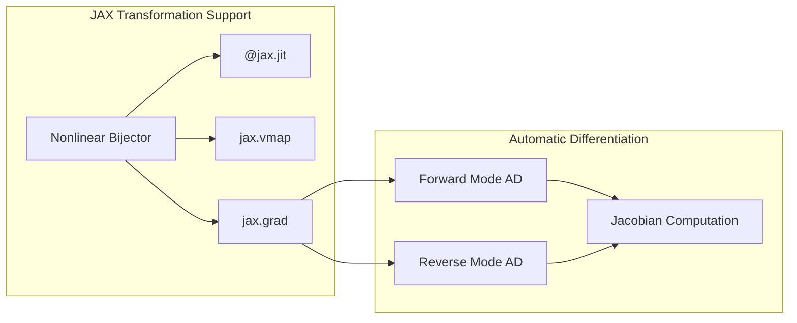

<!-- source: DeepWiki mcp.deepwiki.com · repo google-deepmind/distrax · page 4.2 Nonlinear Bijectors · fetched 2026-10-26 -->

# Nonlinear Bijectors

Relevant source files

The following files were used as context for generating this wiki page:

- [distrax/_src/bijectors/gumbel_cdf.py](distrax/_src/bijectors/gumbel_cdf.py)
- [distrax/_src/bijectors/gumbel_cdf_test.py](distrax/_src/bijectors/gumbel_cdf_test.py)
- [distrax/_src/bijectors/lambda_bijector_test.py](distrax/_src/bijectors/lambda_bijector_test.py)
- [distrax/_src/bijectors/sigmoid_test.py](distrax/_src/bijectors/sigmoid_test.py)
- [distrax/_src/bijectors/tanh_test.py](distrax/_src/bijectors/tanh_test.py)
- [distrax/_src/distributions/gumbel.py](distrax/_src/distributions/gumbel.py)

This document covers nonlinear bijective transformations in Distrax that operate element-wise on scalar inputs. These bijectors apply nonlinear functions like hyperbolic tangent, sigmoid, and cumulative distribution functions to transform probability distributions while maintaining invertibility.

For linear transformations like scaling and shifting, see [Linear Bijectors](#4.1). For complex multi-dimensional transformations and normalizing flows, see [Coupling and Flow Bijectors](#4.3).

## Core Nonlinear Bijectors

Distrax provides several fundamental nonlinear bijectors that apply standard mathematical functions element-wise:

### Tanh Bijector

The `Tanh` bijector applies the hyperbolic tangent function, mapping the real line to the interval (-1, 1). This transformation is commonly used to bound the support of distributions.

**Mathematical Definition:**
- Forward: `y = tanh(x)`
- Inverse: `x = arctanh(y)`
- Log determinant: `log|dy/dx| = log(1 - tanh²(x))`

### Sigmoid Bijector

The `Sigmoid` bijector applies the logistic sigmoid function, mapping the real line to the interval (0, 1). This is useful for creating distributions over probabilities.

**Mathematical Definition:**
- Forward: `y = sigmoid(x) = 1/(1 + exp(-x))`
- Inverse: `x = logit(y) = log(y/(1-y))`
- Log determinant: `log|dy/dx| = log(sigmoid(x) * (1 - sigmoid(x)))`

### GumbelCDF Bijector

The `GumbelCDF` bijector implements the cumulative distribution function of the standard Gumbel distribution, providing a specific nonlinear transformation useful in extreme value modeling.

```mermaid
graph TB
    subgraph "GumbelCDF Implementation"
        INPUT["x: Array"]
        FORWARD["forward_and_log_det()"]
        EXP_NEG_X["exp_neg_x = exp(-x)"]
        Y["y = exp(-exp_neg_x)"]
        LOG_DET["log_det = -x - exp_neg_x"]
        OUTPUT["(y, log_det)"]
        
        INPUT --> FORWARD
        FORWARD --> EXP_NEG_X
        EXP_NEG_X --> Y
        EXP_NEG_X --> LOG_DET
        Y --> OUTPUT
        LOG_DET --> OUTPUT
    end
    
    subgraph "Inverse Operation"
        Y_INPUT["y: Array"]
        INVERSE["inverse_and_log_det()"]
        LOG_Y["log_y = log(y)"]
        X_OUT["x = -log(-log_y)"]
        INV_LOG_DET["log_det = x - log_y"]
        INV_OUTPUT["(x, log_det)"]
        
        Y_INPUT --> INVERSE
        INVERSE --> LOG_Y
        LOG_Y --> X_OUT
        LOG_Y --> INV_LOG_DET
        X_OUT --> INV_LOG_DET
        X_OUT --> INV_OUTPUT
        INV_LOG_DET --> INV_OUTPUT
    end
```

Sources: [distrax/_src/bijectors/gumbel_cdf.py:37-48]()

## Lambda Bijector for Custom Functions

The `Lambda` bijector provides a flexible mechanism to convert arbitrary JAX functions into bijectors with automatic Jacobian computation:

The Lambda bijector automatically handles:
- Forward transformation using the provided function
- Inverse computation (when possible)
- Log determinant Jacobian via automatic differentiation
- Integration with JAX transformations (JIT, vmap, grad)

Sources: [distrax/_src/bijectors/lambda_bijector_test.py:242-255](), [distrax/_src/bijectors/lambda_bijector_test.py:293-311]()

## Implementation Patterns

All nonlinear bijectors in Distrax follow consistent implementation patterns:

| Method | Purpose | Required |
|--------|---------|----------|
| `__init__` | Initialize with `event_ndims_in=0` for scalar operations | Yes |
| `forward_and_log_det` | Compute forward transformation and log determinant | Yes |
| `inverse_and_log_det` | Compute inverse transformation and log determinant | Yes |
| `same_as` | Check bijector equality for optimization | Yes |

### Base Class Integration

Sources: [distrax/_src/bijectors/gumbel_cdf.py:25-52](), [distrax/_src/bijectors/tanh_test.py:39-44](), [distrax/_src/bijectors/sigmoid_test.py:39-44]()

### Numerical Stability

Nonlinear bijectors implement numerically stable computations, particularly for extreme input values:

**Stability Features:**
- Careful handling of overflow/underflow in exponential functions
- Specialized implementations for edge cases
- Validation against TensorFlow Probability equivalents

The test suites verify stability across wide input ranges, including extreme values like `[-10.0, 10.0]` to ensure robust numerical behavior.

Sources: [distrax/_src/bijectors/tanh_test.py:131-143](), [distrax/_src/bijectors/sigmoid_test.py:131-143](), [distrax/_src/bijectors/gumbel_cdf_test.py:132-144]()

## JAX Integration and Performance

All nonlinear bijectors are designed for optimal performance with JAX transformations:

### JIT Compilation

**Performance Optimizations:**
- All bijectors support JIT compilation for fast execution
- Vectorized operations via `jax.vmap` for batch processing
- Automatic differentiation for Jacobian computation
- Shape-preserving operations for efficient broadcasting

Sources: [distrax/_src/bijectors/tanh_test.py:161-168](), [distrax/_src/bijectors/sigmoid_test.py:145-152](), [distrax/_src/bijectors/gumbel_cdf_test.py:146-153]()

### Shape Handling

Nonlinear bijectors preserve input shapes and support broadcasting:

| Input Shape | Output Shape | Log Det Shape |
|-------------|--------------|---------------|
| `()` | `()` | `()` |
| `(2,)` | `(2,)` | `(2,)` |
| `(2, 3)` | `(2, 3)` | `(2, 3)` |
| `(2, 3, 4)` | `(2, 3, 4)` | `(2, 3, 4)` |

This element-wise operation pattern ensures consistent behavior across different tensor shapes and batch dimensions.

Sources: [distrax/_src/bijectors/tanh_test.py:46-76](), [distrax/_src/bijectors/sigmoid_test.py:46-76](), [distrax/_src/bijectors/gumbel_cdf_test.py:46-76]()

---

