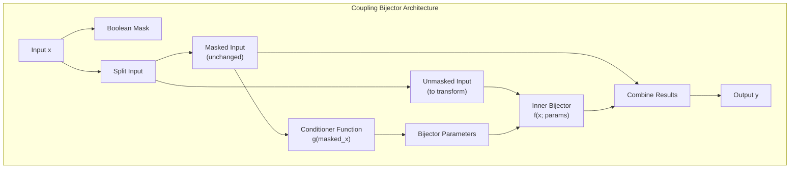
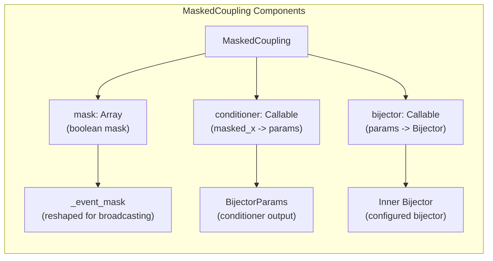
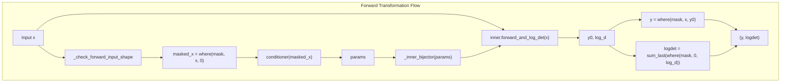
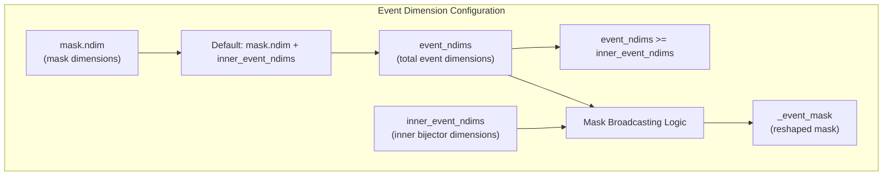
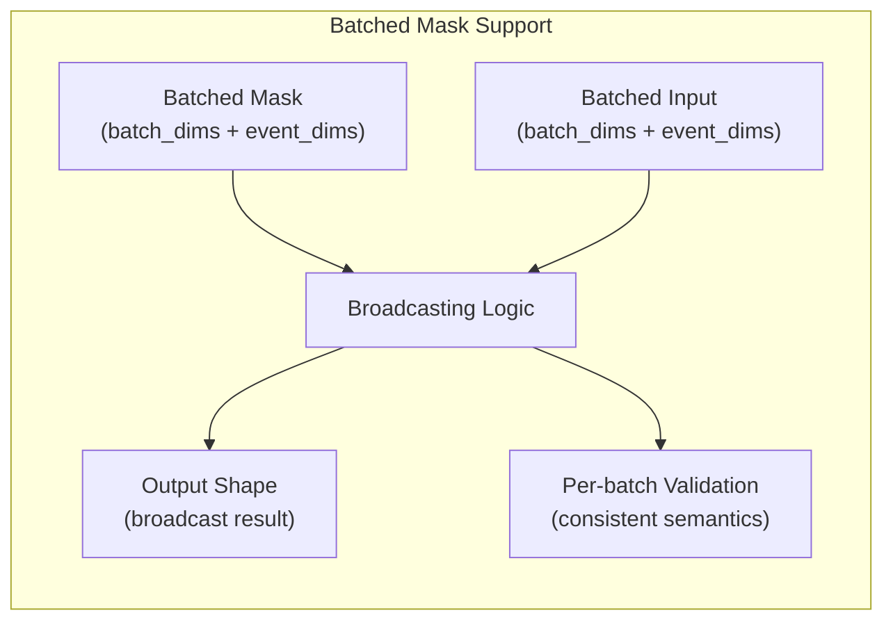

<!-- source: DeepWiki mcp.deepwiki.com · repo google-deepmind/distrax · page 4.3 Coupling and Flow Bijectors · fetched 2026-10-26 -->

# Coupling and Flow Bijectors

Relevant source files

The following files were used as context for generating this wiki page:

- [distrax/_src/bijectors/masked_coupling.py](distrax/_src/bijectors/masked_coupling.py)
- [distrax/_src/bijectors/masked_coupling_test.py](distrax/_src/bijectors/masked_coupling_test.py)
- [distrax/_src/distributions/joint.py](distrax/_src/distributions/joint.py)
- [distrax/_src/distributions/joint_test.py](distrax/_src/distributions/joint_test.py)

## Purpose and Scope

This document covers normalizing flow bijectors in Distrax, specifically focusing on coupling layer implementations that enable construction of complex invertible transformations. The primary implementation is the `MaskedCoupling` bijector which forms the foundation for building normalizing flows.

For general bijector concepts and the base bijector interface, see [Bijectors and Transformations](#2.2). For linear and nonlinear bijectors, see [Linear Bijectors](#4.1) and [Nonlinear Bijectors](#4.2).

## Overview of Coupling Bijectors

Coupling bijectors implement a key building block for normalizing flows by applying transformations to only a subset of input dimensions, conditioned on the remaining (unchanged) dimensions. This design ensures invertibility while allowing complex transformations.

The coupling bijector pattern splits input dimensions into two groups:
- **Masked dimensions**: Remain unchanged through the transformation
- **Unmasked dimensions**: Transformed by an inner bijector conditioned on masked dimensions

**Sources:** [distrax/_src/bijectors/masked_coupling.py:29-58]()

## MaskedCoupling Implementation

The `MaskedCoupling` class implements the coupling bijector pattern with the following mathematical formulation:

| Operation | Formula |
|-----------|---------|
| Forward | `y = (1-m) * f(x; g(m*x)) + m*x` |
| Forward log-det | `log|det J(x)| = sum((1-m) * log|df/dx(x; g(m*x))|)` |
| Inverse | `x = (1-m) * f^{-1}(y; g(m*y)) + m*y` |
| Inverse log-det | `log|det J(y)| = sum((1-m) * log|df^{-1}/dy(y; g(m*y))|)` |

Where `m` is the boolean mask, `f` is the inner bijector, and `g` is the conditioner function.

### Core Components

The `MaskedCoupling` bijector consists of three main components:

**Sources:** [distrax/_src/bijectors/masked_coupling.py:60-108]()

### Key Properties and Methods

| Property/Method | Purpose | Return Type |
|-----------------|---------|-------------|
| `mask` | Boolean mask indicating unchanged dimensions | `Array` |
| `conditioner` | Function computing inner bijector parameters | `Callable[[Array], BijectorParams]` |
| `bijector` | Factory function for inner bijector | `Callable[[BijectorParams], BijectorLike]` |
| `forward_and_log_det` | Forward transformation with log determinant | `Tuple[Array, Array]` |
| `inverse_and_log_det` | Inverse transformation with log determinant | `Tuple[Array, Array]` |

**Sources:** [distrax/_src/bijectors/masked_coupling.py:110-157]()

## Architecture and Data Flow

The `MaskedCoupling` implementation follows a structured data flow pattern:

**Sources:** [distrax/_src/bijectors/masked_coupling.py:136-146]()

### Event Dimension Handling

The bijector supports flexible event dimension configurations:

**Sources:** [distrax/_src/bijectors/masked_coupling.py:87-108]()

## Usage Patterns and Validation

### Initialization and Validation

The `MaskedCoupling` constructor performs several validation checks:

| Validation | Check | Error Condition |
|------------|-------|----------------|
| Mask dtype | `mask.dtype == bool` | Non-boolean mask values |
| Event dimensions | `event_ndims >= inner_event_ndims` | Invalid dimension relationship |
| Inner bijector | Bijector event dimensions match | Mismatched inner bijector dimensions |

**Sources:** [distrax/_src/bijectors/masked_coupling.py:93-98](), [distrax/_src/bijectors/masked_coupling.py:125-134]()

### Batched Operations

The implementation supports batched masks and inputs with automatic broadcasting:

**Sources:** [distrax/_src/bijectors/masked_coupling_test.py:227-267]()

### Integration with JAX

The `MaskedCoupling` bijector is fully compatible with JAX transformations:

- **JIT compilation**: All methods support `jax.jit`
- **Vectorization**: Compatible with `jax.vmap` for batch processing  
- **Automatic differentiation**: Supports forward and reverse mode AD

**Sources:** [distrax/_src/bijectors/masked_coupling_test.py:269-276]()

This coupling bijector implementation provides the foundation for building more complex normalizing flows by chaining multiple coupling layers with different masks and inner bijectors.

---

