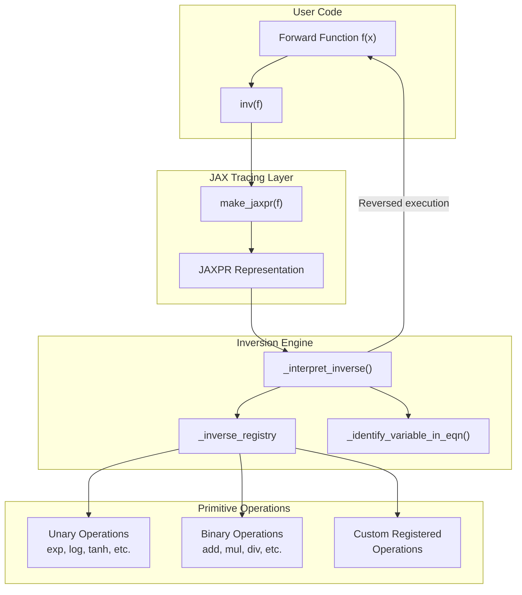
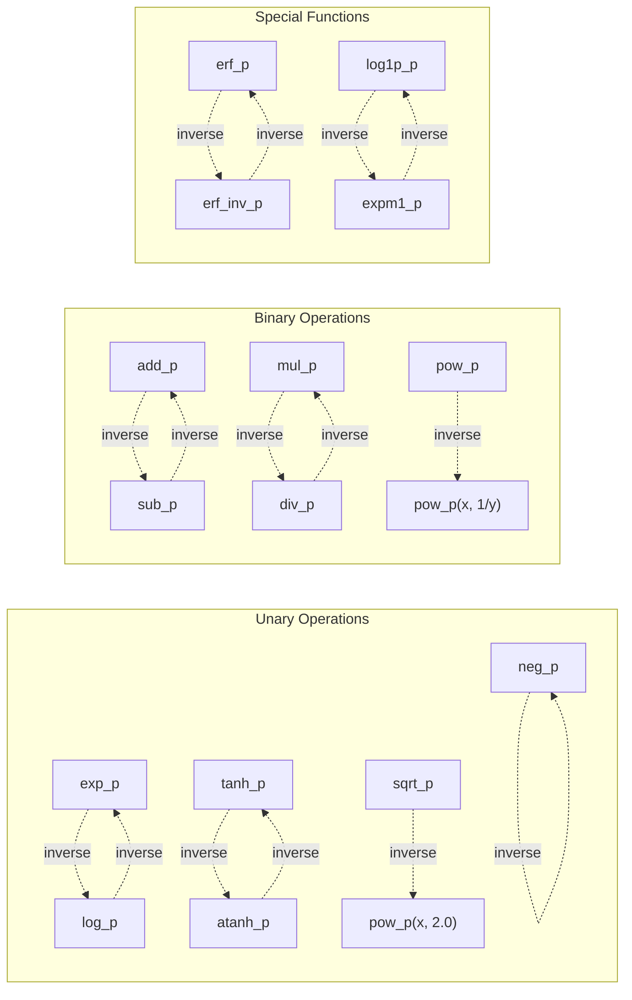
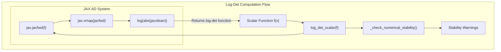
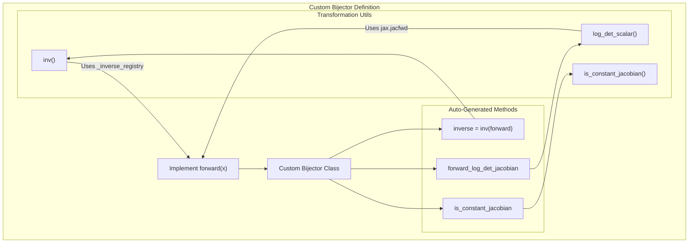
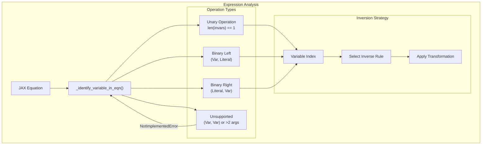
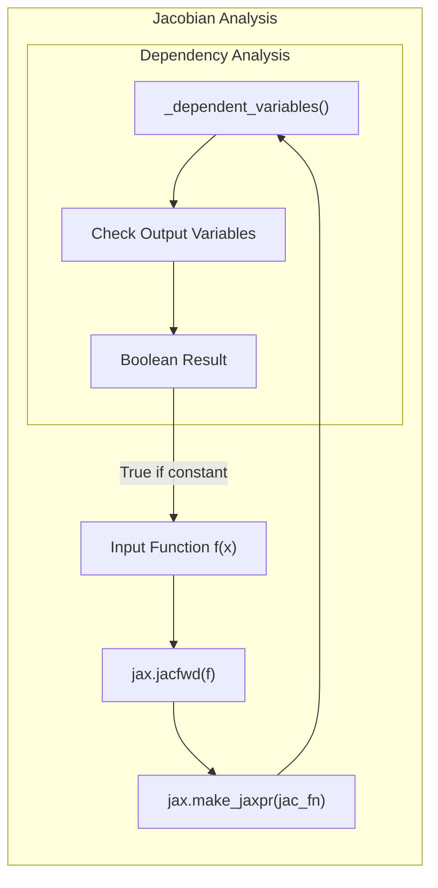

<!-- source: DeepWiki mcp.deepwiki.com · repo google-deepmind/distrax · page 4.4 Custom Bijectors and Function Inversion · fetched 2026-10-26 -->

# Custom Bijectors and Function Inversion

Relevant source files

The following files were used as context for generating this wiki page:

- [distrax/_src/utils/transformations.py](distrax/_src/utils/transformations.py)

This document covers Distrax's capabilities for creating custom bijectors and automatic function inversion. These utilities enable users to define new transformations by implementing only the forward function and automatically deriving the inverse, or by registering custom inversion rules for JAX primitives. For basic bijector usage and pre-built bijectors, see [Linear Bijectors](#4.1) and [Nonlinear Bijectors](#4.2).

## Automatic Function Inversion System

Distrax provides automatic function inversion through JAX transformation utilities that analyze the computational graph and derive inverse operations. The core functionality is implemented in the `inv()` function, which traces a forward function to its JAXPR representation and interprets it in reverse.

## Function Inversion Architecture

The automatic inversion system works by analyzing JAX primitives and applying registered inverse transformations:

Sources: [distrax/_src/utils/transformations.py:129-138](), [distrax/_src/utils/transformations.py:258-330]()

## Core Inversion Components

The transformation system consists of several key components that work together to enable automatic function inversion:

| Component | Function | File Location |
|-----------|----------|---------------|
| `inv()` | Main inversion function | [distrax/_src/utils/transformations.py:129-138]() |
| `_inverse_registry` | Primitive inversion mappings | [distrax/_src/utils/transformations.py:68-95]() |
| `_interpret_inverse()` | JAXPR interpretation engine | [distrax/_src/utils/transformations.py:258-330]() |
| `register_inverse()` | Custom inversion registration | [distrax/_src/utils/transformations.py:110-127]() |
| `log_det_scalar()` | Jacobian log-determinant | [distrax/_src/utils/transformations.py:166-176]() |

Sources: [distrax/_src/utils/transformations.py:68-176]()

## Supported Primitive Inversions

The inversion system includes built-in support for common mathematical operations through the primitive registry:

Sources: [distrax/_src/utils/transformations.py:68-95]()

## Log-Determinant Computation

The system provides automatic computation of log-determinant Jacobians for scalar functions using JAX's automatic differentiation:

Sources: [distrax/_src/utils/transformations.py:166-176](), [distrax/_src/utils/transformations.py:178-187]()

## Custom Bijector Creation Pattern

Creating custom bijectors typically follows this pattern using the transformation utilities:

Sources: [distrax/_src/utils/transformations.py:15-48]()

## Registering Custom Inverse Operations

Users can extend the inversion system by registering custom inverse rules for new primitives:

The `register_inverse()` function supports both unary and binary operations with different handling for left and right operand positions:

| Operation Type | Registration Pattern | Example Use Case |
|----------------|---------------------|------------------|
| Unary | `register_inverse(primitive, inverse_fn)` | Custom activation functions |
| Binary Commutative | `register_inverse(primitive, inverse_fn)` | Symmetric operations |
| Binary Non-Commutative | `register_inverse(primitive, left_inv, right_inv)` | Division, subtraction variants |

Sources: [distrax/_src/utils/transformations.py:110-127]()

## Variable Identification in Expressions

The inversion system analyzes equations to determine variable positions and operation types:

Sources: [distrax/_src/utils/transformations.py:223-256]()

## Numerical Stability Considerations

The transformation system includes built-in checks for potentially unstable operations:

| Primitive | Stability Issue | Recommended Alternative |
|-----------|----------------|------------------------|
| `tanh_p` | Gradient saturation | `distrax.Tanh` bijector |
| `atanh_p` | Domain boundary issues | `distrax.Inverse(distrax.Tanh)` |

The system automatically logs warnings when potentially unstable primitives are detected during function tracing.

Sources: [distrax/_src/utils/transformations.py:104-107](), [distrax/_src/utils/transformations.py:178-187]()

## Experimental Features

### Constant Jacobian Detection

The `is_constant_jacobian()` function attempts to determine whether a function's Jacobian is constant by analyzing the computational graph:

Sources: [distrax/_src/utils/transformations.py:141-164](), [distrax/_src/utils/transformations.py:189-210]()

## Limitations and Best Practices

### Supported Expression Types

The automatic inversion system has several limitations users should be aware of:

- **Single variable occurrence**: Expressions where the input variable appears multiple times are not supported
- **Primitive coverage**: Only registered primitives can be automatically inverted
- **Binary operation constraints**: Both operands cannot be variables simultaneously

### Best Practices

1. **Keep transformations simple**: Use single-occurrence expressions when possible
2. **Register custom primitives**: Extend the registry for domain-specific operations  
3. **Test numerical stability**: Verify behavior at domain boundaries
4. **Prefer built-in bijectors**: Use established bijectors when available for better stability

Sources: [distrax/_src/utils/transformations.py:237-249](), [distrax/_src/utils/transformations.py:292-295]()

---

