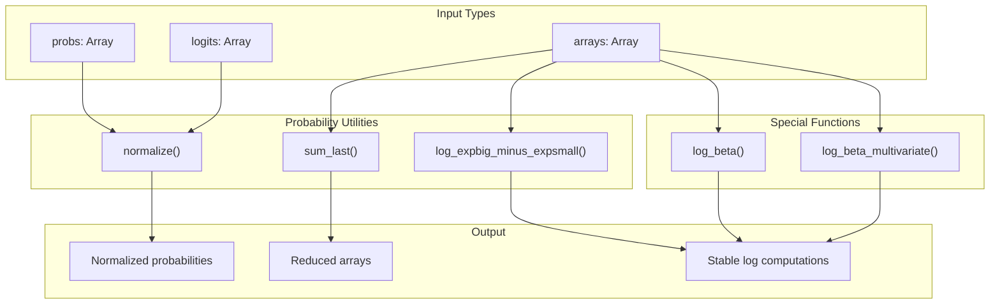
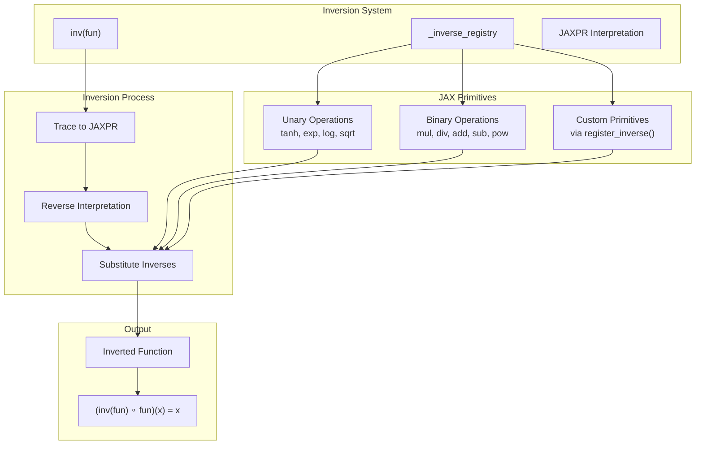
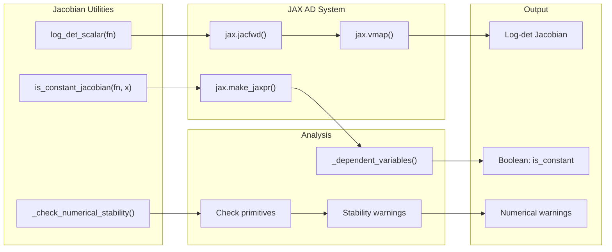
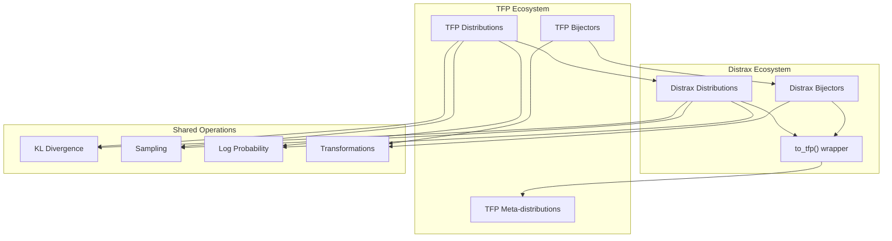
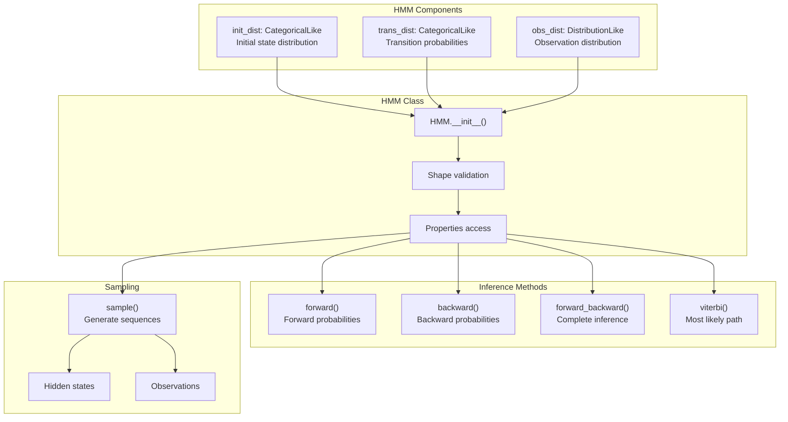
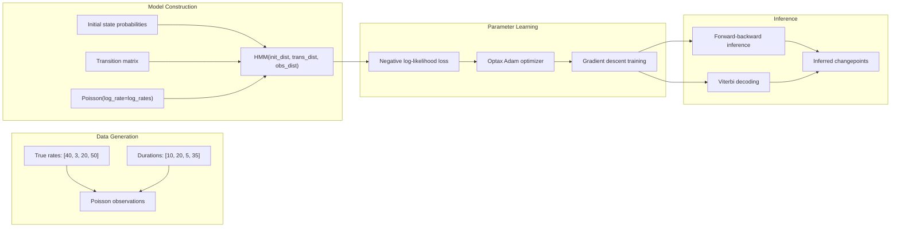

<!-- source: DeepWiki mcp.deepwiki.com · repo google-deepmind/distrax · page 5 Utilities and Advanced Features · fetched 2026-10-26 -->

# Utilities and Advanced Features

Relevant source files

The following files were used as context for generating this wiki page:

- [README.md](README.md)
- [distrax/_src/distributions/beta_test.py](distrax/_src/distributions/beta_test.py)
- [distrax/_src/utils/hmm.py](distrax/_src/utils/hmm.py)
- [distrax/_src/utils/hmm_test.py](distrax/_src/utils/hmm_test.py)
- [distrax/_src/utils/math.py](distrax/_src/utils/math.py)
- [distrax/_src/utils/math_test.py](distrax/_src/utils/math_test.py)
- [distrax/_src/utils/transformations.py](distrax/_src/utils/transformations.py)
- [examples/hmm.py](examples/hmm.py)

This document covers the supporting utilities, mathematical functions, and advanced capabilities that extend Distrax's core distribution and bijector functionality. These utilities provide numerical stability, automatic function manipulation, cross-library compatibility, and specialized probabilistic models.

For core distribution implementations, see [Distributions](#3). For bijector transformations, see [Bijectors](#4).

## Mathematical Utilities

Distrax provides numerically stable mathematical functions and utilities that ensure robust computation across different numerical ranges and edge cases.

### Stable Arithmetic Operations

The `distrax._src.utils.math` module implements numerically stable versions of common operations:

| Function | Purpose | Key Feature |
|----------|---------|-------------|
| `multiply_no_nan` | Element-wise multiplication | Returns 0 when second operand is 0, even if first is NaN/infinite |
| `power_no_nan` | Element-wise exponentiation | Returns 1 when exponent is 0, regardless of base value |
| `mul_exp` | Multiply by exponential | Handles `x * exp(logp)` with zero gradient when `exp(logp)==0` |

These functions include custom JAX derivatives that properly handle symbolic zeros and maintain numerical stability during automatic differentiation.

### Probability and Normalization Functions

The `normalize` function handles both probability and logit normalization, automatically detecting input type and applying appropriate normalization (direct division vs log-softmax).

**Sources:** [distrax/_src/utils/math.py:132-141](), [distrax/_src/utils/math.py:29-47](), [distrax/_src/utils/math.py:82-99]()

## Function Transformations

The `distrax._src.utils.transformations` module provides automatic function manipulation capabilities, particularly for creating inverse functions and computing Jacobian determinants.

### Automatic Function Inversion

The inversion system works by:
1. Tracing the input function to its JAXPR (JAX expression) representation
2. Interpreting the expression in reverse order
3. Substituting each primitive with its registered inverse operation
4. Handling both unary and binary operations with appropriate argument ordering

**Key Functions:**
- `inv(fun)` - Returns inverse function such that `(inv(fun) ∘ fun)(x) = x`
- `register_inverse(primitive, inverse_left, inverse_right=None)` - Registers custom inverse for JAX primitives

**Sources:** [distrax/_src/utils/transformations.py:129-138](), [distrax/_src/utils/transformations.py:110-127](), [distrax/_src/utils/transformations.py:68-95]()

### Jacobian Computation and Analysis

- `log_det_scalar(fn)` - Automatically derives log-determinant of Jacobian using JAX autograd
- `is_constant_jacobian(fn, x=0.0)` - Experimental function to determine if Jacobian is constant
- Numerical stability checking warns about potentially unstable primitives like `tanh_p`

**Sources:** [distrax/_src/utils/transformations.py:166-176](), [distrax/_src/utils/transformations.py:141-163](), [distrax/_src/utils/transformations.py:178-186]()

## TensorFlow Probability Integration

Distrax provides seamless interoperability with TensorFlow Probability (TFP) through wrapper classes and shared interfaces. This enables users to mix Distrax and TFP distributions/bijectors freely.

### Cross-Library Compatibility

Key compatibility features:
- **Bidirectional interoperability**: TFP distributions work directly in Distrax meta-distributions
- **Wrapper functions**: `to_tfp()` enables Distrax objects to work in TFP contexts
- **Shared KL registry**: Cross-library KL divergence computations
- **Consistent APIs**: Similar method signatures and behavior across libraries

**Sources:** [README.md:77-91](), [README.md:124-136](), [README.md:173-194]()

## Hidden Markov Models

The `HMM` class provides a complete implementation of Hidden Markov Models with support for inference algorithms and parameter learning.

### HMM Architecture

### HMM Inference Algorithms

The `HMM` class implements standard algorithms for probabilistic inference:

**Forward Algorithm** [`forward(obs_seq, length=None)`]:
- Computes forward probabilities `p(z_t, x_{1:t})`
- Returns log-likelihood and forward probability history
- Supports variable-length sequences via `length` parameter

**Backward Algorithm** [`backward(obs_seq, length=None)`]:
- Computes backward probabilities `p(x_{t+1:T}|z_t)`
- Used in combination with forward probabilities for full inference

**Forward-Backward Algorithm** [`forward_backward(obs_seq, length=None)`]:
- Combines forward and backward passes
- Returns marginal state probabilities `P(z_t|x_{1:T})`
- Provides complete posterior inference

**Viterbi Algorithm** [`viterbi(obs_seq)`]:
- Finds most probable state sequence
- Uses dynamic programming for efficient computation
- Returns sequence of most likely hidden states

**Sources:** [distrax/_src/utils/hmm.py:47-102](), [distrax/_src/utils/hmm.py:152-197](), [distrax/_src/utils/hmm.py:236-276](), [distrax/_src/utils/hmm.py:278-323]()

### HMM Usage Example

The HMM implementation supports complex probabilistic modeling scenarios, as demonstrated in the changepoint detection example:

This example demonstrates rate changepoint detection in time series data using HMM parameter learning through gradient descent optimization.

**Sources:** [examples/hmm.py:91-96](), [examples/hmm.py:149-162](), [examples/hmm.py:191-207]()

---

