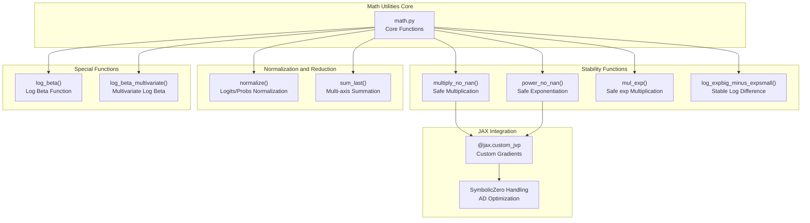
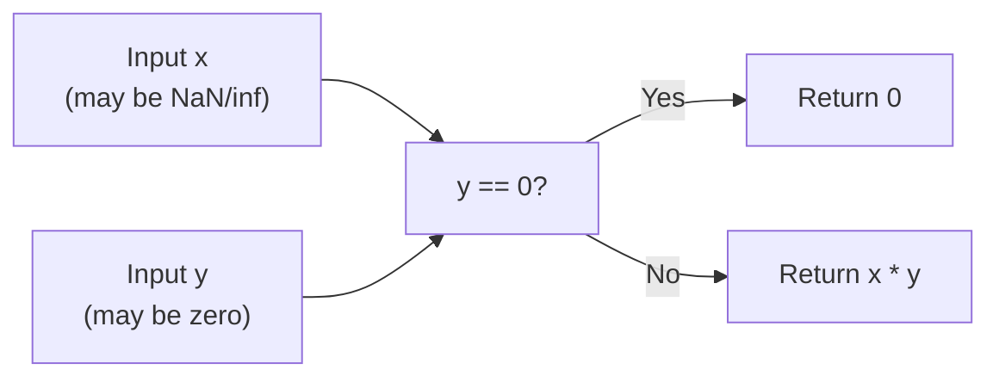
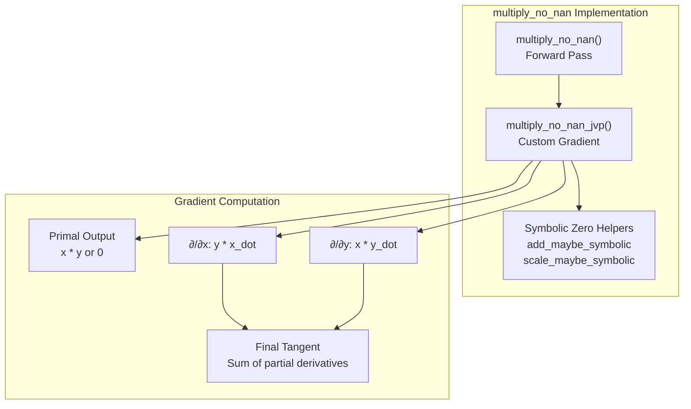
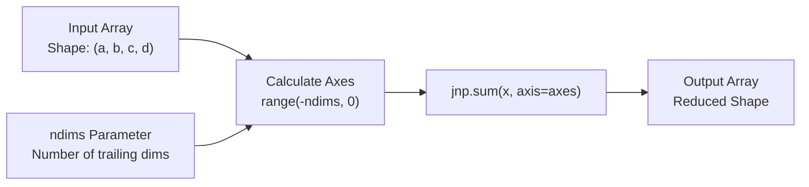
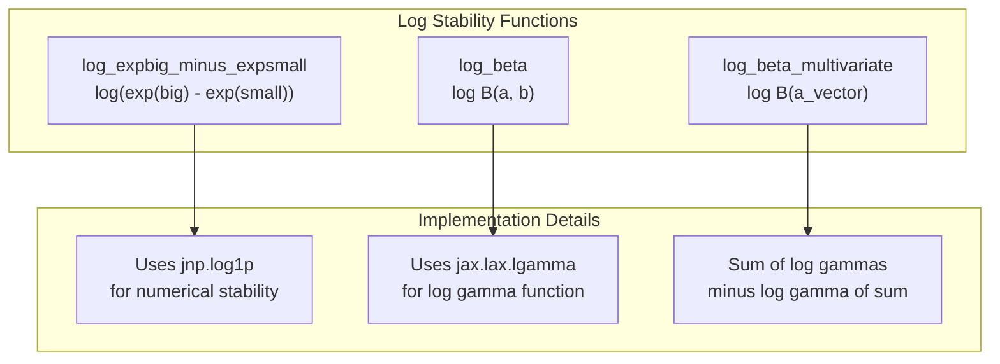
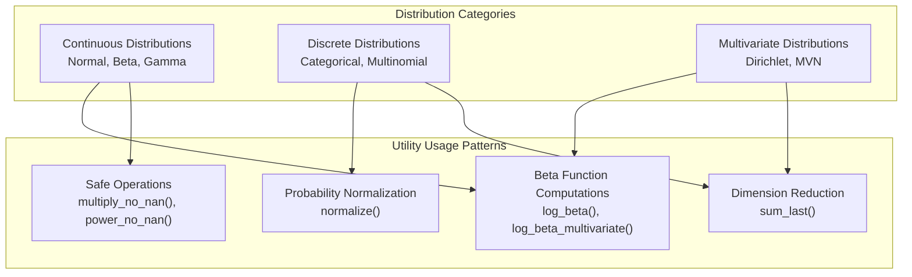

<!-- source: DeepWiki mcp.deepwiki.com · repo google-deepmind/distrax · page 5.1 Mathematical Utilities · fetched 2026-10-26 -->

# Mathematical Utilities

Relevant source files

The following files were used as context for generating this wiki page:

- [distrax/_src/distributions/beta_test.py](distrax/_src/distributions/beta_test.py)
- [distrax/_src/utils/math.py](distrax/_src/utils/math.py)
- [distrax/_src/utils/math_test.py](distrax/_src/utils/math_test.py)

## Purpose and Scope

The mathematical utilities system provides numerically stable mathematical functions and operations designed specifically for probability distributions and statistical computations in Distrax. This module implements robust versions of common mathematical operations that gracefully handle edge cases involving NaN, infinity, and zero values that frequently arise in probabilistic computing.

For information about function transformations and automatic inversion, see [Function Transformations](#5.2). For TensorFlow Probability compatibility functions, see [TensorFlow Probability Integration](#5.3).

## Mathematical Utilities Architecture

The mathematical utilities system is organized around numerical stability and JAX integration:

**Sources:** [distrax/_src/utils/math.py:1-191]()

## Core Stability Functions

### Safe Arithmetic Operations

The mathematical utilities provide safe versions of common arithmetic operations that handle edge cases:

| Function | Purpose | Edge Case Handling |
|----------|---------|-------------------|
| `multiply_no_nan` | Safe multiplication | Returns 0 when second operand is 0, even if first is NaN/inf |
| `power_no_nan` | Safe exponentiation | Returns 1 when exponent is 0, regardless of base value |
| `mul_exp` | Safe exponential multiplication | Returns 0 when `exp(logp)==0`, zeroing gradients appropriately |

The `multiply_no_nan` function implements the TensorFlow `multiply_no_nan` equivalent:

**Sources:** [distrax/_src/utils/math.py:29-48](), [distrax/_src/utils/math.py:82-99](), [distrax/_src/utils/math.py:114-130]()

### Custom Gradient Implementation

The stability functions use JAX's `@jax.custom_jvp` decorator to provide numerically stable gradients:

**Sources:** [distrax/_src/utils/math.py:67-79](), [distrax/_src/utils/math.py:51-65]()

## Normalization and Reduction Functions

### Probability Normalization

The `normalize` function handles both probability and logit normalization:

| Input Type | Operation | Result |
|------------|-----------|--------|
| `probs` | Division by sum | Normalized probabilities |
| `logits` | `log_softmax` | Normalized log probabilities |

### Array Reduction

The `sum_last` function provides a convenient way to sum over trailing dimensions:

**Sources:** [distrax/_src/utils/math.py:132-141](), [distrax/_src/utils/math.py:143-146]()

## Special Mathematical Functions

### Logarithmic Stability Functions

The module provides stable implementations of logarithmic operations commonly needed in probability computations:

The `log_beta` function computes `log B(a, b) = log Γ(a) + log Γ(b) - log Γ(a + b)` using stable log-gamma operations.

The `log_beta_multivariate` function extends this to vectors: `log B(a) = Σ log Γ(a_k) - log Γ(Σ a_k)`.

**Sources:** [distrax/_src/utils/math.py:149-160](), [distrax/_src/utils/math.py:162-175](), [distrax/_src/utils/math.py:177-191]()

## Integration with Distribution System

The mathematical utilities are extensively used throughout Distrax distributions:

**Sources:** [distrax/_src/distributions/beta_test.py:1-243](), [distrax/_src/utils/math_test.py:1-108]()

## Testing and Validation

The mathematical utilities include comprehensive tests that verify:

- **Numerical Stability**: Edge cases with NaN, infinity, and zero values
- **Gradient Correctness**: Custom gradient implementations match expected derivatives  
- **Cross-validation**: Results match reference implementations (SciPy, NumPy)
- **JAX Compatibility**: Functions work correctly with JIT compilation and vectorization

The test suite validates all functions against their mathematical definitions and ensures robust behavior in edge cases that commonly occur in probabilistic computing.

**Sources:** [distrax/_src/utils/math_test.py:26-105]()

---

