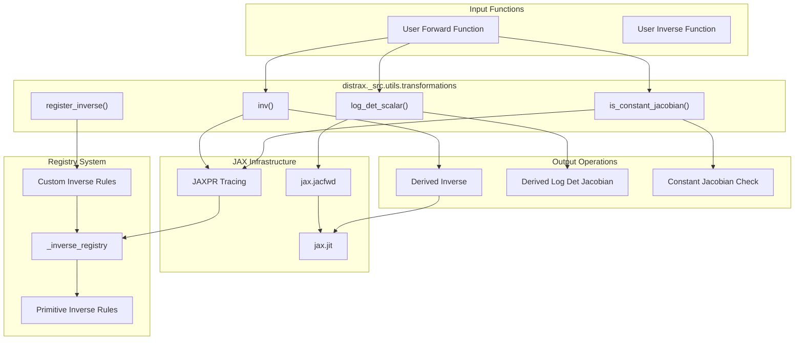
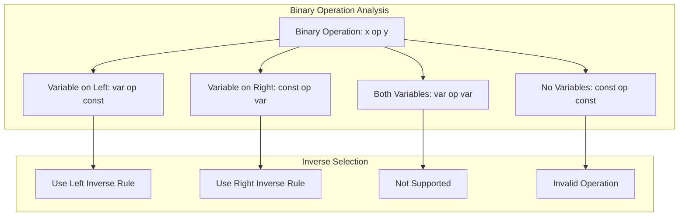
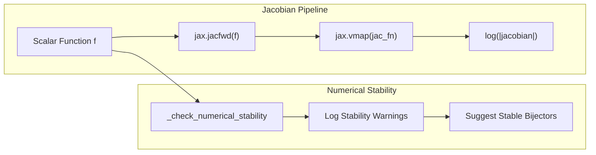
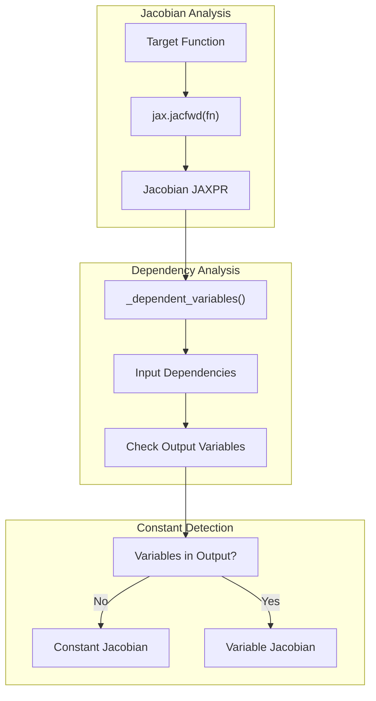
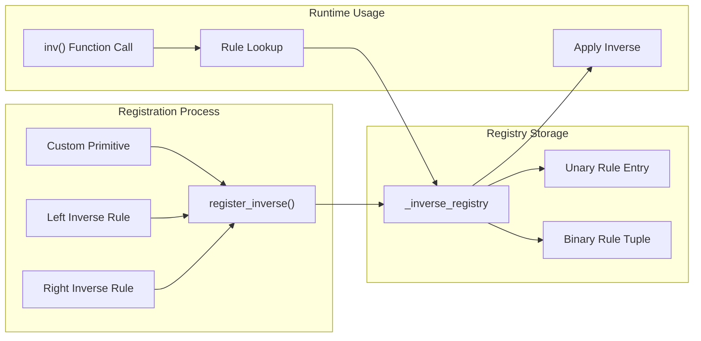
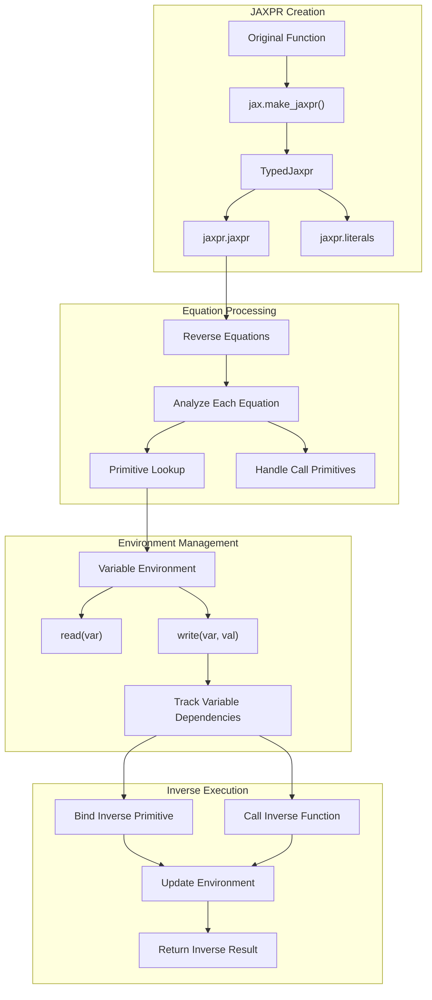

<!-- source: DeepWiki mcp.deepwiki.com · repo google-deepmind/distrax · page 5.2 Function Transformations · fetched 2026-10-26 -->

# Function Transformations

Relevant source files

The following files were used as context for generating this wiki page:

- [distrax/_src/utils/transformations.py](distrax/_src/utils/transformations.py)

This document covers Distrax's utilities for automatically transforming functions to support bijector operations. The function transformation system enables automatic derivation of inverse functions, Jacobian computations, and optimization checks that are essential for implementing bijectors efficiently in JAX.

For information about bijectors themselves, see [Bijectors and Transformations](#2.2). For mathematical utilities used alongside these transformations, see [Mathematical Utilities](#5.1).

## Purpose and Architecture

The function transformation system addresses a fundamental challenge in implementing bijectors: deriving the required mathematical operations (`forward`, `inverse`, `log_det_jacobian`, `is_constant_jacobian`) from minimal user-provided code. Rather than requiring users to manually implement all bijector methods, this system can automatically derive them through JAX program analysis and transformation.

### Core Transformation Architecture

Sources: [distrax/_src/utils/transformations.py:15-48]()

## Automatic Function Inversion

The `inv` function provides automatic inversion of JAX-traceable functions by analyzing their JAXPR representation and substituting each primitive operation with its registered inverse.

### Inversion Process

```mermaid
graph LR
    subgraph "Function Analysis"
        InputFunc["Input Function f"]
        MakeJaxpr["jax.make_jaxpr(f)"]
        JaxprRepr["JAXPR Representation"]
    end
    
    subgraph "Inversion Interpretation"
        ReverseEqns["Reverse Equation Order"]
        LookupInverse["Lookup Primitive Inverse"]
        VariableTracking["Track Variable Positions"]
    end
    
    subgraph "Inverse Construction"
        BindInverses["Bind Inverse Primitives"]
        InverseFunc["Constructed Inverse"]
        JitOptimized["JIT-Optimized Result"]
    end
    
    InputFunc --> MakeJaxpr
    MakeJaxpr --> JaxprRepr
    JaxprRepr --> ReverseEqns
    ReverseEqns --> LookupInverse
    LookupInverse --> VariableTracking
    VariableTracking --> BindInverses
    BindInverses --> InverseFunc
    InverseFunc --> JitOptimized
```

The inversion process handles both unary and binary operations, tracking variable positions to correctly apply inverse operations. For binary operations like division, the system distinguishes between left and right operand positions since `x / y` and `y / x` have different inverses.

Sources: [distrax/_src/utils/transformations.py:129-138](), [distrax/_src/utils/transformations.py:258-330]()

### Primitive Inverse Registry

The system maintains a comprehensive registry of primitive inverse operations:

| Primitive Type | Examples | Inverse Handling |
|---|---|---|
| Unary Operations | `tanh`, `exp`, `log`, `sqrt` | Direct primitive substitution |
| Commutative Binary | `mul`, `add` | Single inverse rule |
| Non-commutative Binary | `div`, `sub`, `pow` | Position-dependent inverse rules |
| Hyperbolic Functions | `sinh`, `cosh`, `tanh` | Paired with inverse hyperbolics |
| Special Functions | `erf`, `log1p`, `expm1` | Domain-specific inverses |

Sources: [distrax/_src/utils/transformations.py:68-95]()

### Variable Position Handling

Sources: [distrax/_src/utils/transformations.py:223-255]()

## Jacobian Computation

The transformation system provides utilities for computing and analyzing Jacobians of scalar functions.

### Log Determinant Computation

The `log_det_scalar` function computes the log determinant of the Jacobian for scalar-valued functions using JAX's automatic differentiation:

Sources: [distrax/_src/utils/transformations.py:166-175]()

### Constant Jacobian Detection

The `is_constant_jacobian` function determines whether a function's Jacobian is constant by analyzing the JAXPR representation of the Jacobian computation:

Sources: [distrax/_src/utils/transformations.py:141-163]()

## Registry System and Extensibility

The transformation system allows registration of custom inverse rules for primitives not covered by the default registry.

### Custom Inverse Registration

The `register_inverse` function enables extension of the inverse registry:

| Parameter | Purpose | Example |
|---|---|---|
| `primitive` | JAX primitive to register | `jax.lax.custom_op_p` |
| `inverse_left` | Left-side inverse function | `lambda x, y: custom_inv_left(x, y)` |
| `inverse_right` | Right-side inverse function | `lambda x, y: custom_inv_right(x, y)` |

Sources: [distrax/_src/utils/transformations.py:110-126]()

## JAXPR Interpretation Infrastructure

The transformation system relies on sophisticated JAXPR interpretation to understand and manipulate JAX program representations.

### JAXPR Processing Pipeline

Sources: [distrax/_src/utils/transformations.py:212-221](), [distrax/_src/utils/transformations.py:258-330]()

### Dependency Analysis

The system tracks variable dependencies through JAXPR equations to determine which variables affect the output:

```mermaid
graph LR
    subgraph "Dependency Tracking"
        InitDeps["Initial Dependencies (Input Vars)"]
        EqnScan["Scan JAXPR Equations"]
        CallExpansion["Expand Call Primitives"]
        PropagateDepss["Propagate Dependencies"]
    end
    
    subgraph "Call Primitive Handling"
        CallJaxpr["Extract call_jaxpr"]
        NameMapping["Variable Name Mapping"]
        RecursiveAnalysis["Recursive Dependency Analysis"]
        MergeResults["Merge Sub-results"]
    end
    
    subgraph "Final Dependencies"
        VarDependencies["Variable Dependencies"]
        OutputAnalysis["Analyze Output Variables"]
        ConstantDetection["Detect Constants"]
    end
    
    InitDeps --> EqnScan
    EqnScan --> CallExpansion
    EqnScan --> PropagateDepss
    
    CallExpansion --> CallJaxpr
    CallJaxpr --> NameMapping
    NameMapping --> RecursiveAnalysis
    RecursiveAnalysis --> MergeResults
    
    PropagateDepss --> VarDependencies
    MergeResults --> VarDependencies
    VarDependencies --> OutputAnalysis
    OutputAnalysis --> ConstantDetection
```

Sources: [distrax/_src/utils/transformations.py:189-209]()

---

