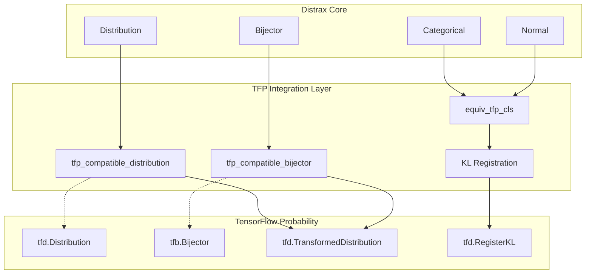
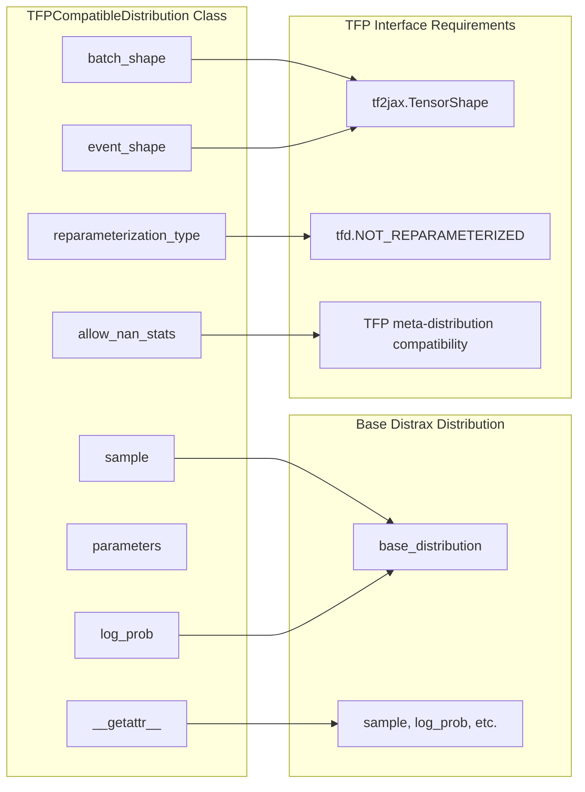
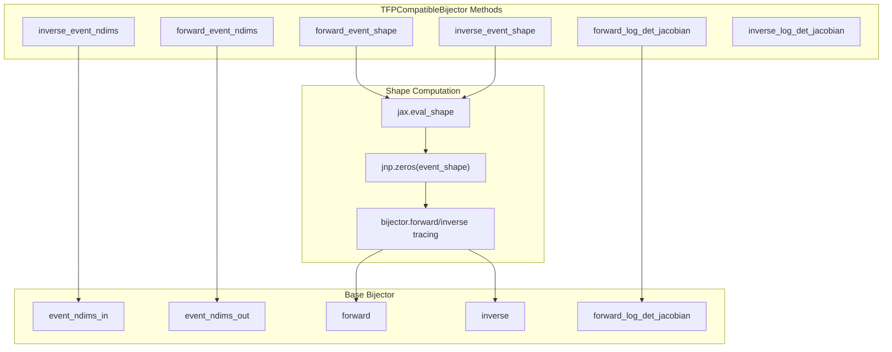
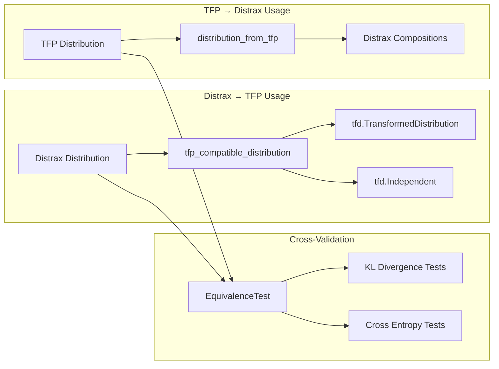

<!-- source: DeepWiki mcp.deepwiki.com · repo google-deepmind/distrax · page 5.3 TensorFlow Probability Integration · fetched 2026-10-26 -->

# TensorFlow Probability Integration

<details>
<summary>Relevant source files</summary>

The following files were used as context for generating this wiki page:

- [distrax/_src/bijectors/tfp_compatible_bijector.py](distrax/_src/bijectors/tfp_compatible_bijector.py)
- [distrax/_src/bijectors/tfp_compatible_bijector_test.py](distrax/_src/bijectors/tfp_compatible_bijector_test.py)
- [distrax/_src/distributions/categorical.py](distrax/_src/distributions/categorical.py)
- [distrax/_src/distributions/categorical_test.py](distrax/_src/distributions/categorical_test.py)
- [distrax/_src/distributions/distribution_from_tfp_test.py](distrax/_src/distributions/distribution_from_tfp_test.py)
- [distrax/_src/distributions/tfp_compatible_distribution.py](distrax/_src/distributions/tfp_compatible_distribution.py)
- [distrax/_src/distributions/tfp_compatible_distribution_test.py](distrax/_src/distributions/tfp_compatible_distribution_test.py)

</details>


This page documents the integration mechanisms between Distrax and TensorFlow Probability (TFP), including bidirectional compatibility wrappers, KL divergence registration, and cross-validation testing frameworks. This integration allows Distrax distributions and bijectors to work seamlessly with TFP meta-distributions and vice versa.

For general information about distributions and bijectors, see [Core Concepts](#2). For testing methodologies, see [Testing Framework](#6.1).

## Integration Architecture

The TFP integration operates through three primary mechanisms: compatibility wrappers, KL divergence registration, and equivalence testing. Each Distrax distribution declares its TFP equivalent and registers KL divergence functions for cross-compatibility.



**Sources:** [distrax/_src/distributions/tfp_compatible_distribution.py:37-170](), [distrax/_src/bijectors/tfp_compatible_bijector.py:34-212](), [distrax/_src/distributions/categorical.py:36](), [distrax/_src/distributions/categorical.py:203-215]()

## KL Divergence Registration

Distrax automatically registers KL divergence functions with TFP's global registry, enabling cross-compatibility between Distrax and TFP distributions. Each distribution that implements KL divergence provides registration for all four combinations: Distrax-to-Distrax, Distrax-to-TFP, TFP-to-Distrax, and TFP-to-TFP.

| Registration Type | Function | Registry Call |
|-------------------|----------|---------------|
| Distrax ↔ Distrax | `_kl_divergence_categorical_categorical` | `tfd.RegisterKL(Categorical, Categorical)` |
| Distrax → TFP | `_kl_divergence_categorical_categorical` | `tfd.RegisterKL(Categorical, Categorical.equiv_tfp_cls)` |
| TFP → Distrax | `_kl_divergence_categorical_categorical` | `tfd.RegisterKL(Categorical.equiv_tfp_cls, Categorical)` |
| Cross-distribution | `_kl_divergence_categorical_categorical` | `tfd.RegisterKL(Categorical, tfd.OneHotCategorical)` |

**Sources:** [distrax/_src/distributions/categorical.py:203-215](), [distrax/_src/distributions/categorical.py:165-200]()

## TFP-Compatible Distribution Wrapper

The `tfp_compatible_distribution` function creates a wrapper that adapts Distrax distributions for use in TFP meta-distributions. The wrapper implements TFP-specific interface requirements while delegating core computations to the underlying Distrax distribution.



The wrapper ensures compatibility by:
- Converting `batch_shape` and `event_shape` to `tfp.tf2jax.TensorShape` objects
- Providing `batch_shape_tensor()` and `event_shape_tensor()` methods
- Implementing `allow_nan_stats` (always returns `True`)
- Setting `reparameterization_type` to `tfd.NOT_REPARAMETERIZED`
- Delegating all computation methods to the base distribution

**Sources:** [distrax/_src/distributions/tfp_compatible_distribution.py:62-170](), [distrax/_src/distributions/tfp_compatible_distribution.py:87-102]()

## TFP-Compatible Bijector Wrapper

The `tfp_compatible_bijector` function creates a wrapper that adapts Distrax bijectors for use in TFP bijector chains and transformed distributions. The wrapper handles event shape computation and provides TFP-specific interface methods.



The wrapper implements shape computation by tracing the bijector's `forward` and `inverse` methods with zero tensors of the appropriate shapes. This approach works for most bijectors but requires the methods to be traceable.

**Sources:** [distrax/_src/bijectors/tfp_compatible_bijector.py:65-212](), [distrax/_src/bijectors/tfp_compatible_bijector.py:117-143]()

## Bidirectional Compatibility

Distrax provides bidirectional compatibility with TFP through wrapper classes and equivalence declarations. This enables seamless interoperability in both directions: Distrax distributions in TFP meta-distributions and TFP distributions in Distrax compositions.



**Sources:** [distrax/_src/distributions/tfp_compatible_distribution_test.py:219-275](), [distrax/_src/distributions/distribution_from_tfp_test.py:36-264]()

## Testing Framework

The integration includes comprehensive testing through the `EquivalenceTest` framework, which validates mathematical correctness and API compatibility between Distrax and TFP implementations.

### Cross-Validation Test Matrix

| Test Category | Distrax-Distrax | Distrax-TFP | TFP-Distrax | TFP-TFP |
|---------------|-----------------|-------------|-------------|---------|
| KL Divergence | ✓ | ✓ | ✓ | ✓ |
| Cross Entropy | ✓ | ✓ | ✓ | ✓ |
| Log Probability | ✓ | ✓ | ✓ | ✓ |
| Sampling | ✓ | ✓ | ✓ | ✓ |

The test framework automatically generates all combinations and validates numerical equivalence within specified tolerances.

**Sources:** [distrax/_src/distributions/categorical_test.py:307-347](), [distrax/_src/distributions/tfp_compatible_distribution_test.py:128-163]()

## Usage Examples

### Using Distrax Distributions in TFP Meta-Distributions

```python
# Wrap Distrax distribution for TFP usage
base_dist = Normal(loc=0., scale=1.)
wrapped_dist = tfp_compatible_distribution(base_dist)

# Use in TFP meta-distributions
transformed = tfd.TransformedDistribution(wrapped_dist, tfb.Exp())
independent = tfd.Independent(wrapped_dist, 1)
```

### Using Distrax Bijectors in TFP Chains

```python
# Wrap Distrax bijector for TFP usage
distrax_bijector = ScalarAffine(shift=1.0, scale=2.0)
wrapped_bijector = tfp_compatible_bijector(distrax_bijector)

# Use in TFP bijector chains
chain = tfb.Chain([tfb.Tanh(), wrapped_bijector])
```

**Sources:** [distrax/_src/distributions/tfp_compatible_distribution.py:37-58](), [distrax/_src/bijectors/tfp_compatible_bijector.py:34-61]()

---

