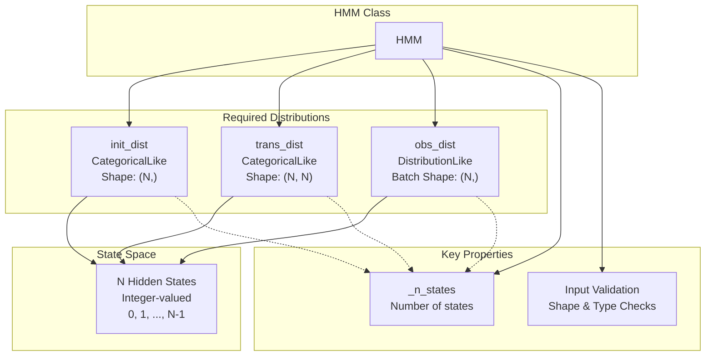
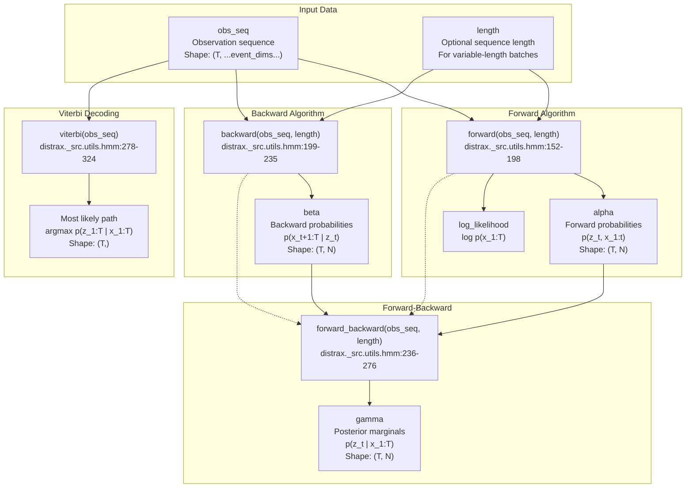
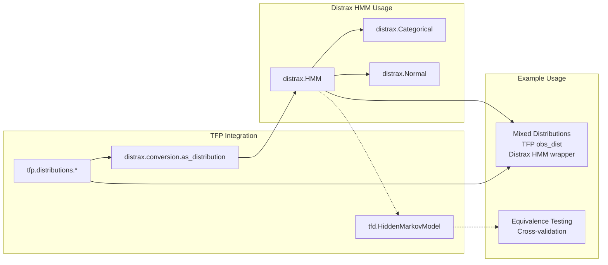

<!-- source: DeepWiki mcp.deepwiki.com · repo google-deepmind/distrax · page 5.4 Hidden Markov Models · fetched 2026-10-26 -->

# Hidden Markov Models

<details>
<summary>Relevant source files</summary>

The following files were used as context for generating this wiki page:

- [README.md](README.md)
- [distrax/_src/utils/hmm.py](distrax/_src/utils/hmm.py)
- [distrax/_src/utils/hmm_test.py](distrax/_src/utils/hmm_test.py)
- [examples/hmm.py](examples/hmm.py)

</details>


This document covers the Hidden Markov Model (HMM) implementation in Distrax, including its architecture, key algorithms, and usage patterns. The HMM class provides forward-backward inference, Viterbi decoding, and sampling capabilities for probabilistic sequence modeling.

For general information about distributions in Distrax, see [Distributions](#3). For details about categorical distributions used in HMM state modeling, see [Categorical Distribution](#3.1.1).

## HMM Architecture and Components

The Distrax HMM implementation follows a modular design where three separate distributions define the model components: initial state distribution, transition distribution, and observation distribution.

### HMM Component Structure



Sources: [distrax/_src/utils/hmm.py:47-102]()

The `HMM` class constructor validates that all distributions have compatible shapes and types. The initial distribution must be unbatched with `N` categories, the transition distribution must have batch shape `(N,)` with `N` categories per batch element, and the observation distribution must have batch shape `(N,)` to define emissions for each state.

### Core HMM Class Interface

| Method | Purpose | Returns |
|--------|---------|---------|
| `__init__(init_dist, trans_dist, obs_dist)` | Constructor with validation | HMM instance |
| `sample(seed, seq_len)` | Generate state and observation sequences | `(states, observations)` |
| `forward(obs_seq, length=None)` | Forward algorithm for filtering | `(log_likelihood, alpha)` |
| `backward(obs_seq, length=None)` | Backward algorithm | `beta` probabilities |
| `forward_backward(obs_seq, length=None)` | Combined inference | `(alpha, beta, gamma, log_likelihood)` |
| `viterbi(obs_seq)` | Most likely state sequence | `state_sequence` |

Sources: [distrax/_src/utils/hmm.py:115-324]()

## Inference Algorithms

The HMM class implements three core inference algorithms for different computational needs: forward filtering, forward-backward smoothing, and Viterbi decoding.

### Algorithm Flow and Dependencies



Sources: [distrax/_src/utils/hmm.py:152-324]()

### Numerical Stability Features

The implementation includes several numerical stability mechanisms:

- **Normalization**: The `_normalize` function prevents underflow by maintaining probability constraints and providing normalizing constants
- **Log-space computation**: The Viterbi algorithm operates in log-space to handle long sequences
- **Epsilon thresholding**: Minimum value thresholds prevent division by zero

Sources: [distrax/_src/utils/hmm.py:28-45]()

## Integration with Distrax Ecosystem

The HMM class integrates seamlessly with other Distrax components and maintains compatibility with TensorFlow Probability distributions.

### Distribution Compatibility Matrix

| Component | Distrax Types | TFP Compatibility | Constraints |
|-----------|---------------|-------------------|-------------|
| `init_dist` | `Categorical`, `CategoricalUniform` | ✓ via `as_distribution` | Unbatched, integer dtype |
| `trans_dist` | `Categorical`, custom categorical | ✓ via `as_distribution` | Batch shape `(N,)`, integer dtype |
| `obs_dist` | Any `Distribution` subclass | ✓ Mixed usage allowed | Batch shape `(N,)` |

Sources: [distrax/_src/utils/hmm.py:65-67](), [distrax/_src/utils/conversion.py]()

### TensorFlow Probability Integration



Sources: [examples/hmm.py:94-96](), [distrax/_src/utils/hmm_test.py:48-60]()

## Usage Patterns and Examples

### Basic HMM Construction

The typical workflow involves creating three distributions and passing them to the HMM constructor:

```python
# From examples/hmm.py
def make_hmm(log_rates, transition_probs, initial_state_probs):
    return distrax.HMM(
        obs_dist=tfp.distributions.Poisson(log_rate=log_rates),
        trans_dist=distrax.Categorical(probs=transition_probs),
        init_dist=distrax.Categorical(probs=initial_state_probs))
```

Sources: [examples/hmm.py:91-97]()

### Changepoint Detection Example

The provided example demonstrates changepoint detection in time series data using Poisson observations:

| Component | Implementation | Purpose |
|-----------|----------------|---------|
| **Data Generation** | `generate_data()` | Creates Poisson time series with changing rates |
| **State Structure** | `build_latent_state()` | Constructs transition matrix with change probability |
| **Parameter Learning** | Gradient descent with `optax` | Learns emission rates via MLE |
| **Inference** | `forward_backward()`, `viterbi()` | Posterior marginals and MAP estimation |

Sources: [examples/hmm.py:60-268]()

### Sampling and Generation

The `sample` method generates both hidden state sequences and corresponding observations:

```python
# Shape validation from tests
states, obs = model.sample(seed=key, seq_len=length)
# states.shape == (length,)
# obs.shape == (length, *obs_dist.event_shape)
```

Sources: [distrax/_src/utils/hmm.py:115-150](), [distrax/_src/utils/hmm_test.py:108-122]()

### Testing and Validation Framework

The test suite validates HMM implementation against TensorFlow Probability:

| Test Category | Validation Method | TFP Comparison |
|---------------|-------------------|----------------|
| **Forward-Backward** | `posterior_marginals()` | Marginal probabilities match |
| **Viterbi** | `posterior_mode()` | MAP state sequences match |
| **Multiple Distributions** | Categorical, Normal, MVN | Cross-compatibility verified |

Sources: [distrax/_src/utils/hmm_test.py:125-160](), [distrax/_src/utils/hmm_test.py:163-182]()

## JAX Integration and Performance

The HMM implementation leverages JAX primitives for performance and differentiability:

- **Scan operations**: `jax.lax.scan` for efficient sequence processing in forward, backward, and Viterbi algorithms
- **Vectorization**: `jax.vmap` for batch processing in the changepoint detection example
- **JIT compilation**: Compatible with `jax.jit` for compiled inference
- **Automatic differentiation**: Supports gradient-based parameter learning

Sources: [distrax/_src/utils/hmm.py:141](), [distrax/_src/utils/hmm.py:192](), [distrax/_src/utils/hmm.py:305](), [examples/hmm.py:164-178]()

---

