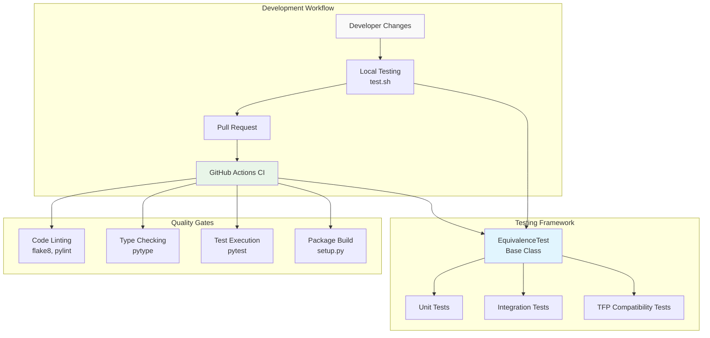
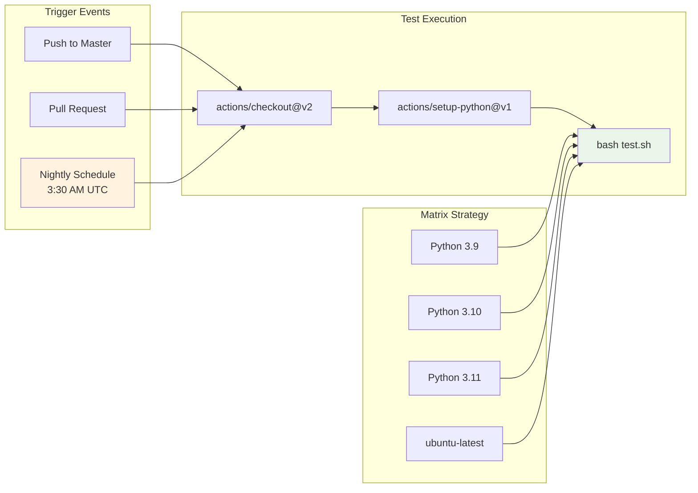
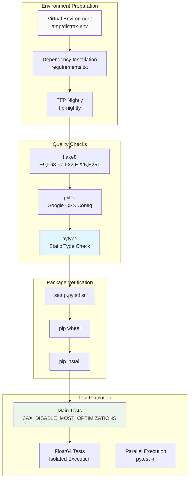
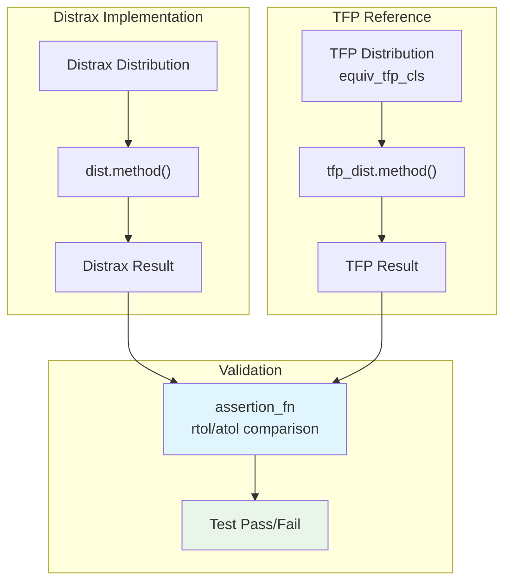
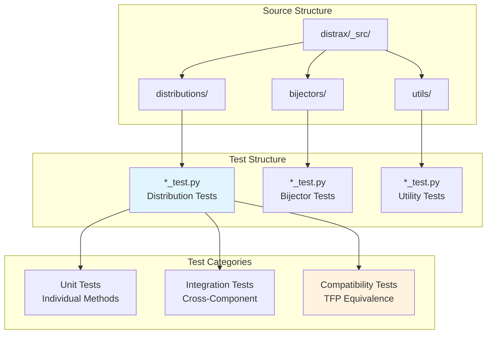

<!-- source: DeepWiki mcp.deepwiki.com · repo google-deepmind/distrax · page 6 Development and Testing · fetched 2026-10-26 -->

# Development and Testing

<details>
<summary>Relevant source files</summary>

The following files were used as context for generating this wiki page:

- [.github/workflows/tests.yml](.github/workflows/tests.yml)
- [CONTRIBUTING.md](CONTRIBUTING.md)
- [distrax/_src/distributions/categorical.py](distrax/_src/distributions/categorical.py)
- [distrax/_src/distributions/categorical_test.py](distrax/_src/distributions/categorical_test.py)
- [distrax/_src/distributions/distribution_from_tfp_test.py](distrax/_src/distributions/distribution_from_tfp_test.py)
- [setup.py](setup.py)
- [test.sh](test.sh)

</details>


This document covers the development workflow, testing framework, and quality assurance practices for Distrax. It provides guidance for contributors on testing methodologies, CI/CD pipeline, and development best practices.

For information about the core distribution and bijector APIs, see [Core Concepts](#2). For specific testing of distributions, see [Distributions](#3).

## Overview

Distrax employs a comprehensive testing strategy that ensures mathematical correctness, JAX compatibility, and seamless integration with TensorFlow Probability. The testing framework is built around equivalence testing, which validates that Distrax implementations produce identical results to their TFP counterparts while maintaining JAX-native performance benefits.



**Testing Framework Architecture**

Sources: [.github/workflows/tests.yml:1-29](), [test.sh:1-87](), [distrax/_src/distributions/categorical_test.py:29-34]()

## Continuous Integration Pipeline

The CI/CD pipeline runs on GitHub Actions and executes a comprehensive test suite across multiple Python versions and environments.

### Pipeline Configuration

The CI pipeline is configured to run on:
- **Triggers**: Push to master, pull requests, and nightly scheduled runs
- **Python Versions**: 3.9, 3.10, 3.11
- **Operating System**: Ubuntu Latest
- **Test Script**: `test.sh`



**CI/CD Pipeline Flow**

Sources: [.github/workflows/tests.yml:1-29]()

### Test Script Workflow

The main test script [`test.sh`] implements a multi-stage testing process:

| Stage | Tools | Purpose |
|-------|-------|---------|
| Environment Setup | `python3 -m venv`, `pip` | Isolated dependency management |
| Code Linting | `flake8`, `pylint` | Code style and quality enforcement |
| Package Building | `setup.py`, `pip wheel` | Installation verification |
| Type Checking | `pytype` | Static type analysis |
| Test Execution | `pytest` | Comprehensive test suite |



**Test Script Execution Flow**

Sources: [test.sh:19-86]()

## Testing Framework

### EquivalenceTest Base Class

The core of Distrax's testing strategy is the `EquivalenceTest` framework, which ensures mathematical equivalence between Distrax and TensorFlow Probability implementations.

#### Test Structure Pattern

All distribution and bijector tests follow a consistent pattern:

```python
class ExampleTest(equivalence.EquivalenceTest):
    def setUp(self):
        super().setUp()
        self._init_distr_cls(example.Example)
```

Key testing methods provided by `EquivalenceTest`:
- `_test_sample_shape()` - Validates sample shape consistency
- `_test_sample_and_log_prob()` - Cross-validates sampling and probability computation
- `_test_attribute()` - Tests distribution properties and methods
- `_test_with_two_distributions()` - Tests KL divergence and cross-entropy

Sources: [distrax/_src/distributions/categorical_test.py:29-34]()

### JAX Transformation Testing

Distrax extensively tests compatibility with JAX transformations using the `@chex.all_variants` decorator:

| Transformation | Test Coverage |
|----------------|---------------|
| `jit` | JIT compilation compatibility |
| `vmap` | Vectorization across batch dimensions |
| `pmap` | Parallel mapping (where applicable) |
| `grad` | Gradient computation verification |

Example test pattern:
```python
@chex.all_variants
@parameterized.named_parameters(...)
def test_sample_and_log_prob(self, distr_params, sample_shape):
    super()._test_sample_and_log_prob(...)
```

Sources: [distrax/_src/distributions/categorical_test.py:64-132]()

### TensorFlow Probability Compatibility

#### Cross-Framework Validation



**Cross-Framework Validation Process**

#### KL Divergence Registration Testing

Distrax tests bidirectional KL divergence compatibility:

```python
# Test patterns for KL divergence
('kl distrax_to_distrax', 'kl_divergence', 'distrax_to_distrax'),
('kl distrax_to_tfp', 'kl_divergence', 'distrax_to_tfp'),
('kl tfp_to_distrax', 'kl_divergence', 'tfp_to_distrax'),
```

Sources: [distrax/_src/distributions/categorical_test.py:307-324](), [distrax/_src/distributions/categorical.py:203-216]()

### Parameterized Testing

Distrax uses extensive parameterized testing to cover edge cases and different configurations:

#### Test Parameter Categories

| Category | Examples | Purpose |
|----------|----------|---------|
| Input Types | `logits` vs `probs` | Parameter flexibility |
| Data Types | `int16`, `int32`, `float32`, `float64` | Type safety |
| Shapes | `1d`, `2d`, batch dimensions | Broadcasting compatibility |
| Edge Cases | `inf`, `-inf`, `0.0` values | Numerical stability |

Example parameterized test:
```python
@parameterized.named_parameters(
    ('1d logits', (4,), False),
    ('2d probs', (3, 4), True),
)
def test_properties(self, shape, from_probs):
```

Sources: [distrax/_src/distributions/categorical_test.py:35-52]()

## Development Best Practices

### Code Quality Standards

#### Linting Configuration

The project uses a multi-layered linting approach:

1. **flake8**: Basic syntax and style checking
   - Selected error codes: `E9`, `F63`, `F7`, `F82`, `E225`, `E251`
   
2. **pylint**: Advanced code quality analysis
   - Based on Google's Open Source Style Guide
   - Custom disabled warnings for test files

#### Type Checking

- **Tool**: `pytype` (Python < 3.11)
- **Scope**: All source files in `distrax/_src/`
- **Configuration**: Jittable type safety verification

Sources: [test.sh:32-66]()

### Testing Guidelines

#### Test Organization



**Test Organization Structure**

#### Required Test Coverage

For new distributions or bijectors, tests must cover:

1. **Core Functionality**
   - `sample()`, `log_prob()`, `prob()`
   - `entropy()`, `mode()`, statistical properties
   
2. **JAX Compatibility**  
   - JIT compilation with `@chex.all_variants`
   - Vectorization with `vmap`
   - Gradient computation
   
3. **TFP Equivalence**
   - Cross-validation against `equiv_tfp_cls`
   - KL divergence registration
   
4. **Edge Cases**
   - Invalid inputs, boundary conditions
   - Numerical stability with extreme values

Sources: [distrax/_src/distributions/categorical_test.py:377-454]()

### Contribution Workflow

#### Pull Request Requirements

1. **Local Testing**: Run `bash test.sh` successfully
2. **Code Review**: All submissions require review
3. **CLA**: Contributor License Agreement required
4. **Style Compliance**: Pass all linting checks

#### Package Building

The setup process validates package integrity:

```python
# Package configuration
install_requires=_parse_requirements('requirements/requirements.txt')
tests_require=_parse_requirements('requirements/requirements-tests.txt')
python_requires='>=3.9'
```

Sources: [setup.py:44-77](), [CONTRIBUTING.md:1-35]()

---

