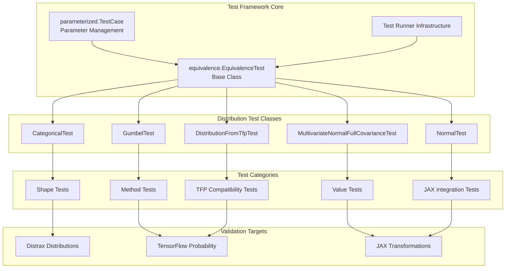
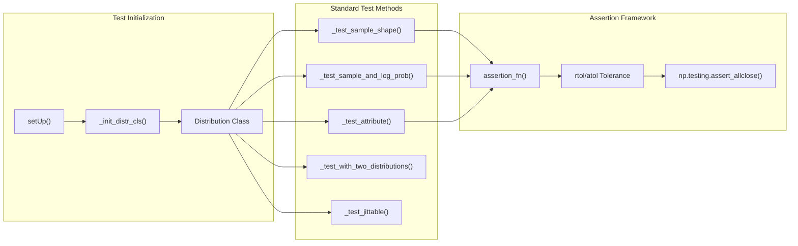
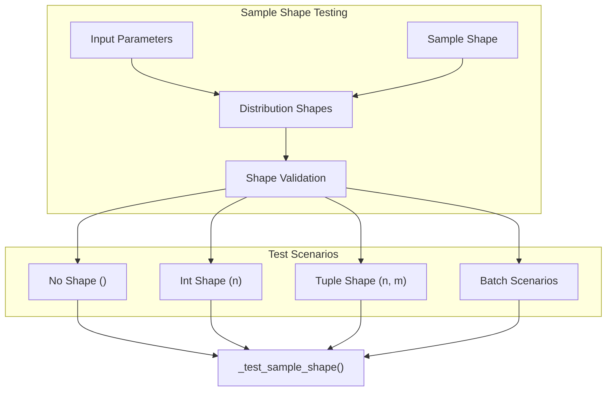
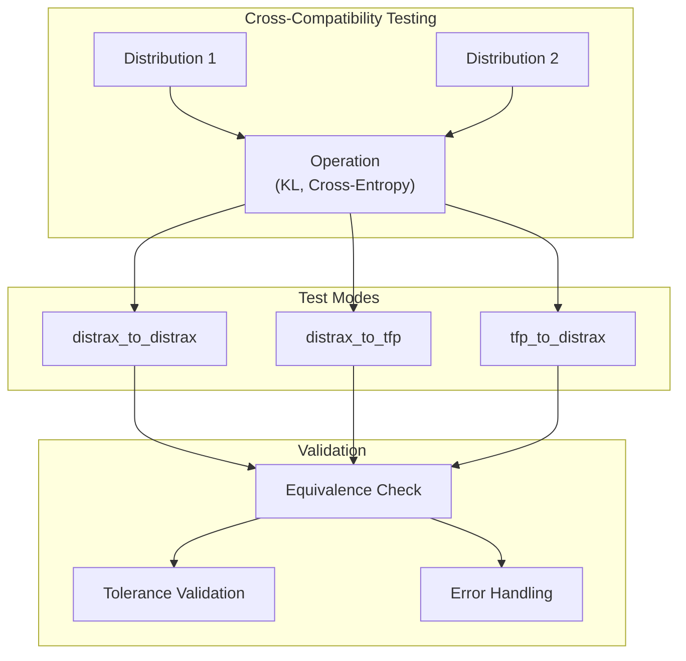
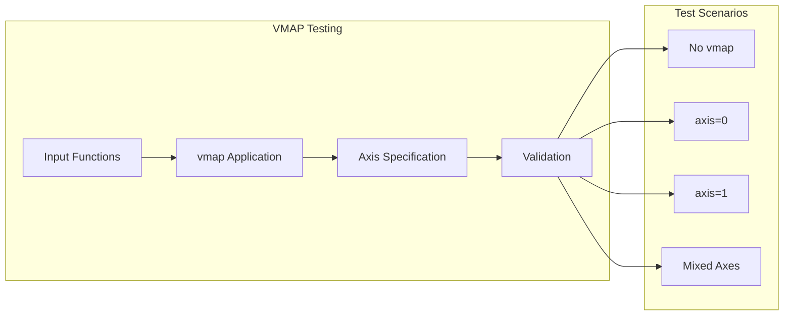

<!-- source: DeepWiki mcp.deepwiki.com · repo google-deepmind/distrax · page 6.1 Testing Framework · fetched 2026-10-26 -->

# Testing Framework

<details>
<summary>Relevant source files</summary>

The following files were used as context for generating this wiki page:

- [distrax/_src/distributions/categorical.py](distrax/_src/distributions/categorical.py)
- [distrax/_src/distributions/categorical_test.py](distrax/_src/distributions/categorical_test.py)
- [distrax/_src/distributions/distribution_from_tfp_test.py](distrax/_src/distributions/distribution_from_tfp_test.py)
- [distrax/_src/distributions/gumbel_test.py](distrax/_src/distributions/gumbel_test.py)
- [distrax/_src/distributions/mvn_full_covariance_test.py](distrax/_src/distributions/mvn_full_covariance_test.py)

</details>


This document covers Distrax's comprehensive testing framework, which ensures mathematical correctness, API compatibility with TensorFlow Probability, and proper JAX integration. The framework is built around equivalence testing that validates Distrax implementations against their TensorFlow Probability counterparts.

For information about the CI/CD pipeline and contribution guidelines, see [Contributing Guidelines](#6.2). For details about TensorFlow Probability integration patterns, see [TensorFlow Probability Integration](#5.3).

## Testing Architecture Overview

The Distrax testing framework is centered around the `EquivalenceTest` base class, which provides systematic validation against TensorFlow Probability distributions. This approach ensures that Distrax distributions maintain mathematical correctness while leveraging JAX's performance benefits.



**Sources:** [distrax/_src/distributions/categorical_test.py:29-33](), [distrax/_src/distributions/gumbel_test.py:28-32](), [distrax/_src/distributions/mvn_full_covariance_test.py:34-38]()

## EquivalenceTest Framework

The `EquivalenceTest` class provides the foundation for systematic comparison between Distrax and TensorFlow Probability distributions. Each distribution test inherits from this base class and gains access to standardized testing methods.

### Core Test Structure



**Sources:** [distrax/_src/distributions/categorical_test.py:31-33](), [distrax/_src/distributions/gumbel_test.py:30-32]()

### Test Class Pattern

Every distribution test follows a consistent initialization pattern:

```python
class CategoricalTest(equivalence.EquivalenceTest):
  def setUp(self):
    super().setUp()
    self._init_distr_cls(categorical.Categorical)
```

The `_init_distr_cls()` method establishes the connection between the Distrax distribution class and its TensorFlow Probability equivalent through the `equiv_tfp_cls` attribute.

**Sources:** [distrax/_src/distributions/categorical_test.py:29-33](), [distrax/_src/distributions/categorical.py:36]()

## Test Methodologies and Patterns

### Parameterized Testing

Distrax extensively uses parameterized tests to cover various input configurations, shapes, and edge cases. The `@parameterized.named_parameters` decorator enables systematic testing across parameter spaces.

| Test Category | Parameters Covered | Example |
|---------------|-------------------|---------|
| Shape Tests | Batch shapes, event shapes, sample shapes | `('1d logits, 2-tuple shape', {'logits': [0.0, 1.0, -0.5]}, (5, 4))` |
| Input Validation | Different parameterizations, dtypes | `('1d probs', {'probs': [0.2, 0.5, 0.3]}, ())` |
| Method Testing | Various distribution methods | `('entropy', 'entropy'), ('mode', 'mode')` |
| Edge Cases | Boundary values, invalid inputs | `('extreme probs', {'probs': [0.0, 1.0, 0.0]}, [0, 1, 1, 2])` |

**Sources:** [distrax/_src/distributions/categorical_test.py:65-96](), [distrax/_src/distributions/gumbel_test.py:34-64]()

### Sample Shape Validation

The framework validates that sampling produces correctly shaped outputs across different sample shapes and distribution parameters:



**Sources:** [distrax/_src/distributions/categorical_test.py:91-96](), [distrax/_src/distributions/gumbel_test.py:61-64]()

### Method Equivalence Testing

The `_test_attribute()` method provides a generic framework for testing any distribution method against its TensorFlow Probability equivalent:

```python
super()._test_attribute(
    attribute_string='log_prob',
    dist_kwargs=distr_params,
    call_args=(value,),
    assertion_fn=self.assertion_fn(rtol=2e-3))
```

This pattern is used for testing methods like `log_prob`, `prob`, `cdf`, `entropy`, `mean`, `variance`, etc.

**Sources:** [distrax/_src/distributions/categorical_test.py:223-227](), [distrax/_src/distributions/gumbel_test.py:118-123]()

## TensorFlow Probability Compatibility Validation

### Cross-Distribution Testing

The framework tests interactions between Distrax and TFP distributions through the `_test_with_two_distributions()` method, which validates operations like KL divergence and cross-entropy across three scenarios:

1. **distrax_to_distrax**: Both distributions are Distrax implementations
2. **distrax_to_tfp**: First distribution is Distrax, second is TFP
3. **tfp_to_distrax**: First distribution is TFP, second is Distrax



**Sources:** [distrax/_src/distributions/categorical_test.py:313-324](), [distrax/_src/distributions/gumbel_test.py:174-189]()

### KL Divergence Registration Validation

The framework validates that KL divergence computations work correctly between Distrax and TFP distributions through the TFP KL registry system:

```python
tfd.RegisterKL(Categorical, Categorical)(
    _kl_divergence_categorical_categorical)
tfd.RegisterKL(Categorical, Categorical.equiv_tfp_cls)(
    _kl_divergence_categorical_categorical)
```

Tests ensure these registrations work bidirectionally and handle edge cases appropriately.

**Sources:** [distrax/_src/distributions/categorical.py:204-209]()

## JAX Integration Testing

### JIT Compilation Validation

The `_test_jittable()` method ensures that all distribution methods work correctly under JAX's JIT compilation:

```python
def test_jittable(self):
  super()._test_jittable(
      (0.1, 1.2), assertion_fn=self.assertion_fn(rtol=3e-2))
```

This validates that distribution operations maintain correctness when compiled and don't introduce numerical artifacts.

**Sources:** [distrax/_src/distributions/gumbel_test.py:191-193](), [distrax/_src/distributions/categorical_test.py:377-378]()

### Vectorization Testing

The framework includes specific tests for JAX's `vmap` functionality to ensure distributions work correctly with vectorized operations:



**Sources:** [distrax/_src/distributions/categorical_test.py:412-433]()

### Gradient Computation Testing

Critical for automatic differentiation, the framework validates that gradients flow correctly through distribution operations, especially for complex cases involving edge values:

```python
def test_entropy_grad(self, logits):
  def entropy_fn(logits):
    return categorical.Categorical(logits).entropy()
  entropy, grads = jax.value_and_grad(entropy_fn)(logits)
  # Validate finite gradients and correct values
```

**Sources:** [distrax/_src/distributions/categorical_test.py:462-473]()

## Writing New Tests

### Test Class Structure

When implementing tests for a new distribution, follow this pattern:

1. **Inherit from EquivalenceTest**: `class NewDistTest(equivalence.EquivalenceTest)`
2. **Initialize in setUp()**: Call `self._init_distr_cls(new_distribution.NewDist)`
3. **Implement required test methods**: Shape tests, method tests, compatibility tests
4. **Add parameterized test cases**: Cover various parameter combinations and edge cases

### Essential Test Methods

| Method | Purpose | Parameters |
|--------|---------|------------|
| `test_event_shape` | Validate event shape computation | Distribution parameters |
| `test_sample_shape` | Validate sample shape generation | Sample shapes, distribution parameters |
| `test_sample_and_log_prob` | Validate sampling and probability computation | Sample shapes, distribution parameters |
| `test_method_with_input` | Validate methods that take values | Method names, test values |
| `test_method` | Validate parameter-free methods | Method names |
| `test_with_two_distributions` | Validate inter-distribution operations | KL divergence, cross-entropy |
| `test_jittable` | Validate JAX JIT compatibility | Distribution parameters |

### Tolerance Specifications

Different operations require different numerical tolerances based on their computational complexity:

- **Basic operations** (`log_prob`, `prob`): `rtol=1e-3` to `3e-3`
- **Complex operations** (`entropy`, `kl_divergence`): `rtol=3e-2` to `6e-2`
- **Covariance computations**: `rtol=2e-2`
- **Cross-platform consistency**: `atol=1e-5` for absolute comparisons

**Sources:** [distrax/_src/distributions/categorical_test.py:131](), [distrax/_src/distributions/gumbel_test.py:100](), [distrax/_src/distributions/mvn_full_covariance_test.py:154-158]()

---

