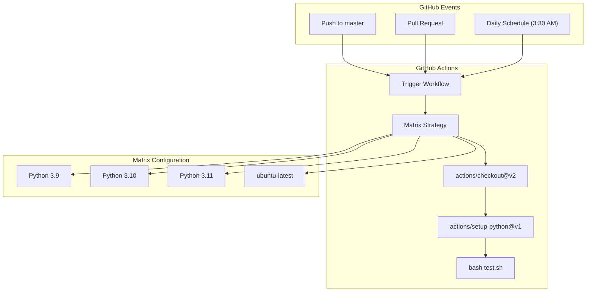
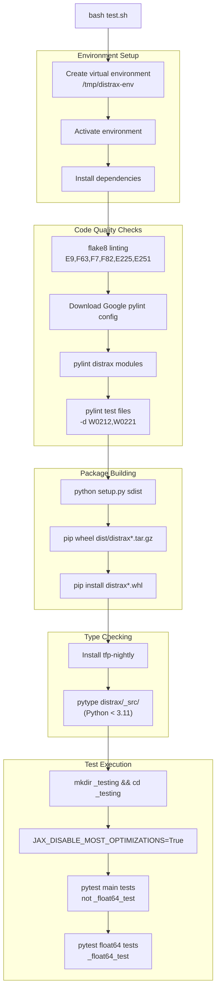

<!-- source: DeepWiki mcp.deepwiki.com · repo google-deepmind/distrax · page 6.2 Contributing Guidelines · fetched 2026-10-26 -->

# Contributing Guidelines

<details>
<summary>Relevant source files</summary>

The following files were used as context for generating this wiki page:

- [.github/workflows/tests.yml](.github/workflows/tests.yml)
- [CONTRIBUTING.md](CONTRIBUTING.md)
- [setup.py](setup.py)
- [test.sh](test.sh)

</details>


This document covers the development workflow, CI/CD pipeline, coding standards, and procedures for contributing new distributions or bijectors to the Distrax codebase. For information about the testing framework and writing tests, see [Testing Framework](#6.1).

## CI/CD Pipeline

### GitHub Actions Workflow

Distrax uses GitHub Actions for continuous integration and testing. The workflow is triggered on pushes and pull requests to the master branch, as well as on a daily schedule.

#### CI/CD Pipeline Flow



Sources: [.github/workflows/tests.yml:1-29]()

### Test Script Execution

The main test script `test.sh` orchestrates the entire testing pipeline including environment setup, dependency installation, code quality checks, and test execution.

#### test.sh Execution Flow



Sources: [test.sh:16-86]()

## Development Environment Setup

### Dependencies and Requirements

| Component | Purpose | Configuration |
|-----------|---------|---------------|
| **Core Dependencies** | Runtime requirements | [requirements/requirements.txt]() |
| **Test Dependencies** | Testing and development tools | [requirements/requirements-tests.txt]() |
| **Linting Tools** | Code quality enforcement | `flake8`, `pylint`, `pylint-exit` |
| **Testing Framework** | Test execution | `pytest-xdist`, `pytest-forked` |
| **Type Checking** | Static type analysis | `pytype` (Python < 3.11) |

### Local Development Setup

```bash
# Create and activate virtual environment
python3 -m venv /tmp/distrax-env
source /tmp/distrax-env/bin/activate

# Install development dependencies
pip install --upgrade pip setuptools wheel
pip install flake8 pytest-xdist pytest-forked pylint pylint-exit
pip install -r requirements/requirements.txt
pip install -r requirements/requirements-tests.txt
```

Sources: [test.sh:19-30]()

## Code Quality Standards

### Linting Configuration

#### flake8 Rules
The project enforces specific flake8 error codes:
- `E9`: Runtime errors
- `F63`: Invalid syntax  
- `F7`: Syntax errors
- `F82`: Undefined names
- `E225`: Missing whitespace around operators
- `E251`: Unexpected spaces around keyword/parameter equals

```bash
flake8 `find distrax -name '*.py' | xargs` --count --select=E9,F63,F7,F82,E225,E251 --show-source --statistics
```

#### pylint Configuration
The project uses Google's OSS pylint configuration with specific overrides:

| Disabled Rule | Scope | Reason |
|---------------|-------|--------|
| `abstract-method` | All modules | Allow abstract methods without implementation |
| `unnecessary-lambda-assignment` | All modules | Permit lambda assignments for functional style |
| `no-value-for-parameter` | All modules | JAX transformations may alter signatures |
| `use-dict-literal` | All modules | Allow dict() constructor usage |
| `protected-access` | Test files only | Tests need access to private members |
| `arguments-differ` | Test files only | Test methods may override with different signatures |

Sources: [test.sh:32-48]()

### Type Checking

Type checking is performed using `pytype` for Python versions before 3.11:

```bash
pytype `find distrax/_src/ -name "*py" | xargs` -k
```

The `-k` flag continues checking even after encountering errors.

Sources: [test.sh:59-66]()

## Contributing New Distributions or Bijectors

### Distribution Development Workflow

```mermaid
graph LR
    subgraph "Development Process"
        design["Design Distribution<br/>Interface"]
        implement["Implement Class<br/>distrax/_src/distributions/"]
        tests["Write Tests<br/>*_test.py"]
        equiv["Add Equivalence Tests<br/>vs TFP"]
    end
    
    subgraph "Integration Steps"
        register["Register in __init__.py"]
        kl_reg["Register KL Divergences<br/>(if applicable)"]
        docs["Update Documentation"]
    end
    
    subgraph "Quality Assurance"
        local_test["Run bash test.sh"]
        pr_submit["Submit Pull Request"]
        ci_pass["CI Tests Pass"]
        review["Code Review"]
    end
    
    design --> implement
    implement --> tests
    tests --> equiv
    equiv --> register
    register --> kl_reg
    kl_reg --> docs
    docs --> local_test
    local_test --> pr_submit
    pr_submit --> ci_pass
    ci_pass --> review
```



### Bijector Development Workflow

```mermaid
graph LR
    subgraph "Bijector Implementation"
        base_class["Inherit from Bijector"]
        forward["Implement forward()"]
        inverse["Implement inverse()"]
        jacobian["Implement log_det_jacobian()"]
    end
    
    subgraph "Testing Requirements"
        invertibility["Test invertibility"]
        jacobian_test["Test Jacobian correctness"]
        shapes["Test shape handling"]
        jit_compat["Test JAX JIT compatibility"]
    end
    
    subgraph "Integration"
        export["Export in bijectors/__init__.py"]
        transform["Test with Transformed distribution"]
        examples["Add usage examples"]
    end
    
    base_class --> forward
    forward --> inverse
    inverse --> jacobian
    jacobian --> invertibility
    invertibility --> jacobian_test
    jacobian_test --> shapes
    shapes --> jit_compat
    jit_compat --> export
    export --> transform
    transform --> examples
```



Sources: Inferred from codebase structure and testing patterns

## Test Execution Strategy

### Test Isolation and Parallelization

The test suite uses `pytest-xdist` for parallel execution and `pytest-forked` for process isolation:

```bash
# Main tests (excluding float64 precision tests)
pytest -n"$(grep -c ^processor /proc/cpuinfo)" --forked \
  `find ../distrax/_src/ -name "*_test.py" | sort` \
  -k 'not _float64_test'

# Isolated float64 precision tests  
pytest -n"$(grep -c ^processor /proc/cpuinfo)" --forked \
  `find ../distrax/_src/ -name "*_test.py" | sort` \
  -k '_float64_test'
```

### Performance Optimization

During testing, JAX optimizations are disabled to speed up test execution:

```bash
export JAX_DISABLE_MOST_OPTIMIZATIONS=True
```

This environment variable is unset after main test execution completes.

Sources: [test.sh:68-83]()

## Pull Request Process

### Prerequisites

1. **Contributor License Agreement**: Must be signed before contributions can be accepted
2. **Local Testing**: All tests must pass locally via `bash test.sh`
3. **Code Review**: All submissions require review via GitHub pull requests

### Submission Checklist

- [ ] Code follows established patterns in `distrax/_src/`
- [ ] Tests written for new functionality
- [ ] Equivalence tests added (for distributions/bijectors)
- [ ] Type annotations included
- [ ] Documentation updated
- [ ] `bash test.sh` passes locally
- [ ] CLA signed

### CI Requirements

All pull requests must pass the complete CI pipeline:

| Check | Tool | Requirement |
|-------|------|-------------|
| **Syntax/Style** | `flake8` | No specified errors |
| **Code Quality** | `pylint` | Pass with Google config |
| **Type Safety** | `pytype` | No type errors (Python < 3.11) |
| **Package Build** | `setup.py` | Successful sdist/wheel build |
| **Tests** | `pytest` | All tests pass across Python 3.9-3.11 |

Sources: [CONTRIBUTING.md:1-35](), [.github/workflows/tests.yml:1-29]()