# Page: Overview

# Overview

<details>
<summary>Relevant source files</summary>

The following files were used as context for generating this wiki page:

- [README.md](README.md)
- [distrax/__init__.py](distrax/__init__.py)
- [distrax/_src/distributions/clipped.py](distrax/_src/distributions/clipped.py)
- [distrax/_src/distributions/clipped_test.py](distrax/_src/distributions/clipped_test.py)
- [distrax/_src/utils/hmm.py](distrax/_src/utils/hmm.py)
- [distrax/_src/utils/hmm_test.py](distrax/_src/utils/hmm_test.py)
- [examples/hmm.py](examples/hmm.py)

</details>


## Purpose and Scope

Distrax is a JAX-native probability distribution library that provides implementations of probability distributions and bijective transformations (bijectors). It serves as a lightweight alternative to TensorFlow Probability (TFP) with emphasis on readability, extensibility, and JAX performance optimizations.

This document covers the overall architecture and design principles of Distrax. For specific distribution implementations, see [Distributions](#3). For bijector details, see [Bijectors](#4). For JAX-specific features and performance considerations, see [JAX Integration](#2.3).

**Sources:** [README.md:1-47](), [distrax/__init__.py:15]()

## Core Architecture

Distrax is built around two primary abstractions: `Distribution` and `Bijector` classes, with additional utilities for advanced probabilistic modeling. The library maintains strict compatibility with TensorFlow Probability while leveraging JAX's compilation and transformation capabilities.

### Main Library Components

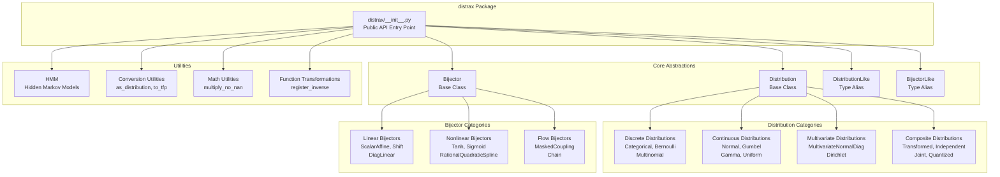

**Sources:** [distrax/__init__.py:17-89](), [README.md:48-137]()

### Code Entity Mapping

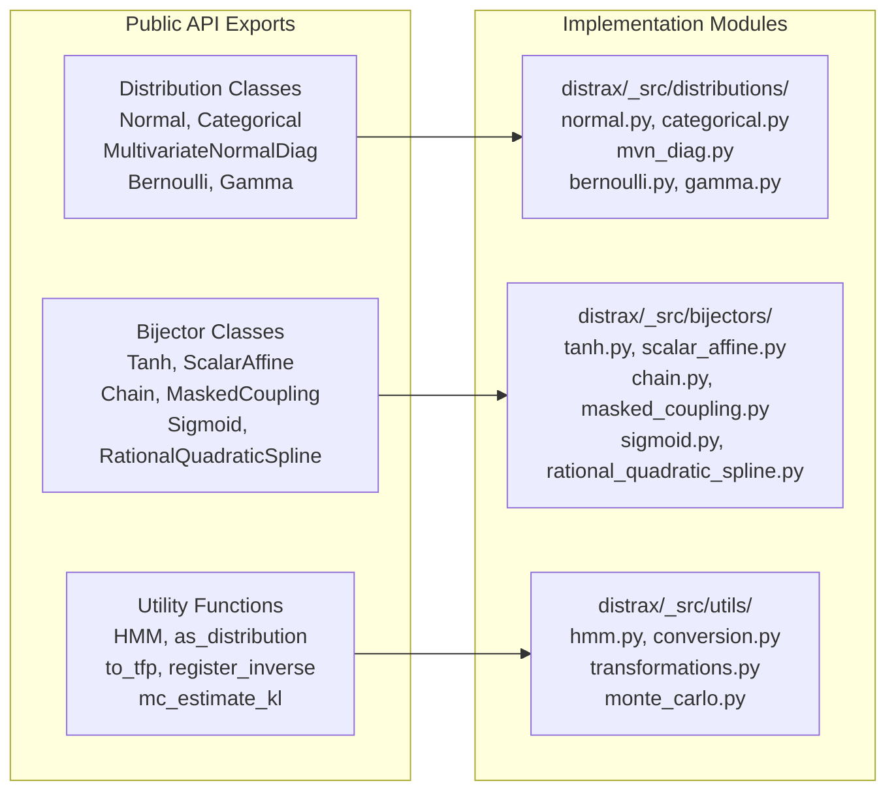

**Sources:** [distrax/__init__.py:40-89](), [distrax/__init__.py:17-37](), [distrax/__init__.py:77-88]()

## Key Components

### Distribution System

The `Distribution` base class provides a uniform interface for probability distributions with methods for sampling, probability calculation, and shape handling. All distributions support JAX transformations and maintain compatibility with TensorFlow Probability.

| Distribution Type | Key Classes | Event Shape | Use Cases |
|------------------|-------------|-------------|-----------|
| Discrete | `Categorical`, `Bernoulli`, `Multinomial` | `()` or `(k,)` | Classification, discrete choice |
| Continuous | `Normal`, `Gumbel`, `Gamma`, `Uniform` | `()` | Regression, continuous modeling |
| Multivariate | `MultivariateNormalDiag`, `Dirichlet` | `(d,)` | Vector-valued variables |
| Composite | `Transformed`, `Independent`, `Joint` | Variable | Meta-distributions |

**Sources:** [distrax/__init__.py:40-75](), [README.md:49-107]()

### Bijector System

Bijectors implement invertible transformations with automatic Jacobian computation. They enable creation of complex distributions by transforming simpler base distributions through the `Transformed` class.

| Bijector Type | Key Classes | Transformation | Jacobian |
|--------------|-------------|----------------|----------|
| Linear | `ScalarAffine`, `Shift`, `DiagLinear` | `y = ax + b` | Constant or diagonal |
| Nonlinear | `Tanh`, `Sigmoid` | Element-wise | Element-wise |
| Flow | `MaskedCoupling`, `RationalQuadraticSpline` | Normalizing flows | Complex |
| Composite | `Chain`, `Inverse` | Composition | Product/inverse |

**Sources:** [distrax/__init__.py:17-37](), [README.md:138-255]()

### Utility System

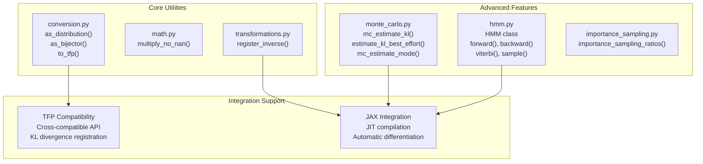

**Sources:** [distrax/__init__.py:77-88](), [distrax/_src/utils/hmm.py:47-324](), [examples/hmm.py:91-96]()

## JAX Integration

Distrax distributions and bijectors are designed as JAX-native implementations that support:

- **JIT Compilation**: All classes implement the `Jittable` interface for compilation optimization
- **Automatic Differentiation**: Native support for `jax.grad` and related transformations  
- **Vectorization**: Compatible with `jax.vmap` for batch operations
- **Functional Programming**: Immutable objects that work naturally with JAX transformations

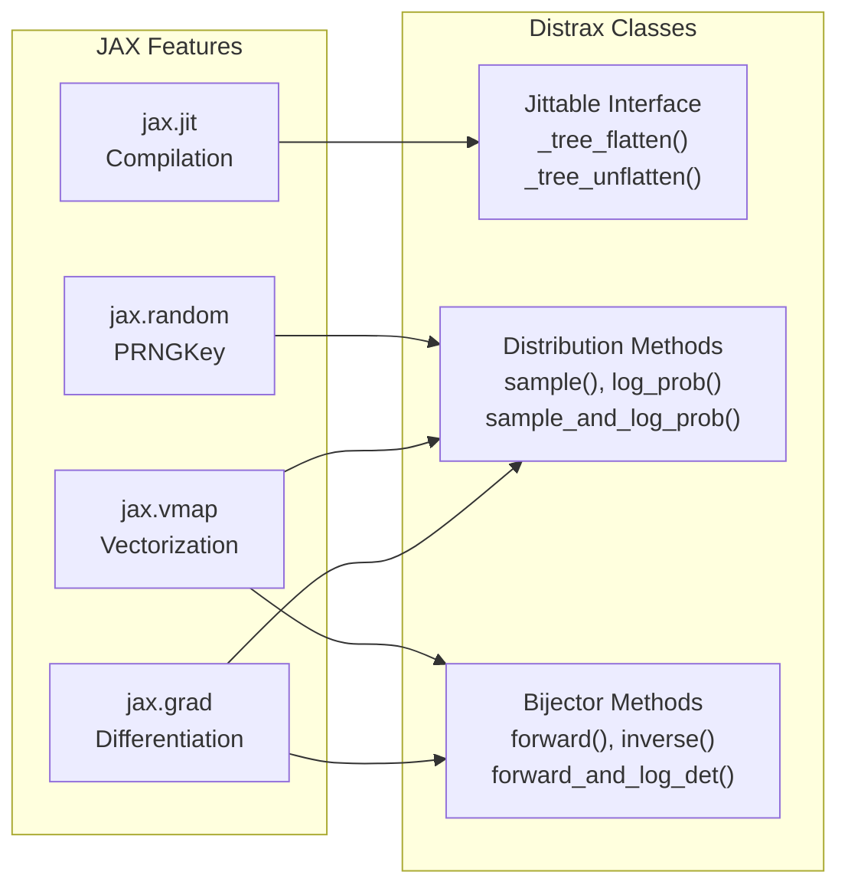

**Sources:** [README.md:257-278](), [README.md:280-294]()

## TensorFlow Probability Compatibility

Distrax maintains bidirectional compatibility with TensorFlow Probability through wrapper utilities and shared API conventions. This enables gradual migration and interoperability between the libraries.

### Compatibility Features

- **API Consistency**: Method signatures match TFP where possible (`sample`, `log_prob`, `kl_divergence`)
- **Cross-Library Usage**: TFP distributions work in Distrax meta-distributions and vice versa
- **Conversion Utilities**: `to_tfp()` wrapper for using Distrax objects in TFP contexts
- **KL Divergence Registration**: Automatic registration with TFP's KL divergence registry

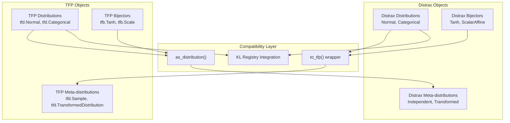

**Sources:** [README.md:76-136](), [README.md:173-195](), [distrax/__init__.py:78-80]()

## Public API Structure

The main entry point [distrax/__init__.py]() exports 160 public symbols organized into logical categories. The `__all__` tuple defines the complete public API surface, ensuring consistent imports and documentation.

| Category | Count | Examples |
|----------|-------|----------|
| Distribution Classes | 25 | `Normal`, `Categorical`, `MultivariateNormalDiag` |
| Bijector Classes | 18 | `Tanh`, `ScalarAffine`, `MaskedCoupling` |
| Utility Functions | 12 | `HMM`, `as_distribution`, `mc_estimate_kl` |
| Type Aliases | 2 | `DistributionLike`, `BijectorLike` |

**Sources:** [distrax/__init__.py:92-160](), [distrax/__init__.py:90]()

---

# Page: Installation and Setup

# Installation and Setup

<details>
<summary>Relevant source files</summary>

The following files were used as context for generating this wiki page:

- [.github/workflows/tests.yml](.github/workflows/tests.yml)
- [CONTRIBUTING.md](CONTRIBUTING.md)
- [requirements/requirements.txt](requirements/requirements.txt)
- [setup.py](setup.py)
- [test.sh](test.sh)

</details>


This document provides comprehensive guidance for installing Distrax and its dependencies, configuring the environment, and verifying the installation. It covers standard installation methods, dependency management, and troubleshooting common issues.

For information about using Distrax after installation, see [Quick Start Guide](#1.2). For development setup and contribution workflows, see [Contributing Guidelines](#6.2). For details about JAX integration features, see [JAX Integration](#2.3).

## System Requirements

Distrax requires Python 3.9 or higher and is officially tested on Python 3.9, 3.10, and 3.11. The library is designed to run on Unix-based systems (Linux, macOS) and follows the JAX ecosystem compatibility requirements.

### Supported Python Versions

| Python Version | Support Status | Testing |
|----------------|----------------|---------|
| 3.9            | ✅ Supported   | CI tested |
| 3.10           | ✅ Supported   | CI tested |
| 3.11           | ✅ Supported   | CI tested |
| 3.12+          | ⚠️ Limited     | Manual testing |

### Platform Support

Distrax inherits platform support from JAX and TensorFlow Probability:

- **Linux**: Full support (primary CI platform)
- **macOS**: Full support  
- **Windows**: Limited support (depends on JAX/TFP compatibility)

Sources: [setup.py:62](), [.github/workflows/tests.yml:18-19]()

## Core Dependencies

Distrax has a carefully managed dependency stack built around JAX and TensorFlow Probability. The core dependencies provide numerical computing, automatic differentiation, and probability distribution functionality.

### Dependency Architecture

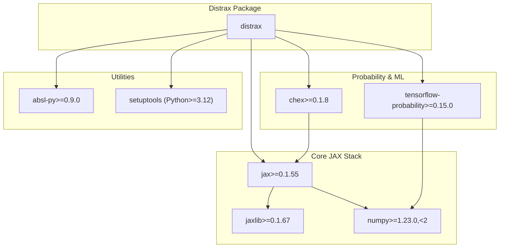

### Required Dependencies

| Package | Version Constraint | Purpose |
|---------|-------------------|---------|
| `jax` | `>=0.1.55` | Core JAX functionality, JIT compilation, autodiff |
| `jaxlib` | `>=0.1.67` | JAX XLA backend, platform-specific optimizations |
| `numpy` | `>=1.23.0,<2` | Numerical computing foundation |
| `tensorflow-probability` | `>=0.15.0` | Probability distributions, bijectors, statistical functions |
| `chex` | `>=0.1.8` | JAX testing utilities, array assertions |
| `absl-py` | `>=0.9.0` | Command-line flags, logging utilities |
| `setuptools` | (Python ≥3.12) | Package installation utilities |

Sources: [requirements/requirements.txt:1-7]()

## Installation Methods

### Standard Installation (PyPI)

The recommended installation method for most users is via pip from PyPI:

```bash
pip install distrax
```

This installs the latest stable release with all required dependencies. For specific versions:

```bash
pip install distrax==0.1.4  # Replace with desired version
```

### Installation with Virtual Environment

To avoid dependency conflicts, use a virtual environment:

```bash
python3 -m venv distrax-env
source distrax-env/bin/activate  # On Windows: distrax-env\Scripts\activate
pip install --upgrade pip setuptools wheel
pip install distrax
```

### Development Installation

For contributors or users needing the latest features:

```bash
git clone https://github.com/google-deepmind/distrax.git
cd distrax
pip install -e .
```

This creates an editable installation that reflects local code changes.

Sources: [setup.py:44-77](), [test.sh:19-30]()

## Installation Flow and Verification

### Installation Process Flow

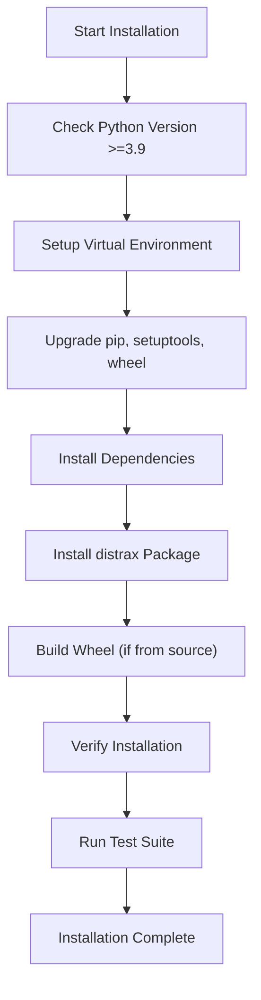

### Installation Verification

After installation, verify that Distrax is working correctly:

```python
import distrax
import jax.numpy as jnp

# Basic functionality test
dist = distrax.Normal(loc=0.0, scale=1.0)
samples = dist.sample(seed=jax.random.PRNGKey(42), sample_shape=(10,))
log_probs = dist.log_prob(samples)
print(f"Samples shape: {samples.shape}")
print(f"Log probabilities shape: {log_probs.shape}")
```

### Comprehensive Testing

For thorough verification, run the test suite using the provided script:

```bash
bash test.sh
```

This script performs:
- Dependency installation in a clean virtual environment
- Code linting with `flake8` and `pylint`
- Package building and wheel installation
- Type checking with `pytype` (Python < 3.11)
- Comprehensive test execution with `pytest`

The test script validates installation by building the package from source and running the full test suite in an isolated environment.

Sources: [test.sh:16-86](), [CONTRIBUTING.md:27-29]()

## Development Dependencies

For development work, additional dependencies are required for testing, linting, and type checking:

### Testing Framework Dependencies

```bash
pip install -r requirements/requirements-tests.txt
```

Common development dependencies include:
- `pytest-xdist`: Parallel test execution
- `pytest-forked`: Process isolation for tests  
- `flake8`: Code style checking
- `pylint`: Advanced code analysis
- `pytype`: Static type checking

### Development Workflow

The development installation process follows these steps:

1. **Environment Setup**: Create virtual environment in `/tmp/distrax-env`
2. **Dependency Installation**: Install core and testing dependencies
3. **Code Quality**: Run `flake8` and `pylint` checks
4. **Package Building**: Build source distribution and wheel
5. **TFP Integration**: Install TFP nightly for compatibility testing
6. **Type Checking**: Run `pytype` analysis (Python < 3.11)
7. **Test Execution**: Run full test suite with JAX optimizations disabled

Sources: [test.sh:19-86]()

## Troubleshooting

### Common Installation Issues

| Issue | Symptoms | Solution |
|-------|----------|----------|
| JAX/JAXLIB mismatch | Import errors, compilation failures | Ensure compatible JAX/JAXLIB versions |
| NumPy version conflicts | Array operation errors | Install NumPy in supported range (>=1.23.0,<2) |
| TFP compatibility | Distribution behavior differences | Use TFP >=0.15.0, consider TFP nightly |
| Python 3.12 issues | Setup tool errors | Ensure `setuptools` is installed |

### JAX Configuration

For optimal performance, configure JAX settings:

```python
import os
# Disable JAX optimizations for faster testing
os.environ['JAX_DISABLE_MOST_OPTIMIZATIONS'] = 'True'

# Enable double precision if needed
from jax.config import config
config.update("jax_enable_x64", True)
```

### Platform-Specific Notes

- **macOS**: May require Xcode command line tools for compilation
- **Linux**: Ensure CUDA compatibility for GPU acceleration
- **Windows**: Limited support; use WSL2 for best compatibility

Sources: [test.sh:75-80](), [setup.py:62]()

## Version Management

### Package Version Detection

The package version is automatically detected from the main module:

```python
import distrax
print(distrax.__version__)
```

The version is parsed from `distrax/__init__.py` during package building using the `_get_version()` function in the setup script.

### Dependency Version Constraints

Distrax uses conservative version constraints to ensure stability:
- **Lower bounds**: Specify minimum versions with required features
- **Upper bounds**: Applied selectively (e.g., NumPy <2) to prevent breaking changes
- **TFP compatibility**: Tested with both stable and nightly builds

Sources: [setup.py:24-31](), [test.sh:56-57]()

---

# Page: Quick Start Guide

# Quick Start Guide

<details>
<summary>Relevant source files</summary>

The following files were used as context for generating this wiki page:

- [README.md](README.md)
- [distrax/__init__.py](distrax/__init__.py)
- [distrax/_src/distributions/clipped.py](distrax/_src/distributions/clipped.py)
- [distrax/_src/distributions/clipped_test.py](distrax/_src/distributions/clipped_test.py)
- [distrax/_src/utils/hmm.py](distrax/_src/utils/hmm.py)
- [distrax/_src/utils/hmm_test.py](distrax/_src/utils/hmm_test.py)
- [examples/hmm.py](examples/hmm.py)

</details>


This guide provides simple examples to get you started with Distrax, covering the basic workflows for creating distributions, sampling, computing probabilities, and using bijectors. For detailed API documentation of specific distributions, see [Distributions](#3). For bijector details, see [Bijectors](#4). For advanced features like HMMs and function transformations, see [Utilities and Advanced Features](#5).

## Core Workflow Overview

Distrax follows a simple workflow: create distributions or bijectors, then use them for sampling, probability computation, or transformation. All objects are JAX-compatible and can be passed to `jax.jit`, `jax.vmap`, and other JAX transformations.

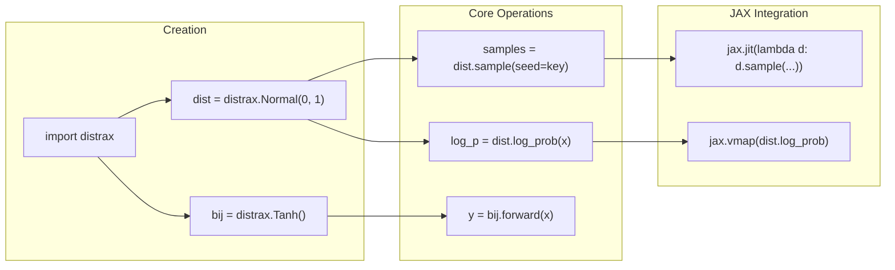

**Sources:** [distrax/__init__.py:15-173](), [README.md:54-107]()

## Basic Imports and Setup

```python
import distrax
import jax
import jax.numpy as jnp

# Generate random key for sampling
key = jax.random.PRNGKey(42)
```

All Distrax classes are available directly from the main module import. The library exports distributions, bijectors, and utility functions through a single namespace.

**Sources:** [distrax/__init__.py:17-90](), [README.md:55-57]()

## Creating and Using Distributions

### Univariate Continuous Distributions

```python
# Normal distribution
normal_dist = distrax.Normal(loc=0.0, scale=1.0)
samples = normal_dist.sample(seed=key)
log_prob = normal_dist.log_prob(samples)

# Uniform distribution  
uniform_dist = distrax.Uniform(low=-1.0, high=1.0)

# Gumbel distribution
gumbel_dist = distrax.Gumbel(loc=0.0, scale=1.0)
```

### Discrete Distributions

```python
# Categorical distribution
probs = jnp.array([0.3, 0.4, 0.3])
categorical_dist = distrax.Categorical(probs=probs)

# Bernoulli distribution
bernoulli_dist = distrax.Bernoulli(probs=0.7)

# Alternative parameterization using logits
logits = jnp.array([1.0, 2.0, 0.5])
categorical_logits = distrax.Categorical(logits=logits)
```

### Multivariate Distributions

```python
# Multivariate Normal with diagonal covariance
mu = jnp.array([0.0, 1.0, -0.5])
sigma = jnp.array([1.0, 0.5, 2.0])
mvn_diag = distrax.MultivariateNormalDiag(loc=mu, scale_diag=sigma)

# Dirichlet distribution
concentration = jnp.array([1.0, 2.0, 3.0])
dirichlet_dist = distrax.Dirichlet(concentration=concentration)
```

**Sources:** [README.md:54-74](), [distrax/__init__.py:40-75]()

## Key Distribution Methods

All Distrax distributions implement a common interface with these essential methods:

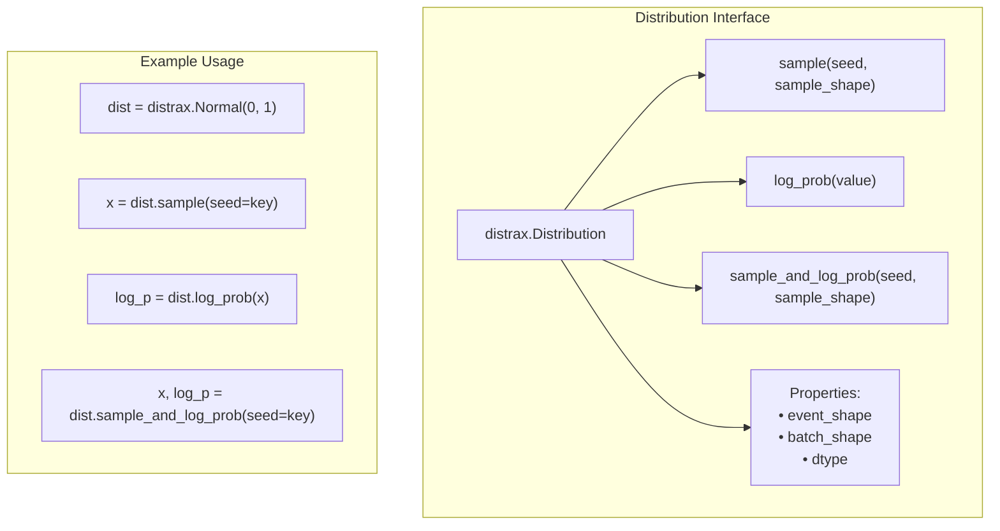

### Efficient Sampling with Log Probabilities

```python
# Instead of separate calls
samples = dist.sample(seed=key)
log_prob = dist.log_prob(samples)

# Use the combined method for efficiency
samples, log_prob = dist.sample_and_log_prob(seed=key)
```

**Sources:** [README.md:93-107](), [distrax/_src/distributions/distribution.py]()

## Working with Bijectors

Bijectors are invertible transformations that can create new distributions by transforming base distributions:

```python
# Create a base distribution and bijector
base_dist = distrax.Normal(0.0, 1.0)
bijector = distrax.Tanh()

# Transform the distribution
transformed_dist = distrax.Transformed(base_dist, bijector)

# Direct bijector operations
x = jnp.array([0.5, -0.3, 1.2])
y = bijector.forward(x)
x_reconstructed = bijector.inverse(y)

# Get transformation and log determinant together
y, log_det = bijector.forward_and_log_det(x)
```

### Common Bijector Patterns

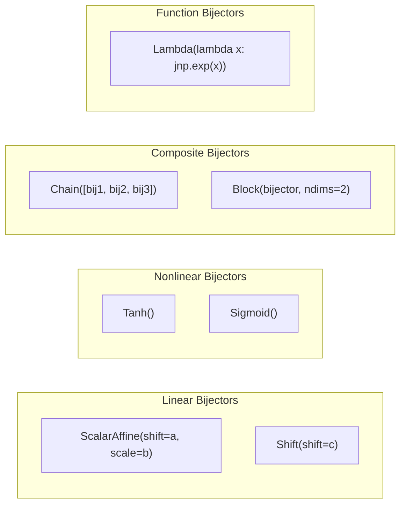

**Sources:** [README.md:138-255](), [distrax/__init__.py:17-37]()

## JAX Integration

### JIT Compilation

Distrax objects can be passed to JIT-compiled functions:

```python
@jax.jit
def log_likelihood(dist, data):
    return jnp.sum(dist.log_prob(data))

# Works with any Distrax distribution
dist = distrax.Normal(0.0, 1.0)
data = jnp.array([0.1, -0.2, 0.5])
ll = log_likelihood(dist, data)
```

### Vectorization with vmap

```python
# Vectorize over different parameters
locs = jnp.array([0.0, 1.0, 2.0])
scales = jnp.array([1.0, 0.5, 2.0])

# Create multiple distributions
dists = jax.vmap(distrax.Normal)(locs, scales)

# Vectorized sampling
samples = jax.vmap(lambda d: d.sample(seed=key))(dists)
```

**Sources:** [README.md:257-294](), [distrax/_src/utils/jittable.py]()

## TensorFlow Probability Interoperability

### Using TFP Distributions in Distrax

```python
import tensorflow_probability.substrates.jax as tfp
tfd = tfp.distributions

# TFP distribution in Distrax meta-distribution
tfp_normal = tfd.Normal(0.0, 1.0)
independent_dist = distrax.Independent(tfp_normal, reinterpreted_batch_ndims=1)
```

### Using Distrax in TFP

```python
# Wrap Distrax distribution for TFP
distrax_dist = distrax.Normal(0.0, 1.0)
wrapped_dist = distrax.to_tfp(distrax_dist)
tfp_meta = tfd.Sample(wrapped_dist, sample_shape=[3])
```

### Cross-Library Compatibility

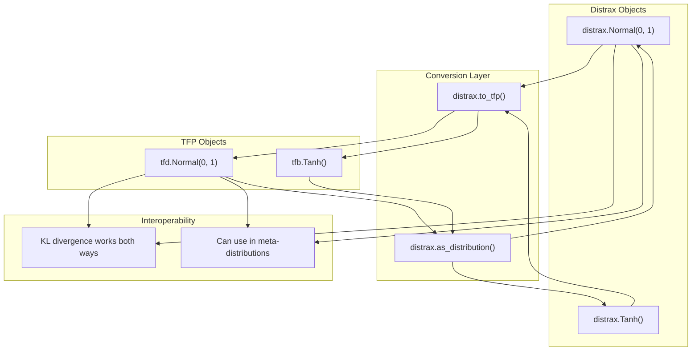

**Sources:** [README.md:76-136](), [README.md:173-195](), [distrax/_src/utils/conversion.py]()

## Practical Examples

### Simple Variational Model

```python
# Prior and posterior
prior = distrax.Normal(0.0, 1.0)
posterior = distrax.Normal(0.5, 0.2)

# Sample from posterior and compute KL divergence
key, subkey = jax.random.split(key)
z = posterior.sample(seed=subkey)
kl_div = posterior.kl_divergence(prior)
```

### Normalizing Flow

```python
# Chain of bijectors for normalizing flow
bijectors = [
    distrax.ScalarAffine(shift=1.0, scale=2.0),
    distrax.Tanh(),
    distrax.ScalarAffine(shift=-0.5, scale=0.5)
]
flow = distrax.Chain(bijectors)

# Transform base distribution
base_dist = distrax.Normal(0.0, 1.0)
flow_dist = distrax.Transformed(base_dist, flow)
```

### Clipped Distribution

```python
# Distribution with bounded support
base_normal = distrax.Normal(0.0, 1.0)
clipped_normal = distrax.Clipped(
    distribution=base_normal,
    minimum=-2.0,
    maximum=2.0
)
```

**Sources:** [examples/vae.py](), [examples/flow.py](), [distrax/_src/distributions/clipped.py:34-142]()

## Next Steps

- For comprehensive distribution documentation, see [Distributions](#3)
- For detailed bijector information, see [Bijectors](#4)  
- For advanced features like HMMs, see [Hidden Markov Models](#5.4)
- For custom distribution creation, see [Development and Testing](#6)

**Sources:** [README.md:348-364](), [examples/hmm.py:1-268]()

---

# Page: Core Concepts

# Core Concepts

<details>
<summary>Relevant source files</summary>

The following files were used as context for generating this wiki page:

- [distrax/_src/distributions/distribution.py](distrax/_src/distributions/distribution.py)
- [distrax/_src/distributions/distribution_test.py](distrax/_src/distributions/distribution_test.py)
- [distrax/_src/distributions/independent.py](distrax/_src/distributions/independent.py)
- [distrax/_src/distributions/quantized.py](distrax/_src/distributions/quantized.py)
- [distrax/_src/distributions/quantized_test.py](distrax/_src/distributions/quantized_test.py)
- [distrax/_src/utils/jittable.py](distrax/_src/utils/jittable.py)
- [distrax/_src/utils/jittable_test.py](distrax/_src/utils/jittable_test.py)

</details>


This document explains the fundamental abstractions that form the foundation of Distrax: distributions, JAX integration, and bijectors. These concepts enable efficient, composable probability distributions that work seamlessly with JAX's functional programming paradigm.

For detailed information about specific distribution types, see [Distributions](#3). For bijector implementations and transformations, see [Bijectors and Transformations](#2.2). For JAX-specific features like JIT compilation and vectorization, see [JAX Integration](#2.3).

## The Distribution Abstraction

The `Distribution` class serves as the abstract base for all probability distributions in Distrax. It defines a consistent interface for sampling, probability computation, and statistical operations while ensuring JAX compatibility.

### Core Distribution Interface

```mermaid
classDiagram
    class Distribution {
        <<abstract>>
        +_sample_n(key: PRNGKey, n: int) EventT*
        +log_prob(value: EventT) Array*
        +event_shape: ShapeT*
        +batch_shape: Tuple[int, ...]
        +sample(seed, sample_shape) EventT
        +prob(value: EventT) Array
        +kl_divergence(other_dist) Array
        +entropy() Array
        +mean() EventT
        +variance() EventT
    }
    
    class Jittable {
        <<abstract>>
        +tree_flatten()
        +tree_unflatten(aux_data, children)
    }
    
    class "Concrete Distributions" {
        +Normal
        +Categorical  
        +Quantized
        +Independent
        +Transformed
    }
    
    Distribution --|> Jittable
    "Concrete Distributions" --|> Distribution
```

The `Distribution` class requires implementations to provide three core abstract components:

- **`_sample_n`**: Internal sampling method that generates `n` samples
- **`log_prob`**: Computes log probability density/mass for given values  
- **`event_shape`**: Defines the shape of individual distribution events

Sources: [distrax/_src/distributions/distribution.py:49-91](), [distrax/_src/distributions/distribution.py:103-106]()

### Event vs Batch Semantics

Distrax follows TensorFlow Probability's event/batch shape semantics, which distinguish between the shape of individual samples and batches of parameters:

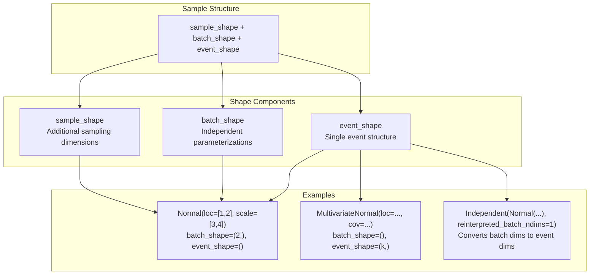

The `batch_shape` is computed dynamically by sampling and analyzing the result structure, while `event_shape` is defined by each distribution implementation.

Sources: [distrax/_src/distributions/distribution.py:109-131](), [distrax/_src/distributions/independent.py:77-82]()

## JAX Integration via Jittable

All Distrax distributions inherit from the `Jittable` interface, which enables seamless integration with JAX transformations like `jit`, `vmap`, and `grad`.

### Jittable Interface Architecture

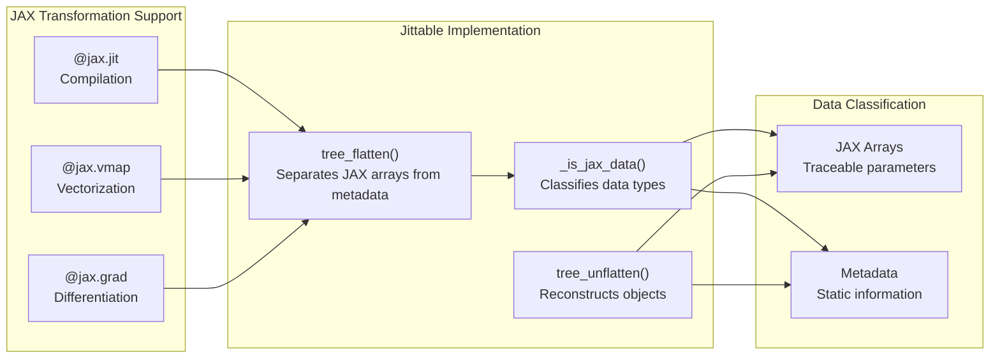

The `Jittable` class automatically registers distribution objects as JAX pytrees and handles the separation of traceable arrays from static metadata during compilation.

Sources: [distrax/_src/utils/jittable.py:21-48](), [distrax/_src/utils/jittable.py:50-65]()

### JAX Data Classification

The `_is_jax_data` function determines which object attributes are traced by JAX transformations:

- **Traceable**: JAX arrays, tracers, and valid JAX types
- **Static Metadata**: Primitive types (`bool`, `int`, `float`), `None`, and shape tuples

This separation ensures that distribution parameters get differentiated while structural information remains static during compilation.

Sources: [distrax/_src/utils/jittable.py:50-65]()

## Composite Distribution Patterns

Distrax provides several patterns for creating complex distributions by composing simpler ones:

### Composition Patterns

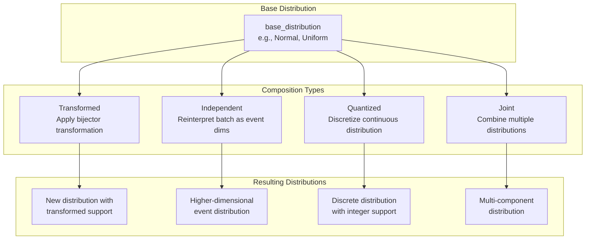

### Independent Distribution Example

The `Independent` distribution demonstrates how batch dimensions can be reinterpreted as event dimensions:

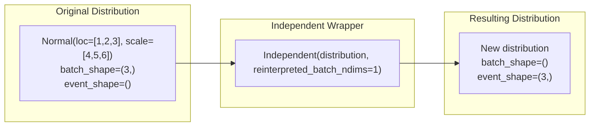

This pattern is essential for creating multivariate distributions from univariate ones and for controlling how `log_prob` operations aggregate across dimensions.

Sources: [distrax/_src/distributions/independent.py:34-90](), [distrax/_src/distributions/quantized.py:37-92]()

## Distribution Method Implementation Patterns

### Sampling and Probability Computation

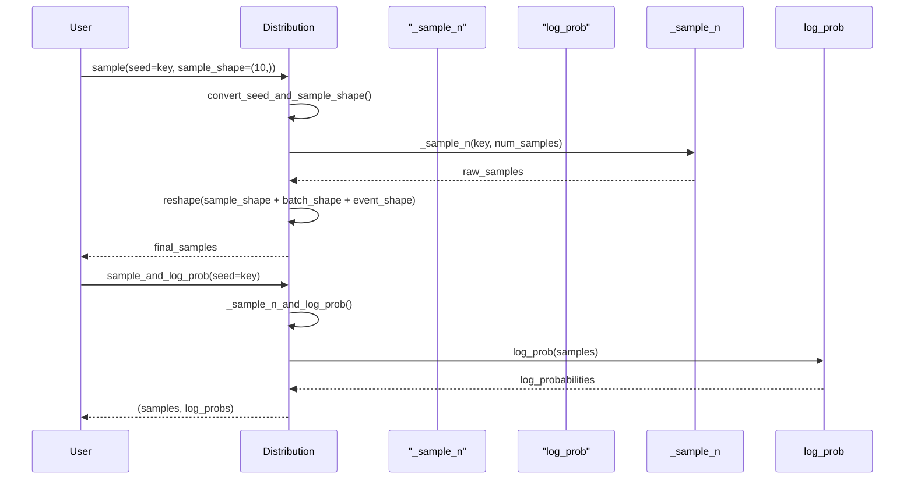

The framework provides default implementations for most methods, with concrete distributions only needing to implement the core abstract methods. The `_sample_n_and_log_prob` method can be overridden for efficiency when log probabilities can be computed more efficiently during sampling.

Sources: [distrax/_src/distributions/distribution.py:57-79](), [distrax/_src/distributions/distribution.py:144-177]()

### Integration with TensorFlow Probability

Distrax distributions integrate seamlessly with TensorFlow Probability through shared KL divergence registrations and compatible interfaces:

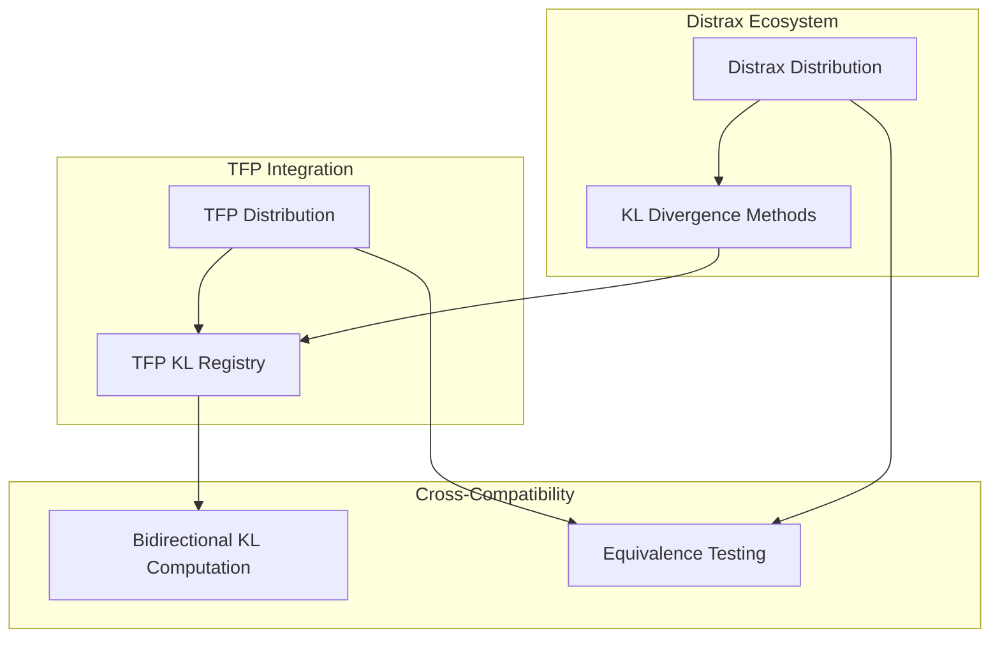

The `kl_divergence` method delegates to TensorFlow Probability's registry system, enabling computation between any combination of Distrax and TFP distributions.

Sources: [distrax/_src/distributions/distribution.py:179-189](), [distrax/_src/distributions/independent.py:189-194]()

---

# Page: Distribution Base Class

# Distribution Base Class

<details>
<summary>Relevant source files</summary>

The following files were used as context for generating this wiki page:

- [distrax/_src/distributions/distribution.py](distrax/_src/distributions/distribution.py)
- [distrax/_src/distributions/distribution_test.py](distrax/_src/distributions/distribution_test.py)
- [distrax/_src/distributions/independent.py](distrax/_src/distributions/independent.py)
- [distrax/_src/distributions/quantized.py](distrax/_src/distributions/quantized.py)

</details>


This document covers the `Distribution` abstract base class, which serves as the foundation for all probability distributions in Distrax. This class defines the core interface that distributions must implement and provides common functionality for sampling, probability computation, and statistical operations.

For information about specific distribution implementations, see [Distributions](#3). For details about JAX integration patterns, see [JAX Integration](#2.3). For bijector transformations that operate on distributions, see [Bijectors and Transformations](#2.2).

## Purpose and Architecture

The `Distribution` class establishes a unified interface for probability distributions while leveraging JAX for high-performance numerical computing. It inherits from `jittable.Jittable` to ensure compatibility with JAX transformations and uses generic typing to support diverse event types including arrays, tuples, and nested structures.

### Class Hierarchy

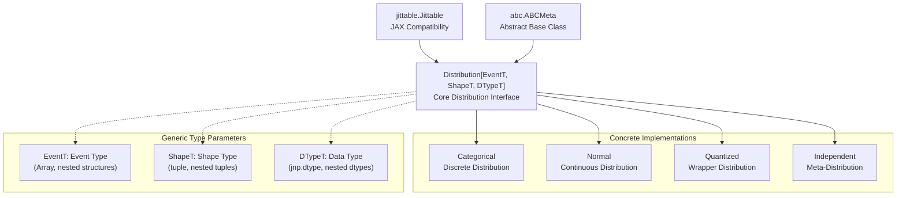

**Sources:** [distrax/_src/distributions/distribution.py:49-51](), [distrax/_src/distributions/quantized.py:37-38](), [distrax/_src/distributions/independent.py:34]()

## Abstract Interface

All distribution implementations must provide these core methods:

### Required Abstract Methods

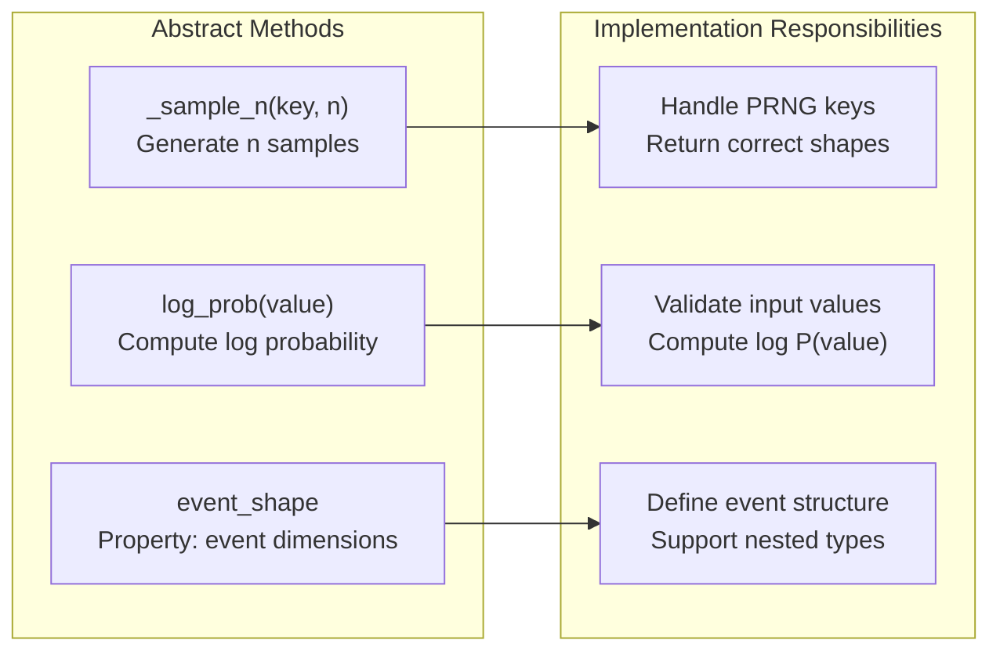

| Method | Purpose | Return Type | Notes |
|--------|---------|-------------|-------|
| `_sample_n(key, n)` | Generate `n` samples | `EventT` | Must handle JAX PRNG keys |
| `log_prob(value)` | Compute log probability | `Array` | Should validate input domain |
| `event_shape` | Event dimensions | `ShapeT` | Can be nested for complex events |

**Sources:** [distrax/_src/distributions/distribution.py:53-55](), [distrax/_src/distributions/distribution.py:81-90](), [distrax/_src/distributions/distribution.py:103-106]()

### Optional Abstract Methods

Some distributions may override these for better performance:

- `_sample_n_and_log_prob(key, n)`: Joint sampling and log probability computation
- `entropy()`: Shannon entropy calculation
- Statistical moments: `mean()`, `variance()`, `mode()`, `median()`
- CDF methods: `log_cdf(value)`, `cdf(value)`, `survival_function(value)`

**Sources:** [distrax/_src/distributions/distribution.py:57-79](), [distrax/_src/distributions/distribution.py:191-194]()

## Concrete Interface

The base class provides a comprehensive set of methods built on the abstract interface:

### Sampling and Probability

```mermaid
graph TB
    subgraph "Public API"
        Sample["sample(seed, sample_shape)<br/>User-facing sampling"]
        SampleLogProb["sample_and_log_prob(seed, sample_shape)<br/>Joint operation"]
        Prob["prob(value)<br/>Probability computation"]
    end
    
    subgraph "Internal Implementation"
        SampleN["_sample_n(key, n)<br/>Abstract method"]
        SampleNLogProb["_sample_n_and_log_prob(key, n)<br/>Optional override"]
        LogProbMethod["log_prob(value)<br/>Abstract method"]
    end
    
    Sample --> SampleN
    SampleLogProb --> SampleNLogProb
    Prob --> LogProbMethod
    
    subgraph "Utilities"
        Convert["convert_seed_and_sample_shape()<br/>Input validation"]
        Reshape["Reshape operations<br/>Handle sample_shape"]
    end
    
    Sample --> Convert
    Sample --> Reshape
```

**Sources:** [distrax/_src/distributions/distribution.py:144-162](), [distrax/_src/distributions/distribution.py:164-177](), [distrax/_src/distributions/distribution.py:92-101]()

### Shape System

The shape system distinguishes between batch dimensions and event dimensions:

| Property | Purpose | Computation |
|----------|---------|-------------|
| `event_shape` | Dimensions of individual events | Defined by implementation |
| `batch_shape` | Dimensions for independent samples | Derived via `jax.eval_shape` |
| `dtype` | Data type of samples | Computed from sample specification |

```mermaid
graph LR
    subgraph "Shape Analysis"
        Sample["sample(seed, sample_shape=())"]
        EvalShape["jax.eval_shape(self.sample, ...)"]
        BatchShape["batch_shape computation"]
        EventShape["event_shape (abstract)"]
    end
    
    Sample --> EvalShape
    EvalShape --> BatchShape
    BatchShape -.-> EventShape
    
    subgraph "Shape Decomposition"
        TotalShape["Total Sample Shape"]
        SampleDims["sample_shape"]
        BatchDims["batch_shape"]
        EventDims["event_shape"]
    end
    
    TotalShape --> SampleDims
    TotalShape --> BatchDims
    TotalShape --> EventDims
```

**Sources:** [distrax/_src/distributions/distribution.py:108-131](), [distrax/_src/distributions/distribution.py:137-142]()

## Statistical and Utility Methods

The base class provides default implementations for statistical operations:

| Category | Methods | Default Behavior |
|----------|---------|------------------|
| Statistical | `mean()`, `variance()`, `stddev()`, `mode()`, `median()` | Raise `NotImplementedError` |
| CDF/Survival | `cdf()`, `log_cdf()`, `survival_function()` | Basic implementations or `NotImplementedError` |
| Information | `entropy()`, `kl_divergence()`, `cross_entropy()` | TFP integration for KL divergence |
| Indexing | `__getitem__(index)` | Batch dimension slicing |

**Sources:** [distrax/_src/distributions/distribution.py:179-189](), [distrax/_src/distributions/distribution.py:262-284](), [distrax/_src/distributions/distribution.py:302-309]()

## JAX Integration Patterns

The Distribution class is designed for seamless JAX integration:

### PRNG Key Handling

```mermaid
graph LR
    subgraph "Seed Input Types"
        IntSeed["int"]
        PRNGKey["jax.random.PRNGKey"]
        NPInt["np.int16/32/64"]
    end
    
    subgraph "Conversion Process"
        Convert["convert_seed_and_sample_shape()"]
        Validate["Type validation"]
        Transform["Key transformation"]
    end
    
    IntSeed --> Convert
    PRNGKey --> Convert
    NPInt --> Convert
    Convert --> Validate
    Convert --> Transform
    
    subgraph "Usage"
        SampleN["_sample_n(key, n)"]
        JAXRandom["jax.random operations"]
    end
    
    Transform --> SampleN
    SampleN --> JAXRandom
```

**Sources:** [distrax/_src/distributions/distribution.py:312-327](), [distrax/_src/distributions/distribution_test.py:183-186]()

### JIT Compatibility

The `jittable.Jittable` inheritance ensures all distribution methods work with JAX transformations:

- `jax.jit`: Just-in-time compilation
- `jax.vmap`: Vectorization  
- `jax.grad`: Automatic differentiation

**Sources:** [distrax/_src/distributions/distribution.py:27](), [distrax/_src/distributions/distribution_test.py:165-174]()

## Extension Patterns

### Wrapper Distributions

Distributions can wrap other distributions to modify behavior:

```mermaid
graph TB
    subgraph "Base Distribution"
        BaseDist["Base Distribution<br/>Original behavior"]
        BaseEvent["Base event_shape"]
        BaseBatch["Base batch_shape"]
    end
    
    subgraph "Wrapper Pattern"
        Wrapper["Wrapper Distribution<br/>Modified behavior"]
        WrapperEvent["Modified event_shape"]
        WrapperBatch["Modified batch_shape"]
    end
    
    subgraph "Examples"
        Quantized["Quantized<br/>Discretizes continuous"]
        Independent["Independent<br/>Reinterprets batch dims"]
        Transformed["Transformed<br/>Applies bijector"]
    end
    
    BaseDist --> Wrapper
    BaseEvent --> WrapperEvent
    BaseBatch --> WrapperBatch
    
    Wrapper --> Quantized
    Wrapper --> Independent
    Wrapper --> Transformed
```

**Sources:** [distrax/_src/distributions/quantized.py:49-91](), [distrax/_src/distributions/independent.py:39-74]()

### Index Operations

Distributions support batch indexing through the `to_batch_shape_index` utility:

```mermaid
graph LR
    subgraph "Indexing Process"
        Index["User index"]
        BatchShape["Distribution batch_shape"]
        Transform["to_batch_shape_index()"]
        NewIndex["Transformed index"]
    end
    
    Index --> Transform
    BatchShape --> Transform
    Transform --> NewIndex
    
    subgraph "Index Types"
        IntIndex["int: single element"]
        SliceIndex["slice: range selection"]
        TupleIndex["tuple: multi-axis"]
        ArrayIndex["array: advanced indexing"]
    end
    
    NewIndex --> IntIndex
    NewIndex --> SliceIndex
    NewIndex --> TupleIndex
    NewIndex --> ArrayIndex
```

**Sources:** [distrax/_src/distributions/distribution.py:330-358](), [distrax/_src/distributions/distribution_test.py:233-259]()

## Type System and Generics

The Distribution class uses generic typing to support diverse event structures:

| Type Parameter | Purpose | Examples |
|----------------|---------|----------|
| `EventT` | Event type structure | `Array`, `Dict[str, Array]`, nested structures |
| `ShapeT` | Shape type structure | `Tuple[int, ...]`, nested shape tuples |
| `DTypeT` | Data type structure | `jnp.dtype`, nested dtype specifications |

This enables distributions over complex structured events while maintaining type safety.

**Sources:** [distrax/_src/distributions/distribution.py:44-46](), [distrax/_src/distributions/distribution_test.py:61-78]()

---

# Page: Bijectors and Transformations

# Bijectors and Transformations

<details>
<summary>Relevant source files</summary>

The following files were used as context for generating this wiki page:

- [distrax/_src/bijectors/scalar_affine.py](distrax/_src/bijectors/scalar_affine.py)
- [distrax/_src/distributions/transformed.py](distrax/_src/distributions/transformed.py)
- [distrax/_src/utils/equivalence.py](distrax/_src/utils/equivalence.py)
- [distrax/_src/utils/transformations.py](distrax/_src/utils/transformations.py)

</details>


This document covers bijectors as invertible transformations in Distrax, their interface and implementation patterns, and the supporting transformation utilities that enable automatic function inversion and Jacobian computation. For information about how bijectors integrate with distributions to create new probability distributions, see the Transformed Distributions section in [Composite and Meta-Distributions](#3.4.1). For details on specific bijector implementations, see [Bijectors](#4).

## Core Bijector Concepts

Bijectors in Distrax are invertible transformations that can be applied to random variables to create new distributions. A bijector `f` implements four key operations:

- `forward(x)`: Computes `y = f(x)` 
- `inverse(y)`: Computes `x = f^(-1)(y)`
- `forward_log_det_jacobian(x)`: Computes `log|det J_f(x)|`
- `inverse_log_det_jacobian(y)`: Computes `log|det J_{f^(-1)}(y)|`

The mathematical foundation ensures that when transforming a distribution with density `p_X(x)`, the resulting distribution has density:

```
p_Y(y) = p_X(f^(-1)(y)) * |det J_{f^(-1)}(y)|
```

## Bijector System Architecture

```mermaid
graph TB
    subgraph "Bijector Interface"
        BASE["Bijector<br/>Base Class"]
        FORWARD["forward()"]
        INVERSE["inverse()"]
        FLDJ["forward_log_det_jacobian()"]
        ILDJ["inverse_log_det_jacobian()"]
    end
    
    subgraph "Transformation Utilities"
        INV["inv()<br/>Function Inversion"]
        LOG_DET["log_det_scalar()<br/>Jacobian Computation"]
        CONST_JAC["is_constant_jacobian()<br/>Jacobian Analysis"]
        REGISTRY["_inverse_registry<br/>Primitive Inversions"]
    end
    
    subgraph "Concrete Bijectors"
        SCALAR["ScalarAffine<br/>shift + scale * x"]
        TANH["Tanh<br/>Element-wise tanh"]
        CHAIN["Chain<br/>Bijector Composition"]
        LAMBDA["Lambda<br/>Custom Functions"]
    end
    
    subgraph "Integration Points"
        TRANSFORMED["Transformed<br/>Distribution"]
        AUTO_INV["Automatic<br/>Inversion"]
        JAX_TRANS["JAX<br/>Transformations"]
    end
    
    BASE --> FORWARD
    BASE --> INVERSE
    BASE --> FLDJ
    BASE --> ILDJ
    
    INV --> REGISTRY
    LOG_DET --> JAX_TRANS
    CONST_JAC --> JAX_TRANS
    
    SCALAR --> BASE
    TANH --> BASE
    CHAIN --> BASE
    LAMBDA --> BASE
    
    LAMBDA --> AUTO_INV
    AUTO_INV --> INV
    AUTO_INV --> LOG_DET
    
    BASE --> TRANSFORMED
    TRANSFORMED --> JAX_TRANS
```

Sources: [distrax/_src/utils/transformations.py:15-48](), [distrax/_src/distributions/transformed.py:35-71](), [distrax/_src/bijectors/scalar_affine.py:28-40]()

## Automatic Function Inversion System

The transformation utilities provide powerful automatic inversion capabilities that allow users to define bijectors using only a forward function. The system traces JAX functions to their JAXPR representation and constructs the inverse by reversing the computation graph.

```mermaid
graph LR
    subgraph "User Function"
        F["f(x) = tanh(2*x + 1)"]
    end
    
    subgraph "JAX Tracing"
        JAXPR["JAXPR<br/>Representation"]
        TRACE["jax.make_jaxpr(f)"]
    end
    
    subgraph "Inversion Process"
        REV["Reverse<br/>Equations"]
        LOOKUP["Primitive<br/>Lookup"]
        CONSTRUCT["Construct<br/>Inverse"]
    end
    
    subgraph "Registry"
        UNARY["Unary Ops<br/>tanh_p -> atanh_p"]
        BINARY["Binary Ops<br/>mul_p -> div_p"]
        CUSTOM["Custom<br/>register_inverse()"]
    end
    
    subgraph "Output"
        INV_F["f^(-1)(y) = (atanh(y) - 1) / 2"]
        LOG_DET["log|det J_f(x)|"]
    end
    
    F --> TRACE
    TRACE --> JAXPR
    JAXPR --> REV
    REV --> LOOKUP
    LOOKUP --> UNARY
    LOOKUP --> BINARY
    LOOKUP --> CUSTOM
    LOOKUP --> CONSTRUCT
    CONSTRUCT --> INV_F
    CONSTRUCT --> LOG_DET
```

Sources: [distrax/_src/utils/transformations.py:129-138](), [distrax/_src/utils/transformations.py:258-330](), [distrax/_src/utils/transformations.py:68-127]()

### Supported Primitive Operations

The inversion system includes built-in support for common mathematical operations:

| Category | Primitives | Inverse Mapping |
|----------|------------|----------------|
| **Unary** | `tanh_p`, `exp_p`, `log_p` | `atanh_p`, `log_p`, `exp_p` |
| **Trigonometric** | `sinh_p`, `cosh_p` | `asinh_p`, `acosh_p` |
| **Binary** | `mul_p`, `add_p`, `div_p` | Handled with left/right cases |
| **Power** | `pow_p`, `sqrt_p`, `square_p` | Reciprocal exponents |

Users can extend this system using `register_inverse()` to add support for custom primitives.

Sources: [distrax/_src/utils/transformations.py:68-102](), [distrax/_src/utils/transformations.py:110-127]()

## Transformed Distribution Integration

Bijectors integrate seamlessly with the distribution system through the `Transformed` class, which represents the pushforward of a base distribution through a bijective transformation.

```mermaid
graph TB
    subgraph "Base Distribution"
        DIST["distribution<br/>p_X(x)"]
        SAMPLE_X["sample() -> x"]
        LOG_PROB_X["log_prob(x)"]
    end
    
    subgraph "Bijector"
        BIJ["bijector<br/>f: X -> Y"]
        FORWARD_F["forward(x) -> y"]
        INVERSE_F["inverse(y) -> x"]
        FLDJ_F["forward_log_det_jacobian(x)"]
        ILDJ_F["inverse_log_det_jacobian(y)"]
    end
    
    subgraph "Transformed Distribution"
        TRANS["Transformed<br/>p_Y(y)"]
        SAMPLE_Y["sample() -> y"]
        LOG_PROB_Y["log_prob(y)"]
        SHAPES["batch_shape, event_shape"]
    end
    
    subgraph "Computation Flow"
        SAMPLE_FLOW["x ~ p_X -> f(x) = y"]
        LOG_PROB_FLOW["p_Y(y) = p_X(f^-1(y)) * |det J_f^-1(y)|"]
    end
    
    DIST --> SAMPLE_X
    SAMPLE_X --> FORWARD_F
    FORWARD_F --> SAMPLE_Y
    
    LOG_PROB_Y --> INVERSE_F
    INVERSE_F --> LOG_PROB_X
    LOG_PROB_X --> ILDJ_F
    ILDJ_F --> LOG_PROB_Y
    
    BIJ --> TRANS
    DIST --> TRANS
    
    SAMPLE_FLOW --> SAMPLE_Y
    LOG_PROB_FLOW --> LOG_PROB_Y
```

Sources: [distrax/_src/distributions/transformed.py:44-50](), [distrax/_src/distributions/transformed.py:161-166](), [distrax/_src/distributions/transformed.py:168-172]()

### Shape and Dtype Inference

The `Transformed` distribution infers its properties by tracing the bijector's `forward` method on dummy inputs from the base distribution. This enables automatic computation of:

- `batch_shape` and `event_shape` after transformation
- Output `dtype` after bijector application
- Compatibility validation between distribution and bijector dimensions

Sources: [distrax/_src/distributions/transformed.py:120-136]()

## JAX Integration and Performance

### Constant Jacobian Optimization

Bijectors can declare whether their Jacobian determinant is constant with respect to input, enabling significant optimizations for operations like `mean()`, `mode()`, and `entropy()`:

```python
if self.bijector.is_constant_jacobian:
    return self.bijector.forward(self.distribution.mean())
```

The `is_constant_jacobian()` utility function can automatically detect this property by analyzing the JAXPR representation.

Sources: [distrax/_src/distributions/transformed.py:194-200](), [distrax/_src/utils/transformations.py:141-163]()

### Numerical Stability

The transformation system includes safeguards against numerically unstable operations, logging warnings when potentially problematic primitives are detected:

```python
_potentially_unstable_primitives = {
    jax.lax.tanh_p: "distrax.Tanh or distrax.Inverse(distrax.Tanh)",
    jax.lax.atanh_p: "distrax.Tanh or distrax.Inverse(distrax.Tanh)",
}
```

Sources: [distrax/_src/utils/transformations.py:104-107](), [distrax/_src/utils/transformations.py:178-186]()

## Example: ScalarAffine Bijector

The `ScalarAffine` bijector demonstrates a complete bijector implementation with the affine transformation `y = scale * x + shift`:

### Key Implementation Features

| Method | Implementation | 
|--------|----------------|
| `forward(x)` | `batched_scale * x + batched_shift` |
| `inverse(y)` | `batched_inv_scale * (y - batched_shift)` |
| `forward_log_det_jacobian(x)` | `broadcast_to(self._log_scale, batch_shape)` |
| `is_constant_jacobian` | `True` (set in constructor) |

The implementation handles broadcasting between bijector parameters and input shapes, and optimizes by precomputing `inv_scale` and `log_scale` during initialization.

Sources: [distrax/_src/bijectors/scalar_affine.py:98-128](), [distrax/_src/bijectors/scalar_affine.py:41-81]()

## Testing and Validation Framework

The bijector system integrates with Distrax's equivalence testing framework, which validates bijector implementations against TensorFlow Probability equivalents:

```mermaid
graph LR
    subgraph "Test Framework"
        EQUIV["EquivalenceTest"]
        ATTR_TEST["_test_attribute()"]
        JITTABLE["_test_jittable()"]
    end
    
    subgraph "Bijector Validation"
        FORWARD_TEST["Forward/Inverse<br/>Consistency"]
        JAC_TEST["Jacobian<br/>Correctness"] 
        TFP_EQUIV["TFP<br/>Equivalence"]
    end
    
    subgraph "JAX Integration"
        JIT_TEST["JIT<br/>Compilation"]
        VMAP_TEST["Vectorization<br/>Support"]
        GRAD_TEST["Gradient<br/>Computation"]
    end
    
    EQUIV --> ATTR_TEST
    EQUIV --> JITTABLE
    
    ATTR_TEST --> FORWARD_TEST
    ATTR_TEST --> JAC_TEST
    ATTR_TEST --> TFP_EQUIV
    
    JITTABLE --> JIT_TEST
    JITTABLE --> VMAP_TEST
    JITTABLE --> GRAD_TEST
```

Sources: [distrax/_src/utils/equivalence.py:74-98](), [distrax/_src/utils/equivalence.py:344-360]()

---

# Page: JAX Integration

# JAX Integration

<details>
<summary>Relevant source files</summary>

The following files were used as context for generating this wiki page:

- [distrax/_src/distributions/quantized_test.py](distrax/_src/distributions/quantized_test.py)
- [distrax/_src/utils/jittable.py](distrax/_src/utils/jittable.py)
- [distrax/_src/utils/jittable_test.py](distrax/_src/utils/jittable_test.py)
- [distrax/_src/utils/transformations.py](distrax/_src/utils/transformations.py)

</details>


This document covers how Distrax leverages JAX's core features including JIT compilation, automatic vectorization (vmap), automatic differentiation, and function transformations. It explains the design patterns and utilities that enable seamless integration with JAX's functional programming paradigm and performance optimizations.

For information about the Distribution base class and its JAX-compatible interface, see [Distribution Base Class](#2.1). For details about bijector transformations, see [Bijectors and Transformations](#2.2).

## Core JAX Integration Architecture

Distrax's JAX integration is built around several key components that enable distributions and bijectors to work seamlessly with JAX transformations:

```mermaid
graph TB
    subgraph "JAX Core Features"
        JIT["jax.jit"]
        VMAP["jax.vmap"]
        GRAD["jax.grad/jacfwd"]
        MAKE_JAXPR["jax.make_jaxpr"]
    end
    
    subgraph "Distrax JAX Integration Layer"
        JITTABLE["Jittable ABC"]
        TRANSFORMATIONS["transformations.py"]
        MATH_UTILS["math.py"]
    end
    
    subgraph "Distribution/Bijector Layer"
        DIST["Distribution Classes"]
        BIJ["Bijector Classes"]
        METHODS["sample/log_prob/forward/inverse"]
    end
    
    JIT --> JITTABLE
    VMAP --> JITTABLE
    GRAD --> TRANSFORMATIONS
    MAKE_JAXPR --> TRANSFORMATIONS
    
    JITTABLE --> DIST
    JITTABLE --> BIJ
    TRANSFORMATIONS --> BIJ
    MATH_UTILS --> DIST
    MATH_UTILS --> BIJ
    
    DIST --> METHODS
    BIJ --> METHODS
```

Sources: [distrax/_src/utils/jittable.py:1-66](), [distrax/_src/utils/transformations.py:1-48]()

## Jittable Interface

The `Jittable` abstract base class enables Distrax objects to be passed as arguments to JIT-compiled functions while maintaining access to their internal state. This is achieved through custom pytree registration that separates JAX-traceable data from metadata.

```mermaid
graph LR
    subgraph "Jittable Implementation"
        JITTABLE_ABC["Jittable ABC"]
        TREE_FLATTEN["tree_flatten()"]
        TREE_UNFLATTEN["tree_unflatten()"]
        IS_JAX_DATA["_is_jax_data()"]
    end
    
    subgraph "JAX Pytree System"
        REGISTER["jax.tree_util.register_pytree_node_class"]
        FLATTEN["jax.tree_util.tree_flatten"]
        UNFLATTEN["jax.tree_util.tree_unflatten"]
    end
    
    subgraph "Data Separation"
        JAX_DATA["JAX-Compatible Data\n(arrays, tracers)"]
        METADATA["Static Metadata\n(shapes, dtypes, strings)"]
    end
    
    JITTABLE_ABC --> TREE_FLATTEN
    JITTABLE_ABC --> TREE_UNFLATTEN
    TREE_FLATTEN --> IS_JAX_DATA
    
    TREE_FLATTEN --> REGISTER
    TREE_UNFLATTEN --> REGISTER
    REGISTER --> FLATTEN
    REGISTER --> UNFLATTEN
    
    IS_JAX_DATA --> JAX_DATA
    IS_JAX_DATA --> METADATA
```

The `Jittable` class automatically registers itself as a JAX pytree and implements intelligent data separation:

- **JAX-compatible data** (arrays, tracers): Included in JAX transformations
- **Static metadata** (shapes, dtypes, strings): Preserved but not traced

Sources: [distrax/_src/utils/jittable.py:21-66]()

### Key Implementation Details

The `tree_flatten` method separates data based on JAX compatibility:

```python
def tree_flatten(self):
    leaves, treedef = jax.tree_util.tree_flatten(self.__dict__)
    switch = list(map(_is_jax_data, leaves))
    children = [leaf if s else None for leaf, s in zip(leaves, switch)]
    metadata = [None if s else leaf for leaf, s in zip(leaves, switch)]
    return children, (metadata, switch, treedef)
```

The `_is_jax_data` function determines what constitutes JAX-compatible data:
- JAX tracers (already converted by JAX)
- Arrays and valid JAX types  
- Excludes primitive types (bool, int, float) and None

Sources: [distrax/_src/utils/jittable.py:34-48](), [distrax/_src/utils/jittable.py:50-65]()

## Function Transformations and Automatic Inversion

The `transformations.py` module provides sophisticated utilities for working with JAX's function transformation system, particularly for automatic bijector inversion.

```mermaid
graph TB
    subgraph "Function Analysis"
        MAKE_JAXPR["jax.make_jaxpr"]
        JAXPR["JAXPR Representation"]
        DEPENDENT_VARS["_dependent_variables()"]
    end
    
    subgraph "Automatic Inversion"
        INV_FN["inv()"]
        INVERSE_REGISTRY["_inverse_registry"]
        INTERPRET_INVERSE["_interpret_inverse()"]
    end
    
    subgraph "Jacobian Analysis"
        IS_CONSTANT["is_constant_jacobian()"]
        LOG_DET_SCALAR["log_det_scalar()"]
        JAC_FWD["jax.jacfwd"]
    end
    
    subgraph "Primitive Operations"
        UNARY_OPS["Unary: tanh, exp, log, sqrt"]
        BINARY_OPS["Binary: add, mul, div, pow"]
        REGISTER_INVERSE["register_inverse()"]
    end
    
    MAKE_JAXPR --> JAXPR
    JAXPR --> DEPENDENT_VARS
    JAXPR --> INTERPRET_INVERSE
    
    INV_FN --> INVERSE_REGISTRY
    INV_FN --> INTERPRET_INVERSE
    INVERSE_REGISTRY --> UNARY_OPS
    INVERSE_REGISTRY --> BINARY_OPS
    
    IS_CONSTANT --> JAC_FWD
    IS_CONSTANT --> DEPENDENT_VARS
    LOG_DET_SCALAR --> JAC_FWD
    
    REGISTER_INVERSE --> INVERSE_REGISTRY
```

Sources: [distrax/_src/utils/transformations.py:28-48](), [distrax/_src/utils/transformations.py:68-95]()

### Automatic Function Inversion

The `inv` function provides automatic inversion of JAX-traceable functions by analyzing their JAXPR representation and applying inverse operations:

```python
def inv(fun):
    """Returns the inverse of `fun` such that (inv(fun) o fun)(x) = x."""
    jaxpr_fn = _invertible_jaxpr_and_constants(fun)
    
    @functools.wraps(fun)
    def wrapped(*args, **kwargs):
        jaxpr, consts = jaxpr_fn(*args, **kwargs)
        out = _interpret_inverse(jaxpr, consts, *args)
        return out[0]
    return wrapped
```

The system maintains a registry of inverse operations for JAX primitives, supporting both unary and binary operations with proper handling of variable positioning.

Sources: [distrax/_src/utils/transformations.py:129-138](), [distrax/_src/utils/transformations.py:258-330]()

## JIT Compilation Support

All Distrax distributions and bijectors are designed to work seamlessly with JAX's JIT compilation through the `Jittable` interface. This enables significant performance improvements for repeated operations.

### JIT-Compatible Design Patterns

1. **Stateless Operations**: All probability computations are pure functions
2. **Pytree Registration**: Automatic handling of complex nested structures  
3. **Static Shape Information**: Shapes and dtypes are preserved as metadata
4. **Tracer Compatibility**: All array operations work with JAX tracers

```mermaid
graph LR
    subgraph "Before JIT"
        DIST_OBJ["Distribution Object"]
        PARAMS["Parameters (arrays)"]
        METADATA["Metadata (shapes, dtypes)"]
    end
    
    subgraph "JIT Compilation"
        TREE_FLATTEN_OP["tree_flatten"]
        JIT_COMPILE["jax.jit compilation"]
        TREE_UNFLATTEN_OP["tree_unflatten"]
    end
    
    subgraph "After JIT"
        COMPILED_FN["Compiled Function"]
        TRACED_PARAMS["Traced Parameters"]
        PRESERVED_META["Preserved Metadata"]
    end
    
    DIST_OBJ --> TREE_FLATTEN_OP
    PARAMS --> TREE_FLATTEN_OP
    METADATA --> TREE_FLATTEN_OP
    
    TREE_FLATTEN_OP --> JIT_COMPILE
    JIT_COMPILE --> TREE_UNFLATTEN_OP
    
    TREE_UNFLATTEN_OP --> COMPILED_FN
    TREE_UNFLATTEN_OP --> TRACED_PARAMS
    TREE_UNFLATTEN_OP --> PRESERVED_META
```

Sources: [distrax/_src/utils/jittable_test.py:35-41](), [distrax/_src/utils/jittable_test.py:58-82]()

## Vectorization (VMAP) Support

The `Jittable` interface enables automatic vectorization through `jax.vmap`, allowing operations to be efficiently broadcasted across batch dimensions.

### VMAP Integration Points

```mermaid
graph TB
    subgraph "Distribution Methods"
        SAMPLE["sample()"]
        LOG_PROB["log_prob()"]
        CDF["cdf()"]
    end
    
    subgraph "VMAP Transformation"
        VMAP_SAMPLE["jax.vmap(sample)"]
        VMAP_LOG_PROB["jax.vmap(log_prob)"]
        VMAP_CDF["jax.vmap(cdf)"]
    end
    
    subgraph "Batch Processing"
        BATCH_SAMPLES["Batch Samples"]
        BATCH_LOG_PROBS["Batch Log Probabilities"]
        BATCH_CDFS["Batch CDFs"]
    end
    
    SAMPLE --> VMAP_SAMPLE
    LOG_PROB --> VMAP_LOG_PROB
    CDF --> VMAP_CDF
    
    VMAP_SAMPLE --> BATCH_SAMPLES
    VMAP_LOG_PROB --> BATCH_LOG_PROBS
    VMAP_CDF --> BATCH_CDFS
```

The vectorization works seamlessly because:
- Parameters are automatically broadcasted through the pytree system
- Batch and event shapes are correctly handled
- All operations remain pure functions

Sources: [distrax/_src/utils/jittable_test.py:42-56]()

## Jacobian Computation and Analysis

Distrax provides utilities for automatic Jacobian computation and analysis, essential for bijector implementations and probability density transformations.

### Jacobian Analysis Pipeline

```mermaid
graph LR
    subgraph "Input Function"
        SCALAR_FN["Scalar Function f(x)"]
        BIJECTOR_FN["Bijector Transform"]
    end
    
    subgraph "JAX Autodiff"
        JACFWD["jax.jacfwd"]
        GRAD["jax.grad"]
        VMAP_JAC["jax.vmap(jacfwd)"]
    end
    
    subgraph "Analysis Tools"
        LOG_DET["log_det_scalar()"]
        IS_CONSTANT["is_constant_jacobian()"]
        STABILITY_CHECK["_check_numerical_stability()"]
    end
    
    subgraph "Results"
        LOG_DET_JAC["Log Det Jacobian"]
        CONSTANT_FLAG["Constant Jacobian Flag"]
        STABILITY_WARN["Stability Warnings"]
    end
    
    SCALAR_FN --> JACFWD
    BIJECTOR_FN --> JACFWD
    
    JACFWD --> LOG_DET
    JACFWD --> IS_CONSTANT
    JACFWD --> VMAP_JAC
    
    LOG_DET --> STABILITY_CHECK
    LOG_DET --> LOG_DET_JAC
    IS_CONSTANT --> CONSTANT_FLAG
    STABILITY_CHECK --> STABILITY_WARN
```

### Key Analysis Functions

The `log_det_scalar` function computes log-determinants for scalar transformations:

```python
def log_det_scalar(fn):
    """Uses JAX autograd to derive the log-det-jacobian of a scalar function."""
    _check_numerical_stability(fn)
    jac_fn = jax.vmap(jax.jacfwd(fn))
    def log_det_fn(x):
        x = jnp.asarray(x)
        jac_scalar = jac_fn(x.reshape(-1))
        log_det_ = jnp.log(jnp.absolute(jac_scalar))
        return log_det_.reshape(x.shape)
    return log_det_fn
```

Sources: [distrax/_src/utils/transformations.py:166-175](), [distrax/_src/utils/transformations.py:141-163]()

## Numerical Stability and Warnings

The transformation system includes built-in numerical stability checks that warn about potentially unstable operations:

### Stability Monitoring

```mermaid
graph TB
    subgraph "Function Analysis"
        MAKE_JAXPR_STAB["jax.make_jaxpr(fn)"]
        EXTRACT_EQNS["Extract equations"]
        CHECK_PRIMITIVES["Check primitive types"]
    end
    
    subgraph "Unstable Primitives"
        TANH_P["jax.lax.tanh_p"]
        ATANH_P["jax.lax.atanh_p"]
        OTHER_UNSTABLE["Other unstable ops"]
    end
    
    subgraph "Recommendations"
        DISTRAX_TANH["Use distrax.Tanh"]
        DISTRAX_INVERSE["Use distrax.Inverse"]
        ALTERNATIVE_IMPL["Alternative implementations"]
    end
    
    MAKE_JAXPR_STAB --> EXTRACT_EQNS
    EXTRACT_EQNS --> CHECK_PRIMITIVES
    
    CHECK_PRIMITIVES --> TANH_P
    CHECK_PRIMITIVES --> ATANH_P
    CHECK_PRIMITIVES --> OTHER_UNSTABLE
    
    TANH_P --> DISTRAX_TANH
    ATANH_P --> DISTRAX_INVERSE
    OTHER_UNSTABLE --> ALTERNATIVE_IMPL
```

The system maintains a registry of potentially unstable primitives and suggests more stable Distrax alternatives when detected.

Sources: [distrax/_src/utils/transformations.py:104-107](), [distrax/_src/utils/transformations.py:178-186]()

## Integration Testing Framework

Distrax includes comprehensive testing to ensure JAX integration works correctly across all transformation scenarios:

| Test Category | Coverage | Key Files |
|---------------|----------|-----------|
| JIT Compilation | Distribution/bijector methods | `*_test.py` files |
| VMAP Compatibility | Batch operations | `jittable_test.py` |
| Gradient Computation | Automatic differentiation | `transformations.py` tests |
| Function Inversion | Bijector inverse operations | `transformations.py` tests |
| Pytree Registration | Object serialization | `jittable_test.py` |

The testing framework verifies that all objects remain functional after JAX transformations and that gradients flow correctly through all operations.

Sources: [distrax/_src/utils/jittable_test.py:35-118](), [distrax/_src/distributions/quantized_test.py:195-197]()

---

# Page: Distributions

# Distributions

<details>
<summary>Relevant source files</summary>

The following files were used as context for generating this wiki page:

- [distrax/__init__.py](distrax/__init__.py)
- [distrax/_src/distributions/clipped.py](distrax/_src/distributions/clipped.py)
- [distrax/_src/distributions/clipped_test.py](distrax/_src/distributions/clipped_test.py)
- [distrax/_src/distributions/distribution.py](distrax/_src/distributions/distribution.py)
- [distrax/_src/distributions/distribution_test.py](distrax/_src/distributions/distribution_test.py)
- [distrax/_src/distributions/independent.py](distrax/_src/distributions/independent.py)
- [distrax/_src/distributions/quantized.py](distrax/_src/distributions/quantized.py)

</details>


This document provides a comprehensive overview of probability distributions in Distrax, covering the base `Distribution` class, the taxonomy of available distributions, and key design patterns for extending and composing distributions.

Distrax offers a rich collection of probability distributions that are JAX-native and compatible with TensorFlow Probability. All distributions inherit from a common base class and provide consistent interfaces for sampling, probability computation, and statistical operations. For detailed information about specific distribution categories, see [Discrete Distributions](#3.1), [Continuous Distributions](#3.2), [Multivariate Distributions](#3.3), and [Composite and Meta-Distributions](#3.4). For information about bijective transformations that can create new distributions, see [Bijectors and Transformations](#2.2).

## Distribution Hierarchy and Base Class

All Distrax distributions inherit from the abstract `Distribution` base class, which defines the core interface and provides common functionality. The base class is generic over event type, shape type, and dtype to support both simple array-valued distributions and nested structured distributions.

**Distribution Base Class Interface**

```mermaid
classDiagram
    class Distribution {
        +_sample_n(key: PRNGKey, n: int) EventT*
        +_sample_n_and_log_prob(key: PRNGKey, n: int) Tuple[EventT, Array]
        +log_prob(value: EventT) Array*
        +prob(value: EventT) Array
        +sample(seed, sample_shape) EventT
        +sample_and_log_prob(seed, sample_shape) Tuple[EventT, Array]
        +kl_divergence(other_dist) Array
        +entropy() Array
        +log_cdf(value: EventT) Array
        +cdf(value: EventT) Array
        +survival_function(value: EventT) Array
        +log_survival_function(value: EventT) Array
        +mean() EventT
        +median() EventT
        +variance() EventT
        +stddev() EventT
        +mode() EventT
        +cross_entropy(other_dist) Array
        +event_shape: ShapeT*
        +batch_shape: Tuple[int, ...]
        +name: str
        +dtype: DTypeT
        +__getitem__(index) Distribution
    }
    
    class Jittable {
        <<interface>>
    }
    
    Distribution --|> Jittable
    
    note for Distribution "Abstract methods marked with *\nAll distributions must implement:\n- _sample_n\n- log_prob\n- event_shape"
```

**Core Distribution Categories**

```mermaid
graph TD
    Distribution["Distribution\n(Base Class)"]
    
    subgraph "Discrete Distributions"
        Categorical["Categorical"]
        Bernoulli["Bernoulli"]
        Multinomial["Multinomial"]
        OneHotCategorical["OneHotCategorical"]
        CategoricalUniform["CategoricalUniform"]
    end
    
    subgraph "Continuous Distributions"
        Normal["Normal"]
        Gumbel["Gumbel"]
        Gamma["Gamma"]
        Beta["Beta"]
        Uniform["Uniform"]
        Laplace["Laplace"]
        Logistic["Logistic"]
        VonMises["VonMises"]
    end
    
    subgraph "Multivariate Distributions"
        MultivariateNormalDiag["MultivariateNormalDiag"]
        MultivariateNormalFullCovariance["MultivariateNormalFullCovariance"]
        MultivariateNormalTri["MultivariateNormalTri"]
        MultivariateNormalDiagPlusLowRank["MultivariateNormalDiagPlusLowRank"]
        MultivariateNormalFromBijector["MultivariateNormalFromBijector"]
        Dirichlet["Dirichlet"]
    end
    
    subgraph "Composite Distributions"
        Transformed["Transformed"]
        Independent["Independent"]
        Joint["Joint"]
        Quantized["Quantized"]
        Clipped["Clipped"]
        MixtureSameFamily["MixtureSameFamily"]
        MixtureOfTwo["MixtureOfTwo"]
    end
    
    subgraph "Specialized Distributions"
        Deterministic["Deterministic"]
        Greedy["Greedy"]
        EpsilonGreedy["EpsilonGreedy"]
        Softmax["Softmax"]
        LogStddevNormal["LogStddevNormal"]
    end
    
    Distribution --> Categorical
    Distribution --> Bernoulli
    Distribution --> Multinomial
    Distribution --> OneHotCategorical
    Distribution --> CategoricalUniform
    
    Distribution --> Normal
    Distribution --> Gumbel
    Distribution --> Gamma
    Distribution --> Beta
    Distribution --> Uniform
    Distribution --> Laplace
    Distribution --> Logistic
    Distribution --> VonMises
    
    Distribution --> MultivariateNormalDiag
    Distribution --> MultivariateNormalFullCovariance
    Distribution --> MultivariateNormalTri
    Distribution --> MultivariateNormalDiagPlusLowRank
    Distribution --> MultivariateNormalFromBijector
    Distribution --> Dirichlet
    
    Distribution --> Transformed
    Distribution --> Independent
    Distribution --> Joint
    Distribution --> Quantized
    Distribution --> Clipped
    Distribution --> MixtureSameFamily
    Distribution --> MixtureOfTwo
    
    Distribution --> Deterministic
    Distribution --> Greedy
    Distribution --> EpsilonGreedy
    Distribution --> Softmax
    Distribution --> LogStddevNormal
```

Sources: [distrax/__init__.py:39-76](), [distrax/_src/distributions/distribution.py:49-51](), [distrax/_src/distributions/distribution.py:103-143]()

## Key Distribution Properties and Methods

Every distribution provides consistent interfaces for the fundamental operations needed in probabilistic programming and machine learning applications.

**Essential Distribution Methods**

| Method | Purpose | Return Type | Notes |
|--------|---------|-------------|--------|
| `sample(seed, sample_shape)` | Generate random samples | `EventT` | Uses `_sample_n` internally |
| `log_prob(value)` | Compute log probability/density | `Array` | Core method, must be implemented |
| `prob(value)` | Compute probability/density | `Array` | Computed as `exp(log_prob)` |
| `sample_and_log_prob(seed, sample_shape)` | Efficient joint sampling and log prob | `Tuple[EventT, Array]` | Often more efficient than separate calls |
| `kl_divergence(other_dist)` | KL divergence to another distribution | `Array` | Uses TFP's KL registry |
| `entropy()` | Shannon entropy | `Array` | Implementation optional |

**Shape and Type Properties**

| Property | Purpose | Type | Description |
|----------|---------|------|-------------|
| `event_shape` | Shape of a single sample | `ShapeT` | Abstract property, must be implemented |
| `batch_shape` | Shape of batch dimensions | `Tuple[int, ...]` | Computed automatically from sample shape |
| `dtype` | Data type of samples | `DTypeT` | Derived from sample evaluation |
| `name` | Distribution name | `str` | Defaults to class name |

**Distribution Shape Semantics**

```mermaid
graph TB
    subgraph "Sample Shape Anatomy"
        SampleShape["sample_shape\n(user specified)"]
        BatchShape["batch_shape\n(distribution parameters)"]
        EventShape["event_shape\n(single outcome)"]
        
        SampleShape --> FinalShape["Final Sample Shape:\nsample_shape + batch_shape + event_shape"]
        BatchShape --> FinalShape
        EventShape --> FinalShape
    end
    
    subgraph "Example: Normal Distribution"
        NormalParams["Normal(loc=[1, 2, 3], scale=0.5)\nbatch_shape=(3,)\nevent_shape=()"]
        NormalSample["sample(sample_shape=(2, 4))\nresult shape: (2, 4, 3)"]
        NormalParams --> NormalSample
    end
    
    subgraph "Example: Multivariate Normal"
        MVNParams["MultivariateNormalDiag(loc=[[1,2], [3,4]], scale_diag=[[0.5,0.5], [1,1]])\nbatch_shape=(2,)\nevent_shape=(2,)"]
        MVNSample["sample(sample_shape=(3,))\nresult shape: (3, 2, 2)"]
        MVNParams --> MVNSample
    end
```

Sources: [distrax/_src/distributions/distribution.py:144-162](), [distrax/_src/distributions/distribution.py:109-130](), [distrax/_src/distributions/distribution.py:138-143]()

## Discrete Distributions

Discrete distributions represent probability mass functions over discrete sample spaces. These distributions are commonly used for categorical data, counts, and discrete decision problems.

**Available Discrete Distributions**

| Distribution | Use Case | Key Parameters | Event Shape |
|-------------|----------|----------------|-------------|
| `Categorical` | Multi-class classification | `logits` or `probs` | `()` |
| `OneHotCategorical` | One-hot encoded categories | `logits` or `probs` | `(num_classes,)` |
| `Bernoulli` | Binary outcomes | `logits` or `probs` | `()` |
| `Multinomial` | Count data | `total_count`, `logits`/`probs` | `(num_classes,)` |
| `CategoricalUniform` | Uniform over categories | `num_categories` | `()` |

For detailed information about discrete distributions, see [Discrete Distributions](#3.1).

Sources: [distrax/__init__.py:40-44](), [distrax/__init__.py:69]()

## Continuous Distributions

Continuous distributions represent probability density functions over continuous sample spaces. These form the backbone of many statistical models and deep learning applications.

**Available Continuous Distributions**

| Distribution | Use Case | Key Parameters | Support |
|-------------|----------|----------------|---------|
| `Normal` | General continuous modeling | `loc`, `scale` | ℝ |
| `Uniform` | Bounded uniform sampling | `low`, `high` | `[low, high)` |
| `Gumbel` | Extreme value modeling | `loc`, `scale` | ℝ |
| `Gamma` | Positive continuous values | `concentration`, `rate` | ℝ⁺ |
| `Beta` | Values in (0,1) | `concentration1`, `concentration0` | `(0, 1)` |
| `Laplace` | Heavy-tailed distributions | `loc`, `scale` | ℝ |
| `Logistic` | Sigmoid-shaped densities | `loc`, `scale` | ℝ |
| `VonMises` | Circular/angular data | `loc`, `concentration` | `[0, 2π)` |

For detailed information about continuous distributions, see [Continuous Distributions](#3.2).

Sources: [distrax/__init__.py:41](), [distrax/__init__.py:52-60](), [distrax/__init__.py:68](), [distrax/__init__.py:74-75]()

## Multivariate Distributions

Multivariate distributions handle vector-valued random variables with potentially complex covariance structures. Distrax provides several parameterizations of multivariate normal distributions and other multivariate distributions.

**Multivariate Normal Variants**

```mermaid
graph TD
    MVNBase["Multivariate Normal\n(Concept)"]
    
    MVNDiag["MultivariateNormalDiag\nDiagonal covariance"]
    MVNFull["MultivariateNormalFullCovariance\nFull covariance matrix"]
    MVNTri["MultivariateNormalTri\nLower triangular parameterization"]
    MVNDiagPlusLowRank["MultivariateNormalDiagPlusLowRank\nDiag + UU^T structure"]
    MVNFromBijector["MultivariateNormalFromBijector\nBijector-transformed standard normal"]
    
    MVNBase --> MVNDiag
    MVNBase --> MVNFull
    MVNBase --> MVNTri
    MVNBase --> MVNDiagPlusLowRank
    MVNBase --> MVNFromBijector
    
    MVNDiag --> Use1["Fast, diagonal covariance"]
    MVNFull --> Use2["Full flexibility, expensive"]
    MVNTri --> Use3["Cholesky factorization"]
    MVNDiagPlusLowRank --> Use4["Low-rank + diagonal"]
    MVNFromBijector --> Use5["Custom transformations"]
```

For detailed information about multivariate distributions, see [Multivariate Distributions](#3.3).

Sources: [distrax/__init__.py:63-67](), [distrax/__init__.py:48]()

## Composite and Meta-Distributions

Composite distributions create new distributions by wrapping, transforming, or combining existing distributions. These provide powerful tools for building complex probabilistic models from simpler components.

**Composite Distribution Patterns**

```mermaid
graph TB
    subgraph "Transformation Patterns"
        Transformed["Transformed\nBijector + Base Distribution"]
        Quantized["Quantized\nDiscretization via ceiling"]
        Clipped["Clipped\nTruncation to [min, max]"]
    end
    
    subgraph "Combination Patterns"
        Independent["Independent\nReinterpret batch dims as event dims"]
        Joint["Joint\nCombine multiple distributions"]
        MixtureSameFamily["MixtureSameFamily\nMixture of same distribution type"]
        MixtureOfTwo["MixtureOfTwo\nBinary mixture"]
    end
    
    subgraph "Wrapper Examples"
        ClippedNormal["ClippedNormal\nClipped(Normal(...))"]
        ClippedLogistic["ClippedLogistic\nClipped(Logistic(...))"]
    end
    
    BaseDistribution["Base Distribution"] --> Transformed
    Bijector["Bijector"] --> Transformed
    
    ContinuousDist["Continuous Distribution"] --> Quantized
    ContinuousDist --> Clipped
    
    AnyDistribution["Any Distribution"] --> Independent
    MultipleDistributions["Multiple Distributions"] --> Joint
    
    Clipped --> ClippedNormal
    Clipped --> ClippedLogistic
```

**Key Composite Distribution Classes**

| Class | Purpose | Key Features |
|-------|---------|--------------|
| `Transformed` | Apply bijector to base distribution | Automatic Jacobian correction |
| `Independent` | Reinterpret batch dimensions as event dimensions | Change statistical semantics |
| `Joint` | Combine multiple distributions into one | Structured events |
| `Quantized` | Discretize continuous distribution | Integer-valued samples via ceiling |
| `Clipped` | Truncate distribution to bounded interval | Mixed discrete-continuous density |

**Clipped Distribution Example**

```mermaid
graph LR
    subgraph "Clipped Distribution Composition"
        BaseDist["Base Distribution\n(e.g., Normal)"]
        ClipParams["Clipping Parameters\nminimum, maximum"]
        ClippedDist["Clipped Distribution"]
        
        BaseDist --> ClippedDist
        ClipParams --> ClippedDist
        
        ClippedDist --> Samples["Samples clipped to [min, max]"]
        ClippedDist --> LogProb["Log prob:\n- Base log prob inside bounds\n- Point masses at boundaries\n- -∞ outside bounds"]
    end
```

For detailed information about composite distributions, see [Composite and Meta-Distributions](#3.4).

Sources: [distrax/_src/distributions/clipped.py:34-68](), [distrax/_src/distributions/quantized.py:37-47](), [distrax/_src/distributions/independent.py:34-75](), [distrax/__init__.py:44-47](), [distrax/__init__.py:55-56](), [distrax/__init__.py:60-62](), [distrax/__init__.py:70](), [distrax/__init__.py:73]()

## JAX Integration and Performance

All Distrax distributions are designed to work seamlessly with JAX transformations, providing efficient compilation and execution on accelerators.

**JAX Compatibility Features**

| Feature | Description | Implementation |
|---------|-------------|----------------|
| JIT Compilation | All methods compile with `jax.jit` | Inherits from `Jittable` base class |
| Vectorization | Support for `jax.vmap` | Consistent batch dimension handling |
| Automatic Differentiation | Gradients through all operations | JAX-native implementations |
| Device Placement | GPU/TPU execution | JAX array operations throughout |

**TensorFlow Probability Integration**

Many distributions include an `equiv_tfp_cls` attribute that specifies the equivalent TensorFlow Probability distribution class. This enables:

- Cross-validation with TFP implementations
- KL divergence registration with TFP's registry
- Seamless interoperability in mixed codebases

For more information about JAX integration patterns, see [JAX Integration](#2.3). For TFP compatibility details, see [TensorFlow Probability Integration](#5.3).

Sources: [distrax/_src/distributions/distribution.py:27](), [distrax/_src/distributions/distribution.py:50](), [distrax/_src/distributions/quantized.py:47](), [distrax/_src/distributions/independent.py:37]()

---

# Page: Discrete Distributions

# Discrete Distributions

<details>
<summary>Relevant source files</summary>

The following files were used as context for generating this wiki page:

- [distrax/_src/distributions/bernoulli.py](distrax/_src/distributions/bernoulli.py)
- [distrax/_src/distributions/categorical.py](distrax/_src/distributions/categorical.py)
- [distrax/_src/distributions/categorical_test.py](distrax/_src/distributions/categorical_test.py)
- [distrax/_src/distributions/distribution_from_tfp_test.py](distrax/_src/distributions/distribution_from_tfp_test.py)
- [distrax/_src/distributions/multinomial.py](distrax/_src/distributions/multinomial.py)

</details>


This document covers Distrax's discrete probability distributions, which model random variables that take values from countable sample spaces. The discrete distributions in Distrax include `Categorical`, `Bernoulli`, and `Multinomial` distributions, all of which inherit from the base `Distribution` class and provide full compatibility with TensorFlow Probability.

For information about continuous distributions, see [Continuous Distributions](#3.2). For details about the base distribution interface, see [Distribution Base Class](#2.1).

## Overview

Discrete distributions in Distrax are implemented as JAX-native classes that extend the abstract `Distribution` base class. Each distribution provides methods for sampling, probability computation, and statistical operations while maintaining compatibility with TensorFlow Probability through equivalence classes and KL divergence registration.

**Discrete Distribution Class Hierarchy**

```mermaid
graph TB
    Distribution["distribution.Distribution<br/>(Abstract Base Class)"]
    
    Categorical["categorical.Categorical<br/>logits or probs<br/>event_shape: ()"]
    Bernoulli["bernoulli.Bernoulli<br/>logits or probs<br/>event_shape: ()"] 
    Multinomial["multinomial.Multinomial<br/>total_count, logits or probs<br/>event_shape: (k,)"]
    
    Distribution --> Categorical
    Distribution --> Bernoulli
    Distribution --> Multinomial
    
    TFP_Cat["tfd.Categorical<br/>(TFP Equivalent)"]
    TFP_Bern["tfd.Bernoulli<br/>(TFP Equivalent)"]
    TFP_Multi["tfd.Multinomial<br/>(TFP Equivalent)"]
    
    Categorical -.->|"equiv_tfp_cls"| TFP_Cat
    Bernoulli -.->|"equiv_tfp_cls"| TFP_Bern
    Multinomial -.->|"equiv_tfp_cls"| TFP_Multi
```

Sources: [distrax/_src/distributions/categorical.py:33-36](), [distrax/_src/distributions/bernoulli.py:36-42](), [distrax/_src/distributions/multinomial.py:40-43]()

## Common Interface and Parameters

All discrete distributions in Distrax share a common parameterization pattern and interface derived from the base `Distribution` class. The key design principles include:

| Feature | Description | Implementation |
|---------|-------------|----------------|
| **Dual Parameterization** | Support for both `logits` and `probs` parameters | Exactly one must be specified, not both |
| **JAX Integration** | Full compatibility with JAX transformations | All methods are JAX-transformable |
| **TFP Compatibility** | Equivalence with TensorFlow Probability | `equiv_tfp_cls` attribute and KL registration |
| **Type Safety** | Configurable output dtypes | `dtype` parameter for sample types |

**Parameter Validation Pattern**

```mermaid
graph LR
    Init["__init__()"] --> Check{"logits XOR probs?"}
    Check -->|"Yes"| ValidateType["Validate dtype"]
    Check -->|"No"| Error["ValueError"]
    ValidateType --> SetParams["Set _logits, _probs, _dtype"]
    SetParams --> Ready["Distribution Ready"]
```

Sources: [distrax/_src/distributions/categorical.py:52-64](), [distrax/_src/distributions/bernoulli.py:60-73](), [distrax/_src/distributions/multinomial.py:63-84]()

## Categorical Distribution

The `Categorical` distribution models discrete random variables that can take one of `k` mutually exclusive outcomes. It is parameterized by either unnormalized log-probabilities (`logits`) or probabilities (`probs`) for each category.

### Key Properties

| Property | Description | Code Reference |
|----------|-------------|----------------|
| `event_shape` | Always `()` (scalar outcomes) | [categorical.py:67-69]() |
| `num_categories` | Number of possible outcomes | [categorical.py:86-90]() |
| `logits` | Log-probabilities (computed if needed) | [categorical.py:72-76]() |
| `probs` | Normalized probabilities | [categorical.py:78-83]() |

### Core Methods

The `Categorical` distribution implements all required distribution methods with special handling for discrete semantics:

- **Sampling**: Uses `jax.random.categorical` with invalid probability handling [categorical.py:92-99]()
- **Log Probability**: Converts values to one-hot and computes log probability [categorical.py:101-109]()
- **CDF**: Cumulative sum of probabilities up to the given value [categorical.py:130-144]()
- **Entropy**: Computed using the formula `-sum(p * log(p))` [categorical.py:117-123]()

Sources: [distrax/_src/distributions/categorical.py:92-148]()

## Bernoulli Distribution

The `Bernoulli` distribution models binary random variables, representing the outcome of a single trial with success probability `p`. It can be viewed as a special case of the categorical distribution with exactly two outcomes.

### Implementation Details

```mermaid
graph TB
    BernoulliInit["Bernoulli.__init__()"] --> ParamCheck{"logits XOR probs?"}
    ParamCheck --> TypeCheck["dtype: bool, int, or float"]
    TypeCheck --> Convert["conversion.as_float_array()"]
    
    Sample["_sample_n()"] --> Uniform["jax.random.uniform()"]
    Uniform --> Compare["uniform < probs"]
    Compare --> Cast["astype(dtype)"]
    
    LogProb["log_prob()"] --> LogProbs["_log_probs_parameter()"]
    LogProbs --> Multiply["multiply_no_nan()"]
```

The Bernoulli distribution uses a helper function `_log_probs_parameter()` that efficiently computes log probabilities for both outcomes, avoiding numerical issues when probabilities are near 0 or 1 [bernoulli.py:101-106]().

Sources: [distrax/_src/distributions/bernoulli.py:44-161]()

## Multinomial Distribution

The `Multinomial` distribution models the outcome of `total_count` independent trials, each of which results in one of `k` mutually exclusive outcomes. Unlike the categorical distribution, it returns count vectors rather than single category indices.

### Key Characteristics

| Aspect | Details |
|--------|---------|
| **Event Shape** | `(k,)` where `k` is number of categories |
| **Parameters** | `total_count`, and either `logits` or `probs` |
| **Output** | Count vector summing to `total_count` |
| **Sampling** | Uses while loop for exact count constraint |

### Sampling Implementation

The multinomial sampling uses a sophisticated approach with JAX's `lax.while_loop` to ensure exact count constraints:

```mermaid
graph TB
    StartSample["_sample_n_scalar()"] --> InitAgg["init_aggregator = zeros"]
    InitAgg --> LoopCheck{"i < total_count?"}
    LoopCheck -->|"Yes"| SampleCat["jax.random.categorical()"]
    SampleCat --> OneHot["jax.nn.one_hot()"]
    OneHot --> AddCount["aggregator += one_hot"]
    AddCount --> Increment["i += 1"]
    Increment --> LoopCheck
    LoopCheck -->|"No"| Return["return aggregator"]
```

Sources: [distrax/_src/distributions/multinomial.py:152-181]()

## TensorFlow Probability Integration

All discrete distributions provide seamless integration with TensorFlow Probability through several mechanisms:

### KL Divergence Registration

Each distribution registers KL divergence functions for cross-compatibility:

```mermaid
graph LR
    DistraxCat["Categorical"] --> KLReg["KL Registration"]
    TFPCat["tfd.Categorical"] --> KLReg
    TFPOneHot["tfd.OneHotCategorical"] --> KLReg
    
    KLReg --> KLFunc["_kl_divergence_categorical_categorical()"]
    KLFunc --> Formula["sum(p1 * log(p1/p2))"]
```

The KL divergence computation handles edge cases where probabilities are zero using `math.mul_exp` for numerical stability [categorical.py:165-200]().

### Equivalence Testing

The testing framework extensively validates compatibility with TFP equivalents using the `EquivalenceTest` base class, ensuring mathematical correctness across all operations [categorical_test.py:29-33]().

Sources: [distrax/_src/distributions/categorical.py:203-215](), [distrax/_src/distributions/bernoulli.py:214-220](), [distrax/_src/distributions/categorical_test.py:29-454]()

## Usage Patterns

### Parameter Normalization

All discrete distributions automatically normalize parameters using utilities from `math.normalize()`:

- `logits` are normalized using log-softmax
- `probs` are normalized to sum to 1.0

### Batch Operations

Discrete distributions support full broadcasting and batching operations, with slicing support for efficient subset operations [categorical.py:154-159]().

### JAX Transformations  

All distributions are designed to work seamlessly with JAX transformations including `jit`, `vmap`, and `grad`, as demonstrated in the extensive test suites [categorical_test.py:412-454]().

Sources: [distrax/_src/distributions/categorical.py:62-63](), [distrax/_src/distributions/multinomial.py:82-83](), [distrax/_src/distributions/categorical_test.py:412-498]()

---

# Page: Categorical Distribution

# Categorical Distribution

<details>
<summary>Relevant source files</summary>

The following files were used as context for generating this wiki page:

- [distrax/_src/distributions/categorical.py](distrax/_src/distributions/categorical.py)
- [distrax/_src/distributions/categorical_test.py](distrax/_src/distributions/categorical_test.py)
- [distrax/_src/distributions/distribution_from_tfp_test.py](distrax/_src/distributions/distribution_from_tfp_test.py)

</details>


This document covers the `Categorical` distribution implementation in Distrax, a discrete probability distribution over categorical outcomes. The `Categorical` distribution models random variables that can take on one of K possible discrete values (categories), making it fundamental for classification tasks, sampling from discrete probability vectors, and multinomial modeling.

For information about other discrete distributions like `Bernoulli` and `Multinomial`, see [Bernoulli and Multinomial](#3.1.2). For the base distribution interface and common methods, see [Distribution Base Class](#2.1).

## Class Architecture

The `Categorical` class inherits from the base `Distribution` class and provides a JAX-native implementation of the categorical distribution with full TensorFlow Probability compatibility.

```mermaid
graph TB
    subgraph "Distribution Hierarchy"
        BASE["distribution.Distribution<br/>(Abstract Base Class)"]
        CAT["categorical.Categorical<br/>(Concrete Implementation)"]
        BASE --> CAT
    end
    
    subgraph "TFP Integration"
        TFP_CAT["tfd.Categorical<br/>(TFP Equivalent)"]
        CAT -.->|"equiv_tfp_cls"| TFP_CAT
    end
    
    subgraph "Core Parameters"
        LOGITS["logits: Array<br/>(Log probabilities)"]
        PROBS["probs: Array<br/>(Probabilities)"]
        DTYPE["dtype: jnp.dtype<br/>(Sample type)"]
    end
    
    subgraph "Key Methods"
        SAMPLE["_sample_n()"]
        LOGPROB["log_prob()"]
        PROB["prob()"]
        ENTROPY["entropy()"]
        MODE["mode()"]
        CDF["cdf()"]
    end
    
    CAT --> LOGITS
    CAT --> PROBS
    CAT --> DTYPE
    CAT --> SAMPLE
    CAT --> LOGPROB
    CAT --> PROB
    CAT --> ENTROPY
    CAT --> MODE
    CAT --> CDF
```

Sources: [distrax/_src/distributions/categorical.py:33-36](), [distrax/_src/distributions/categorical.py:20]()

## Parameterization

The `Categorical` distribution supports two mutually exclusive parameterization methods: logits or probabilities. Exactly one parameter must be provided during initialization.

| Parameter | Type | Description | Constraints |
|-----------|------|-------------|-------------|
| `logits` | `Array` | Log-probabilities (unnormalized) | Real values, automatically normalized |
| `probs` | `Array` | Probabilities (unnormalized) | Non-negative values, automatically normalized |
| `dtype` | `jnp.dtype` | Output sample type | Integer or floating-point types |

```mermaid
graph LR
    subgraph "Parameter Validation"
        INPUT["__init__(logits, probs, dtype)"]
        CHECK["Exactly one of logits/probs<br/>must be non-None"]
        NORM_LOGITS["math.normalize(logits=logits)"]
        NORM_PROBS["math.normalize(probs=probs)"]
        DTYPE_CHECK["dtype must be<br/>integer or floating"]
    end
    
    INPUT --> CHECK
    CHECK -->|"logits provided"| NORM_LOGITS
    CHECK -->|"probs provided"| NORM_PROBS
    INPUT --> DTYPE_CHECK
    
    subgraph "Internal Storage"
        STORED_LOGITS["self._logits"]
        STORED_PROBS["self._probs"]
        STORED_DTYPE["self._dtype"]
    end
    
    NORM_LOGITS --> STORED_LOGITS
    NORM_PROBS --> STORED_PROBS
    DTYPE_CHECK --> STORED_DTYPE
```

Sources: [distrax/_src/distributions/categorical.py:38-64](), [distrax/_src/distributions/categorical.py:52-55]()

### Dynamic Property Access

The distribution provides seamless conversion between logits and probabilities through computed properties:

```mermaid
graph TB
    subgraph "Property Access Pattern"
        LOGITS_PROP["logits property"]
        PROBS_PROP["probs property"]
        
        LOGITS_STORED["self._logits != None"]
        PROBS_STORED["self._probs != None"]
        
        LOG_CONV["jnp.log(self._probs)"]
        SOFTMAX_CONV["jax.nn.softmax(self._logits, axis=-1)"]
    end
    
    LOGITS_PROP --> LOGITS_STORED
    LOGITS_STORED -->|"True"| LOGITS_PROP
    LOGITS_STORED -->|"False"| LOG_CONV
    
    PROBS_PROP --> PROBS_STORED
    PROBS_STORED -->|"True"| PROBS_PROP
    PROBS_STORED -->|"False"| SOFTMAX_CONV
```

Sources: [distrax/_src/distributions/categorical.py:72-83]()

## Core Operations

### Sampling

The `_sample_n` method generates random categorical samples using JAX's efficient categorical sampling with automatic validity checking.

```mermaid
flowchart TD
    subgraph "Sampling Process"
        START["_sample_n(key, n)"]
        SHAPE["new_shape = (n,) + logits.shape[:-1]"]
        VALID["Check probabilities validity<br/>finite and non-negative"]
        SAMPLE["jax.random.categorical(key, logits, axis=-1)"]
        CAST["Cast to self._dtype"]
        MASK["Mask invalid samples to -1"]
        RETURN["Return masked samples"]
    end
    
    START --> SHAPE
    SHAPE --> VALID
    VALID --> SAMPLE
    SAMPLE --> CAST
    CAST --> MASK
    MASK --> RETURN
    
    subgraph "Validity Conditions"
        FINITE["jnp.all(jnp.isfinite(probs))"]
        NONNEG["jnp.all(probs >= 0)"]
        IS_VALID["jnp.logical_and(finite, nonneg)"]
    end
    
    VALID --> FINITE
    VALID --> NONNEG
    FINITE --> IS_VALID
    NONNEG --> IS_VALID
```

Sources: [distrax/_src/distributions/categorical.py:92-99]()

### Probability Calculations

The distribution provides both probability and log-probability computations with proper handling of out-of-domain values:

```mermaid
graph TB
    subgraph "Probability Methods"
        LOG_PROB["log_prob(value)"]
        PROB["prob(value)"]
        
        ONE_HOT["jax.nn.one_hot(value, num_categories)"]
        DOMAIN_CHECK["Check if value in [0, num_categories-1]"]
        
        LOG_CALC["sum(logits * one_hot_value)"]
        PROB_CALC["sum(probs * one_hot_value)"]
        
        LOG_MASK["jnp.where(outside_domain, -inf, log_result)"]
        PROB_RESULT["multiply_no_nan result"]
    end
    
    LOG_PROB --> ONE_HOT
    LOG_PROB --> DOMAIN_CHECK
    ONE_HOT --> LOG_CALC
    DOMAIN_CHECK --> LOG_MASK
    LOG_CALC --> LOG_MASK
    
    PROB --> ONE_HOT
    ONE_HOT --> PROB_CALC
    PROB_CALC --> PROB_RESULT
```

Sources: [distrax/_src/distributions/categorical.py:101-115]()

## Statistical Properties

The `Categorical` class implements key statistical methods with numerically stable computations:

| Method | Description | Implementation Detail |
|--------|-------------|----------------------|
| `entropy()` | Shannon entropy | Uses `mul_exp` for numerical stability |
| `mode()` | Most likely outcome | `argmax` of parameters |
| `cdf(value)` | Cumulative distribution | Cumulative sum with boundary handling |
| `num_categories` | Number of categories | Shape of last dimension |

```mermaid
graph LR
    subgraph "Statistical Methods"
        ENT["entropy()"]
        MODE["mode()"]
        CDF["cdf(value)"]
        
        subgraph "Entropy Computation"
            LOG_PROBS["log_probs = log_softmax or log(probs)"]
            MUL_EXP["math.mul_exp(log_probs, log_probs)"]
            NEG_SUM["-sum(mul_exp_result, axis=-1)"]
        end
        
        subgraph "Mode Computation"
            PARAM["Use _probs or _logits"]
            ARGMAX["jnp.argmax(parameter, axis=-1)"]
            CAST_MODE["Cast to self._dtype"]
        end
        
        subgraph "CDF Computation"
            CLIP["Clip value to [0, K-1]"]
            ONE_HOT_CDF["One-hot encode clipped value"]
            CUMSUM["Cumulative sum of probabilities"]
            BOUNDARY["Handle boundary cases"]
        end
    end
    
    ENT --> LOG_PROBS
    LOG_PROBS --> MUL_EXP
    MUL_EXP --> NEG_SUM
    
    MODE --> PARAM
    PARAM --> ARGMAX
    ARGMAX --> CAST_MODE
    
    CDF --> CLIP
    CLIP --> ONE_HOT_CDF
    ONE_HOT_CDF --> CUMSUM
    CUMSUM --> BOUNDARY
```

Sources: [distrax/_src/distributions/categorical.py:117-148]()

## TensorFlow Probability Integration

The `Categorical` distribution provides comprehensive TFP compatibility through KL divergence registration and API equivalence:

```mermaid
graph TB
    subgraph "KL Divergence Registration"
        KL_FUNC["_kl_divergence_categorical_categorical"]
        
        subgraph "Registered Pairs"
            D2D["Distrax → Distrax"]
            D2T["Distrax → TFP"]
            T2D["TFP → Distrax"]
            OH2D["OneHotCategorical → Distrax"]
            D2OH["Distrax → OneHotCategorical"]
        end
        
        KL_FUNC --> D2D
        KL_FUNC --> D2T
        KL_FUNC --> T2D
        KL_FUNC --> OH2D
        KL_FUNC --> D2OH
    end
    
    subgraph "KL Computation"
        LOGITS1["dist1.logits_parameter()"]
        LOGITS2["dist2.logits_parameter()"]
        VALIDATE["Validate same num_categories"]
        LOG_SOFT1["log_softmax(logits1)"]
        LOG_SOFT2["log_softmax(logits2)"]
        KL_CALC["sum(mul_exp(log_p1 - log_p2, log_p1))"]
    end
    
    KL_FUNC --> LOGITS1
    KL_FUNC --> LOGITS2
    LOGITS1 --> VALIDATE
    LOGITS2 --> VALIDATE
    VALIDATE --> LOG_SOFT1
    VALIDATE --> LOG_SOFT2
    LOG_SOFT1 --> KL_CALC
    LOG_SOFT2 --> KL_CALC
```

Sources: [distrax/_src/distributions/categorical.py:165-215](), [distrax/_src/distributions/categorical.py:204-215]()

## JAX Integration Features

The `Categorical` distribution is designed for seamless JAX integration with support for key transformations:

### Indexing and Slicing

The distribution supports advanced indexing operations that preserve the distribution type:

```mermaid
graph LR
    subgraph "Indexing Support"
        GETITEM["__getitem__(index)"]
        BATCH_INDEX["to_batch_shape_index()"]
        
        subgraph "Parameter Slicing"
            LOGITS_SLICE["Categorical(logits=logits[index])"]
            PROBS_SLICE["Categorical(probs=probs[index])"]
        end
        
        GETITEM --> BATCH_INDEX
        BATCH_INDEX --> LOGITS_SLICE
        BATCH_INDEX --> PROBS_SLICE
    end
    
    subgraph "VMAP Compatibility"
        VMAP_IN["vmap over inputs"]
        VMAP_OUT["vmap over outputs"]
        BATCH_OPS["Batched operations"]
    end
    
    GETITEM --> VMAP_IN
    LOGITS_SLICE --> VMAP_OUT
    PROBS_SLICE --> VMAP_OUT
    VMAP_IN --> BATCH_OPS
    VMAP_OUT --> BATCH_OPS
```

Sources: [distrax/_src/distributions/categorical.py:154-159](), [distrax/_src/distributions/categorical_test.py:412-453]()

### Numerical Stability

The implementation includes several numerical stability features for gradient computation and extreme values:

| Feature | Implementation | Purpose |
|---------|---------------|---------|
| `mul_exp` usage | Replaces `exp(log_probs) * log_probs` | Handles -inf logits gracefully |
| `multiply_no_nan` | Safe multiplication with zeros | Prevents NaN propagation |
| Gradient clipping | Automatic handling of -inf logits | Maintains finite gradients |
| Validity masking | Sample masking for invalid distributions | Robust sampling behavior |

Sources: [distrax/_src/distributions/categorical.py:123](), [distrax/_src/distributions/categorical.py:109](), [distrax/_src/distributions/categorical_test.py:462-497]()

---

# Page: Bernoulli and Multinomial

# Bernoulli and Multinomial

<details>
<summary>Relevant source files</summary>

The following files were used as context for generating this wiki page:

- [distrax/_src/distributions/bernoulli.py](distrax/_src/distributions/bernoulli.py)
- [distrax/_src/distributions/log_stddev_normal_test.py](distrax/_src/distributions/log_stddev_normal_test.py)
- [distrax/_src/distributions/multinomial.py](distrax/_src/distributions/multinomial.py)
- [distrax/_src/distributions/multinomial_test.py](distrax/_src/distributions/multinomial_test.py)

</details>


This document covers the discrete probability distributions for binary outcomes (Bernoulli) and categorical count data (Multinomial) in Distrax. These distributions are fundamental building blocks for modeling categorical data and binary decisions in probabilistic machine learning.

For continuous probability distributions, see [Normal and Uniform Distributions](#3.2.1). For categorical distributions without fixed trial counts, see [Categorical Distribution](#3.1.1).

## Overview

Distrax provides two key discrete count distributions:

- **Bernoulli**: Models binary outcomes (0 or 1) with a single probability parameter
- **Multinomial**: Models count data across multiple categories with a fixed number of trials

Both distributions support parameterization via either probabilities or logits, follow the standard Distrax distribution interface, and maintain compatibility with TensorFlow Probability.

```mermaid
graph TB
    subgraph "Discrete Count Distributions"
        DIST["distribution.Distribution<br/>Base Class"]
        BERN["Bernoulli<br/>Binary outcomes"]
        MULT["Multinomial<br/>Categorical counts"]
    end
    
    subgraph "Parameterization"
        LOGITS["logits parameter<br/>Log-odds representation"]
        PROBS["probs parameter<br/>Probability representation"]
        COUNT["total_count<br/>Number of trials"]
    end
    
    subgraph "TFP Compatibility"
        TFP_BERN["tfd.Bernoulli"]
        TFP_MULT["tfd.Multinomial"]
    end
    
    DIST --> BERN
    DIST --> MULT
    
    LOGITS --> BERN
    PROBS --> BERN
    LOGITS --> MULT
    PROBS --> MULT
    COUNT --> MULT
    
    BERN --> TFP_BERN
    MULT --> TFP_MULT
```

Sources: [distrax/_src/distributions/bernoulli.py:36-43](), [distrax/_src/distributions/multinomial.py:40-43]()

## Bernoulli Distribution

The `Bernoulli` class models binary random variables that take values 0 or 1. It inherits from `distribution.Distribution` and provides the standard distribution interface.

### Parameters and Properties

| Parameter | Type | Description |
|-----------|------|-------------|
| `logits` | `Optional[Numeric]` | Log-odds of success (mutually exclusive with `probs`) |
| `probs` | `Optional[Numeric]` | Probability of success (mutually exclusive with `logits`) |
| `dtype` | `Union[jnp.dtype, type[Any]]` | Output data type (bool, integer, or floating-point) |

```mermaid
graph LR
    subgraph "Bernoulli Parameters"
        INPUT_LOGITS["logits<br/>Log-odds input"]
        INPUT_PROBS["probs<br/>Probability input"]
        DTYPE["dtype<br/>Output type"]
    end
    
    subgraph "Internal Representation"
        INTERNAL_LOGITS["_logits<br/>Stored logits"]
        INTERNAL_PROBS["_probs<br/>Stored probs"]
    end
    
    subgraph "Computed Properties"
        PROP_LOGITS["logits property<br/>Auto-converted"]
        PROP_PROBS["probs property<br/>Auto-converted"]
    end
    
    INPUT_LOGITS --> INTERNAL_LOGITS
    INPUT_PROBS --> INTERNAL_PROBS
    INTERNAL_LOGITS --> PROP_LOGITS
    INTERNAL_PROBS --> PROP_PROBS
    INTERNAL_LOGITS --> PROP_PROBS
    INTERNAL_PROBS --> PROP_LOGITS
```

Sources: [distrax/_src/distributions/bernoulli.py:44-74](), [distrax/_src/distributions/bernoulli.py:88-99]()

### Key Methods

The Bernoulli distribution implements all required distribution methods:

| Method | Purpose | Key Implementation Details |
|--------|---------|---------------------------|
| `_sample_n` | Generate samples | Uses uniform random variables with threshold comparison |
| `log_prob` | Log probability density | Numerically stable computation using `multiply_no_nan` |
| `prob` | Probability density | Direct probability computation |
| `cdf` | Cumulative distribution | Piecewise function based on support {0, 1} |
| `entropy` | Shannon entropy | Uses both probabilities and log probabilities |
| `mean` | Expected value | Returns `probs` directly |
| `variance` | Variance | Formula: `(1 - probs) * probs` |
| `mode` | Most likely value | Returns 1 if `probs > 0.5`, else 0 |

Sources: [distrax/_src/distributions/bernoulli.py:108-161]()

### Sampling Implementation

```mermaid
graph TD
    START["_sample_n(key, n)"]
    UNIFORM["Generate uniform(0,1)<br/>shape: (n,) + batch_shape"]
    COMPARE["uniform < probs"]
    CAST["Cast to self._dtype"]
    END["Return samples"]
    
    START --> UNIFORM
    UNIFORM --> COMPARE
    COMPARE --> CAST
    CAST --> END
```

Sources: [distrax/_src/distributions/bernoulli.py:108-114]()

## Multinomial Distribution

The `Multinomial` class models the number of successes in each category over a fixed number of independent trials. Each sample is a vector of counts that sum to `total_count`.

### Parameters and Properties

| Parameter | Type | Description |
|-----------|------|-------------|
| `total_count` | `Numeric` | Number of trials per sample |
| `logits` | `Optional[Array]` | Logits for each category (mutually exclusive with `probs`) |
| `probs` | `Optional[Array]` | Probabilities for each category (mutually exclusive with `logits`) |
| `dtype` | `Union[jnp.dtype, type[Any]]` | Output data type (integer or floating-point) |

The implementation automatically normalizes probabilities and handles broadcasting between `total_count` and the category parameters.

```mermaid
graph TB
    subgraph "Input Validation"
        CHECK_MUTUAL["Exactly one of<br/>logits/probs must be None"]
        CHECK_SHAPE["Last dimension >= 2<br/>for categories"]
        CHECK_DTYPE["Integer or floating-point<br/>dtype only"]
    end
    
    subgraph "Parameter Processing"
        NORMALIZE_PROBS["math.normalize(probs=probs)"]
        NORMALIZE_LOGITS["math.normalize(logits=logits)"]
        BROADCAST["lax.broadcast_shapes<br/>for batch dimensions"]
    end
    
    subgraph "Properties"
        EVENT_SHAPE["event_shape: (num_categories,)"]
        BATCH_SHAPE["batch_shape: broadcasted shape"]
        TOTAL_COUNT_PROP["total_count: broadcasted"]
    end
    
    CHECK_MUTUAL --> NORMALIZE_PROBS
    CHECK_MUTUAL --> NORMALIZE_LOGITS
    CHECK_SHAPE --> NORMALIZE_PROBS
    CHECK_SHAPE --> NORMALIZE_LOGITS
    NORMALIZE_PROBS --> BROADCAST
    NORMALIZE_LOGITS --> BROADCAST
    BROADCAST --> EVENT_SHAPE
    BROADCAST --> BATCH_SHAPE
    BROADCAST --> TOTAL_COUNT_PROP
```

Sources: [distrax/_src/distributions/multinomial.py:60-93]()

### Sampling Strategy

The multinomial sampling uses a sequential approach that handles variable `total_count` values efficiently:

```mermaid
graph TD
    SPLIT_KEYS["Split PRNG keys<br/>for batch dimensions"]
    RESHAPE["Reshape inputs<br/>for vectorization"]
    VMAP["jax.vmap(_sample_n_scalar)"]
    LOOP["lax.while_loop<br/>for each trial"]
    CATEGORICAL["jax.random.categorical<br/>sample category"]
    ONEHOT["jax.nn.one_hot<br/>convert to counts"]
    ACCUMULATE["Add to count vector"]
    RESHAPE_OUT["Reshape to final<br/>batch + event shape"]
    
    SPLIT_KEYS --> RESHAPE
    RESHAPE --> VMAP
    VMAP --> LOOP
    LOOP --> CATEGORICAL
    CATEGORICAL --> ONEHOT
    ONEHOT --> ACCUMULATE
    ACCUMULATE --> LOOP
    LOOP --> RESHAPE_OUT
```

Sources: [distrax/_src/distributions/multinomial.py:152-181]()

### Statistical Methods

The multinomial distribution provides comprehensive statistical computations:

| Method | Formula/Implementation |
|--------|----------------------|
| `log_prob` | `lgamma(total_count + 1) - sum(lgamma(counts + 1)) + sum(log_probs * counts)` |
| `entropy` | Uses vectorized computation with `lax.while_loop` for numerical stability |
| `mean` | `total_count * probs` |
| `variance` | `total_count * probs * (1 - probs)` |
| `covariance` | `total_count * (-probs_i * probs_j + diag(probs))` |

Sources: [distrax/_src/distributions/multinomial.py:143-281]()

## TensorFlow Probability Integration

Both distributions maintain full compatibility with TensorFlow Probability through:

### Equivalence Classes

```python
# Bernoulli
equiv_tfp_cls = tfd.Bernoulli

# Multinomial  
equiv_tfp_cls = tfd.Multinomial
```

### KL Divergence Registration

The Bernoulli distribution registers KL divergence computations with TFP's dispatch system:

```mermaid
graph LR
    DISTRAX_BERN["Bernoulli<br/>(Distrax)"]
    TFP_BERN["tfd.Bernoulli<br/>(TFP)"]
    KL_FUNC["_kl_divergence_bernoulli_bernoulli"]
    
    DISTRAX_BERN --> KL_FUNC
    TFP_BERN --> KL_FUNC
    KL_FUNC --> DISTRAX_BERN
    KL_FUNC --> TFP_BERN
```

Sources: [distrax/_src/distributions/bernoulli.py:42](), [distrax/_src/distributions/bernoulli.py:214-221](), [distrax/_src/distributions/multinomial.py:43]()

## Usage Patterns

### Bernoulli Distribution

```python
# Create from probabilities
bernoulli_probs = Bernoulli(probs=0.3)

# Create from logits
bernoulli_logits = Bernoulli(logits=0.5)

# Different output types
bernoulli_bool = Bernoulli(probs=0.7, dtype=bool)
bernoulli_int = Bernoulli(probs=0.7, dtype=int)
```

### Multinomial Distribution

```python
# Simple case: 10 trials, 3 categories
multinomial = Multinomial(total_count=10, probs=[0.2, 0.3, 0.5])

# Batch processing: different trial counts
multinomial_batch = Multinomial(
    total_count=[5, 10], 
    logits=[[0.1, -0.2, 0.3], [0.0, 0.5, -0.1]]
)
```

### Indexing and Slicing

Both distributions support advanced indexing that preserves the distribution type:

```python
# Batch indexing
batch_bernoulli = Bernoulli(probs=[[0.3, 0.7], [0.1, 0.9]])
single_bernoulli = batch_bernoulli[0]  # Returns Bernoulli with probs=[0.3, 0.7]

# Multinomial slicing
batch_multinomial = Multinomial(total_count=[3, 5], probs=[[0.2, 0.8], [0.4, 0.6]])
sliced_multinomial = batch_multinomial[..., -1]  # Proper indexing handling
```

Sources: [distrax/_src/distributions/bernoulli.py:162-167](), [distrax/_src/distributions/multinomial.py:282-291]()

---

# Page: Specialized Discrete Distributions

# Specialized Discrete Distributions

<details>
<summary>Relevant source files</summary>

The following files were used as context for generating this wiki page:

- [distrax/_src/distributions/categorical_uniform.py](distrax/_src/distributions/categorical_uniform.py)
- [distrax/_src/distributions/categorical_uniform_test.py](distrax/_src/distributions/categorical_uniform_test.py)
- [distrax/_src/distributions/mvn_diag_plus_low_rank_test.py](distrax/_src/distributions/mvn_diag_plus_low_rank_test.py)
- [distrax/_src/distributions/mvn_diag_test.py](distrax/_src/distributions/mvn_diag_test.py)
- [distrax/_src/distributions/one_hot_categorical_test.py](distrax/_src/distributions/one_hot_categorical_test.py)

</details>


This section covers specialized discrete distributions that extend beyond the fundamental discrete distributions. These distributions provide specific sampling behaviors and parameterizations for specialized use cases. For basic discrete distributions like Categorical, Bernoulli, and Multinomial, see [Categorical Distribution](#3.1.1) and [Bernoulli and Multinomial](#3.1.2).

## Overview

Distrax provides specialized discrete distributions that offer alternative representations or hybrid behaviors:

| Distribution | Purpose | Key Features |
|--------------|---------|-------------|
| `OneHotCategorical` | One-hot encoded categorical sampling | Samples vectors instead of indices |
| `CategoricalUniform` | Categorical-uniform mixture | Combines discrete choice with continuous uniform components |

These distributions maintain compatibility with JAX transformations and follow the standard Distribution interface.

## OneHotCategorical Distribution

The `OneHotCategorical` distribution extends the categorical distribution by sampling one-hot encoded vectors instead of integer indices. This is particularly useful in scenarios where downstream computations expect one-hot representations.

### Basic Usage and Parameterization

```mermaid
graph TB
    subgraph "OneHotCategorical Parameters"
        LOGITS["logits: Array<br/>Unnormalized log probabilities"]
        PROBS["probs: Array<br/>Normalized probabilities"]
        DTYPE["dtype: Optional<br/>Sample dtype (int32, int64, float32, float64)"]
    end
    
    subgraph "OneHotCategorical Distribution"
        OHC["OneHotCategorical"]
        NUMCAT["num_categories: int"]
        SAMPLE["sample() → one-hot vectors"]
        LOGPROB["log_prob(one_hot_value)"]
    end
    
    subgraph "Special Behaviors"
        NEGPROB["Negative probs → sample = -1"]
        NANPROB["NaN probs → sample = -1"]
        EXTREME["Extreme probs handled"]
    end
    
    LOGITS --> OHC
    PROBS --> OHC
    DTYPE --> OHC
    
    OHC --> NUMCAT
    OHC --> SAMPLE
    OHC --> LOGPROB
    
    OHC --> NEGPROB
    OHC --> NANPROB
    OHC --> EXTREME
```

Sources: [distrax/_src/distributions/one_hot_categorical_test.py:35-65](), [distrax/_src/distributions/one_hot_categorical_test.py:43-54]()

### Relationship to Categorical Distribution

The `OneHotCategorical` distribution maintains mathematical equivalence with `Categorical` while changing the sample representation:

```mermaid
graph LR
    subgraph "Input Space"
        LOGITS_IN["logits: [0.0, 1.0, -0.5]"]
        PROBS_IN["probs: [0.2, 0.5, 0.3]"]
    end
    
    subgraph "Categorical"
        CAT["Categorical"]
        CAT_SAMPLE["sample() → int<br/>0, 1, or 2"]
    end
    
    subgraph "OneHotCategorical"  
        OHC["OneHotCategorical"]
        OHC_SAMPLE["sample() → one-hot<br/>[1,0,0], [0,1,0], [0,0,1]"]
    end
    
    subgraph "Compatibility"
        KL["KL divergence compatible"]
        CROSS["Cross entropy compatible"]
        EQUIV["Mathematically equivalent"]
    end
    
    LOGITS_IN --> CAT
    LOGITS_IN --> OHC
    PROBS_IN --> CAT
    PROBS_IN --> OHC
    
    CAT --> CAT_SAMPLE
    OHC --> OHC_SAMPLE
    
    CAT --> KL
    OHC --> KL
    CAT --> CROSS
    OHC --> CROSS
    CAT --> EQUIV
    OHC --> EQUIV
```

Sources: [distrax/_src/distributions/one_hot_categorical_test.py:379-412](), [distrax/_src/distributions/one_hot_categorical_test.py:21-22]()

### Error Handling and Edge Cases

The `OneHotCategorical` distribution includes robust error handling for invalid probability configurations:

- **Negative probabilities after normalization**: Returns sample values of `-1`
- **NaN probabilities**: Returns sample values of `-1` 
- **Extreme probability values**: Handled gracefully with appropriate log probability calculations
- **Invalid dtype specifications**: Raises `ValueError` for boolean or complex dtypes

Sources: [distrax/_src/distributions/one_hot_categorical_test.py:67-86](), [distrax/_src/distributions/one_hot_categorical_test.py:55-64]()

## CategoricalUniform Distribution

The `CategoricalUniform` distribution represents a mixture of categorical and uniform distributions. It divides a continuous interval into discrete bins, each with uniform probability density within the bin and categorical probability weights between bins.

### Mathematical Formulation

Given an interval `[a, b]` and probability vector `p = [p_1, ..., p_K]`, the PDF is:
- `p(x) = p_k / C` if `(k-1)C ≤ x - a < kC` for `k = 1, ..., K`
- `p(x) = 0` otherwise
- Where `C = (b-a) / K`

```mermaid
graph TB
    subgraph "CategoricalUniform Components"
        INTERVAL["Interval [low, high]"]
        BINS["K bins of equal width C"]
        WEIGHTS["Categorical weights p_k"]
    end
    
    subgraph "Implementation"
        MIXTURE["MixtureSameFamily"]
        UNIFORM_COMP["Uniform components<br/>per bin"]
        CAT_MIXTURE["Categorical mixture<br/>distribution"]
    end
    
    subgraph "Key Methods"
        SAMPLE["_sample_n()<br/>via inverse CDF"]
        LOGPROB["log_prob()<br/>via mixture"]
        ENTROPY["entropy()<br/>sum of components"]
        ICDF["_inverse_cdf()<br/>quantile mapping"]
    end
    
    INTERVAL --> BINS
    BINS --> UNIFORM_COMP
    WEIGHTS --> CAT_MIXTURE
    
    UNIFORM_COMP --> MIXTURE
    CAT_MIXTURE --> MIXTURE
    
    MIXTURE --> SAMPLE
    MIXTURE --> LOGPROB
    MIXTURE --> ENTROPY
    SAMPLE --> ICDF
```

Sources: [distrax/_src/distributions/categorical_uniform.py:35-46](), [distrax/_src/distributions/categorical_uniform.py:119-126]()

### Implementation Architecture

The `CategoricalUniform` distribution is implemented as a wrapper around `MixtureSameFamily`:

```mermaid
graph LR
    subgraph "CategoricalUniform"
        CU["CategoricalUniform"]
        LOW["low: Numeric"]
        HIGH["high: Numeric"] 
        LOGITS["logits: Array"]
    end
    
    subgraph "Internal Mixture"
        MSF["MixtureSameFamily"]
        UNIFORM["Uniform components"]
        CATEGORICAL["Categorical mixture"]
    end
    
    subgraph "Helper Methods"
        LIMITS["_get_category_limits()"]
        MIXTURE_GET["_get_mixture()"]
        INV_CDF["_inverse_cdf()"]
    end
    
    CU --> LOW
    CU --> HIGH
    CU --> LOGITS
    
    CU --> LIMITS
    CU --> MIXTURE_GET
    CU --> INV_CDF
    
    MIXTURE_GET --> MSF
    MSF --> UNIFORM
    MSF --> CATEGORICAL
    
    LIMITS --> UNIFORM
    LOGITS --> CATEGORICAL
```

Sources: [distrax/_src/distributions/categorical_uniform.py:115-126](), [distrax/_src/distributions/categorical_uniform.py:85-89]()

### Broadcasting and Batch Operations

The `CategoricalUniform` distribution supports flexible broadcasting across its parameters:

| Parameter | Shape Requirements | Broadcast Behavior |
|-----------|-------------------|-------------------|
| `low` | Scalar or batch shape | Broadcasted to batch shape |
| `high` | Scalar or batch shape | Broadcasted to batch shape |  
| `logits` | `(..., K)` where K > 0 | Last dimension determines `num_bins` |

The batch shape is determined by: `jax.lax.broadcast_shapes(low.shape, high.shape, logits.shape[:-1])`

Sources: [distrax/_src/distributions/categorical_uniform.py:80-83](), [distrax/_src/distributions/categorical_uniform_test.py:26-123]()

## Distribution Relationships

These specialized discrete distributions maintain important relationships with core Distrax distributions:

```mermaid
graph TB
    subgraph "Core Discrete"
        CAT["Categorical"]
        BERN["Bernoulli"] 
        MULT["Multinomial"]
    end
    
    subgraph "Specialized Discrete"
        OHC["OneHotCategorical"]
        CU["CategoricalUniform"]
    end
    
    subgraph "Continuous"
        UNIFORM["Uniform"]
    end
    
    subgraph "Meta"
        MSF["MixtureSameFamily"]
    end
    
    CAT -.->|"mathematical equivalence"| OHC
    CAT -->|"mixture component"| CU
    UNIFORM -->|"bin components"| CU
    MSF -->|"implementation"| CU
    
    OHC -.->|"KL divergence"| CAT
    OHC -.->|"cross entropy"| CAT
```

Sources: [distrax/_src/distributions/one_hot_categorical_test.py:379-412](), [distrax/_src/distributions/categorical_uniform.py:22-23]()

---

# Page: Continuous Distributions

# Continuous Distributions

<details>
<summary>Relevant source files</summary>

The following files were used as context for generating this wiki page:

- [distrax/_src/bijectors/gumbel_cdf.py](distrax/_src/bijectors/gumbel_cdf.py)
- [distrax/_src/bijectors/gumbel_cdf_test.py](distrax/_src/bijectors/gumbel_cdf_test.py)
- [distrax/_src/distributions/gamma.py](distrax/_src/distributions/gamma.py)
- [distrax/_src/distributions/gamma_test.py](distrax/_src/distributions/gamma_test.py)
- [distrax/_src/distributions/gumbel.py](distrax/_src/distributions/gumbel.py)
- [distrax/_src/distributions/normal.py](distrax/_src/distributions/normal.py)
- [distrax/_src/distributions/normal_test.py](distrax/_src/distributions/normal_test.py)
- [distrax/_src/distributions/uniform.py](distrax/_src/distributions/uniform.py)
- [distrax/_src/distributions/uniform_test.py](distrax/_src/distributions/uniform_test.py)

</details>


This document covers univariate continuous probability distributions in Distrax that operate over real-valued sample spaces. These distributions model random variables that can take any value within a continuous range, such as the Normal, Uniform, Gumbel, and Gamma distributions.

For discrete distributions over finite sample spaces, see [Discrete Distributions](#3.1). For distributions over vector-valued random variables, see [Multivariate Distributions](#3.3). For distributions that combine or transform other distributions, see [Composite and Meta-Distributions](#3.4).

## Architecture Overview

Continuous distributions in Distrax follow a consistent architectural pattern, inheriting from the base `Distribution` class and providing implementations for core probability operations.

### Class Hierarchy

```mermaid
graph TB
    Distribution["distribution.Distribution<br/>Base Class"]
    
    subgraph "Continuous Distributions"
        Normal["normal.Normal<br/>Gaussian distribution"]
        Uniform["uniform.Uniform<br/>Rectangular distribution"]
        Gumbel["gumbel.Gumbel<br/>Extreme value distribution"]
        Gamma["gamma.Gamma<br/>Shape-scale distribution"]
    end
    
    subgraph "TFP Integration"
        TFPNormal["tfd.Normal"]
        TFPUniform["tfd.Uniform"]
        TFPGumbel["tfd.Gumbel"]
        TFPGamma["tfd.Gamma"]
    end
    
    Distribution --> Normal
    Distribution --> Uniform
    Distribution --> Gumbel
    Distribution --> Gamma
    
    Normal -.-> TFPNormal
    Uniform -.-> TFPUniform
    Gumbel -.-> TFPGumbel
    Gamma -.-> TFPGamma
```

**Sources:** [distrax/_src/distributions/normal.py:37-40](), [distrax/_src/distributions/uniform.py:35-38](), [distrax/_src/distributions/gumbel.py:35-38](), [distrax/_src/distributions/gamma.py:34-37]()

### Core Interface Pattern

All continuous distributions implement a standard interface with the following key methods:

```mermaid
graph LR
    subgraph "Distribution Interface"
        Sample["_sample_n()<br/>Generate samples"]
        LogProb["log_prob()<br/>Evaluate log density"]
        CDF["cdf() / log_cdf()<br/>Cumulative distribution"]
        Moments["mean(), variance()<br/>Statistical moments"]
        Entropy["entropy()<br/>Information content"]
    end
    
    subgraph "JAX Integration"
        Broadcasting["Batch shape<br/>broadcasting"]
        JIT["JAX JIT<br/>compilation"]
        VMAP["JAX vmap<br/>vectorization"]
        Slicing["__getitem__()<br/>Batch slicing"]
    end
    
    Sample --> Broadcasting
    LogProb --> JIT
    CDF --> VMAP
    Moments --> Slicing
```

**Sources:** [distrax/_src/distributions/normal.py:78-91](), [distrax/_src/distributions/uniform.py:76-90](), [distrax/_src/distributions/gumbel.py:87-97](), [distrax/_src/distributions/gamma.py:79-91]()

## Key Features

### Parameterization and Broadcasting

Continuous distributions support flexible parameterization with automatic broadcasting between parameter arrays:

| Distribution | Parameters | Constraints |
|--------------|------------|-------------|
| `Normal` | `loc` (mean), `scale` (std dev) | `scale > 0` |
| `Uniform` | `low` (minimum), `high` (maximum) | `low < high` |
| `Gumbel` | `loc` (location), `scale` (scale) | `scale > 0` |
| `Gamma` | `concentration` (shape), `rate` (inverse scale) | `concentration > 0`, `rate > 0` |

**Sources:** [distrax/_src/distributions/normal.py:42-52](), [distrax/_src/distributions/uniform.py:40-51](), [distrax/_src/distributions/gumbel.py:40-51](), [distrax/_src/distributions/gamma.py:39-50]()

### Batch Shape Handling

Each distribution automatically computes its batch shape from parameter broadcasting:

```mermaid
graph TB
    subgraph "Parameter Broadcasting"
        Param1["Parameter 1<br/>Shape: (3, 1)"]
        Param2["Parameter 2<br/>Shape: (2,)"]
        BatchShape["Batch Shape<br/>(3, 2)"]
        
        Param1 --> BatchShape
        Param2 --> BatchShape
    end
    
    subgraph "Event Shape"
        EventShape["Event Shape: ()<br/>Scalar samples"]
    end
    
    subgraph "Sample Shape"
        SampleCall["sample(seed, (100,))"]
        OutputShape["Output Shape<br/>(100, 3, 2)"]
        
        SampleCall --> OutputShape
        BatchShape --> OutputShape
        EventShape --> OutputShape
    end
```

**Sources:** [distrax/_src/distributions/normal.py:58-61](), [distrax/_src/distributions/uniform.py:73-74](), [distrax/_src/distributions/gumbel.py:59-61]()

## Individual Distributions

### Normal Distribution

The `Normal` class implements the Gaussian distribution with location-scale parameterization.

```mermaid
graph LR
    subgraph "Normal Distribution"
        Constructor["Normal(loc, scale)"]
        Properties["loc, scale properties<br/>with broadcasting"]
        Sampling["_sample_from_std_normal()<br/>JAX random.normal"]
        LogProb["log_prob()<br/>-0.5 * standardized^2"]
        CDF["cdf(), log_cdf()<br/>scipy.special.ndtr"]
        Standardize["_standardize()<br/>(value - loc) / scale"]
    end
    
    Constructor --> Properties
    Properties --> Sampling
    Properties --> Standardize
    Standardize --> LogProb
    Standardize --> CDF
```

Key implementation details:
- Uses `jax.random.normal` for efficient sampling [distrax/_src/distributions/normal.py:73-76]()
- Implements both `cdf` and `survival_function` using JAX scipy functions [distrax/_src/distributions/normal.py:98-112]()
- Provides optimized `_sample_n_and_log_prob` for simultaneous operations [distrax/_src/distributions/normal.py:85-90]()

**Sources:** [distrax/_src/distributions/normal.py:37-147]()

### Uniform Distribution

The `Uniform` class implements the rectangular distribution over a bounded interval.

```mermaid
graph LR
    subgraph "Uniform Distribution"
        Constructor["Uniform(low=0, high=1)"]
        Properties["low, high, range<br/>properties"]
        Sampling["jax.random.uniform<br/>minval=0, maxval=1"]
        Transform["low + range * uniform"]
        Probability["prob(): 1/range if in bounds<br/>else 0"]
        CDF["cdf(): piecewise linear"]
    end
    
    Constructor --> Properties
    Properties --> Sampling
    Sampling --> Transform
    Properties --> Probability
    Properties --> CDF
```

Key features:
- Default parameters create standard uniform [0, 1] distribution [distrax/_src/distributions/uniform.py:40]()
- Efficient piecewise probability computation using `jnp.where` [distrax/_src/distributions/uniform.py:96-101]()
- Handles boundary conditions explicitly in CDF [distrax/_src/distributions/uniform.py:123-129]()

**Sources:** [distrax/_src/distributions/uniform.py:35-167]()

### Gumbel Distribution

The `Gumbel` class implements the Type-I extreme value distribution, commonly used in extreme value theory.

```mermaid
graph LR
    subgraph "Gumbel Distribution"
        Constructor["Gumbel(loc, scale)"]
        Standardize["_standardize()<br/>(value - loc) / scale"]
        LogProb["log_prob()<br/>-(z + exp(-z)) - log(scale)"]
        Sampling["jax.random.gumbel<br/>standard Gumbel"]
        Transform["scale * sample + loc"]
        LogCDF["log_cdf()<br/>-exp(-z)"]
        Moments["mean: loc + scale * euler_gamma<br/>variance: scale^2 * pi^2 / 6"]
    end
    
    Constructor --> Standardize
    Standardize --> LogProb
    Standardize --> LogCDF
    Constructor --> Sampling
    Sampling --> Transform
    Constructor --> Moments
```

Special features:
- Uses Euler's constant in mean calculation [distrax/_src/distributions/gumbel.py:108-110]()
- Mode equals the location parameter [distrax/_src/distributions/gumbel.py:120-122]()
- Implements numerically stable CDF using exponential form [distrax/_src/distributions/gumbel.py:103-106]()

**Sources:** [distrax/_src/distributions/gumbel.py:35-158]()

### Gamma Distribution

The `Gamma` class implements the Gamma distribution using concentration-rate parameterization.

```mermaid
graph LR
    subgraph "Gamma Distribution"
        Constructor["Gamma(concentration, rate)"]
        Sampling["jax.random.gamma<br/>with concentration parameter"]
        RateTransform["sample / rate<br/>inverse scale transform"]
        LogProb["concentration * log(rate)<br/>+ (concentration-1) * log(value)<br/>- rate * value<br/>- lgamma(concentration)"]
        CDF["jax.lax.igamma<br/>incomplete gamma function"]
        Mode["mode = (concentration-1) / rate<br/>if concentration >= 1"]
    end
    
    Constructor --> Sampling
    Sampling --> RateTransform
    Constructor --> LogProb
    Constructor --> CDF
    Constructor --> Mode
```

Key characteristics:
- Uses JAX's incomplete gamma function for CDF [distrax/_src/distributions/gamma.py:103-105]()
- Mode is undefined (NaN) when concentration < 1 [distrax/_src/distributions/gamma.py:123-126]()
- Entropy calculation uses digamma function [distrax/_src/distributions/gamma.py:93-101]()

**Sources:** [distrax/_src/distributions/gamma.py:34-161]()

## TensorFlow Probability Integration

All continuous distributions include seamless integration with TensorFlow Probability through equivalent class mappings and KL divergence registration:

```mermaid
graph TB
    subgraph "Distrax Distributions"
        DistraxNormal["Normal<br/>equiv_tfp_cls = tfd.Normal"]
        DistraxUniform["Uniform<br/>equiv_tfp_cls = tfd.Uniform"]
        DistraxGumbel["Gumbel<br/>equiv_tfp_cls = tfd.Gumbel"]
        DistraxGamma["Gamma<br/>equiv_tfp_cls = tfd.Gamma"]
    end
    
    subgraph "KL Divergence Registry"
        KLRegister["tfd.RegisterKL()"]
        KLFunctions["_kl_divergence_*_*<br/>functions"]
        
        KLRegister --> KLFunctions
    end
    
    subgraph "Cross-compatibility"
        DistraxToTFP["distrax_to_tfp"]
        TFPToDistrax["tfp_to_distrax"]
        DistraxToDistrax["distrax_to_distrax"]
    end
    
    DistraxNormal --> KLRegister
    DistraxUniform --> KLRegister
    DistraxGumbel --> KLRegister
    DistraxGamma --> KLRegister
    
    KLFunctions --> DistraxToTFP
    KLFunctions --> TFPToDistrax
    KLFunctions --> DistraxToDistrax
```

Each distribution implements custom KL divergence functions that are automatically registered with TFP, enabling cross-library compatibility for KL divergence and cross-entropy calculations.

**Sources:** [distrax/_src/distributions/normal.py:170-173](), [distrax/_src/distributions/uniform.py:164-167](), [distrax/_src/distributions/gumbel.py:155-158](), [distrax/_src/distributions/gamma.py:158-161]()

## Related Bijectors

The Gumbel distribution has a corresponding bijector implementation for CDF transformations:

### GumbelCDF Bijector

The `GumbelCDF` bijector implements the transformation `y = exp(-exp(-x))` and its inverse:

```mermaid
graph LR
    subgraph "GumbelCDF Bijector"
        Forward["forward(): exp(-exp(-x))"]
        Inverse["inverse(): -log(-log(y))"]
        ForwardLogDet["forward_log_det_jacobian:<br/>-x - exp(-x)"]
        InverseLogDet["inverse_log_det_jacobian:<br/>x - log(y)"]
    end
    
    subgraph "Applications"
        TransformedDist["TransformedDistribution<br/>with GumbelCDF"]
        UniformToGumbel["Uniform → Gumbel<br/>transformation"]
    end
    
    Forward --> TransformedDist
    Inverse --> UniformToGumbel
    ForwardLogDet --> TransformedDist
    InverseLogDet --> TransformedDist
```

**Sources:** [distrax/_src/bijectors/gumbel_cdf.py:25-52]()

---

# Page: Normal and Uniform Distributions

# Normal and Uniform Distributions

<details>
<summary>Relevant source files</summary>

The following files were used as context for generating this wiki page:

- [distrax/_src/distributions/normal.py](distrax/_src/distributions/normal.py)
- [distrax/_src/distributions/normal_test.py](distrax/_src/distributions/normal_test.py)
- [distrax/_src/distributions/uniform.py](distrax/_src/distributions/uniform.py)
- [distrax/_src/distributions/uniform_test.py](distrax/_src/distributions/uniform_test.py)

</details>


This document covers the fundamental continuous probability distributions in Distrax: Normal (Gaussian) and Uniform distributions. These are univariate distributions that extend the base `Distribution` class and provide core building blocks for probabilistic modeling. For discrete distributions, see [Discrete Distributions](#3.1). For multivariate extensions, see [Multivariate Normal Distributions](#3.3.1).

## Distribution Class Hierarchy

Both Normal and Uniform distributions inherit from the base `Distribution` class and follow the same interface patterns.

```mermaid
graph TB
    subgraph "distrax._src.distributions"
        BASE["distribution.Distribution<br/>Abstract Base Class"]
        NORMAL["normal.Normal<br/>loc, scale parameters"]
        UNIFORM["uniform.Uniform<br/>low, high parameters"]
    end
    
    subgraph "TensorFlow Probability"
        TFP_NORMAL["tfd.Normal<br/>equiv_tfp_cls"]
        TFP_UNIFORM["tfd.Uniform<br/>equiv_tfp_cls"]
    end
    
    BASE --> NORMAL
    BASE --> UNIFORM
    
    NORMAL -.-> TFP_NORMAL
    UNIFORM -.-> TFP_UNIFORM
    
    NORMAL --> NORMAL_METHODS["• log_prob()<br/>• cdf()<br/>• sample()<br/>• entropy()<br/>• mean(), variance()"]
    UNIFORM --> UNIFORM_METHODS["• log_prob(), prob()<br/>• cdf()<br/>• sample()<br/>• entropy()<br/>• mean(), variance()"]
```

Sources: [distrax/_src/distributions/normal.py:37-42](), [distrax/_src/distributions/uniform.py:35-38]()

## Normal Distribution

The `Normal` class implements the Gaussian distribution with location parameter `loc` (mean) and scale parameter `scale` (standard deviation).

### Class Definition and Parameters

```mermaid
graph LR
    subgraph "Normal Distribution"
        INIT["Normal.__init__()<br/>loc: Numeric<br/>scale: Numeric"]
        PROPS["Properties:<br/>• loc (mean)<br/>• scale (std dev)<br/>• batch_shape<br/>• event_shape = ()"]
        
        INIT --> PROPS
    end
    
    subgraph "Core Methods"
        SAMPLE["_sample_n()<br/>Uses jax.random.normal"]
        LOGPROB["log_prob()<br/>-0.5 * (x-μ)²/σ² - log(σ√2π)"]
        CDF["cdf(), log_cdf()<br/>Uses jax.scipy.special.ndtr"]
        STATS["Statistics:<br/>• entropy()<br/>• mean(), variance()<br/>• mode(), median()"]
    end
    
    PROPS --> SAMPLE
    PROPS --> LOGPROB  
    PROPS --> CDF
    PROPS --> STATS
```

Sources: [distrax/_src/distributions/normal.py:42-51](), [distrax/_src/distributions/normal.py:78-90](), [distrax/_src/distributions/normal.py:92-96]()

### Key Implementation Details

| Method | Implementation | Line Reference |
|--------|---------------|----------------|
| `__init__(loc, scale)` | Converts parameters using `conversion.as_float_array` | [normal.py:42-51]() |
| `_sample_n(key, n)` | `scale * rnd + loc` where `rnd ~ N(0,1)` | [normal.py:78-83]() |
| `log_prob(value)` | `-0.5 * square((value - loc) / scale) - log_normalization` | [normal.py:92-96]() |
| `cdf(value)` | `jax.scipy.special.ndtr(standardize(value))` | [normal.py:98-100]() |
| `entropy()` | `0.5 + half_log2pi + log(scale)` | [normal.py:117-121]() |

The distribution uses efficient standardization via the `_standardize` method that computes `(value - loc) / scale`.

Sources: [distrax/_src/distributions/normal.py:114-115](), [distrax/_src/distributions/normal.py:34]()

## Uniform Distribution

The `Uniform` class implements the continuous uniform distribution over the interval `[low, high]`.

### Class Definition and Parameters

```mermaid
graph LR
    subgraph "Uniform Distribution"
        INIT["Uniform.__init__()<br/>low: Numeric = 0<br/>high: Numeric = 1"]
        PROPS["Properties:<br/>• low (lower bound)<br/>• high (upper bound)<br/>• range = high - low<br/>• event_shape = ()"]
        
        INIT --> PROPS
    end
    
    subgraph "Core Methods"
        SAMPLE["_sample_n()<br/>low + range * uniform[0,1]"]
        PROB["prob(), log_prob()<br/>1/range inside [low,high]<br/>0 outside"]
        CDF["cdf()<br/>Piecewise linear function"]
        STATS["Statistics:<br/>• entropy() = log(range)<br/>• mean() = (low+high)/2<br/>• variance() = range²/12"]
    end
    
    PROPS --> SAMPLE
    PROPS --> PROB
    PROPS --> CDF
    PROPS --> STATS
```

Sources: [distrax/_src/distributions/uniform.py:40-51](), [distrax/_src/distributions/uniform.py:76-83](), [distrax/_src/distributions/uniform.py:96-101]()

### Key Implementation Details

| Method | Implementation | Line Reference |
|--------|---------------|----------------|
| `__init__(low, high)` | Default parameters `low=0.0, high=1.0` | [uniform.py:40-51]() |
| `_sample_n(key, n)` | `low + range * jax.random.uniform(key, ...)` | [uniform.py:76-83]() |
| `prob(value)` | `1/range` if `low ≤ value ≤ high`, else `0` | [uniform.py:96-101]() |
| `cdf(value)` | Piecewise: `0`, `(value-low)/range`, `1` | [uniform.py:123-129]() |
| `variance()` | `range² / 12` | [uniform.py:111-113]() |

The uniform distribution implements both `prob()` and `log_prob()` methods, where `log_prob` calls `log(prob(value))`.

Sources: [distrax/_src/distributions/uniform.py:92-94]()

## JAX Integration and Performance Features

Both distributions fully support JAX transformations and provide optimized implementations for common operations.

```mermaid
graph TB
    subgraph "JAX Transformations"
        JIT["@jax.jit compatibility<br/>All methods JIT-compilable"]
        VMAP["jax.vmap support<br/>Vectorized operations"]
        GRAD["Automatic differentiation<br/>Through all parameters"]
    end
    
    subgraph "Optimized Sampling"
        JOINT_SAMPLE["_sample_n_and_log_prob()<br/>Efficient joint computation"]
        BATCH_OPS["Batch operations<br/>Broadcasting support"]
        SLICE["__getitem__() slicing<br/>Efficient distribution slicing"]
    end
    
    subgraph "Numerical Stability"
        LOG_SPACE["Log-space computations<br/>log_prob, log_cdf"]
        SPECIAL_FUNCS["jax.scipy.special<br/>ndtr, log_ndtr"]
        CONVERSION["conversion.as_float_array<br/>Type safety"]
    end
    
    JIT --> JOINT_SAMPLE
    VMAP --> BATCH_OPS
    GRAD --> LOG_SPACE
    
    JOINT_SAMPLE --> SPECIAL_FUNCS
    BATCH_OPS --> SLICE
    LOG_SPACE --> CONVERSION
```

Sources: [distrax/_src/distributions/normal.py:85-90](), [distrax/_src/distributions/uniform.py:85-90](), [distrax/_src/distributions/normal.py:143-146]()

### Broadcasting and Slicing Support

Both distributions support flexible parameter broadcasting and efficient slicing:

- **Broadcasting**: Parameters with different shapes are automatically broadcast to compatible batch shapes
- **Slicing**: The `__getitem__` method enables efficient extraction of distribution slices
- **Batch operations**: All methods work seamlessly with batched parameters

Example usage patterns tested in the test suites include:
- Broadcasting location/scale or low/high parameters
- Slicing with various index types (`int`, `slice`, `Ellipsis`)
- VMAP operations across different axes

Sources: [distrax/_src/distributions/normal_test.py:175-186](), [distrax/_src/distributions/uniform_test.py:152-165]()

## KL Divergence and TensorFlow Probability Integration

Both distributions provide KL divergence computations and seamless TFP integration.

```mermaid
graph LR
    subgraph "KL Divergence Functions"
        NORMAL_KL["_kl_divergence_normal_normal<br/>Analytical formula"]
        UNIFORM_KL["_kl_divergence_uniform_uniform<br/>Log ratio + infinite cases"]
    end
    
    subgraph "TFP Registration"
        REG_DISTRAX["RegisterKL(Distrax, Distrax)"]
        REG_TO_TFP["RegisterKL(Distrax, TFP)"]  
        REG_FROM_TFP["RegisterKL(TFP, Distrax)"]
    end
    
    subgraph "Cross-Compatibility"
        EQUIV_TEST["EquivalenceTest<br/>Cross-validation"]
        SHARED_KL["Shared KL registry<br/>Bidirectional support"]
    end
    
    NORMAL_KL --> REG_DISTRAX
    UNIFORM_KL --> REG_DISTRAX
    
    REG_DISTRAX --> REG_TO_TFP
    REG_TO_TFP --> REG_FROM_TFP
    
    REG_FROM_TFP --> EQUIV_TEST
    EQUIV_TEST --> SHARED_KL
```

The KL divergence implementations use analytical formulas:
- **Normal**: `0.5 * ((μ₁-μ₂)/σ₂)² + 0.5 * (exp(2*(log σ₁ - log σ₂)) - 1) - (log σ₁ - log σ₂)`
- **Uniform**: `log((b₂-a₂)/(b₁-a₁))` if support of dist1 ⊆ support of dist2, else `∞`

Sources: [distrax/_src/distributions/normal.py:149-167](), [distrax/_src/distributions/uniform.py:141-161](), [distrax/_src/distributions/normal.py:171-173]()

---

# Page: Gumbel Distribution

# Gumbel Distribution

<details>
<summary>Relevant source files</summary>

The following files were used as context for generating this wiki page:

- [distrax/_src/bijectors/gumbel_cdf.py](distrax/_src/bijectors/gumbel_cdf.py)
- [distrax/_src/bijectors/gumbel_cdf_test.py](distrax/_src/bijectors/gumbel_cdf_test.py)
- [distrax/_src/distributions/gumbel.py](distrax/_src/distributions/gumbel.py)
- [distrax/_src/distributions/gumbel_test.py](distrax/_src/distributions/gumbel_test.py)
- [distrax/_src/distributions/mvn_full_covariance_test.py](distrax/_src/distributions/mvn_full_covariance_test.py)

</details>


This document covers the Gumbel distribution implementation in Distrax, including its parameterization, statistical properties, and associated bijector. The Gumbel distribution is a continuous probability distribution used in extreme value statistics and modeling maximum/minimum values.

For other continuous distributions like Normal and Uniform, see [Normal and Uniform Distributions](#3.2.1). For information about bijectors and transformations in general, see [Bijectors and Transformations](#2.2).

## Mathematical Definition

The Gumbel distribution is parameterized by location `loc` and scale `scale` parameters. For a random variable X following a Gumbel distribution:

- **Probability Density Function**: `f(x) = (1/scale) * exp(-(z + exp(-z)))` where `z = (x - loc) / scale`
- **Cumulative Distribution Function**: `F(x) = exp(-exp(-z))` where `z = (x - loc) / scale`
- **Support**: Real numbers (-∞, ∞)

The distribution is commonly used in extreme value theory and appears naturally when modeling the maximum of a large number of random variables.

Sources: [distrax/_src/distributions/gumbel.py:77-81](), [distrax/_src/distributions/gumbel.py:103-106]()

## Implementation Overview

```mermaid
graph TB
    subgraph "Distribution Hierarchy"
        Distribution["distribution.Distribution<br/>(Base Class)"]
        Gumbel["gumbel.Gumbel<br/>(Concrete Implementation)"]
    end
    
    subgraph "Core Parameters"
        loc["self._loc<br/>(Location Parameter)"]
        scale["self._scale<br/>(Scale Parameter)"]
        batch_shape["self._batch_shape<br/>(Broadcasted Shape)"]
    end
    
    subgraph "TFP Integration"
        tfp_equiv["equiv_tfp_cls<br/>= tfd.Gumbel"]
        kl_reg["KL Divergence<br/>Registration"]
    end
    
    subgraph "Related Bijector"
        GumbelCDF["gumbel_cdf.GumbelCDF<br/>(CDF Bijector)"]
    end
    
    Distribution --> Gumbel
    Gumbel --> loc
    Gumbel --> scale
    Gumbel --> batch_shape
    Gumbel --> tfp_equiv
    Gumbel --> kl_reg
    
    Gumbel -.-> GumbelCDF
```

The `Gumbel` class inherits from the base `Distribution` class and implements the standard distribution interface. It maintains compatibility with TensorFlow Probability through the `equiv_tfp_cls` attribute and provides KL divergence registration.

Sources: [distrax/_src/distributions/gumbel.py:35-52](), [distrax/_src/distributions/gumbel.py:156-158]()

## Core Functionality

### Initialization and Parameters

The `Gumbel` distribution is initialized with two parameters:

```python
# From gumbel.py constructor
def __init__(self, loc: Numeric, scale: Numeric):
```

- `loc`: The location parameter (mean of the distribution)
- `scale`: The scale parameter (spread of the distribution)

The implementation automatically broadcasts the parameters and computes the batch shape using JAX's broadcasting rules.

Sources: [distrax/_src/distributions/gumbel.py:40-51]()

### Sampling and Probability Computation

```mermaid
graph LR
    subgraph "Sampling Pipeline"
        std_gumbel["_sample_from_std_gumbel()<br/>(jax.random.gumbel)"]
        transform["Scale and Shift<br/>(scale * rnd + loc)"]
        samples["Final Samples"]
    end
    
    subgraph "Probability Computation"
        standardize["_standardize()<br/>((value - loc) / scale)"]
        log_prob_calc["log_prob()<br/>(-(z + exp(-z)) - log(scale))"]
    end
    
    subgraph "CDF Computation"
        log_cdf_calc["log_cdf()<br/>(-exp(-z))"]
    end
    
    std_gumbel --> transform
    transform --> samples
    
    standardize --> log_prob_calc
    standardize --> log_cdf_calc
```

The sampling process uses JAX's built-in `jax.random.gumbel` function to generate standard Gumbel samples, then transforms them using the location and scale parameters. Probability computation involves standardizing the input and applying the Gumbel log-probability formula.

Sources: [distrax/_src/distributions/gumbel.py:82-97](), [distrax/_src/distributions/gumbel.py:73-80](), [distrax/_src/distributions/gumbel.py:103-106]()

## Statistical Properties

The `Gumbel` class implements all standard statistical methods:

| Method | Formula | Implementation |
|--------|---------|----------------|
| `mean()` | `loc + scale * γ` | Uses Euler's gamma constant |
| `mode()` | `loc` | Returns the location parameter |
| `median()` | `loc - scale * log(log(2))` | Closed-form expression |
| `variance()` | `(scale * π)² / 6` | Uses π²/6 factor |
| `stddev()` | `scale * π / √6` | Square root of variance |
| `entropy()` | `log(scale) + 1 + γ` | Uses Euler's gamma constant |

Where γ is Euler's gamma constant (`jnp.euler_gamma` ≈ 0.5772).

Sources: [distrax/_src/distributions/gumbel.py:99-127]()

### KL Divergence

The implementation provides a custom KL divergence function for computing `KL(dist1 || dist2)` between two Gumbel distributions:

```python
def _kl_divergence_gumbel_gumbel(dist1, dist2):
    # Closed-form KL divergence computation
```

This function is registered with TensorFlow Probability for seamless integration and supports cross-compatibility between Distrax and TFP Gumbel distributions.

Sources: [distrax/_src/distributions/gumbel.py:134-158]()

## GumbelCDF Bijector

The related `GumbelCDF` bijector implements the cumulative distribution function transformation:

```mermaid
graph TB
    subgraph "GumbelCDF Bijector"
        forward["forward()<br/>y = exp(-exp(-x))"]
        inverse["inverse()<br/>x = -log(-log(y))"]
        fwd_logdet["forward_log_det_jacobian()<br/>-x - exp(-x)"]
        inv_logdet["inverse_log_det_jacobian()<br/>x - log(y)"]
    end
    
    subgraph "Applications"
        transform_dist["Transform Distributions<br/>(via bijector.Transformed)"]
        uniform_to_gumbel["Uniform → Gumbel<br/>(Inverse Transform)"]
    end
    
    forward -.-> transform_dist
    inverse -.-> uniform_to_gumbel
    fwd_logdet -.-> transform_dist
    inv_logdet -.-> uniform_to_gumbel
```

The `GumbelCDF` bijector enables:
- Converting uniform random variables to Gumbel-distributed variables
- Creating transformed distributions with Gumbel CDF as the transformation
- Normalizing flows that incorporate Gumbel CDF layers

Sources: [distrax/_src/bijectors/gumbel_cdf.py:25-52]()

## JAX Integration

The `Gumbel` distribution is fully compatible with JAX transformations:

- **JIT Compilation**: All methods support `jax.jit` compilation
- **Vectorization**: Supports `jax.vmap` for batch operations  
- **Automatic Differentiation**: Compatible with `jax.grad` and related functions
- **Numerical Stability**: Uses numerically stable implementations for extreme values

The implementation leverages JAX's broadcasting capabilities and uses JAX-native functions like `jnp.exp`, `jnp.log`, and `jax.random.gumbel`.

Sources: [distrax/_src/distributions/gumbel_test.py:191-193](), [distrax/_src/bijectors/gumbel_cdf_test.py:146-153]()

## TensorFlow Probability Compatibility

The `Gumbel` class maintains full compatibility with TensorFlow Probability:

- **Equivalence Testing**: Comprehensive test suite validates equivalent behavior
- **KL Divergence Registration**: Cross-compatible KL divergence computations
- **API Consistency**: Identical method signatures and behavior
- **Type Compatibility**: Works seamlessly in functions expecting TFP distributions

This compatibility enables users to mix Distrax and TFP distributions in the same codebase without modification.

Sources: [distrax/_src/distributions/gumbel_test.py:28-32](), [distrax/_src/distributions/gumbel_test.py:166-189]()

---

# Page: Gamma and Beta Distributions

# Gamma and Beta Distributions

<details>
<summary>Relevant source files</summary>

The following files were used as context for generating this wiki page:

- [distrax/_src/distributions/beta_test.py](distrax/_src/distributions/beta_test.py)
- [distrax/_src/distributions/gamma.py](distrax/_src/distributions/gamma.py)
- [distrax/_src/distributions/gamma_test.py](distrax/_src/distributions/gamma_test.py)
- [distrax/_src/utils/math.py](distrax/_src/utils/math.py)
- [distrax/_src/utils/math_test.py](distrax/_src/utils/math_test.py)

</details>


This document covers the implementation of Gamma and Beta distributions in Distrax, including their parameterizations, mathematical properties, and integration with TensorFlow Probability. These are continuous probability distributions commonly used in Bayesian statistics and machine learning applications.

For information about other continuous distributions like Normal and Uniform, see [Normal and Uniform Distributions](#3.2.1). For multivariate extensions, see [Multivariate Distributions](#3.3).

## Distribution Class Hierarchy

The Gamma and Beta distributions follow Distrax's standard distribution architecture, inheriting from the base `Distribution` class and implementing the required interface methods.

```mermaid
graph TB
    subgraph "Base Classes"
        DIST["distribution.Distribution<br/>Base Class"]
    end
    
    subgraph "Gamma Distribution"
        GAMMA["gamma.Gamma<br/>concentration, rate"]
        GAMMA_METHODS["Key Methods:<br/>• log_prob()<br/>• entropy()<br/>• cdf()<br/>• mean(), variance()<br/>• mode()"]
    end
    
    subgraph "Beta Distribution" 
        BETA["beta.Beta<br/>alpha, beta"]
        BETA_METHODS["Key Methods:<br/>• log_prob()<br/>• entropy()<br/>• cdf()<br/>• mean(), variance()<br/>• mode()"]
    end
    
    subgraph "TFP Integration"
        TFP_GAMMA["tfd.Gamma<br/>equiv_tfp_cls"]
        TFP_BETA["tfd.Beta<br/>equiv_tfp_cls"]
        KL_REG["KL Divergence<br/>Registration"]
    end
    
    DIST --> GAMMA
    DIST --> BETA
    GAMMA --> GAMMA_METHODS
    BETA --> BETA_METHODS
    GAMMA --> TFP_GAMMA
    BETA --> TFP_BETA
    TFP_GAMMA --> KL_REG
    TFP_BETA --> KL_REG
```

**Sources:** [distrax/_src/distributions/gamma.py:34-38](), [distrax/_src/distributions/gamma.py:158-161]()

## Gamma Distribution Implementation

The `Gamma` class implements the Gamma distribution with shape-rate parameterization, where samples are drawn from the positive real line.

### Parameters and Properties

The Gamma distribution is parameterized by two positive values:

| Parameter | Description | Mathematical Role |
|-----------|-------------|-------------------|
| `concentration` | Shape parameter (α) | Controls distribution shape |
| `rate` | Inverse scale parameter (β) | Controls distribution scale |

```mermaid
graph LR
    subgraph "Gamma Distribution Flow"
        PARAMS["Parameters:<br/>concentration (α)<br/>rate (β)"] 
        INIT["gamma.Gamma.__init__()"]
        PROPS["Properties:<br/>• batch_shape<br/>• event_shape = ()"]
        BROADCAST["Broadcasting:<br/>jax.lax.broadcast_shapes()"]
    end
    
    subgraph "Core Methods"
        SAMPLE["_sample_n()<br/>jax.random.gamma()"]
        LOGPROB["log_prob()<br/>α*log(β) + (α-1)*log(x)<br/>- β*x - lgamma(α)"]
        STATS["Statistics:<br/>• mean = α/β<br/>• variance = α/β²<br/>• mode = (α-1)/β"]
    end
    
    PARAMS --> INIT
    INIT --> PROPS
    INIT --> BROADCAST
    PROPS --> SAMPLE
    PROPS --> LOGPROB
    PROPS --> STATS
```

**Sources:** [distrax/_src/distributions/gamma.py:39-50](), [distrax/_src/distributions/gamma.py:84-91](), [distrax/_src/distributions/gamma.py:111-126]()

### Key Implementation Details

The Gamma distribution implements several mathematical functions with numerical stability considerations:

**Sampling:** Uses JAX's native `jax.random.gamma` for standard Gamma sampling, then scales by the rate parameter:
[distrax/_src/distributions/gamma.py:72-82]()

**Log Probability:** Computes the log PDF using the standard Gamma formula with `jax.lax.lgamma` for numerical stability:
[distrax/_src/distributions/gamma.py:84-91]()

**Statistics:** Provides closed-form expressions for mean, variance, and mode:
[distrax/_src/distributions/gamma.py:111-126]()

## Beta Distribution Implementation

The Beta distribution is parameterized by two positive shape parameters and produces samples in the interval [0, 1].

### Parameters and Mathematical Properties

| Parameter | Description | Mathematical Role |
|-----------|-------------|-------------------|
| `alpha` | First shape parameter (α) | Controls left skewness |
| `beta` | Second shape parameter (β) | Controls right skewness |

The Beta distribution uses the mathematical utilities in `math.py` for computing the beta function and its logarithm.

```mermaid
graph TB
    subgraph "Beta Function Utilities"
        LOG_BETA["math.log_beta(a, b)<br/>log Γ(a) + log Γ(b) - log Γ(a+b)"]
        MULTI_BETA["math.log_beta_multivariate(a)<br/>Σ log Γ(aₖ) - log Γ(Σ aₖ)"]
        LGAMMA["jax.lax.lgamma()<br/>Stable log-gamma computation"]
    end
    
    subgraph "Beta Distribution Usage"
        BETA_LOGPROB["Beta log_prob computation"]
        BETA_ENTROPY["Beta entropy calculation"]
        DIRICHLET["Dirichlet distribution<br/>(multivariate extension)"]
    end
    
    LOG_BETA --> BETA_LOGPROB
    LOG_BETA --> BETA_ENTROPY
    MULTI_BETA --> DIRICHLET
    LGAMMA --> LOG_BETA
    LGAMMA --> MULTI_BETA
```

**Sources:** [distrax/_src/utils/math.py:162-174](), [distrax/_src/utils/math.py:177-190](), [distrax/_src/distributions/beta_test.py:208-212]()

## TensorFlow Probability Integration

Both Gamma and Beta distributions maintain full compatibility with TensorFlow Probability through the equivalence system and KL divergence registration.

### KL Divergence Implementation

The Gamma distribution includes a specialized KL divergence computation for improved numerical stability:

```mermaid
graph LR
    subgraph "KL Divergence Components"
        T1["t1: β₂(log β₁ - log β₂)"]
        T2["t2: log Γ(β₂) - log Γ(β₁)"] 
        T3["t3: (α₁-α₂)ψ(α₁)"]
        T4["t4: (β₂-β₁)(α₁/β₁)"]
    end
    
    subgraph "Registration"
        KL_FUNC["_kl_divergence_gamma_gamma()"]
        TFP_REG["tfd.RegisterKL()<br/>All combinations"]
    end
    
    T1 --> KL_FUNC
    T2 --> KL_FUNC  
    T3 --> KL_FUNC
    T4 --> KL_FUNC
    KL_FUNC --> TFP_REG
```

**Sources:** [distrax/_src/distributions/gamma.py:135-155](), [distrax/_src/distributions/gamma.py:158-161]()

### Equivalence Testing Framework

Both distributions use the `EquivalenceTest` framework to ensure mathematical consistency with TensorFlow Probability:

| Test Category | Purpose | Implementation |
|---------------|---------|----------------|
| Parameter Broadcasting | Verify shape handling | [distrax/_src/distributions/gamma_test.py:34-50]() |
| Sampling Consistency | Cross-validate sampling | [distrax/_src/distributions/gamma_test.py:67-82]() |
| Statistical Properties | Verify moments and entropy | [distrax/_src/distributions/gamma_test.py:135-143]() |
| KL Divergence | Cross-validate KL computations | [distrax/_src/distributions/gamma_test.py:146-171]() |

## Mathematical Stability Features

The implementations include several numerical stability enhancements:

```mermaid
graph TB
    subgraph "Numerical Stability"
        LGAMMA_STABLE["jax.lax.lgamma()<br/>Stable log-gamma"]
        DIGAMMA_STABLE["jax.lax.digamma()<br/>Stable digamma function"]
        IGAMMA_STABLE["jax.lax.igamma()<br/>Regularized incomplete gamma"]
    end
    
    subgraph "Usage in Distributions"
        GAMMA_LOGPROB["Gamma.log_prob()"]
        GAMMA_ENTROPY["Gamma.entropy()"]
        GAMMA_CDF["Gamma.cdf()"]
        GAMMA_KL["Gamma KL divergence"]
        BETA_UTILS["Beta function utilities"]
    end
    
    LGAMMA_STABLE --> GAMMA_LOGPROB
    LGAMMA_STABLE --> GAMMA_ENTROPY
    LGAMMA_STABLE --> GAMMA_KL
    LGAMMA_STABLE --> BETA_UTILS
    DIGAMMA_STABLE --> GAMMA_ENTROPY
    DIGAMMA_STABLE --> GAMMA_KL
    IGAMMA_STABLE --> GAMMA_CDF
```

**Sources:** [distrax/_src/distributions/gamma.py:90](), [distrax/_src/distributions/gamma.py:100](), [distrax/_src/distributions/gamma.py:105](), [distrax/_src/utils/math.py:174]()

## Usage Patterns and Broadcasting

Both distributions support JAX's broadcasting semantics for batch operations:

**Parameter Broadcasting:** Parameters can have different shapes and will be broadcast to a common batch shape [distrax/_src/distributions/gamma.py:49-50]()

**Slicing Support:** Both distributions implement `__getitem__` for easy batch manipulation [distrax/_src/distributions/gamma.py:128-132]()

**JAX Integration:** Full compatibility with `jit`, `vmap`, and automatic differentiation through the JAX ecosystem [distrax/_src/distributions/gamma_test.py:173-175]()

**Sources:** [distrax/_src/distributions/gamma_test.py:34-50](), [distrax/_src/distributions/gamma_test.py:177-196](), [distrax/_src/distributions/beta_test.py:214-239]()

---

# Page: Other Continuous Distributions

# Other Continuous Distributions

<details>
<summary>Relevant source files</summary>

The following files were used as context for generating this wiki page:

- [distrax/_src/bijectors/linear_test.py](distrax/_src/bijectors/linear_test.py)
- [distrax/_src/distributions/von_mises.py](distrax/_src/distributions/von_mises.py)
- [distrax/_src/distributions/von_mises_test.py](distrax/_src/distributions/von_mises_test.py)
- [distrax/_src/utils/conversion.py](distrax/_src/utils/conversion.py)

</details>


This page documents additional continuous distributions in Distrax beyond the fundamental ones covered in previous sections. Currently, this includes the VonMises distribution for circular data and serves as a foundation for other specialized continuous distributions like Laplace and Logistic distributions.

For basic continuous distributions like Normal and Uniform, see [Normal and Uniform Distributions](#3.2.1). For extreme value modeling with Gumbel distribution, see [Gumbel Distribution](#3.2.2). For shape-based distributions, see [Gamma and Beta Distributions](#3.2.3).

## VonMises Distribution

The `VonMises` distribution is a continuous probability distribution over angles, representing the circular analog of the Normal distribution. It is the maximum entropy distribution on the circle given a circular mean and variance.

### Distribution Properties

The VonMises distribution is parameterized by:
- `loc`: The circular mean in radians (can take any real value)
- `concentration`: The concentration parameter (≥ 0), analogous to 1/σ in Normal distributions

**Key Mathematical Properties:**
- **Support**: [-π, π) with periodic extension
- **PDF**: `exp(concentration * cos(x - loc)) / (2π * I₀(concentration))`
- **Special Cases**: 
  - When `concentration = 0`: Uniform distribution over [-π, π)
  - When `concentration → ∞`: Approximates Normal distribution

Sources: [distrax/_src/distributions/von_mises.py:40-90]()

### Class Structure and Methods

```mermaid
graph TB
    subgraph "VonMises Distribution"
        VM["VonMises"]
        DIST["distribution.Distribution"]
        VM --> DIST
        
        VM --> LOC["loc: Array<br/>circular mean"]
        VM --> CONC["concentration: Array<br/>concentration parameter"]
        
        VM --> SAMPLE["_sample_n()<br/>rejection sampling"]
        VM --> PROB["prob() / log_prob()<br/>density computation"]
        VM --> CDF["cdf()<br/>series/normal approximation"]
        VM --> ENTROPY["entropy()<br/>analytical formula"]
        VM --> VARIANCE["variance()<br/>1 - I₁(k)/I₀(k)"]
    end
    
    subgraph "Helper Functions"
        SAMPLE_FN["_von_mises_sample()<br/>custom JVP for gradients"]
        CDF_FN["_von_mises_cdf()<br/>numerical CDF computation"]
        CONVERT["_convert_angle_to_standard()<br/>[-π, π) normalization"]
        
        SAMPLE --> SAMPLE_FN
        CDF --> CDF_FN
        VM --> CONVERT
    end
    
    subgraph "TFP Integration"
        EQUIV["equiv_tfp_cls = tfd.VonMises"]
        KL["_kl_divergence_vonmises_vonmises()<br/>registered KL divergence"]
        
        VM --> EQUIV
        VM --> KL
    end
```

Sources: [distrax/_src/distributions/von_mises.py:39-209](), [distrax/_src/distributions/von_mises.py:488-496]()

### Sampling Algorithm

The VonMises distribution uses a sophisticated rejection sampling algorithm with custom gradient computation for differentiability.

**Sampling Strategy Diagram:**

```mermaid
graph TD
    subgraph "Sampling Decision"
        CONC_CHECK["concentration > cutoff?"]
        EXACT["use_exact = True<br/>precise algorithm"]
        APPROX["use_exact = False<br/>approximation"]
        
        CONC_CHECK --> EXACT
        CONC_CHECK --> APPROX
    end
    
    subgraph "Rejection Sampling Loop"
        UNIFORM["sample u ~ Uniform(-1,1)"]
        COMPUTE_W["w = (1 + s*cos(πu))/(s + cos(πu))"]
        COMPUTE_Y["y = concentration*(s - w)"]
        ACCEPT["accept if y*exp(1-y) ≥ v"]
        
        UNIFORM --> COMPUTE_W
        COMPUTE_W --> COMPUTE_Y
        COMPUTE_Y --> ACCEPT
        ACCEPT -->|reject| UNIFORM
    end
    
    subgraph "Custom Gradients"
        JVP["_von_mises_sample.defjvp"]
        ANALYTIC["analytical gradient<br/>via implicit differentiation"]
        
        JVP --> ANALYTIC
    end
    
    EXACT --> UNIFORM
    APPROX --> UNIFORM
    ACCEPT -->|accept| JVP
```

Sources: [distrax/_src/distributions/von_mises.py:218-278](), [distrax/_src/distributions/von_mises.py:281-308]()

### CDF Computation

The CDF computation uses different numerical strategies based on the concentration parameter value.

**CDF Computation Strategy:**

```mermaid
graph LR
    subgraph "CDF Method Selection"
        CONC_TEST["concentration < 10.5?"]
        SERIES["Series Expansion<br/>_von_mises_cdf_series()"]
        NORMAL["Normal Approximation<br/>_von_mises_cdf_normal()"]
        
        CONC_TEST -->|yes| SERIES
        CONC_TEST -->|no| NORMAL
    end
    
    subgraph "Series Method"
        SERIES_TERMS["20 terms backward iteration"]
        SERIES_FORMULA["CDF = 0.5 + x/(2π) + vn/π"]
        
        SERIES --> SERIES_TERMS
        SERIES_TERMS --> SERIES_FORMULA
    end
    
    subgraph "Normal Approximation"
        NORM_TRANSFORM["z = √(2/π)/I₀(k) * sin(x/2)"]
        NORM_CORRECTION["xi correction for accuracy"]
        NORM_CDF["Standard Normal CDF"]
        
        NORMAL --> NORM_TRANSFORM
        NORM_TRANSFORM --> NORM_CORRECTION
        NORM_CORRECTION --> NORM_CDF
    end
    
    subgraph "Gradient Computation"
        CUSTOM_JVP["_von_mises_cdf.defjvp"]
        ANALYTICAL_GRAD["analytical derivatives<br/>w.r.t. value and concentration"]
        
        SERIES_FORMULA --> CUSTOM_JVP
        NORM_CDF --> CUSTOM_JVP
        CUSTOM_JVP --> ANALYTICAL_GRAD
    end
```

Sources: [distrax/_src/distributions/von_mises.py:310-458](), [distrax/_src/distributions/von_mises.py:389-421](), [distrax/_src/distributions/von_mises.py:423-458]()

## Implementation Details

### Core Methods and Properties

| Method | Description | Key Implementation Details |
|--------|-------------|---------------------------|
| `__init__(loc, concentration)` | Constructor | Broadcasts parameters, validates shapes |
| `prob(value)` / `log_prob(value)` | Density evaluation | Uses modified Bessel functions I₀, I₁ |
| `_sample_n(key, n)` | Sampling | Rejection sampling with custom JVP |
| `cdf(value)` | Cumulative distribution | Dual-strategy: series vs normal approximation |
| `entropy()` | Shannon entropy | Analytical formula using Bessel function ratios |
| `variance()` | Circular variance | `1 - I₁(k)/I₀(k)` where k is concentration |
| `mean()` / `mode()` | Central tendencies | Both return the `loc` parameter |

Sources: [distrax/_src/distributions/von_mises.py:93-209]()

### Numerical Stability Features

**Angle Normalization:**
- All angles are converted to the standard range [-π, π) using `_convert_angle_to_standard()`
- CDF values are clipped to [0, 1] to handle numerical edge cases
- Special handling for extreme concentration values in sampling

**Gradient Computation:**
- Custom JVP implementations for both sampling and CDF to ensure differentiability
- Analytical gradients prevent issues with rejection sampling's discrete nature
- Vectorized gradient operations for efficiency

Sources: [distrax/_src/distributions/von_mises.py:211-216](), [distrax/_src/distributions/von_mises.py:281-308](), [distrax/_src/distributions/von_mises.py:350-387]()

## TensorFlow Probability Integration

The VonMises distribution maintains full compatibility with TensorFlow Probability through:

### Equivalence Class Registration
```python
equiv_tfp_cls = tfd.VonMises
```

### KL Divergence Registration
The implementation includes analytical KL divergence computation between VonMises distributions:
- Registered for all combinations: Distrax↔Distrax, Distrax↔TFP, TFP↔Distrax
- Uses Bessel function ratios: `I₁(k₁)/I₀(k₁)` for efficient computation
- Handles circular mean differences: `cos(loc₁ - loc₂)` terms

Sources: [distrax/_src/distributions/von_mises.py:91](), [distrax/_src/distributions/von_mises.py:461-496]()

## Testing and Validation

The VonMises implementation includes comprehensive testing covering:

### Statistical Accuracy
- Cross-validation against SciPy's `vonmises` distribution
- Kolmogorov-Smirnov tests for sampling accuracy
- Moment matching tests for mean and variance
- Special case validation (uniform distribution when concentration=0)

### Gradient Correctness
- JAX gradient checking for all differentiable operations
- Comparison against TensorFlow Probability reference implementations
- Implicit differentiation validation for sampling gradients

### Edge Cases
- Extreme concentration values (near zero and near infinity)
- NaN and infinite input handling
- Numerical precision across different dtypes (float16, float32, float64)

Sources: [distrax/_src/distributions/von_mises_test.py:34-555]()

## Future Extensions

This section serves as the foundation for additional continuous distributions that may be added to Distrax, such as:
- **Laplace Distribution**: Exponential-based distribution for robust modeling
- **Logistic Distribution**: S-shaped CDF distribution for classification applications  
- **Wrapped Normal**: Another circular distribution alternative to VonMises
- **Beta Prime**: Related to Beta distribution for ratio modeling

The patterns established in VonMises (custom JVP, TFP integration, comprehensive testing) provide templates for implementing these additional distributions.

---

# Page: Multivariate Distributions

# Multivariate Distributions

<details>
<summary>Relevant source files</summary>

The following files were used as context for generating this wiki page:

- [distrax/_src/distributions/mvn_diag_plus_low_rank.py](distrax/_src/distributions/mvn_diag_plus_low_rank.py)
- [distrax/_src/distributions/mvn_diag_plus_low_rank_test.py](distrax/_src/distributions/mvn_diag_plus_low_rank_test.py)
- [distrax/_src/distributions/mvn_diag_test.py](distrax/_src/distributions/mvn_diag_test.py)
- [distrax/_src/distributions/mvn_from_bijector.py](distrax/_src/distributions/mvn_from_bijector.py)
- [distrax/_src/distributions/mvn_from_bijector_test.py](distrax/_src/distributions/mvn_from_bijector_test.py)
- [distrax/_src/distributions/mvn_tri.py](distrax/_src/distributions/mvn_tri.py)
- [distrax/_src/distributions/one_hot_categorical_test.py](distrax/_src/distributions/one_hot_categorical_test.py)

</details>


This document covers probability distributions over vector-valued random variables in Distrax. Multivariate distributions model joint probability distributions where each sample is a vector rather than a scalar value. The primary focus is on multivariate normal distributions and related parameterizations, though other multivariate distributions like Dirichlet are also available.

For univariate continuous distributions, see [Continuous Distributions](#3.2). For discrete distributions that may have vector outputs (like OneHotCategorical), see [Discrete Distributions](#3.1).

## Core Architecture

Distrax implements multivariate distributions primarily through a bijector-based approach, where complex multivariate distributions are constructed by transforming simpler base distributions using invertible transformations.

```mermaid
graph TB
    subgraph "Multivariate Distribution System"
        BASE["MultivariateNormalFromBijector<br/>Base Implementation"]
        
        subgraph "Specialized Implementations"
            DIAG["MultivariateNormalDiag<br/>Diagonal Covariance"]
            TRI["MultivariateNormalTri<br/>Triangular Scale"]
            LOWRANK["MultivariateNormalDiagPlusLowRank<br/>Diagonal + Low-Rank"]
        end
        
        subgraph "Other Multivariate"
            DIRICHLET["Dirichlet<br/>Simplex Distribution"]
            OTHER["Other Multivariate<br/>Distributions"]
        end
    end
    
    subgraph "Underlying Components"
        BIJECTORS["Linear Bijectors<br/>DiagLinear, TriangularLinear<br/>DiagPlusLowRankLinear"]
        INDEPENDENT["Independent<br/>Reinterprets Batch Dims"]
        NORMAL["Normal<br/>Base Distribution"]
    end
    
    BASE --> BIJECTORS
    BASE --> INDEPENDENT
    BASE --> NORMAL
    
    DIAG --> BASE
    TRI --> BASE
    LOWRANK --> BASE
```

**Multivariate Distribution Architecture**

Sources: [distrax/_src/distributions/mvn_from_bijector.py:51-88](), [distrax/_src/distributions/mvn_diag.py](), [distrax/_src/distributions/mvn_tri.py](), [distrax/_src/distributions/mvn_diag_plus_low_rank.py]()

## MultivariateNormalFromBijector

The `MultivariateNormalFromBijector` class is the foundational implementation for multivariate normal distributions in Distrax. It uses the bijector pattern to transform a standard multivariate normal distribution.

```mermaid
graph LR
    subgraph "Transformation Pipeline"
        STD_MVN["Standard MVN<br/>N(0, I)"]
        SCALE["Scale Bijector<br/>A @ z"]
        SHIFT["Shift Bijector<br/>+ b"]
        RESULT["Result MVN<br/>N(b, AA^T)"]
    end
    
    subgraph "Linear Bijector Types"
        DIAG_LIN["DiagLinear<br/>Diagonal scaling"]
        TRI_LIN["TriangularLinear<br/>Triangular matrix"]
        LOWRANK_LIN["DiagPlusLowRankLinear<br/>Diagonal + UV^T"]
    end
    
    STD_MVN --> SCALE
    SCALE --> SHIFT
    SHIFT --> RESULT
    
    DIAG_LIN --> SCALE
    TRI_LIN --> SCALE
    LOWRANK_LIN --> SCALE
```

**MultivariateNormalFromBijector Transformation Chain**

The class implements the transformation `x = A @ z + b` where:
- `z ~ N(0, I)` is a standard multivariate normal
- `A` is a linear transformation matrix (implemented as a linear bijector)
- `b` is the location parameter
- The resulting distribution is `x ~ N(b, AA^T)`

Key methods include:
- `mean()`, `median()`, `mode()` - all return the location parameter
- `covariance()` - computes `AA^T` 
- `variance()` - diagonal entries of the covariance matrix
- `stddev()` - square root of variance

Sources: [distrax/_src/distributions/mvn_from_bijector.py:51-152]()

## Distribution Variants

### MultivariateNormalDiag

Optimized implementation for multivariate normal distributions with diagonal covariance matrices. Uses `DiagLinear` bijector for efficient computation.

```python
# Parameterized by location and scale diagonal
dist = MultivariateNormalDiag(
    loc=jnp.array([0., 1.]), 
    scale_diag=jnp.array([0.5, 2.0])
)
```

### MultivariateNormalTri  

For distributions with triangular scale matrices, supporting both lower and upper triangular parameterizations via the `TriangularLinear` bijector.

```python
# Lower triangular scale matrix
dist = MultivariateNormalTri(
    loc=jnp.zeros((3,)),
    scale_tri=jnp.array([[1., 0., 0.],
                         [0.5, 1., 0.], 
                         [0.2, 0.3, 1.]]),
    is_lower=True
)
```

### MultivariateNormalDiagPlusLowRank

Implements the parameterization `S = diag(D) + U @ V^T` where the scale matrix has a diagonal component plus a low-rank component.

```python
dist = MultivariateNormalDiagPlusLowRank(
    loc=jnp.zeros((4,)),
    scale_diag=jnp.ones((4,)),
    scale_u_matrix=jnp.random.normal(key, (4, 2)),
    scale_v_matrix=jnp.random.normal(key, (4, 2))
)
```

Sources: [distrax/_src/distributions/mvn_diag.py](), [distrax/_src/distributions/mvn_tri.py:62-139](), [distrax/_src/distributions/mvn_diag_plus_low_rank.py:88-206]()

## KL Divergence Registration

The multivariate normal implementations include comprehensive KL divergence computation support, with registered functions for cross-compatibility with TensorFlow Probability.

```mermaid
graph TB
    subgraph "KL Divergence Registration"
        DISTRAX_MVN["MultivariateNormalFromBijector"]
        TFP_MVN["tfd.MultivariateNormalLinearOperator"]
        
        KL_FUNC["_kl_divergence_mvn_mvn<br/>Efficient KL computation"]
        
        REG1["RegisterKL<br/>Distrax to Distrax"]
        REG2["RegisterKL<br/>Distrax to TFP"] 
        REG3["RegisterKL<br/>TFP to Distrax"]
    end
    
    DISTRAX_MVN --> REG1
    DISTRAX_MVN --> REG2
    TFP_MVN --> REG3
    
    REG1 --> KL_FUNC
    REG2 --> KL_FUNC
    REG3 --> KL_FUNC
```

**KL Divergence Registration System**

The KL divergence implementation uses the formula:
```
KL(p || q) = log|det(Σ_q)| - log|det(Σ_p)| + 0.5 * (
    -k + tr[Σ_q^{-1} Σ_p] + (μ_q - μ_p)^T Σ_q^{-1} (μ_q - μ_p)
)
```

Special optimizations are applied when both distributions have diagonal scale matrices to avoid computing full matrix operations.

Sources: [distrax/_src/distributions/mvn_from_bijector.py:214-266]()

## Parameter Validation and Broadcasting

All multivariate normal implementations include comprehensive parameter validation and support JAX broadcasting semantics.

| Parameter | Validation | Broadcasting |
|-----------|------------|--------------|
| `loc` | Must have ≥1 dimension | Broadcasts with scale parameters |
| `scale_diag` | Must have ≥1 dimension | Last dimension must match `loc` |
| `scale_tri` | Must be square matrix | Last two dimensions define event shape |
| `scale_u_matrix` | Must have ≥2 dimensions | Batch dimensions broadcast |
| `scale_v_matrix` | Must match `scale_u_matrix` rank | Must have same last dimension as `scale_u_matrix` |

The batch shape is computed as the broadcast of all parameter batch shapes, and the event shape is determined by the last dimension of the location parameter.

Sources: [distrax/_src/distributions/mvn_from_bijector.py:40-49](), [distrax/_src/distributions/mvn_tri.py:33-60](), [distrax/_src/distributions/mvn_diag_plus_low_rank.py:33-86]()

## Testing and Equivalence

The multivariate distribution implementations are extensively tested for equivalence with TensorFlow Probability counterparts, ensuring mathematical correctness and API compatibility.

Key test patterns include:
- Sample shape verification across different parameterizations
- Log probability computation against TFP reference implementations  
- Statistical moment calculations (mean, variance, covariance)
- KL divergence cross-validation between Distrax and TFP
- Numerical stability with extreme parameter values
- JAX transformation compatibility (JIT, vmap, grad)

Sources: [distrax/_src/distributions/mvn_from_bijector_test.py](), [distrax/_src/distributions/mvn_diag_test.py](), [distrax/_src/distributions/mvn_diag_plus_low_rank_test.py]()

---

# Page: Multivariate Normal Distributions

# Multivariate Normal Distributions

<details>
<summary>Relevant source files</summary>

The following files were used as context for generating this wiki page:

- [distrax/_src/distributions/mvn_diag_plus_low_rank.py](distrax/_src/distributions/mvn_diag_plus_low_rank.py)
- [distrax/_src/distributions/mvn_diag_plus_low_rank_test.py](distrax/_src/distributions/mvn_diag_plus_low_rank_test.py)
- [distrax/_src/distributions/mvn_diag_test.py](distrax/_src/distributions/mvn_diag_test.py)
- [distrax/_src/distributions/mvn_from_bijector.py](distrax/_src/distributions/mvn_from_bijector.py)
- [distrax/_src/distributions/mvn_from_bijector_test.py](distrax/_src/distributions/mvn_from_bijector_test.py)
- [distrax/_src/distributions/mvn_tri.py](distrax/_src/distributions/mvn_tri.py)
- [distrax/_src/distributions/one_hot_categorical_test.py](distrax/_src/distributions/one_hot_categorical_test.py)

</details>


This document covers Distrax's multivariate normal distribution implementations, which provide efficient, JAX-native distributions over vector-valued random variables. These distributions support various covariance structures including diagonal, full covariance via triangular decomposition, and diagonal-plus-low-rank parameterizations.

For discrete distributions over categorical variables, see [Discrete Distributions](#3.1). For univariate continuous distributions, see [Continuous Distributions](#3.2). For general information about bijectors and transformations used in these implementations, see [Bijectors and Transformations](#2.2).

## Architecture Overview

Distrax's multivariate normal distributions are built on a unified bijector-based architecture. All implementations extend `MultivariateNormalFromBijector`, which transforms a standard multivariate normal using linear bijectors to create distributions with different covariance structures.

```mermaid
graph TB
    subgraph "Core Architecture"
        MVNFB["MultivariateNormalFromBijector"]
        TRANS["Transformed"]
        INDEP["Independent"]
        NORMAL["Normal"]
    end
    
    subgraph "Bijector System"
        LINEAR["Linear (ABC)"]
        DIAG["DiagLinear"]
        TRI["TriangularLinear"]
        DLOWRANK["DiagPlusLowRankLinear"]
    end
    
    subgraph "Concrete Implementations"
        MVNDIAG["MultivariateNormalDiag"]
        MVNTRI["MultivariateNormalTri"]
        MVNDLR["MultivariateNormalDiagPlusLowRank"]
    end
    
    MVNFB --> TRANS
    TRANS --> INDEP
    INDEP --> NORMAL
    
    MVNFB --> LINEAR
    LINEAR --> DIAG
    LINEAR --> TRI
    LINEAR --> DLOWRANK
    
    MVNDIAG --> MVNFB
    MVNTRI --> MVNFB
    MVNDLR --> MVNFB
    
    MVNDIAG --> DIAG
    MVNTRI --> TRI
    MVNDLR --> DLOWRANK
```

**Sources:** [distrax/_src/distributions/mvn_from_bijector.py:51-93](), [distrax/_src/distributions/mvn_tri.py:62-118](), [distrax/_src/distributions/mvn_diag_plus_low_rank.py:88-176]()

## Core Implementation: MultivariateNormalFromBijector

The `MultivariateNormalFromBijector` class implements the mathematical transformation `x = A @ z + b`, where `z ~ N(0, I)` is a standard multivariate normal, `A` is a linear transformation matrix, and `b` is the location vector. This results in `x ~ N(b, A @ A.T)`.

```mermaid
graph LR
    subgraph "Standard MVN"
        Z["z ~ N(0, I)"]
    end
    
    subgraph "Linear Transformation"
        SCALE["scale: Linear"]
        SHIFT["shift: Shift"]
        CHAIN["Chain([Block(Shift(loc)), scale])"]
    end
    
    subgraph "Transformed MVN"
        X["x ~ N(loc, scale @ scale.T)"]
    end
    
    Z --> CHAIN
    SCALE --> CHAIN
    SHIFT --> CHAIN
    CHAIN --> X
```

**Key Components:**

| Component | Type | Purpose |
|-----------|------|---------|
| `loc` | `Array` | Mean vector (location parameter) |
| `scale` | `Linear` | Bijector implementing matrix multiplication |
| `bijector` | `Chain` | Composed transformation: shift then scale |
| `distribution` | `Independent` | Standard MVN base distribution |

**Sources:** [distrax/_src/distributions/mvn_from_bijector.py:51-93](), [distrax/_src/distributions/mvn_from_bijector.py:78-87]()

## Diagonal Covariance: MultivariateNormalDiag

For diagonal covariance matrices, `MultivariateNormalDiag` uses the `DiagLinear` bijector, making the transformation `x = diag(scale_diag) @ z + loc`. This is efficient for independent components with different variances.

```mermaid
graph TB
    subgraph "Parameters"
        LOC["loc: Array[..., k]"]
        SDIAG["scale_diag: Array[..., k]"]
    end
    
    subgraph "Implementation"
        DIAGLIN["DiagLinear(scale_diag)"]
        MVNFB1["MultivariateNormalFromBijector(loc, DiagLinear)"]
    end
    
    subgraph "Properties"
        COV["covariance: diag(scale_diag²)"]
        VAR["variance: scale_diag²"]
        STD["stddev: |scale_diag|"]
    end
    
    LOC --> MVNFB1
    SDIAG --> DIAGLIN
    DIAGLIN --> MVNFB1
    
    MVNFB1 --> COV
    MVNFB1 --> VAR
    MVNFB1 --> STD
```

**Sources:** [distrax/_src/distributions/mvn_diag_test.py:30-50](), [distrax/_src/distributions/mvn_from_bijector.py:128-134]()

## Triangular Scale: MultivariateNormalTri

`MultivariateNormalTri` uses triangular matrices for the scale parameter, typically the Cholesky decomposition of the covariance matrix. The `TriangularLinear` bijector handles either lower or upper triangular matrices.

```mermaid
graph TB
    subgraph "Parameters"
        LOC2["loc: Array[..., k]"]
        STRI["scale_tri: Array[..., k, k]"]
        ISLOWER["is_lower: bool"]
    end
    
    subgraph "Processing"
        TRIL["tril(scale_tri) if is_lower"]
        TRIU["triu(scale_tri) if not is_lower"]
        TRILIN["TriangularLinear(matrix, is_lower)"]
    end
    
    subgraph "Implementation"
        MVNFB2["MultivariateNormalFromBijector(loc, TriangularLinear)"]
    end
    
    LOC2 --> MVNFB2
    STRI --> TRIL
    STRI --> TRIU
    ISLOWER --> TRILIN
    TRIL --> TRILIN
    TRIU --> TRILIN
    TRILIN --> MVNFB2
```

**Sources:** [distrax/_src/distributions/mvn_tri.py:72-118](), [distrax/_src/distributions/mvn_tri.py:113-116]()

## Diagonal Plus Low-Rank: MultivariateNormalDiagPlusLowRank

This implementation supports covariance structures of the form `C = S @ S.T` where `S = diag(D) + U @ V.T`. This is efficient for modeling correlations with a low-rank structure plus independent noise.

```mermaid
graph TB
    subgraph "Parameters"
        LOC3["loc: Array[..., k]"]
        SDIAG2["scale_diag: Array[..., k]"]
        UMAT["scale_u_matrix: Array[..., k, r]"]
        VMAT["scale_v_matrix: Array[..., k, r]"]
    end
    
    subgraph "Scale Matrix Construction"
        DLRLIN["DiagPlusLowRankLinear(u_matrix, v_matrix, diag)"]
        SCALE_FORM["S = diag(scale_diag) + U @ V.T"]
    end
    
    subgraph "Implementation"
        MVNFB3["MultivariateNormalFromBijector(loc, DiagPlusLowRankLinear)"]
    end
    
    subgraph "Covariance"
        COV_FORM["C = S @ S.T"]
    end
    
    LOC3 --> MVNFB3
    SDIAG2 --> DLRLIN
    UMAT --> DLRLIN
    VMAT --> DLRLIN
    DLRLIN --> SCALE_FORM
    SCALE_FORM --> MVNFB3
    MVNFB3 --> COV_FORM
```

**Sources:** [distrax/_src/distributions/mvn_diag_plus_low_rank.py:88-176](), [distrax/_src/distributions/mvn_diag_plus_low_rank.py:168-175]()

## Statistical Methods and Properties

All multivariate normal implementations provide consistent statistical methods through the base `MultivariateNormalFromBijector` class:

| Method | Returns | Description |
|--------|---------|-------------|
| `mean()` | `Array[..., k]` | Distribution mean (equals `loc`) |
| `median()` | `Array[..., k]` | Distribution median (equals `loc`) |
| `mode()` | `Array[..., k]` | Distribution mode (equals `loc`) |
| `variance()` | `Array[..., k]` | Marginal variances |
| `stddev()` | `Array[..., k]` | Marginal standard deviations |
| `covariance()` | `Array[..., k, k]` | Full covariance matrix |
| `sample()` | `Array[..., k]` | Random samples |
| `log_prob()` | `Array[...]` | Log probability density |

The implementations optimize these methods based on the covariance structure. For example, diagonal distributions avoid constructing full covariance matrices when computing variance.

**Sources:** [distrax/_src/distributions/mvn_from_bijector.py:105-152](), [distrax/_src/distributions/mvn_from_bijector.py:128-134]()

## TensorFlow Probability Integration

Distrax multivariate normal distributions integrate seamlessly with TensorFlow Probability through KL divergence registration and type compatibility:

```mermaid
graph LR
    subgraph "Distrax MVN Types"
        DMVNFB["MultivariateNormalFromBijector"]
    end
    
    subgraph "TFP MVN Types"
        TFPMVNLO["tfd.MultivariateNormalLinearOperator"]
        TFPMVNDIAG["tfd.MultivariateNormalDiag"]
        TFPMVNTRIL["tfd.MultivariateNormalTriL"]
        TFPMVNDLR["tfd.MultivariateNormalDiagPlusLowRank"]
    end
    
    subgraph "KL Divergence Registration"
        KL1["KL(Distrax || Distrax)"]
        KL2["KL(Distrax || TFP)"]
        KL3["KL(TFP || Distrax)"]
    end
    
    DMVNFB -.->|"RegisterKL"| KL1
    DMVNFB -.->|"RegisterKL"| KL2
    TFPMVNLO -.->|"RegisterKL"| KL3
    
    KL1 --> DMVNFB
    KL2 --> TFPMVNLO
    KL3 --> DMVNFB
```

The KL divergence implementation in `_kl_divergence_mvn_mvn` handles different scale matrix structures efficiently, using diagonal optimizations when possible.

**Sources:** [distrax/_src/distributions/mvn_from_bijector.py:214-265](), [distrax/_src/distributions/mvn_from_bijector.py:241-253]()

## Usage Patterns and Broadcasting

All multivariate normal distributions support JAX broadcasting semantics for batch processing:

```mermaid
graph TB
    subgraph "Input Shapes"
        LOC_SHAPE["loc: (batch_dims..., event_dim)"]
        SCALE_SHAPE["scale parameters: (batch_dims..., ...)"]
    end
    
    subgraph "Broadcasting Rules"
        BROADCAST["jnp.broadcast_shapes(loc.shape[:-1], scale.batch_shape)"]
    end
    
    subgraph "Output Shapes"
        BATCH_SHAPE["batch_shape: broadcasted batch dimensions"]
        EVENT_SHAPE["event_shape: (event_dim,)"]
        SAMPLE_SHAPE["samples: (sample_shape..., batch_shape..., event_dim)"]
    end
    
    LOC_SHAPE --> BROADCAST
    SCALE_SHAPE --> BROADCAST
    BROADCAST --> BATCH_SHAPE
    BATCH_SHAPE --> EVENT_SHAPE
    EVENT_SHAPE --> SAMPLE_SHAPE
```

**Parameter Validation:**
- `loc` must have at least 1 dimension with the last dimension as the event dimension
- Scale parameters must be compatible with `loc.shape[-1]`
- Matrices must be square and properly sized for the event dimension

**Sources:** [distrax/_src/distributions/mvn_from_bijector.py:40-48](), [distrax/_src/distributions/mvn_from_bijector.py:75-77]()

---

# Page: Dirichlet and Other Multivariate

# Dirichlet and Other Multivariate

<details>
<summary>Relevant source files</summary>

The following files were used as context for generating this wiki page:

- [distrax/_src/distributions/dirichlet.py](distrax/_src/distributions/dirichlet.py)
- [distrax/_src/distributions/dirichlet_test.py](distrax/_src/distributions/dirichlet_test.py)
- [distrax/_src/distributions/independent_test.py](distrax/_src/distributions/independent_test.py)
- [distrax/_src/distributions/transformed_test.py](distrax/_src/distributions/transformed_test.py)

</details>


This section covers multivariate distributions in Distrax beyond the Multivariate Normal family. The primary focus is the `Dirichlet` distribution for modeling probability vectors on the simplex, along with utility distributions like `Independent` that convert univariate distributions into multivariate ones. For Multivariate Normal distributions, see [Multivariate Normal Distributions](#3.3.1).

## Dirichlet Distribution

The `Dirichlet` distribution models random vectors on the probability simplex where components are non-negative and sum to 1. It is commonly used for modeling probability distributions, topic proportions, and categorical priors.

### Mathematical Foundation

```mermaid
graph TD
    Simplex["Probability Simplex<br/>(K-1)-dimensional"] --> Event["Event Shape: (K,)"]
    Alpha["Concentration Parameters<br/>α₁, α₂, ..., αₖ > 0"] --> PDF["PDF: ∏ᵢxᵢᵅⁱ⁻¹ / B(α)"]
    PDF --> Constraint["∑ᵢxᵢ = 1, xᵢ > 0"]
    
    Alpha --> Mean["Mean: αᵢ / ∑ⱼαⱼ"]
    Alpha --> Mode["Mode: (αᵢ-1) / ∑ⱼ(αⱼ-1)"]
    Alpha --> Variance["Variance Formula"]
    Alpha --> Covariance["Full Covariance Matrix"]
```

The Dirichlet distribution is parameterized by concentration parameters `α = [α₁, α₂, ..., αₖ]` where each `αᵢ > 0`. Higher concentration values create distributions more concentrated around the mean.

Sources: [distrax/_src/distributions/dirichlet.py:36-49]()

### Implementation Architecture

```mermaid
graph TB
    DirichletClass["Dirichlet"]
    BaseDistribution["distribution.Distribution"]
    TFPEquiv["tfd.Dirichlet"]
    
    DirichletClass --|"inherits from"--> BaseDistribution
    DirichletClass --|"equiv_tfp_cls"--> TFPEquiv
    
    ConcentrationParam["concentration: Array<br/>Shape: batch_shape + (K,)"]
    LogNorm["_log_normalization_constant<br/>math.log_beta_multivariate"]
    
    ConcentrationParam --> DirichletClass
    LogNorm --> DirichletClass
    
    SampleMethod["_sample_n()<br/>jax.random.dirichlet"]
    LogProbMethod["log_prob()<br/>Uses concentration - 1"]
    StatMethods["entropy(), mean(), mode()<br/>variance(), covariance()"]
    
    DirichletClass --> SampleMethod
    DirichletClass --> LogProbMethod
    DirichletClass --> StatMethods
```

The `Dirichlet` class is implemented in [distrax/_src/distributions/dirichlet.py:36]() and inherits from the base `Distribution` class. Key implementation details:

- **Concentration Parameter**: Stored as `_concentration` with validation for minimum dimensionality and positivity
- **Normalization**: Pre-computed `_log_normalization_constant` using multivariate log-beta function
- **Shape Properties**: Event shape is `(K,)` while batch shape is all leading dimensions

Sources: [distrax/_src/distributions/dirichlet.py:53-72]()

### Core Methods and Properties

| Method | Purpose | Implementation Notes |
|--------|---------|---------------------|
| `concentration` | Access concentration parameters | Property returning `_concentration` |
| `_sample_n()` | Generate samples | Uses `jax.random.dirichlet` |
| `log_prob()` | Compute log probability | `∑(α-1)log(x) - log_beta(α)` |
| `entropy()` | Shannon entropy | Uses digamma functions |
| `mean()` | Expected value | `α / ∑α` |
| `mode()` | Most likely value | `(α-1) / ∑(α-1)` with NaN handling |
| `variance()` | Component variances | Diagonal of covariance |
| `covariance()` | Full covariance matrix | `batch_shape + (K, K)` output |

The implementation handles edge cases carefully. For example, the `mode()` method returns `jnp.nan` when any `αᵢ ≤ 1` since the mode is undefined in this case.

Sources: [distrax/_src/distributions/dirichlet.py:88-151]()

### KL Divergence and Cross-Entropy

```mermaid
graph LR
    Dirichlet1["Dirichlet(α₁)"] --> KLFunc["_kl_divergence_dirichlet_dirichlet"]
    Dirichlet2["Dirichlet(α₂)"] --> KLFunc
    Beta1["Beta(α, β)"] --> KLFunc
    Beta2["Beta(α, β)"] --> KLFunc
    TFPDirichlet["tfd.Dirichlet"] --> KLFunc
    TFPBeta["tfd.Beta"] --> KLFunc
    
    KLFunc --> Result["KL(dist1 || dist2)"]
    
    KLFunc --> Registration["TFP KL Registry<br/>All combinations registered"]
```

The Dirichlet distribution supports KL divergence computation with:
- Other Dirichlet distributions
- Beta distributions (treated as 2-dimensional Dirichlet)
- TensorFlow Probability equivalents

The KL divergence formula uses the multivariate log-beta function and digamma functions for efficient computation.

Sources: [distrax/_src/distributions/dirichlet.py:178-222]()

## Independent Distribution

The `Independent` distribution converts univariate or lower-dimensional multivariate distributions into higher-dimensional multivariate distributions by reinterpreting batch dimensions as event dimensions.

### Conceptual Model

```mermaid
graph TB
    BaseUnivariate["Base Distribution<br/>Normal(loc=[1,2,3], scale=[1,1,1])<br/>batch_shape=(3,), event_shape=()"]
    
    IndependentWrapper["Independent(base, reinterpreted_batch_ndims=1)"]
    
    ResultMultivariate["Resulting Distribution<br/>batch_shape=(), event_shape=(3,)<br/>3D multivariate distribution"]
    
    BaseUnivariate --> IndependentWrapper
    IndependentWrapper --> ResultMultivariate
    
    LogProbChange["log_prob() sums over<br/>reinterpreted dimensions"]
    IndependentWrapper --> LogProbChange
```

This pattern is commonly used to:
- Create multivariate distributions from independent univariate components
- Control which dimensions are treated as batch vs event dimensions
- Aggregate log probabilities across specified dimensions

Sources: [distrax/_src/distributions/independent_test.py:33-41]()

### Usage Patterns

```mermaid
graph TD
    MVNPattern["Multivariate Normal Pattern<br/>Independent(Normal(...), 1)"]
    DiagPattern["Diagonal Covariance<br/>Independent(Normal(...), 1)"]
    TensorPattern["Higher-Order Tensors<br/>Independent(base, ndims>1)"]
    
    BaseNormal["normal.Normal(loc, scale)<br/>Element-wise parameters"]
    BaseMVN["mvn_diag.MultivariateNormalDiag"]
    
    BaseNormal --> MVNPattern
    MVNPattern --> DiagPattern
    BaseMVN --> TensorPattern
    
    TFPCompat["TFP Compatibility<br/>tfd.Independent equivalent"]
    MVNPattern --> TFPCompat
```

The `Independent` distribution provides flexibility in dimension interpretation and maintains compatibility with TensorFlow Probability's equivalent functionality.

Sources: [distrax/_src/distributions/independent_test.py:126-144]()

## Transformed Multivariate Distributions

While not strictly a distinct multivariate distribution class, the `Transformed` distribution can create multivariate distributions by applying bijectors to base distributions.

### Transformation Patterns

```mermaid
graph TB
    BaseDistribution["Base Distribution<br/>e.g., MultivariateNormalDiag"]
    Bijector["Bijector Transformation<br/>e.g., Affine, Flow-based"]
    TransformedDist["Transformed Distribution<br/>New multivariate distribution"]
    
    BaseDistribution --> TransformedDist
    Bijector --> TransformedDist
    
    Examples["Examples:<br/>• Normalizing Flows<br/>• Affine Transformations<br/>• Constrained Distributions"]
    TransformedDist --> Examples
    
    ShapeHandling["Shape Consistency<br/>Bijector event_ndims must match<br/>base distribution event_shape"]
    Bijector --> ShapeHandling
```

This approach enables creation of complex multivariate distributions through bijective transformations, particularly useful for normalizing flows and constrained distributions.

Sources: [distrax/_src/distributions/transformed_test.py:222-248]()

## Testing and Validation

All multivariate distributions in this category use the equivalence testing framework to ensure compatibility with TensorFlow Probability:

| Distribution | TFP Equivalent | Key Test Areas |
|-------------|----------------|----------------|
| `Dirichlet` | `tfd.Dirichlet` | Sample shapes, log_prob, KL divergence |
| `Independent` | `tfd.Independent` | Shape reinterpretation, vmap compatibility |
| `Transformed` | `tfd.TransformedDistribution` | Bijector composition, batch handling |

The testing framework validates mathematical correctness, shape consistency, and JAX transformation compatibility across all implementations.

Sources: [distrax/_src/distributions/dirichlet_test.py:31-35](), [distrax/_src/distributions/independent_test.py:126-144](), [distrax/_src/distributions/transformed_test.py:57-61]()

---

# Page: Composite and Meta-Distributions

# Composite and Meta-Distributions

<details>
<summary>Relevant source files</summary>

The following files were used as context for generating this wiki page:

- [distrax/__init__.py](distrax/__init__.py)
- [distrax/_src/bijectors/scalar_affine.py](distrax/_src/bijectors/scalar_affine.py)
- [distrax/_src/distributions/clipped.py](distrax/_src/distributions/clipped.py)
- [distrax/_src/distributions/clipped_test.py](distrax/_src/distributions/clipped_test.py)
- [distrax/_src/distributions/dirichlet.py](distrax/_src/distributions/dirichlet.py)
- [distrax/_src/distributions/dirichlet_test.py](distrax/_src/distributions/dirichlet_test.py)
- [distrax/_src/distributions/independent_test.py](distrax/_src/distributions/independent_test.py)
- [distrax/_src/distributions/transformed.py](distrax/_src/distributions/transformed.py)
- [distrax/_src/distributions/transformed_test.py](distrax/_src/distributions/transformed_test.py)
- [distrax/_src/utils/equivalence.py](distrax/_src/utils/equivalence.py)

</details>


This document covers distributions in Distrax that wrap, transform, or combine other distributions to create new probability distributions. These meta-distributions enable powerful composition patterns by building complex distributions from simpler components.

For information about specific univariate or multivariate distributions, see [Continuous Distributions](#3.2) and [Multivariate Distributions](#3.3). For details about bijectors used in transformations, see [Bijectors](#4).

## Overview

Composite and meta-distributions in Distrax fall into several categories based on how they modify or combine base distributions:

```mermaid
graph TD
    Base["Base Distribution<br/>(Normal, Uniform, etc.)"] 
    
    subgraph "Transformation"
        Trans["Transformed"]
        Bij["+ Bijector"]
    end
    
    subgraph "Dimension Reinterpretation" 
        Indep["Independent"]
        Batch["Batch → Event"]
    end
    
    subgraph "Combination"
        Joint["Joint"]
        Mix["MixtureSameFamily"]
    end
    
    subgraph "Support Modification"
        Clip["Clipped"]
        Quant["Quantized"]
    end
    
    Base --> Trans
    Bij --> Trans
    Base --> Indep
    Base --> Joint
    Base --> Clip
    Base --> Quant
    
    Trans --> New1["New Distribution"]
    Indep --> New2["New Distribution"] 
    Joint --> New3["New Distribution"]
    Clip --> New4["New Distribution"]
    Quant --> New5["New Distribution"]
```

**Sources:** [distrax/__init__.py:39-76]()

| Distribution Class | Purpose | Key Use Cases |
|-------------------|---------|---------------|
| `Transformed` | Apply bijective transformations | Normalizing flows, constrained parameters |
| `Independent` | Reinterpret batch dims as event dims | Converting univariate to multivariate |
| `Joint` | Combine multiple distributions | Modeling correlated variables |
| `Clipped` | Truncate distribution support | Bounded continuous variables |
| `Quantized` | Discretize continuous distributions | Discrete approximations |
| `MixtureSameFamily` | Mixture of same distribution family | Multi-modal distributions |

## Architecture of Composite Distributions

The composite distribution system follows a clear architectural pattern where each meta-distribution wraps one or more base distributions while preserving the core `Distribution` interface:

```mermaid
graph LR
    subgraph "Distribution Interface"
        DI["Distribution ABC<br/>- sample()<br/>- log_prob()<br/>- batch_shape<br/>- event_shape"]
    end
    
    subgraph "Composite Implementations"
        Trans["Transformed"]
        Indep["Independent"] 
        Joint["Joint"]
        Clip["Clipped"]
    end
    
    subgraph "Core Components"
        Base["Base Distribution(s)"]
        Bij["Bijector (for Transformed)"]
        Params["Additional Parameters"]
    end
    
    DI --> Trans
    DI --> Indep
    DI --> Joint  
    DI --> Clip
    
    Base --> Trans
    Base --> Indep
    Base --> Joint
    Base --> Clip
    
    Bij --> Trans
    Params --> Clip
```

**Sources:** [distrax/_src/distributions/distribution.py](), [distrax/_src/distributions/transformed.py:35-71](), [distrax/_src/distributions/clipped.py:34-68]()

Each composite distribution handles:
- **Shape management**: Computing correct `batch_shape` and `event_shape` from components
- **Sampling**: Coordinating sampling from base distributions and applying transformations
- **Probability computation**: Adjusting log probabilities for transformations or constraints
- **JAX compatibility**: Ensuring JIT compilation and automatic differentiation work correctly

## Transformed Distributions

The `Transformed` distribution applies a bijective transformation to a base distribution using a `Bijector`. This is the foundation for normalizing flows and constraining parameters to specific domains.

### Mathematical Foundation

For a base distribution `p(x)` and bijector `f`, the transformed distribution has density:

```
log p(y) = log p(x) - log|det J_f(x)|
```

where `x = f^(-1)(y)` and `J_f(x)` is the Jacobian of `f` at `x`.

### Implementation Details

```mermaid
graph TD
    Input["Input y"]
    
    subgraph "Transformed.log_prob(y)"
        Inv["bijector.inverse(y) → x"]
        ILDJ["bijector.inverse_log_det(y) → log|det J|"]
        BaseLP["distribution.log_prob(x)"]
        Sum["log_prob_x + inverse_log_det"]
    end
    
    Input --> Inv
    Input --> ILDJ
    Inv --> BaseLP
    BaseLP --> Sum
    ILDJ --> Sum
    
    Sum --> Output["log p(y)"]
```

**Sources:** [distrax/_src/distributions/transformed.py:161-166]()

The `Transformed` class performs lazy shape inference using JAX tracing to determine the output shapes and dtype:

| Property | Computation Method |
|----------|-------------------|
| `batch_shape` | Inferred via `jax.eval_shape` on bijector forward pass |
| `event_shape` | Based on `bijector.event_ndims_out` |
| `dtype` | Determined by bijector output type |

**Sources:** [distrax/_src/distributions/transformed.py:120-136]()

### Example Usage Patterns

The `Transformed` distribution enables several important patterns:

1. **Parameter constraints**: Transform unconstrained parameters to constrained domains
2. **Normalizing flows**: Chain multiple bijectors for complex transformations  
3. **Change of variables**: Apply mathematical transformations with correct density adjustments

**Sources:** [distrax/_src/distributions/transformed.py:52-61]()

## Independent Distributions  

The `Independent` distribution reinterprets batch dimensions as event dimensions, effectively treating a collection of independent random variables as a single multivariate distribution.

### Dimension Reinterpretation

```mermaid
graph LR
    subgraph "Before: Independent Univariate"
        B1["batch_shape: (2, 3)"]
        E1["event_shape: ()"]
        D1["Normal(loc=[2,3], scale=[2,3])"]
    end
    
    subgraph "After: Multivariate"  
        B2["batch_shape: (2,)"]
        E2["event_shape: (3,)"]
        D2["Independent(Normal(...), 1)"]
    end
    
    B1 --> B2
    E1 --> E2
    D1 --> D2
```

**Sources:** [distrax/_src/distributions/independent_test.py:36-41]()

The `reinterpreted_batch_ndims` parameter controls how many batch dimensions become event dimensions:

| `reinterpreted_batch_ndims` | Effect |
|---------------------------|--------|
| `0` | No change (identity transformation) |
| `1` | Last batch dim becomes event dim |
| `2` | Last two batch dims become event dims |
| `None` | All batch dims become event dims |

### Log Probability Computation

For `Independent` distributions, log probabilities are summed over the reinterpreted dimensions:

```
log_prob_independent = sum(log_prob_base, axis=reinterpreted_axes)
```

This reflects the mathematical fact that independent random variables have joint log probability equal to the sum of individual log probabilities.

**Sources:** [distrax/_src/distributions/independent_test.py:79-101]()

## Joint Distributions

The `Joint` distribution combines multiple distributions to model correlated random variables. Unlike `Independent`, `Joint` preserves potential dependencies between components.

### Structure and Interface

```mermaid
graph TD
    subgraph "Joint Distribution"
        D1["Distribution 1"]
        D2["Distribution 2"] 
        DN["Distribution N"]
        
        Joint["Joint([D1, D2, ..., DN])"]
    end
    
    subgraph "Output Structure"
        S1["Sample 1"]
        S2["Sample 2"]
        SN["Sample N"]
        
        Tuple["(Sample1, Sample2, ..., SampleN)"]
    end
    
    D1 --> Joint
    D2 --> Joint
    DN --> Joint
    
    Joint --> S1
    Joint --> S2  
    Joint --> SN
    
    S1 --> Tuple
    S2 --> Tuple
    SN --> Tuple
```

**Sources:** [distrax/__init__.py:56]()

Joint distributions enable modeling scenarios where multiple random variables need to be sampled together while maintaining their individual distributional properties.

## Clipped Distributions

Clipped distributions truncate the support of a base distribution to a specified interval `[minimum, maximum]`, creating a mixture of discrete and continuous components.

### Mathematical Formulation

For a base distribution with CDF `F(x)` and PDF `p(x)`:

```mermaid
graph TD
    Input["Input value x"]
    
    subgraph "Clipped.log_prob(x)"
        Check1{"x == minimum?"}
        Check2{"x == maximum?"}
        Check3{"minimum < x < maximum?"}
        Check4{"x outside [min,max]?"}
        
        LP1["log(F(minimum))"]
        LP2["log(1 - F(maximum))"]
        LP3["log(p(x))"]
        LP4["-∞"]
    end
    
    Input --> Check1
    Check1 -->|Yes| LP1
    Check1 -->|No| Check2
    Check2 -->|Yes| LP2
    Check2 -->|No| Check3
    Check3 -->|Yes| LP3
    Check3 -->|No| Check4
    Check4 -->|Yes| LP4
```

**Sources:** [distrax/_src/distributions/clipped.py:79-95]()

### Implementation Components

The `Clipped` class maintains several precomputed quantities for efficiency:

| Attribute | Purpose | Computation |
|-----------|---------|-------------|
| `_log_prob_minimum` | Log probability mass at lower bound | `distribution.log_cdf(minimum)` |
| `_log_prob_maximum` | Log probability mass at upper bound | `distribution.log_survival_function(maximum)` |
| `_minimum` | Lower clipping boundary | Broadcasted to `batch_shape` |
| `_maximum` | Upper clipping boundary | Broadcasted to `batch_shape` |

**Sources:** [distrax/_src/distributions/clipped.py:63-67]()

### Specialized Clipped Distributions

Distrax provides specialized implementations for common cases:

- **`ClippedNormal`**: Clipped normal distribution
- **`ClippedLogistic`**: Clipped logistic distribution

These inherit from `Clipped` and provide convenient constructors:

**Sources:** [distrax/_src/distributions/clipped.py:126-141]()

## Quantized Distributions

The `Quantized` distribution discretizes a continuous base distribution by rounding samples to discrete values while maintaining proper probability mass assignments.

### Quantization Process

```mermaid
graph LR
    Continuous["Continuous Base<br/>Distribution"]
    Sample["Sample x"]
    Round["Round to nearest<br/>discrete value"]
    Discrete["Discrete Sample"]
    
    subgraph "Probability Computation"
        Interval["Integration over<br/>quantization interval"]
        Mass["Discrete probability<br/>mass"]
    end
    
    Continuous --> Sample
    Sample --> Round
    Round --> Discrete
    
    Continuous --> Interval
    Interval --> Mass
```

**Sources:** [distrax/__init__.py:70]()

Quantized distributions are particularly useful for:
- Discrete approximations of continuous models
- Modeling inherently discrete but approximately continuous phenomena
- Bridging continuous and discrete modeling approaches

## Integration and Composition Patterns

Composite distributions can be nested and combined to create sophisticated probability models:

### Chaining Transformations

```mermaid
graph LR
    Base["Normal(0, 1)"]
    B1["Bijector 1<br/>(Scale)"]
    T1["Transformed 1"]
    B2["Bijector 2<br/>(Shift)"]
    T2["Transformed 2"]
    Indep["Independent"]
    Final["Final Distribution"]
    
    Base --> T1
    B1 --> T1
    T1 --> T2
    B2 --> T2
    T2 --> Indep
    Indep --> Final
```

### Shape Evolution

| Stage | `batch_shape` | `event_shape` | Description |
|-------|---------------|---------------|-------------|
| Base Normal | `()` | `()` | Standard scalar normal |
| After Scale | `(3,)` | `()` | Batched scaling |
| After Shift | `(3,)` | `()` | Batched shifting |
| After Independent | `()` | `(3,)` | Multivariate distribution |

**Sources:** [distrax/_src/distributions/transformed.py:88-102](), [distrax/_src/distributions/independent_test.py:184-207]()

This composition pattern demonstrates how Distrax's design enables building complex distributions through systematic application of simple transformations, each preserving the core `Distribution` interface while adding specific functionality.

---

# Page: Transformed Distributions

# Transformed Distributions

<details>
<summary>Relevant source files</summary>

The following files were used as context for generating this wiki page:

- [distrax/_src/bijectors/scalar_affine.py](distrax/_src/bijectors/scalar_affine.py)
- [distrax/_src/distributions/transformed.py](distrax/_src/distributions/transformed.py)
- [distrax/_src/utils/equivalence.py](distrax/_src/utils/equivalence.py)

</details>


This document covers the `Transformed` distribution class, which implements distributions created by applying bijective transformations (bijectors) to base distributions. This enables creating complex distributions by transforming simpler ones through differentiable, invertible functions.

For information about bijectors themselves, see [Bijectors and Transformations](#2.2). For other composite distributions, see [Independent and Joint Distributions](#3.4.2).

## Mathematical Foundation

The `Transformed` distribution implements the mathematical concept of a pushforward distribution. Given a base distribution with density `p(x)` and a bijective transformation `f`, the transformed distribution has density:

```
log p(y) = log p(x) - log|det J(f)(x)|
```

where `x = f^{-1}(y)` and `J(f)(x)` is the Jacobian matrix of `f` evaluated at `x`.

## Implementation Overview

The core implementation resides in the `Transformed` class, which inherits from the base `Distribution` class and orchestrates the interaction between a base distribution and a bijector.

```mermaid
graph TB
    subgraph "Transformed Distribution Architecture"
        TD["Transformed<br/>(Distribution)"]
        BD["Base Distribution<br/>(DistributionLike)"]
        BJ["Bijector<br/>(BijectorLike)"]
        
        TD -->|"contains"| BD
        TD -->|"contains"| BJ
        
        TD -->|"log_prob(y)"| IP["inverse_and_log_det(y)"]
        IP -->|"x, ildj"| BD
        BD -->|"log_prob(x)"| LP["log p(x)"]
        LP -->|"+ ildj"| RESULT["log p(y)"]
        
        TD -->|"sample()"| BD
        BD -->|"x"| BJ
        BJ -->|"forward(x)"| SAMPLE["y"]
    end
```

**Key Class Structure:**
- `Transformed.__init__()` validates compatibility between base distribution and bijector
- Properties are computed lazily via JAX tracing for shape and dtype inference
- The class maintains TFP compatibility through `equiv_tfp_cls = tfd.TransformedDistribution`

Sources: [distrax/_src/distributions/transformed.py:35-109]()

## Core Methods and Operations

### Probability Computation

The `log_prob` method implements the change of variables formula:

```mermaid
graph LR
    subgraph "log_prob Computation Flow"
        INPUT["value: y"]
        INVERSE["bijector.inverse_and_log_det(y)"]
        BASE["distribution.log_prob(x)"]
        COMBINE["lp_x + ildj_y"]
        OUTPUT["log p(y)"]
        
        INPUT --> INVERSE
        INVERSE -->|"x, ildj_y"| BASE
        BASE -->|"lp_x"| COMBINE
        COMBINE --> OUTPUT
    end
```

Sources: [distrax/_src/distributions/transformed.py:161-166]()

### Sampling

Sampling follows a two-step process: sample from base distribution, then apply forward transformation:

```mermaid
graph LR
    subgraph "Sampling Flow"
        KEY["PRNG Key"]
        BASE_SAMPLE["distribution.sample(key, n)"]
        FORWARD["vmap(bijector.forward)"]
        SAMPLES["transformed samples"]
        
        KEY --> BASE_SAMPLE
        BASE_SAMPLE -->|"x"| FORWARD
        FORWARD -->|"y = f(x)"| SAMPLES
    end
```

The implementation uses `jax.vmap` to vectorize the bijector's forward function across samples.

Sources: [distrax/_src/distributions/transformed.py:168-172]()

### Efficient Sample and Log Prob

The `_sample_n_and_log_prob` method provides an optimized path that avoids inverse computation:

```mermaid
graph TB
    subgraph "Efficient Sample and Log Prob"
        KEY["PRNG Key"]
        BASE_SLP["distribution.sample_and_log_prob(key, n)"]
        FORWARD_LD["vmap(bijector.forward_and_log_det)"]
        SUBTRACT["vmap(subtract)"]
        
        KEY --> BASE_SLP
        BASE_SLP -->|"x, lp_x"| FORWARD_LD
        FORWARD_LD -->|"y, fldj"| SUBTRACT
        SUBTRACT -->|"lp_y = lp_x - fldj"| RESULT["(y, lp_y)"]
    end
```

This method is particularly useful for bijectors that don't implement inverse methods or when inverse computation is expensive.

Sources: [distrax/_src/distributions/transformed.py:174-191]()

## Shape and Type Inference

The `Transformed` class uses JAX tracing to infer shapes and dtypes dynamically:

| Property | Computation Method |
|----------|-------------------|
| `dtype` | Traced from `bijector.forward` on dummy input |
| `event_shape` | Last `event_ndims_out` dimensions of forward output |
| `batch_shape` | Remaining dimensions after event dimensions |

The inference process creates a dummy array matching the base distribution's shape and dtype, then traces the bijector's forward function to determine the output characteristics.

Sources: [distrax/_src/distributions/transformed.py:120-159]()

## Special Cases for Constant Jacobian Bijectors

When bijectors have constant Jacobian properties, certain operations become more efficient:

### Mean Computation
- **Constant Jacobian**: `mean = bijector.forward(base_distribution.mean())`
- **Variable Jacobian**: Not implemented (raises `NotImplementedError`)

### Mode Computation  
- **Constant log-determinant**: `mode = bijector.forward(base_distribution.mode())`
- **Variable log-determinant**: Not implemented

### Entropy Computation
- **Constant log-determinant**: `entropy = base_entropy + forward_log_det_jacobian`
- **Variable log-determinant**: Not implemented

Sources: [distrax/_src/distributions/transformed.py:193-243]()

## KL Divergence Between Transformed Distributions

The library implements KL divergence computation between two `Transformed` distributions with the same bijector:

```mermaid
graph TB
    subgraph "KL Divergence Computation"
        T1["Transformed(dist1, bij1)"]
        T2["Transformed(dist2, bij2)"]
        
        CHECK["Bijector Equality Check"]
        T1 --> CHECK
        T2 --> CHECK
        
        CHECK -->|"Same Instance"| EQUAL["Equal"]
        CHECK -->|"same_as() == True"| EQUAL
        CHECK -->|"JAXpr comparison"| TRACE["Compare JAX traces"]
        TRACE -->|"Equal"| EQUAL
        TRACE -->|"Different"| ERROR["NotImplementedError"]
        
        EQUAL --> KL["dist1.kl_divergence(dist2)"]
    end
```

The bijector equality check follows a hierarchy:
1. Object identity (`bij1 is bij2`)
2. Semantic equality (`bij1.same_as(bij2)`)
3. JAX trace comparison (`str(jaxpr1) == str(jaxpr2)`)

Sources: [distrax/_src/distributions/transformed.py:246-314]()

## Integration and Compatibility

### TensorFlow Probability Integration

The `Transformed` class maintains full compatibility with TFP through:
- `equiv_tfp_cls = tfd.TransformedDistribution`
- Registered KL divergence functions for cross-library compatibility
- Support for TFP distributions and bijectors as inputs

### JAX Integration

Key JAX features leveraged:
- `jax.eval_shape` for shape inference without computation
- `jax.vmap` for efficient vectorized transformations  
- `jax.make_jaxpr` for bijector comparison
- Full JIT compatibility through traceable operations

Sources: [distrax/_src/distributions/transformed.py:73-74](), [distrax/_src/distributions/transformed.py:309-314]()

## Usage Patterns

### Basic Transformation
```python
# Example from documentation
dist = distrax.Normal(loc=0., scale=1.)
bij = distrax.ScalarAffine(shift=jnp.asarray([3., 3., 3.]))
transformed_dist = distrax.Transformed(distribution=dist, bijector=bij)
```

### Validation Requirements
- Base distribution must have array events (not nested structures)
- Bijector's `event_ndims_in` must match base distribution's event shape length
- Bijector must be differentiable and invertible for probability computations

Sources: [distrax/_src/distributions/transformed.py:55-61](), [distrax/_src/distributions/transformed.py:88-102]()

---

# Page: Independent and Joint Distributions

# Independent and Joint Distributions

<details>
<summary>Relevant source files</summary>

The following files were used as context for generating this wiki page:

- [distrax/_src/bijectors/masked_coupling.py](distrax/_src/bijectors/masked_coupling.py)
- [distrax/_src/bijectors/masked_coupling_test.py](distrax/_src/bijectors/masked_coupling_test.py)
- [distrax/_src/distributions/dirichlet.py](distrax/_src/distributions/dirichlet.py)
- [distrax/_src/distributions/dirichlet_test.py](distrax/_src/distributions/dirichlet_test.py)
- [distrax/_src/distributions/independent_test.py](distrax/_src/distributions/independent_test.py)
- [distrax/_src/distributions/joint.py](distrax/_src/distributions/joint.py)
- [distrax/_src/distributions/joint_test.py](distrax/_src/distributions/joint_test.py)
- [distrax/_src/distributions/transformed_test.py](distrax/_src/distributions/transformed_test.py)

</details>


This document covers composite distributions that modify or combine other distributions: the `Independent` distribution, which reinterprets batch dimensions as event dimensions, and the `Joint` distribution, which combines multiple distributions into a single joint distribution. For information about bijector-based transformations, see [Transformed Distributions](#3.4.1). For information about discretization and truncation, see [Quantized and Clipped Distributions](#3.4.3).

## Independent Distribution

The `Independent` distribution wrapper reinterprets some number of rightmost batch dimensions of a base distribution as event dimensions. This is commonly used to create multivariate distributions from univariate ones or to change the statistical interpretation of existing distributions.

### Core Concept

The `Independent` distribution takes a base distribution and a parameter `reinterpreted_batch_ndims` that specifies how many batch dimensions to move into the event shape. This changes how log probabilities and other statistics are computed.

```mermaid
graph TD
    subgraph "Independent Distribution Wrapper"
        BASE["Base Distribution<br/>batch_shape=(2,3)<br/>event_shape=(4,)"]
        INDEP["Independent<br/>reinterpreted_batch_ndims=1"]
        RESULT["Resulting Distribution<br/>batch_shape=(2,)<br/>event_shape=(3,4)"]
        
        BASE --> INDEP
        INDEP --> RESULT
    end
    
    subgraph "Log Probability Behavior"
        ORIG_LP["Original: log_prob per (4,) event<br/>Output shape: (2,3)"]
        NEW_LP["Independent: log_prob per (3,4) event<br/>Output shape: (2,)"]
        
        ORIG_LP --> NEW_LP
    end
```

Sources: [distrax/_src/distributions/independent_test.py:41](), [distrax/_src/distributions/independent_test.py:184-207]()

### Key Implementation Classes

```mermaid
graph LR
    subgraph "Class Hierarchy"
        DIST["distribution.Distribution"]
        INDEP["independent.Independent"]
        
        DIST --> INDEP
    end
    
    subgraph "Core Properties"
        BATCH["batch_shape<br/>property"]
        EVENT["event_shape<br/>property"] 
        REINT["reinterpreted_batch_ndims<br/>parameter"]
        
        INDEP --> BATCH
        INDEP --> EVENT
        INDEP --> REINT
    end
    
    subgraph "Key Methods"
        SAMPLE["_sample_n()"]
        LOGPROB["log_prob()"]
        SLICE["__getitem__()"]
        
        INDEP --> SAMPLE
        INDEP --> LOGPROB
        INDEP --> SLICE
    end
```

Sources: [distrax/_src/distributions/independent_test.py:41](), [distrax/_src/distributions/independent_test.py:56-77]()

### Usage Patterns

The `Independent` distribution is commonly used in several scenarios:

| Use Case | Base Distribution | `reinterpreted_batch_ndims` | Result |
|----------|-------------------|----------------------------|---------|
| Multivariate from Univariate | `Normal(loc=[1,2,3], scale=[4,5,6])` | `1` | Multivariate Normal with independence assumption |
| Change Event Interpretation | `MultivariateNormalDiag` with batch dims | `1` or `2` | Different event/batch structure |
| TFP Compatibility | Any batched distribution | Variable | Match TFP `Independent` behavior |

The constructor supports both explicit `reinterpreted_batch_ndims` values and `None` for automatic inference.

Sources: [distrax/_src/distributions/independent_test.py:177-199](), [distrax/_src/distributions/independent_test.py:347-396]()

## Joint Distribution

The `Joint` distribution creates a single distribution over a tree structure of independent component distributions. All component distributions must have the same `batch_shape`, and the resulting samples maintain the tree structure of the input distributions.

### Core Concept

```mermaid
graph TD
    subgraph "Input Structure"
        DIST_DICT["distributions = {<br/>'cat': Categorical(...),<br/>'normal': Normal(...),<br/>'mvn': MultivariateNormalDiag(...)<br/>}"]
    end
    
    subgraph "Joint Distribution"
        JOINT["Joint(distributions)"]
        BATCH_CHECK["Validates same batch_shape<br/>across all distributions"]
        
        DIST_DICT --> JOINT
        JOINT --> BATCH_CHECK
    end
    
    subgraph "Output Operations"
        SAMPLE["sample() returns<br/>{<br/>'cat': cat_sample,<br/>'normal': normal_sample,<br/>'mvn': mvn_sample<br/>}"]
        LOGPROB["log_prob(value)<br/>sums log_probs<br/>across tree"]
        
        JOINT --> SAMPLE
        JOINT --> LOGPROB
    end
```

Sources: [distrax/_src/distributions/joint.py:34-67](), [distrax/_src/distributions/joint_test.py:30-76]()

### Tree Structure Support

The `Joint` distribution supports arbitrary tree structures using JAX's `tree` utilities:

```mermaid
graph LR
    subgraph "Supported Structures"
        SINGLE["Single Distribution<br/>Joint(normal_dist)"]
        TUPLE["Tuple Structure<br/>Joint((cat_dist, mvn_dist))"]
        LIST["List Structure<br/>Joint([cat_dist, mvn_dist])"]
        DICT["Dictionary Structure<br/>Joint({'a': dist1, 'b': dist2})"]
        NESTED["Nested Structure<br/>Joint({'cats': [cat1, cat2],<br/>'normals': (norm1, norm2)})"]
    end
    
    subgraph "Implementation Components"
        TREE_MAP["tree.map_structure()"]
        TREE_FLATTEN["tree.flatten()"]
        TREE_UNFLATTEN["tree.unflatten_as()"]
        
        SINGLE --> TREE_MAP
        TUPLE --> TREE_MAP
        LIST --> TREE_FLATTEN
        DICT --> TREE_UNFLATTEN
        NESTED --> TREE_MAP
    end
```

Sources: [distrax/_src/distributions/joint.py:53-54](), [distrax/_src/distributions/joint_test.py:243-291](), [distrax/_src/distributions/joint_test.py:115-153]()

### Core Methods Implementation

```mermaid
graph TD
    subgraph "Joint Class Methods"
        INIT["__init__(distributions)"]
        SAMPLE_N["_sample_n(key, n)"]
        SAMPLE_LP["_sample_n_and_log_prob(key, n)"]
        LOGPROB["log_prob(value)"]
        
        INIT --> SAMPLE_N
        INIT --> SAMPLE_LP
        INIT --> LOGPROB
    end
    
    subgraph "Key Operations"
        SPLIT_KEYS["jax.random.split(key, num_dists)"]
        MAP_SAMPLE["tree.map_structure(sample_fn, dists, keys)"]
        SUM_LOGPROBS["jnp.sum(jnp.stack(log_probs), axis=0)"]
        
        SAMPLE_N --> SPLIT_KEYS
        SAMPLE_N --> MAP_SAMPLE
        LOGPROB --> SUM_LOGPROBS
    end
    
    subgraph "Properties"
        BATCH_SHAPE["batch_shape: first_dist.batch_shape"]
        EVENT_SHAPE["event_shape: tree structure of event_shapes"]
        DTYPE["dtype: tree structure of dtypes"]
        
        INIT --> BATCH_SHAPE
        INIT --> EVENT_SHAPE
        INIT --> DTYPE
    end
```

Sources: [distrax/_src/distributions/joint.py:68-117](), [distrax/_src/distributions/joint.py:144-152]()

## Implementation Details

### Independent Distribution Architecture

The `Independent` distribution primarily modifies how dimensions are interpreted without changing the underlying sampling or probability computation logic:

| Operation | Base Distribution | Independent Wrapper |
|-----------|-------------------|-------------------|
| `sample()` | Returns samples with original shape | Same samples, same shape |
| `log_prob()` | Per-event log probability | Sums over reinterpreted dimensions |
| `batch_shape` | Original batch shape | Reduced by `reinterpreted_batch_ndims` |
| `event_shape` | Original event shape | Extended with reinterpreted dimensions |

Sources: [distrax/_src/distributions/independent_test.py:79-124]()

### Joint Distribution Architecture

The `Joint` distribution coordinates multiple independent distributions:

```mermaid
graph TB
    subgraph "Joint Distribution Internal Flow"
        INPUT["Tree of Distributions"]
        VALIDATE["Batch Shape Validation<br/>all dists must have same batch_shape"]
        STORE["Store as self._distributions"]
        
        INPUT --> VALIDATE
        VALIDATE --> STORE
    end
    
    subgraph "Sampling Flow"
        KEY_IN["Input PRNG Key"]
        SPLIT["jax.random.split(key, num_dists)"]
        MAP_SAMPLE["tree.map_structure(sample_fn)"]
        TREE_OUT["Tree-structured Output"]
        
        KEY_IN --> SPLIT
        SPLIT --> MAP_SAMPLE
        MAP_SAMPLE --> TREE_OUT
    end
    
    subgraph "Log Probability Flow"
        VALUE_IN["Tree-structured Input"]
        MAP_LOGPROB["tree.map_structure(log_prob_fn)"]
        FLATTEN["tree.flatten(log_probs)"]
        SUM["jnp.sum(log_probs, axis=0)"]
        SCALAR_OUT["Scalar Output"]
        
        VALUE_IN --> MAP_LOGPROB
        MAP_LOGPROB --> FLATTEN
        FLATTEN --> SUM
        SUM --> SCALAR_OUT
    end
```

Sources: [distrax/_src/distributions/joint.py:68-99](), [distrax/_src/distributions/joint.py:46-67]()

### KL Divergence and Advanced Operations

Both distributions support KL divergence computation:

- **Independent**: Uses the base distribution's KL divergence, with TFP compatibility through equivalence testing
- **Joint**: Implements `_kl_divergence_joint_joint` that sums KL divergences across corresponding tree elements

Sources: [distrax/_src/distributions/independent_test.py:304-344](), [distrax/_src/distributions/joint.py:144-152](), [distrax/_src/distributions/joint_test.py:331-344]()

---

# Page: Quantized and Clipped Distributions

# Quantized and Clipped Distributions

<details>
<summary>Relevant source files</summary>

The following files were used as context for generating this wiki page:

- [distrax/__init__.py](distrax/__init__.py)
- [distrax/_src/distributions/clipped.py](distrax/_src/distributions/clipped.py)
- [distrax/_src/distributions/clipped_test.py](distrax/_src/distributions/clipped_test.py)
- [distrax/_src/distributions/quantized_test.py](distrax/_src/distributions/quantized_test.py)
- [distrax/_src/utils/jittable.py](distrax/_src/utils/jittable.py)
- [distrax/_src/utils/jittable_test.py](distrax/_src/utils/jittable_test.py)

</details>


This document covers composite distributions that modify the behavior of base distributions by constraining or transforming their sample spaces. Specifically, it covers the `Quantized` distribution which discretizes continuous distributions, and the `Clipped` distribution which truncates distributions to specified ranges.

For information about other composite distributions like `Transformed` and `Independent`, see [Independent and Joint Distributions](#3.4.2). For basic distribution concepts, see [Distribution Base Class](#2.1).

## Overview

Distrax provides two main types of constraining distributions that wrap existing distributions:

| Distribution Type | Purpose | Sample Transformation | Use Case |
|------------------|---------|----------------------|----------|
| `Quantized` | Discretizes continuous distributions | Rounds to integers, applies cutoffs | Converting continuous to discrete |
| `Clipped` | Truncates to specified range | Clips to boundaries | Bounded support from unbounded distributions |

Both distributions modify the sample space and probability calculations of their underlying base distributions while preserving the batch and event shapes.

## Quantized Distributions

The `Quantized` distribution converts continuous distributions into discrete distributions by rounding samples to integers and optionally applying lower and upper cutoffs.

### Architecture and Components

```mermaid
graph TB
    subgraph "Quantized Distribution System"
        QD["Quantized"]
        BD["Base Distribution<br/>(Continuous)"]
        QP["Quantized Parameters"]
        
        QD --> BD
        QD --> QP
        
        subgraph "Parameters"
            LOW["low: Optional[float]<br/>Lower cutoff"]
            HIGH["high: Optional[float]<br/>Upper cutoff"]
        end
        
        QP --> LOW
        QP --> HIGH
        
        subgraph "Operations"
            SAMPLE["_sample_n()<br/>Floor + random"]
            LOGPROB["log_prob()<br/>Integrate over unit intervals"]
            CDF["cdf()<br/>Discrete cumulative"]
        end
        
        QD --> SAMPLE
        QD --> LOGPROB
        QD --> CDF
    end
    
    subgraph "Example Usage"
        UNIFORM["Uniform(0, 100)"]
        QUANT["Quantized(uniform, low=10, high=90)"]
        SAMPLES["Integer samples: {10, 11, ..., 90}"]
        
        UNIFORM --> QUANT
        QUANT --> SAMPLES
    end
```

Sources: [distrax/__init__.py:70](), [distrax/_src/distributions/quantized_test.py:22]()

### Key Properties

The `Quantized` distribution has several important characteristics:

- **Sample Space**: Always produces integer values within the specified range
- **Cutoffs**: Optional `low` and `high` parameters that constrain the support
- **Probability Calculation**: Integrates the base distribution's probability over unit intervals
- **Invalid Values**: Returns `-inf` log probability for non-integers and out-of-range values

### Sample Transformation Process

```mermaid
graph LR
    subgraph "Quantization Process"
        BASE_SAMPLE["Base Distribution<br/>Sample: 45.7"]
        FLOOR_OP["Floor Operation<br/>floor(45.7) = 45"]
        RANDOM_OFFSET["+ Uniform(0,1)<br/>45 + 0.3 = 45.3"]
        CUTOFF_CHECK["Apply Cutoffs<br/>Ensure low ≤ x ≤ high"]
        FINAL_SAMPLE["Final Sample: 45"]
        
        BASE_SAMPLE --> FLOOR_OP
        FLOOR_OP --> RANDOM_OFFSET
        RANDOM_OFFSET --> CUTOFF_CHECK
        CUTOFF_CHECK --> FINAL_SAMPLE
    end
    
    subgraph "Probability Calculation"
        LOG_PROB_INPUT["log_prob(x)"]
        INTEGER_CHECK["Is x integer?"]
        RANGE_CHECK["low ≤ x ≤ high?"]
        INTEGRATE["Integrate base distribution<br/>over [x, x+1)"]
        RESULT["Log probability"]
        
        LOG_PROB_INPUT --> INTEGER_CHECK
        INTEGER_CHECK -->|No| NEG_INF["-∞"]
        INTEGER_CHECK -->|Yes| RANGE_CHECK
        RANGE_CHECK -->|No| NEG_INF
        RANGE_CHECK -->|Yes| INTEGRATE
        INTEGRATE --> RESULT
    end
```

Sources: [distrax/_src/distributions/quantized_test.py:100-107](), [distrax/_src/distributions/quantized_test.py:147-164]()

### Usage Patterns

The `Quantized` distribution is commonly used in scenarios requiring discrete versions of continuous distributions:

```python
# Basic quantization without cutoffs
uniform_base = distrax.Uniform(0., 100.)
quantized = distrax.Quantized(uniform_base)  # Supports integers 0 to 100

# With cutoffs to restrict range
quantized_bounded = distrax.Quantized(uniform_base, low=10., high=90.)

# Batch operations supported
batch_uniform = distrax.Uniform(low=[0., 10.], high=[100., 90.])
batch_quantized = distrax.Quantized(batch_uniform, low=5., high=80.)
```

Sources: [distrax/_src/distributions/quantized_test.py:62-66](), [distrax/_src/distributions/quantized_test.py:217-245]()

## Clipped Distributions

The `Clipped` distribution constrains samples from any distribution to lie within a specified `[minimum, maximum]` range by clipping values that fall outside this range to the nearest boundary.

### Class Hierarchy

```mermaid
graph TB
    subgraph "Clipped Distribution Classes"
        DIST["Distribution<br/>(Base Class)"]
        CLIPPED["Clipped<br/>Generic clipping wrapper"]
        CLIPPED_NORMAL["ClippedNormal<br/>Normal + clipping"]
        CLIPPED_LOGISTIC["ClippedLogistic<br/>Logistic + clipping"]
        
        DIST --> CLIPPED
        CLIPPED --> CLIPPED_NORMAL
        CLIPPED --> CLIPPED_LOGISTIC
        
        subgraph "Base Distributions"
            NORMAL["Normal"]
            LOGISTIC["Logistic"]
        end
        
        CLIPPED_NORMAL -.-> NORMAL
        CLIPPED_LOGISTIC -.-> LOGISTIC
        
        subgraph "Properties"
            MIN_PROP["minimum: Array<br/>Lower boundary"]
            MAX_PROP["maximum: Array<br/>Upper boundary"]
            DIST_PROP["distribution: DistributionLike<br/>Wrapped distribution"]
        end
        
        CLIPPED --> MIN_PROP
        CLIPPED --> MAX_PROP
        CLIPPED --> DIST_PROP
    end
```

Sources: [distrax/_src/distributions/clipped.py:34](), [distrax/_src/distributions/clipped.py:126](), [distrax/_src/distributions/clipped.py:135]()

### Clipping Mechanism

The clipping operation affects both sampling and probability calculation:

```mermaid
graph LR
    subgraph "Sample Clipping"
        RAW_SAMPLE["Raw Sample<br/>from base distribution"]
        CLIP_OP["jnp.clip(sample, minimum, maximum)"]
        CLIPPED_SAMPLE["Clipped Sample"]
        
        RAW_SAMPLE --> CLIP_OP
        CLIP_OP --> CLIPPED_SAMPLE
    end
    
    subgraph "Probability Calculation"
        VALUE["Input Value"]
        BOUNDARY_CHECK["value == boundary?"]
        RANGE_CHECK["minimum ≤ value ≤ maximum?"]
        
        BOUNDARY_MASS["Probability mass<br/>at boundary"]
        BASE_PROB["Base distribution<br/>log_prob(value)"]
        NEG_INF_RESULT["-∞"]
        
        VALUE --> BOUNDARY_CHECK
        BOUNDARY_CHECK -->|Yes| BOUNDARY_MASS
        BOUNDARY_CHECK -->|No| RANGE_CHECK
        RANGE_CHECK -->|Yes| BASE_PROB
        RANGE_CHECK -->|No| NEG_INF_RESULT
    end
```

Sources: [distrax/_src/distributions/clipped.py:69-72](), [distrax/_src/distributions/clipped.py:79-95]()

### Boundary Probability Handling

The `Clipped` distribution correctly handles probability mass that accumulates at the boundaries:

| Condition | Log Probability Calculation |
|-----------|----------------------------|
| `value == minimum` | `log_cdf(minimum)` of base distribution |
| `value == maximum` | `log_survival_function(maximum)` of base distribution |
| `minimum < value < maximum` | `log_prob(value)` of base distribution |
| `value < minimum` or `value > maximum` | `-∞` |

This ensures that the total probability mass is preserved while correctly accounting for the truncation.

Sources: [distrax/_src/distributions/clipped.py:85-95](), [distrax/_src/distributions/clipped.py:66-67]()

### Broadcasting and Batch Support

The `Clipped` distribution supports flexible broadcasting of minimum and maximum boundaries:

```python
# Scalar boundaries with batched distribution
batch_normal = distrax.Normal(loc=[0., 1., 2.], scale=[1., 1., 1.])
clipped = distrax.Clipped(batch_normal, minimum=-1., maximum=3.)

# Vector boundaries that broadcast to batch shape  
clipped_vector = distrax.Clipped(
    batch_normal, 
    minimum=[-0.5, 0., 1.], 
    maximum=[2., 2.5, 3.]
)
```

The implementation validates that minimum and maximum arrays have fewer dimensions than the distribution's batch shape and can be broadcast to it.

Sources: [distrax/_src/distributions/clipped.py:57-62](), [distrax/_src/distributions/clipped.py:64-65]()

## Implementation Details

### Jittable Interface

Both `Quantized` and `Clipped` distributions inherit from the `Jittable` base class, making them compatible with JAX transformations:

- **JIT Compilation**: All methods can be compiled with `jax.jit`
- **Vectorization**: Support for `jax.vmap` operations
- **Gradient Computation**: Compatible with `jax.grad` for differentiable operations

Sources: [distrax/_src/utils/jittable.py:21-22](), [distrax/_src/distributions/quantized_test.py:195-196](), [distrax/_src/distributions/clipped_test.py:143-160]()

### Index Slicing Support

Both distributions support array-style indexing for batch dimensions:

```mermaid
graph LR
    subgraph "Slicing Operations"
        ORIGINAL["Original Distribution<br/>batch_shape=(2,3,4)"]
        SLICE_OP["dist[1]"]
        SLICED["Sliced Distribution<br/>batch_shape=(3,4)"]
        
        ORIGINAL --> SLICE_OP
        SLICE_OP --> SLICED
        
        subgraph "Preserved Properties"
            EVENT_SHAPE["event_shape unchanged"]
            BASE_DIST["Base distribution sliced"]
            PARAMS["Parameters sliced"]
        end
        
        SLICED --> EVENT_SHAPE
        SLICED --> BASE_DIST
        SLICED --> PARAMS
    end
```

Sources: [distrax/_src/distributions/clipped.py:117-123](), [distrax/_src/distributions/quantized_test.py:362-399]()

### Error Handling

Both distributions include validation for common misuse patterns:

- **Event Shape Validation**: `Clipped` requires base distributions with scalar event shapes
- **Broadcasting Validation**: Boundary parameters must be broadcastable to batch dimensions
- **Multivariate Rejection**: `Quantized` only accepts univariate distributions

Sources: [distrax/_src/distributions/clipped.py:55-56](), [distrax/_src/distributions/quantized_test.py:342-347]()

## Key Differences and Usage Guidelines

| Aspect | Quantized | Clipped |
|--------|-----------|---------|
| **Primary Purpose** | Discretization | Range truncation |
| **Sample Type** | Always integers | Same as base distribution |
| **Boundary Behavior** | Hard cutoffs (excludes values) | Accumulates probability mass |
| **Base Distribution** | Continuous only | Any distribution |
| **Event Shape** | Preserves scalar events | Requires scalar events |
| **Common Use Cases** | Discrete approximations, categorical modeling | Bounded parameter spaces, safety constraints |

Choose `Quantized` when you need discrete versions of continuous distributions, and `Clipped` when you need to enforce hard boundaries on any distribution type while preserving the continuous nature of the samples.

Sources: [distrax/_src/distributions/quantized_test.py:1-444](), [distrax/_src/distributions/clipped_test.py:1-205]()

---

# Page: Bijectors

# Bijectors

<details>
<summary>Relevant source files</summary>

The following files were used as context for generating this wiki page:

- [distrax/_src/bijectors/scalar_affine.py](distrax/_src/bijectors/scalar_affine.py)
- [distrax/_src/distributions/transformed.py](distrax/_src/distributions/transformed.py)
- [distrax/_src/utils/equivalence.py](distrax/_src/utils/equivalence.py)
- [distrax/_src/utils/transformations.py](distrax/_src/utils/transformations.py)

</details>


Bijectors are invertible transformations that enable the creation of new probability distributions by transforming existing ones. This page provides a comprehensive guide to the bijector system in Distrax, covering the core interface, transformation mechanics, and integration with distributions.

For conceptual background on bijectors and their role in probability transformations, see [Bijectors and Transformations](#2.2). For specific implementations of different bijector types, see [Linear Bijectors](#4.1), [Nonlinear Bijectors](#4.2), [Coupling and Flow Bijectors](#4.3), and [Custom Bijectors and Function Inversion](#4.4). For automatic function transformations and utilities, see [Function Transformations](#5.2).

## Core Bijector Interface

The bijector system in Distrax is built around differentiable, invertible transformations that implement a standardized interface. All bijectors inherit from a base `Bijector` class and must provide forward and inverse transformations along with their corresponding Jacobian determinants.

### Essential Methods

Every bijector must implement the following core functionality:

| Method | Purpose | Mathematical Expression |
|--------|---------|------------------------|
| `forward(x)` | Transform from base space to target space | `y = f(x)` |
| `inverse(y)` | Transform from target space to base space | `x = f^{-1}(y)` |
| `forward_log_det_jacobian(x)` | Log determinant of forward Jacobian | `log|det ∂f/∂x|` |
| `inverse_log_det_jacobian(y)` | Log determinant of inverse Jacobian | `log|det ∂f^{-1}/∂y|` |

Additional convenience methods combine transformations with their log determinants:
- `forward_and_log_det(x)` returns `(f(x), log|det ∂f/∂x|)`
- `inverse_and_log_det(y)` returns `(f^{-1}(y), log|det ∂f^{-1}/∂y|)`

```mermaid
graph TB
    subgraph "Bijector Interface"
        BijectorBase["Bijector Base Class"]
        
        Forward["forward(x)"]
        Inverse["inverse(y)"]
        ForwardLogDet["forward_log_det_jacobian(x)"]
        InverseLogDet["inverse_log_det_jacobian(y)"]
        
        ForwardAndLogDet["forward_and_log_det(x)"]
        InverseAndLogDet["inverse_and_log_det(y)"]
    end
    
    subgraph "Properties"
        EventNdimsIn["event_ndims_in"]
        EventNdimsOut["event_ndims_out"]
        IsConstantJacobian["is_constant_jacobian"]
        IsConstantLogDet["is_constant_log_det"]
    end
    
    BijectorBase --> Forward
    BijectorBase --> Inverse
    BijectorBase --> ForwardLogDet
    BijectorBase --> InverseLogDet
    BijectorBase --> ForwardAndLogDet
    BijectorBase --> InverseAndLogDet
    
    BijectorBase --> EventNdimsIn
    BijectorBase --> EventNdimsOut
    BijectorBase --> IsConstantJacobian
    BijectorBase --> IsConstantLogDet
```

Sources: [distrax/_src/utils/transformations.py:15-48](), [distrax/_src/bijectors/scalar_affine.py:28-140]()

### Key Properties

Bijectors expose several properties that describe their transformation characteristics:

- `event_ndims_in`: Number of dimensions in input events
- `event_ndims_out`: Number of dimensions in output events  
- `is_constant_jacobian`: Whether the Jacobian matrix is constant w.r.t. input
- `is_constant_log_det`: Whether the log determinant is constant w.r.t. input

These properties enable optimizations in transformed distributions and help determine when certain operations (like computing means or modes) are feasible.

Sources: [distrax/_src/bijectors/scalar_affine.py:62](), [distrax/_src/distributions/transformed.py:195-210]()

## Bijector Types and Hierarchy

Distrax provides a comprehensive set of bijector implementations organized by transformation type and complexity.

```mermaid
graph TB
    subgraph "Linear Transformations"
        ScalarAffine["ScalarAffine<br/>y = scale * x + shift"]
        Scale["Scale<br/>y = scale * x"]
        Shift["Shift<br/>y = x + shift"]
        MatrixBijectors["Matrix-based<br/>Linear transformations"]
    end
    
    subgraph "Nonlinear Transformations"
        Tanh["Tanh<br/>Element-wise tanh"]
        Sigmoid["Sigmoid<br/>Element-wise sigmoid"]
        Exp["Exp<br/>Element-wise exponential"]
        Log["Log<br/>Element-wise logarithm"]
    end
    
    subgraph "Composite Bijectors"
        Chain["Chain<br/>Composition of bijectors"]
        Block["Block<br/>Apply to tensor blocks"]
        Lambda["Lambda<br/>Custom function wrapper"]
        Inverse["Inverse<br/>Automatic inversion"]
    end
    
    subgraph "Normalizing Flows"
        MaskedCoupling["MaskedCoupling<br/>Coupling layers"]
        SplineFlows["Spline-based<br/>Rational quadratic splines"]
        AutoregressiveFlows["Autoregressive<br/>Sequential transformations"]
    end
    
    BijectorBase --> ScalarAffine
    BijectorBase --> Tanh
    BijectorBase --> Chain
    BijectorBase --> MaskedCoupling
```

Sources: [distrax/_src/bijectors/scalar_affine.py:28-40](), [distrax/_src/utils/transformations.py:68-95]()

## Integration with Distributions

Bijectors integrate seamlessly with Distrax distributions through the `Transformed` distribution class, which applies bijective transformations to base distributions.

### Transformation Mathematics

When a bijector `f` transforms a distribution with density `p(x)`, the resulting distribution has density:

```
log p(y) = log p(x) - log|det J_f(x)|
```

where `x = f^{-1}(y)` and `J_f(x)` is the Jacobian matrix of `f` at `x`.

```mermaid
graph LR
    subgraph "Base Distribution Space"
        BaseDist["Base Distribution<br/>p(x)"]
        BaseSpace["x ~ p(x)"]
    end
    
    subgraph "Bijector Transformation"
        BijectorF["Bijector f"]
        Forward["forward: x → y"]
        Inverse["inverse: y → x"]
        LogDetJac["log|det J_f(x)|"]
    end
    
    subgraph "Transformed Distribution Space"
        TransformedDist["Transformed Distribution<br/>p(y)"]
        TransSpace["y = f(x)"]
        TransLogProb["log p(y) = log p(f⁻¹(y)) - log|det J_f(f⁻¹(y))|"]
    end
    
    BaseDist --> BijectorF
    BaseSpace --> Forward
    Forward --> TransSpace
    TransSpace --> Inverse
    
    BijectorF --> TransformedDist
    LogDetJac --> TransLogProb
    
    TransformedDist --> TransLogProb
```

Sources: [distrax/_src/distributions/transformed.py:35-70]()

### Sampling and Probability Computation

The `Transformed` distribution implements sampling and probability evaluation by coordinating between the base distribution and bijector:

**Sampling Process:**
1. Sample from base distribution: `x ~ p(x)`
2. Apply forward transformation: `y = f(x)`
3. Return transformed sample `y`

**Log Probability Computation:**
1. Apply inverse transformation: `x = f^{-1}(y)`
2. Compute base log probability: `log p(x)`
3. Compute inverse log determinant: `log|det J_{f^{-1}}(y)|`
4. Return: `log p(x) + log|det J_{f^{-1}}(y)|`

Sources: [distrax/_src/distributions/transformed.py:161-191]()

## Automatic Function Inversion

Distrax provides powerful utilities for automatically deriving bijector implementations from JAX-traceable functions, eliminating the need to manually implement inverse transformations and Jacobian computations.

### Function Inversion System

The `inv` function in the transformations module can automatically invert functions composed of invertible JAX primitives:

```mermaid
graph TB
    subgraph "Forward Function"
        UserFunc["User Function f(x)"]
        JAXTrace["JAX Tracing"]
        JAXPR["JAXPR Representation"]
    end
    
    subgraph "Inversion Process"
        InverseInterpreter["Inverse Interpreter"]
        InverseRegistry["Inverse Registry<br/>Primitive mappings"]
        InvertedJAXPR["Inverted JAXPR"]
    end
    
    subgraph "Inverse Function"
        InverseFunc["Inverse Function f⁻¹(y)"]
        JITCompiled["JIT Compiled"]
    end
    
    UserFunc --> JAXTrace
    JAXTrace --> JAXPR
    JAXPR --> InverseInterpreter
    InverseRegistry --> InverseInterpreter
    InverseInterpreter --> InvertedJAXPR
    InvertedJAXPR --> InverseFunc
    InverseFunc --> JITCompiled
```

The system maintains a registry mapping JAX primitives to their inverses:

| Primitive | Inverse | Type |
|-----------|---------|------|
| `tanh_p` | `atanh_p` | Unary |
| `exp_p` | `log_p` | Unary |
| `sqrt_p` | `x² (power 2)` | Unary |
| `mul_p` | `div_p` | Binary |
| `add_p` | `sub_p` | Binary |

Sources: [distrax/_src/utils/transformations.py:68-95](), [distrax/_src/utils/transformations.py:129-139]()

### Jacobian Computation Utilities

The transformations module provides utilities for automatically computing log-determinant Jacobians:

- `log_det_scalar(fn)`: Derives log-det-jacobian using JAX autograd for scalar functions
- `is_constant_jacobian(fn, x)`: Attempts to determine if a function has constant Jacobian

These utilities enable the creation of bijectors from simple mathematical functions without manual derivation of gradients or determinants.

Sources: [distrax/_src/utils/transformations.py:141-176]()

## Custom Bijector Development

Developers can extend the bijector system by implementing custom transformations or using the automatic function inversion capabilities.

### Manual Implementation

Custom bijectors inherit from the base `Bijector` class and implement the required interface methods. The `ScalarAffine` bijector provides a canonical example:

```python
class ScalarAffine(base.Bijector):
  def __init__(self, shift, scale=None, log_scale=None):
    super().__init__(event_ndims_in=0, is_constant_jacobian=True)
    # Parameter initialization...
  
  def forward(self, x): 
    return self._scale * x + self._shift
    
  def inverse(self, y):
    return self._inv_scale * (y - self._shift)
    
  def forward_log_det_jacobian(self, x):
    return jnp.broadcast_to(self._log_scale, x.shape)
```

Sources: [distrax/_src/bijectors/scalar_affine.py:28-140]()

### Lambda Bijectors

For simple transformations, the `Lambda` bijector wrapper allows creation of bijectors from JAX functions, automatically deriving inverses and Jacobians when possible using the transformation utilities.

Sources: [distrax/_src/utils/transformations.py:15-48]()

## Performance and Optimization

Bijectors in Distrax are designed for high performance with JAX transformations and automatic differentiation.

### Constant Jacobian Optimizations

Bijectors with constant Jacobians (like affine transformations) enable significant optimizations:
- Mean and mode computations become simple forward transformations
- Entropy calculations use constant log-determinant offsets
- Reduced computational overhead in probability calculations

### JAX Integration

All bijector operations are compatible with JAX transformations:
- `jit` compilation for performance
- `vmap` for vectorized operations
- `grad` for automatic differentiation
- Full integration with JAX's functional programming model

Sources: [distrax/_src/distributions/transformed.py:195-243](), [distrax/_src/bijectors/scalar_affine.py:62]()

---

# Page: Linear Bijectors

# Linear Bijectors

<details>
<summary>Relevant source files</summary>

The following files were used as context for generating this wiki page:

- [distrax/_src/bijectors/lower_upper_triangular_affine.py](distrax/_src/bijectors/lower_upper_triangular_affine.py)
- [distrax/_src/bijectors/lower_upper_triangular_affine_test.py](distrax/_src/bijectors/lower_upper_triangular_affine_test.py)
- [distrax/_src/bijectors/scalar_affine.py](distrax/_src/bijectors/scalar_affine.py)
- [distrax/_src/bijectors/unconstrained_affine.py](distrax/_src/bijectors/unconstrained_affine.py)
- [distrax/_src/distributions/transformed.py](distrax/_src/distributions/transformed.py)
- [distrax/_src/utils/equivalence.py](distrax/_src/utils/equivalence.py)

</details>


## Purpose and Scope

Linear bijectors implement affine transformations (linear functions plus a constant shift) that can be applied to probability distributions through the `Transformed` class. These bijectors perform computationally efficient transformations with constant Jacobian determinants, making them particularly useful for constructing complex distributions from simple base distributions.

This page covers the three main linear bijector implementations in Distrax:
- `ScalarAffine` for element-wise transformations  
- `UnconstrainedAffine` for general matrix transformations
- `LowerUpperTriangularAffine` for efficient LU-decomposed transformations

For nonlinear transformations like `Tanh` and `Sigmoid`, see [Nonlinear Bijectors](#4.2). For more complex flow-based bijectors, see [Coupling and Flow Bijectors](#4.3).

## Linear Bijector Types

| Bijector | Transformation | Computational Cost | Use Case |
|----------|---------------|-------------------|----------|
| `ScalarAffine` | `y = scale * x + shift` | O(1) per element | Element-wise scaling/shifting |
| `UnconstrainedAffine` | `y = Ax + b` | O(D³) for inverse/det | Small dimensionality, general transforms |
| `LowerUpperTriangularAffine` | `y = LUx + b` | O(D²) for inverse, O(D) for det | Efficient matrix transforms |

## Class Hierarchy and Relationships

```mermaid
graph TB
    Bijector["base.Bijector<br/>Base class"]
    
    ScalarAffine["ScalarAffine<br/>Element-wise affine"]
    UnconstrainedAffine["UnconstrainedAffine<br/>General matrix affine"]
    Chain["chain.Chain<br/>Bijector composition"]
    LUAffine["LowerUpperTriangularAffine<br/>LU-decomposed affine"]
    
    TriangularLinear["triangular_linear.TriangularLinear"]
    Shift["shift.Shift"]
    Block["block.Block"]
    
    Bijector --> ScalarAffine
    Bijector --> UnconstrainedAffine
    Bijector --> Chain
    Chain --> LUAffine
    
    LUAffine -.-> TriangularLinear
    LUAffine -.-> Shift
    LUAffine -.-> Block
    
    style Bijector fill:#f9f9f9
    style Chain fill:#f9f9f9
```

Sources: [distrax/_src/bijectors/scalar_affine.py:28-29](), [distrax/_src/bijectors/unconstrained_affine.py:49-50](), [distrax/_src/bijectors/lower_upper_triangular_affine.py:28-29]()

## ScalarAffine

The `ScalarAffine` bijector performs element-wise affine transformations with the formula `y = scale * x + shift`. It operates independently on each element of the input, making it suitable for applying different scales and shifts across batch or event dimensions.

### Parameters and Properties

The bijector accepts three parameter configurations:
- `shift` (required): The additive constant
- `scale`: The multiplicative factor (must be non-zero)
- `log_scale`: Unconstrained log of the scale parameter

Key properties defined in [distrax/_src/bijectors/scalar_affine.py:62]():
- `event_ndims_in=0`: Operates element-wise
- `is_constant_jacobian=True`: Jacobian determinant is constant

### Core Methods

```mermaid
graph LR
    Input["x<br/>Input array"] 
    Forward["forward(x)<br/>scale * x + shift"]
    LogDet["forward_log_det_jacobian(x)<br/>log|scale|"]
    Output["y<br/>Transformed array"]
    
    Input --> Forward
    Input --> LogDet
    Forward --> Output
    
    Inverse["inverse(y)<br/>(y - shift) / scale"]
    InvLogDet["inverse_log_det_jacobian(y)<br/>-log|scale|"]
    
    Output --> Inverse
    Output --> InvLogDet
    Inverse --> Input
```

Sources: [distrax/_src/bijectors/scalar_affine.py:98-129]()

## UnconstrainedAffine  

The `UnconstrainedAffine` bijector implements general matrix affine transformations `y = Ax + b` where `A` is a square matrix and `b` is a bias vector. This provides maximum flexibility but comes with O(D³) computational cost for matrix operations.

### Implementation Details

The bijector validates parameters through `check_affine_parameters()` in [distrax/_src/bijectors/unconstrained_affine.py:26-47]():
- Matrix must be square and at least 2D
- Bias must be at least 1D  
- Matrix and bias dimensions must be compatible

The forward transformation uses vectorized matrix multiplication in [distrax/_src/bijectors/unconstrained_affine.py:95-99]():

```python
def unbatched(single_x, matrix, bias):
    return matrix @ single_x + bias
batched = jnp.vectorize(unbatched, signature="(m),(m,m),(m)->(m)")
```

### Computational Considerations

⚠️ **Performance Warning**: Both determinant computation and matrix inversion scale as O(D³), making this bijector suitable only for small dimensionalities. For larger dimensions, consider `LowerUpperTriangularAffine`.

Sources: [distrax/_src/bijectors/unconstrained_affine.py:62-64](), [distrax/_src/bijectors/unconstrained_affine.py:91-127]()

## LowerUpperTriangularAffine

The `LowerUpperTriangularAffine` bijector provides an efficient implementation of matrix affine transformations using LU decomposition. It parameterizes the transformation matrix `A` as `A = LU` where `L` is lower-triangular and `U` is upper-triangular.

### LU Decomposition Structure

```mermaid
graph TB
    Matrix["matrix<br/>Input parameterization"]
    
    Lower["L<br/>Lower triangular<br/>(ones on diagonal)"]
    Upper["U<br/>Upper triangular"] 
    Bias["bias<br/>Shift vector"]
    
    ShiftBij["shift.Shift<br/>+bias"]
    LowerBij["triangular_linear.TriangularLinear<br/>L matrix"]
    UpperBij["triangular_linear.TriangularLinear<br/>U matrix"]
    
    Chain["chain.Chain<br/>[shift, lower, upper]"]
    
    Matrix --> Lower
    Matrix --> Upper
    
    Lower --> LowerBij
    Upper --> UpperBij
    Bias --> ShiftBij
    
    ShiftBij --> Chain
    LowerBij --> Chain  
    UpperBij --> Chain
    
    Chain --> LUAffine["LowerUpperTriangularAffine"]
```

Sources: [distrax/_src/bijectors/lower_upper_triangular_affine.py:70-77]()

### Efficiency Benefits

The LU parameterization provides significant computational advantages:

| Operation | Complexity | Implementation |
|-----------|------------|----------------|
| Forward transform | O(D²) | Two triangular solves |
| Jacobian determinant | O(D) | `sum(log(diag(U)))` |
| Matrix reconstruction | O(D³) | `L @ U` (when needed) |

The parameterization ensures that when the input `matrix` is identity, `LU` is also identity, providing a natural initialization in [distrax/_src/bijectors/lower_upper_triangular_affine.py:51-58]().

### Properties and Access

The bijector exposes the decomposed components:
- `lower`: Lower triangular matrix `L` with ones on diagonal
- `upper`: Upper triangular matrix `U`  
- `matrix`: Reconstructed product `A = LU`
- `bias`: The shift vector `b`

Sources: [distrax/_src/bijectors/lower_upper_triangular_affine.py:79-97]()

## Integration with Transformed Distributions

Linear bijectors integrate seamlessly with the `Transformed` distribution class to create new distributions through change of variables. The constant Jacobian property enables efficient computation of transformed distribution properties.

```mermaid
graph LR
    BaseDistribution["Base Distribution<br/>e.g., Normal(0, 1)"]
    LinearBijector["Linear Bijector<br/>ScalarAffine, etc."]
    
    Transformed["Transformed<br/>Distribution"]
    
    Sample["sample()"]
    LogProb["log_prob()"]
    
    BaseDistribution --> Transformed
    LinearBijector --> Transformed
    
    Transformed --> Sample
    Transformed --> LogProb
    
    subgraph "Transformation Process"
        BaseSample["x ~ base"]
        Forward["y = f(x)"]
        LogDetJac["log|det J|"]
        TransLogProb["log p(y) = log p(x) - log|det J|"]
        
        BaseSample --> Forward
        BaseSample --> LogDetJac
        LogDetJac --> TransLogProb
    end
    
    Sample -.-> BaseSample
    LogProb -.-> TransLogProb
```

Example usage pattern from [distrax/_src/distributions/transformed.py:55-61]():
```python
dist = distrax.Normal(loc=0., scale=1.)
bij = distrax.ScalarAffine(shift=jnp.asarray([3., 3., 3.]))
transformed_dist = distrax.Transformed(distribution=dist, bijector=bij)
```

Sources: [distrax/_src/distributions/transformed.py:35-71](), [distrax/_src/distributions/transformed.py:161-166]()

---

# Page: Nonlinear Bijectors

# Nonlinear Bijectors

<details>
<summary>Relevant source files</summary>

The following files were used as context for generating this wiki page:

- [distrax/_src/bijectors/gumbel_cdf.py](distrax/_src/bijectors/gumbel_cdf.py)
- [distrax/_src/bijectors/gumbel_cdf_test.py](distrax/_src/bijectors/gumbel_cdf_test.py)
- [distrax/_src/bijectors/lambda_bijector_test.py](distrax/_src/bijectors/lambda_bijector_test.py)
- [distrax/_src/bijectors/sigmoid_test.py](distrax/_src/bijectors/sigmoid_test.py)
- [distrax/_src/bijectors/tanh_test.py](distrax/_src/bijectors/tanh_test.py)
- [distrax/_src/distributions/gumbel.py](distrax/_src/distributions/gumbel.py)

</details>


This document covers nonlinear bijective transformations in Distrax that operate element-wise on scalar inputs. These bijectors apply nonlinear functions like hyperbolic tangent, sigmoid, and cumulative distribution functions to transform probability distributions while maintaining invertibility.

For linear transformations like scaling and shifting, see [Linear Bijectors](#4.1). For complex multi-dimensional transformations and normalizing flows, see [Coupling and Flow Bijectors](#4.3).

## Core Nonlinear Bijectors

Distrax provides several fundamental nonlinear bijectors that apply standard mathematical functions element-wise:

### Tanh Bijector

The `Tanh` bijector applies the hyperbolic tangent function, mapping the real line to the interval (-1, 1). This transformation is commonly used to bound the support of distributions.

**Mathematical Definition:**
- Forward: `y = tanh(x)`
- Inverse: `x = arctanh(y)`
- Log determinant: `log|dy/dx| = log(1 - tanh²(x))`

### Sigmoid Bijector

The `Sigmoid` bijector applies the logistic sigmoid function, mapping the real line to the interval (0, 1). This is useful for creating distributions over probabilities.

**Mathematical Definition:**
- Forward: `y = sigmoid(x) = 1/(1 + exp(-x))`
- Inverse: `x = logit(y) = log(y/(1-y))`
- Log determinant: `log|dy/dx| = log(sigmoid(x) * (1 - sigmoid(x)))`

### GumbelCDF Bijector

The `GumbelCDF` bijector implements the cumulative distribution function of the standard Gumbel distribution, providing a specific nonlinear transformation useful in extreme value modeling.

```mermaid
graph TB
    subgraph "GumbelCDF Implementation"
        INPUT["x: Array"]
        FORWARD["forward_and_log_det()"]
        EXP_NEG_X["exp_neg_x = exp(-x)"]
        Y["y = exp(-exp_neg_x)"]
        LOG_DET["log_det = -x - exp_neg_x"]
        OUTPUT["(y, log_det)"]
        
        INPUT --> FORWARD
        FORWARD --> EXP_NEG_X
        EXP_NEG_X --> Y
        EXP_NEG_X --> LOG_DET
        Y --> OUTPUT
        LOG_DET --> OUTPUT
    end
    
    subgraph "Inverse Operation"
        Y_INPUT["y: Array"]
        INVERSE["inverse_and_log_det()"]
        LOG_Y["log_y = log(y)"]
        X_OUT["x = -log(-log_y)"]
        INV_LOG_DET["log_det = x - log_y"]
        INV_OUTPUT["(x, log_det)"]
        
        Y_INPUT --> INVERSE
        INVERSE --> LOG_Y
        LOG_Y --> X_OUT
        LOG_Y --> INV_LOG_DET
        X_OUT --> INV_LOG_DET
        X_OUT --> INV_OUTPUT
        INV_LOG_DET --> INV_OUTPUT
    end
```

Sources: [distrax/_src/bijectors/gumbel_cdf.py:37-48]()

## Lambda Bijector for Custom Functions

The `Lambda` bijector provides a flexible mechanism to convert arbitrary JAX functions into bijectors with automatic Jacobian computation:

```mermaid
graph LR
    subgraph "Lambda Bijector Architecture"
        FUNC["Custom Function<br/>f(x)"]
        LAMBDA["Lambda Bijector"]
        AUTO_DIFF["JAX Autodiff"]
        JAC_COMP["Jacobian Computation"]
        BIJECTOR["Full Bijector"]
        
        FUNC --> LAMBDA
        LAMBDA --> AUTO_DIFF
        AUTO_DIFF --> JAC_COMP
        JAC_COMP --> BIJECTOR
    end
    
    subgraph "Supported Functions"
        TANH_F["jnp.tanh"]
        EXP_F["jnp.exp"]
        SQUARE_F["jnp.square"]
        CUSTOM_F["Custom Functions"]
        
        TANH_F --> LAMBDA
        EXP_F --> LAMBDA
        SQUARE_F --> LAMBDA
        CUSTOM_F --> LAMBDA
    end
```

The Lambda bijector automatically handles:
- Forward transformation using the provided function
- Inverse computation (when possible)
- Log determinant Jacobian via automatic differentiation
- Integration with JAX transformations (JIT, vmap, grad)

Sources: [distrax/_src/bijectors/lambda_bijector_test.py:242-255](), [distrax/_src/bijectors/lambda_bijector_test.py:293-311]()

## Implementation Patterns

All nonlinear bijectors in Distrax follow consistent implementation patterns:

| Method | Purpose | Required |
|--------|---------|----------|
| `__init__` | Initialize with `event_ndims_in=0` for scalar operations | Yes |
| `forward_and_log_det` | Compute forward transformation and log determinant | Yes |
| `inverse_and_log_det` | Compute inverse transformation and log determinant | Yes |
| `same_as` | Check bijector equality for optimization | Yes |

### Base Class Integration

```mermaid
graph TB
    subgraph "Bijector Hierarchy"
        BASE["base.Bijector"]
        GUMBEL["GumbelCDF"]
        TANH["Tanh"]
        SIGMOID["Sigmoid"]
        LAMBDA["Lambda"]
        
        BASE --> GUMBEL
        BASE --> TANH
        BASE --> SIGMOID
        BASE --> LAMBDA
    end
    
    subgraph "Common Properties"
        EVENT_IN["event_ndims_in = 0"]
        EVENT_OUT["event_ndims_out = 0"]
        CONST_JAC["is_constant_jacobian = False"]
        CONST_LOG["is_constant_log_det = False"]
    end
    
    subgraph "Core Methods"
        FORWARD["forward_and_log_det()"]
        INVERSE["inverse_and_log_det()"]
        SAME["same_as()"]
    end
    
    BASE --> EVENT_IN
    BASE --> EVENT_OUT
    BASE --> CONST_JAC
    BASE --> CONST_LOG
    
    GUMBEL --> FORWARD
    GUMBEL --> INVERSE
    GUMBEL --> SAME
```

Sources: [distrax/_src/bijectors/gumbel_cdf.py:25-52](), [distrax/_src/bijectors/tanh_test.py:39-44](), [distrax/_src/bijectors/sigmoid_test.py:39-44]()

### Numerical Stability

Nonlinear bijectors implement numerically stable computations, particularly for extreme input values:

**Stability Features:**
- Careful handling of overflow/underflow in exponential functions
- Specialized implementations for edge cases
- Validation against TensorFlow Probability equivalents

The test suites verify stability across wide input ranges, including extreme values like `[-10.0, 10.0]` to ensure robust numerical behavior.

Sources: [distrax/_src/bijectors/tanh_test.py:131-143](), [distrax/_src/bijectors/sigmoid_test.py:131-143](), [distrax/_src/bijectors/gumbel_cdf_test.py:132-144]()

## JAX Integration and Performance

All nonlinear bijectors are designed for optimal performance with JAX transformations:

### JIT Compilation

```mermaid
graph LR
    subgraph "JAX Transformation Support"
        BIJECTOR["Nonlinear Bijector"]
        JIT["@jax.jit"]
        VMAP["jax.vmap"]
        GRAD["jax.grad"]
        
        BIJECTOR --> JIT
        BIJECTOR --> VMAP
        BIJECTOR --> GRAD
    end
    
    subgraph "Automatic Differentiation"
        FORWARD_GRAD["Forward Mode AD"]
        REVERSE_GRAD["Reverse Mode AD"]
        JACOBIAN["Jacobian Computation"]
        
        GRAD --> FORWARD_GRAD
        GRAD --> REVERSE_GRAD
        FORWARD_GRAD --> JACOBIAN
        REVERSE_GRAD --> JACOBIAN
    end
```

**Performance Optimizations:**
- All bijectors support JIT compilation for fast execution
- Vectorized operations via `jax.vmap` for batch processing
- Automatic differentiation for Jacobian computation
- Shape-preserving operations for efficient broadcasting

Sources: [distrax/_src/bijectors/tanh_test.py:161-168](), [distrax/_src/bijectors/sigmoid_test.py:145-152](), [distrax/_src/bijectors/gumbel_cdf_test.py:146-153]()

### Shape Handling

Nonlinear bijectors preserve input shapes and support broadcasting:

| Input Shape | Output Shape | Log Det Shape |
|-------------|--------------|---------------|
| `()` | `()` | `()` |
| `(2,)` | `(2,)` | `(2,)` |
| `(2, 3)` | `(2, 3)` | `(2, 3)` |
| `(2, 3, 4)` | `(2, 3, 4)` | `(2, 3, 4)` |

This element-wise operation pattern ensures consistent behavior across different tensor shapes and batch dimensions.

Sources: [distrax/_src/bijectors/tanh_test.py:46-76](), [distrax/_src/bijectors/sigmoid_test.py:46-76](), [distrax/_src/bijectors/gumbel_cdf_test.py:46-76]()

---

# Page: Coupling and Flow Bijectors

# Coupling and Flow Bijectors

<details>
<summary>Relevant source files</summary>

The following files were used as context for generating this wiki page:

- [distrax/_src/bijectors/masked_coupling.py](distrax/_src/bijectors/masked_coupling.py)
- [distrax/_src/bijectors/masked_coupling_test.py](distrax/_src/bijectors/masked_coupling_test.py)
- [distrax/_src/distributions/joint.py](distrax/_src/distributions/joint.py)
- [distrax/_src/distributions/joint_test.py](distrax/_src/distributions/joint_test.py)

</details>


## Purpose and Scope

This document covers normalizing flow bijectors in Distrax, specifically focusing on coupling layer implementations that enable construction of complex invertible transformations. The primary implementation is the `MaskedCoupling` bijector which forms the foundation for building normalizing flows.

For general bijector concepts and the base bijector interface, see [Bijectors and Transformations](#2.2). For linear and nonlinear bijectors, see [Linear Bijectors](#4.1) and [Nonlinear Bijectors](#4.2).

## Overview of Coupling Bijectors

Coupling bijectors implement a key building block for normalizing flows by applying transformations to only a subset of input dimensions, conditioned on the remaining (unchanged) dimensions. This design ensures invertibility while allowing complex transformations.

The coupling bijector pattern splits input dimensions into two groups:
- **Masked dimensions**: Remain unchanged through the transformation
- **Unmasked dimensions**: Transformed by an inner bijector conditioned on masked dimensions

```mermaid
graph TB
    subgraph "Coupling Bijector Architecture"
        Input["Input x"] --> Mask["Boolean Mask"]
        Input --> Split["Split Input"]
        
        Split --> Unchanged["Masked Input<br/>(unchanged)"]
        Split --> Transform["Unmasked Input<br/>(to transform)"]
        
        Unchanged --> Conditioner["Conditioner Function<br/>g(masked_x)"]
        Conditioner --> Params["Bijector Parameters"]
        
        Transform --> InnerBij["Inner Bijector<br/>f(x; params)"]
        Params --> InnerBij
        
        Unchanged --> Combine["Combine Results"]
        InnerBij --> Combine
        Combine --> Output["Output y"]
    end
```

**Sources:** [distrax/_src/bijectors/masked_coupling.py:29-58]()

## MaskedCoupling Implementation

The `MaskedCoupling` class implements the coupling bijector pattern with the following mathematical formulation:

| Operation | Formula |
|-----------|---------|
| Forward | `y = (1-m) * f(x; g(m*x)) + m*x` |
| Forward log-det | `log|det J(x)| = sum((1-m) * log|df/dx(x; g(m*x))|)` |
| Inverse | `x = (1-m) * f^{-1}(y; g(m*y)) + m*y` |
| Inverse log-det | `log|det J(y)| = sum((1-m) * log|df^{-1}/dy(y; g(m*y))|)` |

Where `m` is the boolean mask, `f` is the inner bijector, and `g` is the conditioner function.

### Core Components

The `MaskedCoupling` bijector consists of three main components:

```mermaid
graph LR
    subgraph "MaskedCoupling Components"
        MC[MaskedCoupling] --> Mask["mask: Array<br/>(boolean mask)"]
        MC --> Cond["conditioner: Callable<br/>(masked_x -> params)"]
        MC --> Bij["bijector: Callable<br/>(params -> Bijector)"]
        
        Mask --> EventMask["_event_mask<br/>(reshaped for broadcasting)"]
        Cond --> Params["BijectorParams<br/>(conditioner output)"]
        Bij --> InnerBij["Inner Bijector<br/>(configured bijector)"]
    end
```

**Sources:** [distrax/_src/bijectors/masked_coupling.py:60-108]()

### Key Properties and Methods

| Property/Method | Purpose | Return Type |
|-----------------|---------|-------------|
| `mask` | Boolean mask indicating unchanged dimensions | `Array` |
| `conditioner` | Function computing inner bijector parameters | `Callable[[Array], BijectorParams]` |
| `bijector` | Factory function for inner bijector | `Callable[[BijectorParams], BijectorLike]` |
| `forward_and_log_det` | Forward transformation with log determinant | `Tuple[Array, Array]` |
| `inverse_and_log_det` | Inverse transformation with log determinant | `Tuple[Array, Array]` |

**Sources:** [distrax/_src/bijectors/masked_coupling.py:110-157]()

## Architecture and Data Flow

The `MaskedCoupling` implementation follows a structured data flow pattern:

```mermaid
graph TD
    subgraph "Forward Transformation Flow"
        X["Input x"] --> CheckShape["_check_forward_input_shape"]
        CheckShape --> MaskOp["masked_x = where(mask, x, 0)"]
        MaskOp --> CondCall["conditioner(masked_x)"]
        CondCall --> BijParams["params"]
        
        BijParams --> InnerBij["_inner_bijector(params)"]
        X --> InnerFwd["inner.forward_and_log_det(x)"]
        InnerBij --> InnerFwd
        InnerFwd --> Y0AndLogD["y0, log_d"]
        
        Y0AndLogD --> WhereY["y = where(mask, x, y0)"]
        Y0AndLogD --> SumLogDet["logdet = sum_last(where(mask, 0, log_d))"]
        
        WhereY --> Output["(y, logdet)"]
        SumLogDet --> Output
    end
```

**Sources:** [distrax/_src/bijectors/masked_coupling.py:136-146]()

### Event Dimension Handling

The bijector supports flexible event dimension configurations:

```mermaid
graph TB
    subgraph "Event Dimension Configuration"
        EventNdims["event_ndims<br/>(total event dimensions)"]
        InnerNdims["inner_event_ndims<br/>(inner bijector dimensions)"]
        MaskNdims["mask.ndim<br/>(mask dimensions)"]
        
        EventNdims --> Constraint["event_ndims >= inner_event_ndims"]
        MaskNdims --> Default["Default: mask.ndim + inner_event_ndims"]
        Default --> EventNdims
        
        EventNdims --> Broadcasting["Mask Broadcasting Logic"]
        InnerNdims --> Broadcasting
        Broadcasting --> EventMask["_event_mask<br/>(reshaped mask)"]
    end
```

**Sources:** [distrax/_src/bijectors/masked_coupling.py:87-108]()

## Usage Patterns and Validation

### Initialization and Validation

The `MaskedCoupling` constructor performs several validation checks:

| Validation | Check | Error Condition |
|------------|-------|----------------|
| Mask dtype | `mask.dtype == bool` | Non-boolean mask values |
| Event dimensions | `event_ndims >= inner_event_ndims` | Invalid dimension relationship |
| Inner bijector | Bijector event dimensions match | Mismatched inner bijector dimensions |

**Sources:** [distrax/_src/bijectors/masked_coupling.py:93-98](), [distrax/_src/bijectors/masked_coupling.py:125-134]()

### Batched Operations

The implementation supports batched masks and inputs with automatic broadcasting:

```mermaid
graph LR
    subgraph "Batched Mask Support"
        BatchMask["Batched Mask<br/>(batch_dims + event_dims)"] --> Broadcast["Broadcasting Logic"]
        BatchInput["Batched Input<br/>(batch_dims + event_dims)"] --> Broadcast
        
        Broadcast --> OutputBatch["Output Shape<br/>(broadcast result)"]
        
        Broadcast --> Validation["Per-batch Validation<br/>(consistent semantics)"]
    end
```

**Sources:** [distrax/_src/bijectors/masked_coupling_test.py:227-267]()

### Integration with JAX

The `MaskedCoupling` bijector is fully compatible with JAX transformations:

- **JIT compilation**: All methods support `jax.jit`
- **Vectorization**: Compatible with `jax.vmap` for batch processing  
- **Automatic differentiation**: Supports forward and reverse mode AD

**Sources:** [distrax/_src/bijectors/masked_coupling_test.py:269-276]()

This coupling bijector implementation provides the foundation for building more complex normalizing flows by chaining multiple coupling layers with different masks and inner bijectors.

---

# Page: Custom Bijectors and Function Inversion

# Custom Bijectors and Function Inversion

<details>
<summary>Relevant source files</summary>

The following files were used as context for generating this wiki page:

- [distrax/_src/utils/transformations.py](distrax/_src/utils/transformations.py)

</details>


This document covers Distrax's capabilities for creating custom bijectors and automatic function inversion. These utilities enable users to define new transformations by implementing only the forward function and automatically deriving the inverse, or by registering custom inversion rules for JAX primitives. For basic bijector usage and pre-built bijectors, see [Linear Bijectors](#4.1) and [Nonlinear Bijectors](#4.2).

## Automatic Function Inversion System

Distrax provides automatic function inversion through JAX transformation utilities that analyze the computational graph and derive inverse operations. The core functionality is implemented in the `inv()` function, which traces a forward function to its JAXPR representation and interprets it in reverse.

## Function Inversion Architecture

The automatic inversion system works by analyzing JAX primitives and applying registered inverse transformations:

```mermaid
graph TB
    subgraph "User Code"
        forward_fn["Forward Function f(x)"]
        inv_call["inv(f)"]
    end
    
    subgraph "JAX Tracing Layer"
        jaxpr_trace["make_jaxpr(f)"]
        jaxpr_repr["JAXPR Representation"]
    end
    
    subgraph "Inversion Engine"
        interpret_inv["_interpret_inverse()"]
        registry["_inverse_registry"]
        identify_var["_identify_variable_in_eqn()"]
    end
    
    subgraph "Primitive Operations"
        unary_ops["Unary Operations<br/>exp, log, tanh, etc."]
        binary_ops["Binary Operations<br/>add, mul, div, etc."]
        custom_ops["Custom Registered<br/>Operations"]
    end
    
    forward_fn --> inv_call
    inv_call --> jaxpr_trace
    jaxpr_trace --> jaxpr_repr
    jaxpr_repr --> interpret_inv
    interpret_inv --> registry
    interpret_inv --> identify_var
    
    registry --> unary_ops
    registry --> binary_ops
    registry --> custom_ops
    
    interpret_inv --> |"Reversed execution"| forward_fn
```

Sources: [distrax/_src/utils/transformations.py:129-138](), [distrax/_src/utils/transformations.py:258-330]()

## Core Inversion Components

The transformation system consists of several key components that work together to enable automatic function inversion:

| Component | Function | File Location |
|-----------|----------|---------------|
| `inv()` | Main inversion function | [distrax/_src/utils/transformations.py:129-138]() |
| `_inverse_registry` | Primitive inversion mappings | [distrax/_src/utils/transformations.py:68-95]() |
| `_interpret_inverse()` | JAXPR interpretation engine | [distrax/_src/utils/transformations.py:258-330]() |
| `register_inverse()` | Custom inversion registration | [distrax/_src/utils/transformations.py:110-127]() |
| `log_det_scalar()` | Jacobian log-determinant | [distrax/_src/utils/transformations.py:166-176]() |

Sources: [distrax/_src/utils/transformations.py:68-176]()

## Supported Primitive Inversions

The inversion system includes built-in support for common mathematical operations through the primitive registry:

```mermaid
graph LR
    subgraph "Unary Operations"
        exp_p["exp_p"] -.->|"inverse"| log_p["log_p"]
        log_p -.->|"inverse"| exp_p
        tanh_p["tanh_p"] -.->|"inverse"| atanh_p["atanh_p"]
        atanh_p -.->|"inverse"| tanh_p
        sqrt_p["sqrt_p"] -.->|"inverse"| square_op["pow_p(x, 2.0)"]
        neg_p["neg_p"] -.->|"inverse"| neg_p
    end
    
    subgraph "Binary Operations"
        add_p["add_p"] -.->|"inverse"| sub_p["sub_p"]
        sub_p -.->|"inverse"| add_p
        mul_p["mul_p"] -.->|"inverse"| div_p["div_p"]
        div_p -.->|"inverse"| mul_p
        pow_p["pow_p"] -.->|"inverse"| pow_inv["pow_p(x, 1/y)"]
    end
    
    subgraph "Special Functions"
        erf_p["erf_p"] -.->|"inverse"| erf_inv_p["erf_inv_p"]
        erf_inv_p -.->|"inverse"| erf_p
        log1p_p["log1p_p"] -.->|"inverse"| expm1_p["expm1_p"]
        expm1_p -.->|"inverse"| log1p_p
    end
```

Sources: [distrax/_src/utils/transformations.py:68-95]()

## Log-Determinant Computation

The system provides automatic computation of log-determinant Jacobians for scalar functions using JAX's automatic differentiation:

```mermaid
graph TB
    subgraph "Log-Det Computation Flow"
        scalar_fn["Scalar Function f(x)"]
        log_det_call["log_det_scalar(f)"]
        
        subgraph "JAX AD System"
            jacfwd["jax.jacfwd(f)"]
            vmap_jac["jax.vmap(jacfwd)"]
            log_abs["log(abs(jacobian))"]
        end
        
        stability_check["_check_numerical_stability()"]
        warning_system["Stability Warnings"]
    end
    
    scalar_fn --> log_det_call
    log_det_call --> stability_check
    stability_check --> warning_system
    log_det_call --> jacfwd
    jacfwd --> vmap_jac
    vmap_jac --> log_abs
    
    log_abs --> |"Returns log-det function"| scalar_fn
```

Sources: [distrax/_src/utils/transformations.py:166-176](), [distrax/_src/utils/transformations.py:178-187]()

## Custom Bijector Creation Pattern

Creating custom bijectors typically follows this pattern using the transformation utilities:

```mermaid
graph TB
    subgraph "Custom Bijector Definition"
        forward_impl["Implement forward(x)"]
        bijector_class["Custom Bijector Class"]
        
        subgraph "Auto-Generated Methods"
            auto_inverse["inverse = inv(forward)"]
            auto_log_det["forward_log_det_jacobian"]
            constant_jac["is_constant_jacobian"]
        end
        
        subgraph "Transformation Utils"
            inv_func["inv()"]
            log_det_func["log_det_scalar()"]
            const_check["is_constant_jacobian()"]
        end
    end
    
    forward_impl --> bijector_class
    bijector_class --> auto_inverse
    bijector_class --> auto_log_det
    bijector_class --> constant_jac
    
    auto_inverse --> inv_func
    auto_log_det --> log_det_func
    constant_jac --> const_check
    
    inv_func --> |"Uses _inverse_registry"| forward_impl
    log_det_func --> |"Uses jax.jacfwd"| forward_impl
```

Sources: [distrax/_src/utils/transformations.py:15-48]()

## Registering Custom Inverse Operations

Users can extend the inversion system by registering custom inverse rules for new primitives:

The `register_inverse()` function supports both unary and binary operations with different handling for left and right operand positions:

| Operation Type | Registration Pattern | Example Use Case |
|----------------|---------------------|------------------|
| Unary | `register_inverse(primitive, inverse_fn)` | Custom activation functions |
| Binary Commutative | `register_inverse(primitive, inverse_fn)` | Symmetric operations |
| Binary Non-Commutative | `register_inverse(primitive, left_inv, right_inv)` | Division, subtraction variants |

Sources: [distrax/_src/utils/transformations.py:110-127]()

## Variable Identification in Expressions

The inversion system analyzes equations to determine variable positions and operation types:

```mermaid
graph TB
    subgraph "Expression Analysis"
        equation["JAX Equation"]
        identify_var["_identify_variable_in_eqn()"]
        
        subgraph "Operation Types"
            unary["Unary Operation<br/>len(invars) == 1"]
            binary_left["Binary Left<br/>(Var, Literal)"]
            binary_right["Binary Right<br/>(Literal, Var)"]
            unsupported["Unsupported<br/>(Var, Var) or >2 args"]
        end
        
        subgraph "Inversion Strategy"
            var_idx["Variable Index"]
            select_inverse["Select Inverse Rule"]
            apply_inverse["Apply Transformation"]
        end
    end
    
    equation --> identify_var
    identify_var --> unary
    identify_var --> binary_left
    identify_var --> binary_right
    identify_var --> unsupported
    
    unary --> var_idx
    binary_left --> var_idx
    binary_right --> var_idx
    
    var_idx --> select_inverse
    select_inverse --> apply_inverse
    
    unsupported --> |"NotImplementedError"| identify_var
```

Sources: [distrax/_src/utils/transformations.py:223-256]()

## Numerical Stability Considerations

The transformation system includes built-in checks for potentially unstable operations:

| Primitive | Stability Issue | Recommended Alternative |
|-----------|----------------|------------------------|
| `tanh_p` | Gradient saturation | `distrax.Tanh` bijector |
| `atanh_p` | Domain boundary issues | `distrax.Inverse(distrax.Tanh)` |

The system automatically logs warnings when potentially unstable primitives are detected during function tracing.

Sources: [distrax/_src/utils/transformations.py:104-107](), [distrax/_src/utils/transformations.py:178-187]()

## Experimental Features

### Constant Jacobian Detection

The `is_constant_jacobian()` function attempts to determine whether a function's Jacobian is constant by analyzing the computational graph:

```mermaid
graph LR
    subgraph "Jacobian Analysis"
        input_fn["Input Function f(x)"]
        jacfwd["jax.jacfwd(f)"]
        make_jaxpr["jax.make_jaxpr(jac_fn)"]
        
        subgraph "Dependency Analysis"
            dependent_vars["_dependent_variables()"]
            check_outvars["Check Output Variables"]
            result["Boolean Result"]
        end
    end
    
    input_fn --> jacfwd
    jacfwd --> make_jaxpr
    make_jaxpr --> dependent_vars
    dependent_vars --> check_outvars
    check_outvars --> result
    
    result --> |"True if constant"| input_fn
```

Sources: [distrax/_src/utils/transformations.py:141-164](), [distrax/_src/utils/transformations.py:189-210]()

## Limitations and Best Practices

### Supported Expression Types

The automatic inversion system has several limitations users should be aware of:

- **Single variable occurrence**: Expressions where the input variable appears multiple times are not supported
- **Primitive coverage**: Only registered primitives can be automatically inverted
- **Binary operation constraints**: Both operands cannot be variables simultaneously

### Best Practices

1. **Keep transformations simple**: Use single-occurrence expressions when possible
2. **Register custom primitives**: Extend the registry for domain-specific operations  
3. **Test numerical stability**: Verify behavior at domain boundaries
4. **Prefer built-in bijectors**: Use established bijectors when available for better stability

Sources: [distrax/_src/utils/transformations.py:237-249](), [distrax/_src/utils/transformations.py:292-295]()

---

# Page: Utilities and Advanced Features

# Utilities and Advanced Features

<details>
<summary>Relevant source files</summary>

The following files were used as context for generating this wiki page:

- [README.md](README.md)
- [distrax/_src/distributions/beta_test.py](distrax/_src/distributions/beta_test.py)
- [distrax/_src/utils/hmm.py](distrax/_src/utils/hmm.py)
- [distrax/_src/utils/hmm_test.py](distrax/_src/utils/hmm_test.py)
- [distrax/_src/utils/math.py](distrax/_src/utils/math.py)
- [distrax/_src/utils/math_test.py](distrax/_src/utils/math_test.py)
- [distrax/_src/utils/transformations.py](distrax/_src/utils/transformations.py)
- [examples/hmm.py](examples/hmm.py)

</details>


This document covers the supporting utilities, mathematical functions, and advanced capabilities that extend Distrax's core distribution and bijector functionality. These utilities provide numerical stability, automatic function manipulation, cross-library compatibility, and specialized probabilistic models.

For core distribution implementations, see [Distributions](#3). For bijector transformations, see [Bijectors](#4).

## Mathematical Utilities

Distrax provides numerically stable mathematical functions and utilities that ensure robust computation across different numerical ranges and edge cases.

### Stable Arithmetic Operations

The `distrax._src.utils.math` module implements numerically stable versions of common operations:

| Function | Purpose | Key Feature |
|----------|---------|-------------|
| `multiply_no_nan` | Element-wise multiplication | Returns 0 when second operand is 0, even if first is NaN/infinite |
| `power_no_nan` | Element-wise exponentiation | Returns 1 when exponent is 0, regardless of base value |
| `mul_exp` | Multiply by exponential | Handles `x * exp(logp)` with zero gradient when `exp(logp)==0` |

These functions include custom JAX derivatives that properly handle symbolic zeros and maintain numerical stability during automatic differentiation.

### Probability and Normalization Functions

```mermaid
graph TB
    subgraph "Probability Utilities"
        norm["normalize()"]
        sum_last["sum_last()"]
        log_exp["log_expbig_minus_expsmall()"]
    end
    
    subgraph "Special Functions"
        log_beta["log_beta()"]
        log_beta_mv["log_beta_multivariate()"]
    end
    
    subgraph "Input Types"
        probs["probs: Array"]
        logits["logits: Array"]
        arrays["arrays: Array"]
    end
    
    subgraph "Output"
        normalized["Normalized probabilities"]
        reduced["Reduced arrays"]
        stable_log["Stable log computations"]
    end
    
    probs --> norm
    logits --> norm
    arrays --> sum_last
    arrays --> log_exp
    arrays --> log_beta
    arrays --> log_beta_mv
    
    norm --> normalized
    sum_last --> reduced
    log_exp --> stable_log
    log_beta --> stable_log
    log_beta_mv --> stable_log
```

The `normalize` function handles both probability and logit normalization, automatically detecting input type and applying appropriate normalization (direct division vs log-softmax).

**Sources:** [distrax/_src/utils/math.py:132-141](), [distrax/_src/utils/math.py:29-47](), [distrax/_src/utils/math.py:82-99]()

## Function Transformations

The `distrax._src.utils.transformations` module provides automatic function manipulation capabilities, particularly for creating inverse functions and computing Jacobian determinants.

### Automatic Function Inversion

```mermaid
graph TB
    subgraph "Inversion System"
        inv_fn["inv(fun)"]
        registry["_inverse_registry"]
        jaxpr["JAXPR Interpretation"]
    end
    
    subgraph "JAX Primitives"
        unary["Unary Operations<br/>tanh, exp, log, sqrt"]
        binary["Binary Operations<br/>mul, div, add, sub, pow"]
        custom["Custom Primitives<br/>via register_inverse()"]
    end
    
    subgraph "Inversion Process"
        trace["Trace to JAXPR"]
        reverse["Reverse Interpretation"]
        substitute["Substitute Inverses"]
    end
    
    subgraph "Output"
        inv_fun["Inverted Function"]
        composition["(inv(fun) ∘ fun)(x) = x"]
    end
    
    inv_fn --> trace
    trace --> reverse
    reverse --> substitute
    substitute --> inv_fun
    inv_fun --> composition
    
    registry --> unary
    registry --> binary
    registry --> custom
    
    unary --> substitute
    binary --> substitute
    custom --> substitute
```

The inversion system works by:
1. Tracing the input function to its JAXPR (JAX expression) representation
2. Interpreting the expression in reverse order
3. Substituting each primitive with its registered inverse operation
4. Handling both unary and binary operations with appropriate argument ordering

**Key Functions:**
- `inv(fun)` - Returns inverse function such that `(inv(fun) ∘ fun)(x) = x`
- `register_inverse(primitive, inverse_left, inverse_right=None)` - Registers custom inverse for JAX primitives

**Sources:** [distrax/_src/utils/transformations.py:129-138](), [distrax/_src/utils/transformations.py:110-127](), [distrax/_src/utils/transformations.py:68-95]()

### Jacobian Computation and Analysis

```mermaid
graph LR
    subgraph "Jacobian Utilities"
        log_det["log_det_scalar(fn)"]
        is_const["is_constant_jacobian(fn, x)"]
        stability["_check_numerical_stability()"]
    end
    
    subgraph "JAX AD System"
        jacfwd["jax.jacfwd()"]
        vmap["jax.vmap()"]
        make_jaxpr["jax.make_jaxpr()"]
    end
    
    subgraph "Analysis"
        trace_deps["_dependent_variables()"]
        check_prims["Check primitives"]
        warn["Stability warnings"]
    end
    
    subgraph "Output"
        log_det_jacobian["Log-det Jacobian"]
        const_flag["Boolean: is_constant"]
        warnings["Numerical warnings"]
    end
    
    log_det --> jacfwd
    jacfwd --> vmap
    vmap --> log_det_jacobian
    
    is_const --> make_jaxpr
    make_jaxpr --> trace_deps
    trace_deps --> const_flag
    
    stability --> check_prims
    check_prims --> warn
    warn --> warnings
```

- `log_det_scalar(fn)` - Automatically derives log-determinant of Jacobian using JAX autograd
- `is_constant_jacobian(fn, x=0.0)` - Experimental function to determine if Jacobian is constant
- Numerical stability checking warns about potentially unstable primitives like `tanh_p`

**Sources:** [distrax/_src/utils/transformations.py:166-176](), [distrax/_src/utils/transformations.py:141-163](), [distrax/_src/utils/transformations.py:178-186]()

## TensorFlow Probability Integration

Distrax provides seamless interoperability with TensorFlow Probability (TFP) through wrapper classes and shared interfaces. This enables users to mix Distrax and TFP distributions/bijectors freely.

### Cross-Library Compatibility

```mermaid
graph TB
    subgraph "Distrax Ecosystem"
        dx_dist["Distrax Distributions"]
        dx_bij["Distrax Bijectors"] 
        to_tfp["to_tfp() wrapper"]
    end
    
    subgraph "TFP Ecosystem"
        tfp_dist["TFP Distributions"]
        tfp_bij["TFP Bijectors"]
        tfp_meta["TFP Meta-distributions"]
    end
    
    subgraph "Shared Operations"
        kl_div["KL Divergence"]
        sample["Sampling"]
        log_prob["Log Probability"]
        transforms["Transformations"]
    end
    
    dx_dist --> to_tfp
    dx_bij --> to_tfp
    to_tfp --> tfp_meta
    
    tfp_dist --> dx_dist
    tfp_bij --> dx_bij
    
    dx_dist --> kl_div
    tfp_dist --> kl_div
    
    dx_dist --> sample
    tfp_dist --> sample
    
    dx_dist --> log_prob
    tfp_dist --> log_prob
    
    dx_bij --> transforms
    tfp_bij --> transforms
```

Key compatibility features:
- **Bidirectional interoperability**: TFP distributions work directly in Distrax meta-distributions
- **Wrapper functions**: `to_tfp()` enables Distrax objects to work in TFP contexts
- **Shared KL registry**: Cross-library KL divergence computations
- **Consistent APIs**: Similar method signatures and behavior across libraries

**Sources:** [README.md:77-91](), [README.md:124-136](), [README.md:173-194]()

## Hidden Markov Models

The `HMM` class provides a complete implementation of Hidden Markov Models with support for inference algorithms and parameter learning.

### HMM Architecture

```mermaid
graph TB
    subgraph "HMM Components"
        init_dist["init_dist: CategoricalLike<br/>Initial state distribution"]
        trans_dist["trans_dist: CategoricalLike<br/>Transition probabilities"]
        obs_dist["obs_dist: DistributionLike<br/>Observation distribution"]
    end
    
    subgraph "HMM Class"
        hmm_constructor["HMM.__init__()"]
        validation["Shape validation"]
        properties["Properties access"]
    end
    
    subgraph "Inference Methods"
        forward["forward()<br/>Forward probabilities"]
        backward["backward()<br/>Backward probabilities"]
        forward_backward["forward_backward()<br/>Complete inference"]
        viterbi["viterbi()<br/>Most likely path"]
    end
    
    subgraph "Sampling"
        sample["sample()<br/>Generate sequences"]
        states["Hidden states"]
        observations["Observations"]
    end
    
    init_dist --> hmm_constructor
    trans_dist --> hmm_constructor
    obs_dist --> hmm_constructor
    
    hmm_constructor --> validation
    validation --> properties
    
    properties --> forward
    properties --> backward
    properties --> forward_backward
    properties --> viterbi
    properties --> sample
    
    sample --> states
    sample --> observations
```

### HMM Inference Algorithms

The `HMM` class implements standard algorithms for probabilistic inference:

**Forward Algorithm** [`forward(obs_seq, length=None)`]:
- Computes forward probabilities `p(z_t, x_{1:t})`
- Returns log-likelihood and forward probability history
- Supports variable-length sequences via `length` parameter

**Backward Algorithm** [`backward(obs_seq, length=None)`]:
- Computes backward probabilities `p(x_{t+1:T}|z_t)`
- Used in combination with forward probabilities for full inference

**Forward-Backward Algorithm** [`forward_backward(obs_seq, length=None)`]:
- Combines forward and backward passes
- Returns marginal state probabilities `P(z_t|x_{1:T})`
- Provides complete posterior inference

**Viterbi Algorithm** [`viterbi(obs_seq)`]:
- Finds most probable state sequence
- Uses dynamic programming for efficient computation
- Returns sequence of most likely hidden states

**Sources:** [distrax/_src/utils/hmm.py:47-102](), [distrax/_src/utils/hmm.py:152-197](), [distrax/_src/utils/hmm.py:236-276](), [distrax/_src/utils/hmm.py:278-323]()

### HMM Usage Example

The HMM implementation supports complex probabilistic modeling scenarios, as demonstrated in the changepoint detection example:

```mermaid
graph LR
    subgraph "Data Generation"
        true_rates["True rates: [40, 3, 20, 50]"]
        true_durations["Durations: [10, 20, 5, 35]"]
        poisson_data["Poisson observations"]
    end
    
    subgraph "Model Construction"
        init_probs["Initial state probabilities"]
        trans_matrix["Transition matrix"]
        obs_poisson["Poisson(log_rate=log_rates)"]
        hmm_model["HMM(init_dist, trans_dist, obs_dist)"]
    end
    
    subgraph "Parameter Learning"
        loss_fn["Negative log-likelihood loss"]
        optax_adam["Optax Adam optimizer"]
        gradient_descent["Gradient descent training"]
    end
    
    subgraph "Inference"
        forward_backward_inf["Forward-backward inference"]
        viterbi_inf["Viterbi decoding"]
        changepoints["Inferred changepoints"]
    end
    
    true_rates --> poisson_data
    true_durations --> poisson_data
    
    init_probs --> hmm_model
    trans_matrix --> hmm_model
    obs_poisson --> hmm_model
    
    hmm_model --> loss_fn
    loss_fn --> optax_adam
    optax_adam --> gradient_descent
    
    gradient_descent --> forward_backward_inf
    gradient_descent --> viterbi_inf
    forward_backward_inf --> changepoints
    viterbi_inf --> changepoints
```

This example demonstrates rate changepoint detection in time series data using HMM parameter learning through gradient descent optimization.

**Sources:** [examples/hmm.py:91-96](), [examples/hmm.py:149-162](), [examples/hmm.py:191-207]()

---

# Page: Mathematical Utilities

# Mathematical Utilities

<details>
<summary>Relevant source files</summary>

The following files were used as context for generating this wiki page:

- [distrax/_src/distributions/beta_test.py](distrax/_src/distributions/beta_test.py)
- [distrax/_src/utils/math.py](distrax/_src/utils/math.py)
- [distrax/_src/utils/math_test.py](distrax/_src/utils/math_test.py)

</details>


## Purpose and Scope

The mathematical utilities system provides numerically stable mathematical functions and operations designed specifically for probability distributions and statistical computations in Distrax. This module implements robust versions of common mathematical operations that gracefully handle edge cases involving NaN, infinity, and zero values that frequently arise in probabilistic computing.

For information about function transformations and automatic inversion, see [Function Transformations](#5.2). For TensorFlow Probability compatibility functions, see [TensorFlow Probability Integration](#5.3).

## Mathematical Utilities Architecture

The mathematical utilities system is organized around numerical stability and JAX integration:

```mermaid
graph TB
    subgraph "Math Utilities Core"
        MATH_PY["math.py<br/>Core Functions"]
    end
    
    subgraph "Stability Functions"
        MULTIPLY_NO_NAN["multiply_no_nan()<br/>Safe Multiplication"]
        POWER_NO_NAN["power_no_nan()<br/>Safe Exponentiation"]
        MUL_EXP["mul_exp()<br/>Safe exp Multiplication"]
        LOG_EXPBIG["log_expbig_minus_expsmall()<br/>Stable Log Difference"]
    end
    
    subgraph "Normalization and Reduction"
        NORMALIZE["normalize()<br/>Logits/Probs Normalization"]
        SUM_LAST["sum_last()<br/>Multi-axis Summation"]
    end
    
    subgraph "Special Functions"
        LOG_BETA["log_beta()<br/>Log Beta Function"]
        LOG_BETA_MULTI["log_beta_multivariate()<br/>Multivariate Log Beta"]
    end
    
    subgraph "JAX Integration"
        CUSTOM_JVP["@jax.custom_jvp<br/>Custom Gradients"]
        SYMBOLIC_ZERO["SymbolicZero Handling<br/>AD Optimization"]
    end
    
    MATH_PY --> MULTIPLY_NO_NAN
    MATH_PY --> POWER_NO_NAN
    MATH_PY --> MUL_EXP
    MATH_PY --> LOG_EXPBIG
    MATH_PY --> NORMALIZE
    MATH_PY --> SUM_LAST
    MATH_PY --> LOG_BETA
    MATH_PY --> LOG_BETA_MULTI
    
    MULTIPLY_NO_NAN --> CUSTOM_JVP
    POWER_NO_NAN --> CUSTOM_JVP
    CUSTOM_JVP --> SYMBOLIC_ZERO
```

**Sources:** [distrax/_src/utils/math.py:1-191]()

## Core Stability Functions

### Safe Arithmetic Operations

The mathematical utilities provide safe versions of common arithmetic operations that handle edge cases:

| Function | Purpose | Edge Case Handling |
|----------|---------|-------------------|
| `multiply_no_nan` | Safe multiplication | Returns 0 when second operand is 0, even if first is NaN/inf |
| `power_no_nan` | Safe exponentiation | Returns 1 when exponent is 0, regardless of base value |
| `mul_exp` | Safe exponential multiplication | Returns 0 when `exp(logp)==0`, zeroing gradients appropriately |

The `multiply_no_nan` function implements the TensorFlow `multiply_no_nan` equivalent:

```mermaid
graph LR
    INPUT_X["Input x<br/>(may be NaN/inf)"]
    INPUT_Y["Input y<br/>(may be zero)"]
    CHECK_ZERO["y == 0?"]
    RETURN_ZERO["Return 0"]
    RETURN_PRODUCT["Return x * y"]
    
    INPUT_X --> CHECK_ZERO
    INPUT_Y --> CHECK_ZERO
    CHECK_ZERO -->|"Yes"| RETURN_ZERO
    CHECK_ZERO -->|"No"| RETURN_PRODUCT
```

**Sources:** [distrax/_src/utils/math.py:29-48](), [distrax/_src/utils/math.py:82-99](), [distrax/_src/utils/math.py:114-130]()

### Custom Gradient Implementation

The stability functions use JAX's `@jax.custom_jvp` decorator to provide numerically stable gradients:

```mermaid
graph TB
    subgraph "multiply_no_nan Implementation"
        FORWARD["multiply_no_nan()<br/>Forward Pass"]
        JVP_RULE["multiply_no_nan_jvp()<br/>Custom Gradient"]
        SYMBOLIC_HELPERS["Symbolic Zero Helpers<br/>add_maybe_symbolic<br/>scale_maybe_symbolic"]
    end
    
    subgraph "Gradient Computation"
        PRIMAL_OUT["Primal Output<br/>x * y or 0"]
        TANGENT_1["∂/∂x: y * x_dot"]
        TANGENT_2["∂/∂y: x * y_dot"]
        TANGENT_SUM["Final Tangent<br/>Sum of partial derivatives"]
    end
    
    FORWARD --> JVP_RULE
    JVP_RULE --> SYMBOLIC_HELPERS
    JVP_RULE --> PRIMAL_OUT
    JVP_RULE --> TANGENT_1
    JVP_RULE --> TANGENT_2
    TANGENT_1 --> TANGENT_SUM
    TANGENT_2 --> TANGENT_SUM
```

**Sources:** [distrax/_src/utils/math.py:67-79](), [distrax/_src/utils/math.py:51-65]()

## Normalization and Reduction Functions

### Probability Normalization

The `normalize` function handles both probability and logit normalization:

| Input Type | Operation | Result |
|------------|-----------|--------|
| `probs` | Division by sum | Normalized probabilities |
| `logits` | `log_softmax` | Normalized log probabilities |

### Array Reduction

The `sum_last` function provides a convenient way to sum over trailing dimensions:

```mermaid
graph LR
    INPUT_ARRAY["Input Array<br/>Shape: (a, b, c, d)"]
    NDIMS_PARAM["ndims Parameter<br/>Number of trailing dims"]
    AXES_CALC["Calculate Axes<br/>range(-ndims, 0)"]
    SUM_OP["jnp.sum(x, axis=axes)"]
    OUTPUT_ARRAY["Output Array<br/>Reduced Shape"]
    
    INPUT_ARRAY --> AXES_CALC
    NDIMS_PARAM --> AXES_CALC
    AXES_CALC --> SUM_OP
    SUM_OP --> OUTPUT_ARRAY
```

**Sources:** [distrax/_src/utils/math.py:132-141](), [distrax/_src/utils/math.py:143-146]()

## Special Mathematical Functions

### Logarithmic Stability Functions

The module provides stable implementations of logarithmic operations commonly needed in probability computations:

```mermaid
graph TB
    subgraph "Log Stability Functions"
        LOG_EXPBIG["log_expbig_minus_expsmall<br/>log(exp(big) - exp(small))"]
        LOG_BETA_FUNC["log_beta<br/>log B(a, b)"]
        LOG_BETA_MULTI["log_beta_multivariate<br/>log B(a_vector)"]
    end
    
    subgraph "Implementation Details"
        LOG1P["Uses jnp.log1p<br/>for numerical stability"]
        LGAMMA["Uses jax.lax.lgamma<br/>for log gamma function"]
        GAMMA_SUM["Sum of log gammas<br/>minus log gamma of sum"]
    end
    
    LOG_EXPBIG --> LOG1P
    LOG_BETA_FUNC --> LGAMMA
    LOG_BETA_MULTI --> GAMMA_SUM
```

The `log_beta` function computes `log B(a, b) = log Γ(a) + log Γ(b) - log Γ(a + b)` using stable log-gamma operations.

The `log_beta_multivariate` function extends this to vectors: `log B(a) = Σ log Γ(a_k) - log Γ(Σ a_k)`.

**Sources:** [distrax/_src/utils/math.py:149-160](), [distrax/_src/utils/math.py:162-175](), [distrax/_src/utils/math.py:177-191]()

## Integration with Distribution System

The mathematical utilities are extensively used throughout Distrax distributions:

```mermaid
graph TB
    subgraph "Distribution Categories"
        CONTINUOUS["Continuous Distributions<br/>Normal, Beta, Gamma"]
        DISCRETE["Discrete Distributions<br/>Categorical, Multinomial"]
        MULTIVARIATE["Multivariate Distributions<br/>Dirichlet, MVN"]
    end
    
    subgraph "Utility Usage Patterns"
        NORMALIZATION["Probability Normalization<br/>normalize()"]
        BETA_FUNCTIONS["Beta Function Computations<br/>log_beta(), log_beta_multivariate()"]
        SAFE_ARITHMETIC["Safe Operations<br/>multiply_no_nan(), power_no_nan()"]
        REDUCTION["Dimension Reduction<br/>sum_last()"]
    end
    
    DISCRETE --> NORMALIZATION
    CONTINUOUS --> BETA_FUNCTIONS
    CONTINUOUS --> SAFE_ARITHMETIC
    MULTIVARIATE --> BETA_FUNCTIONS
    MULTIVARIATE --> REDUCTION
    DISCRETE --> REDUCTION
```

**Sources:** [distrax/_src/distributions/beta_test.py:1-243](), [distrax/_src/utils/math_test.py:1-108]()

## Testing and Validation

The mathematical utilities include comprehensive tests that verify:

- **Numerical Stability**: Edge cases with NaN, infinity, and zero values
- **Gradient Correctness**: Custom gradient implementations match expected derivatives  
- **Cross-validation**: Results match reference implementations (SciPy, NumPy)
- **JAX Compatibility**: Functions work correctly with JIT compilation and vectorization

The test suite validates all functions against their mathematical definitions and ensures robust behavior in edge cases that commonly occur in probabilistic computing.

**Sources:** [distrax/_src/utils/math_test.py:26-105]()

---

# Page: Function Transformations

# Function Transformations

<details>
<summary>Relevant source files</summary>

The following files were used as context for generating this wiki page:

- [distrax/_src/utils/transformations.py](distrax/_src/utils/transformations.py)

</details>


This document covers Distrax's utilities for automatically transforming functions to support bijector operations. The function transformation system enables automatic derivation of inverse functions, Jacobian computations, and optimization checks that are essential for implementing bijectors efficiently in JAX.

For information about bijectors themselves, see [Bijectors and Transformations](#2.2). For mathematical utilities used alongside these transformations, see [Mathematical Utilities](#5.1).

## Purpose and Architecture

The function transformation system addresses a fundamental challenge in implementing bijectors: deriving the required mathematical operations (`forward`, `inverse`, `log_det_jacobian`, `is_constant_jacobian`) from minimal user-provided code. Rather than requiring users to manually implement all bijector methods, this system can automatically derive them through JAX program analysis and transformation.

### Core Transformation Architecture

```mermaid
graph TB
    subgraph "Input Functions"
        UserForward["User Forward Function"]
        UserInverse["User Inverse Function"]
    end
    
    subgraph "distrax._src.utils.transformations"
        InvFunc["inv()"]
        LogDetFunc["log_det_scalar()"]
        ConstJacFunc["is_constant_jacobian()"]
        RegisterFunc["register_inverse()"]
    end
    
    subgraph "JAX Infrastructure"
        JaxprTracing["JAXPR Tracing"]
        AutoDiff["jax.jacfwd"]
        JitCompilation["jax.jit"]
    end
    
    subgraph "Registry System"
        InverseRegistry["_inverse_registry"]
        PrimitiveInverses["Primitive Inverse Rules"]
        CustomRules["Custom Inverse Rules"]
    end
    
    subgraph "Output Operations"
        DerivedInverse["Derived Inverse"]
        DerivedLogDet["Derived Log Det Jacobian"]
        ConstantCheck["Constant Jacobian Check"]
    end
    
    UserForward --> InvFunc
    UserForward --> LogDetFunc
    UserForward --> ConstJacFunc
    
    InvFunc --> JaxprTracing
    LogDetFunc --> AutoDiff
    ConstJacFunc --> JaxprTracing
    
    JaxprTracing --> InverseRegistry
    InverseRegistry --> PrimitiveInverses
    RegisterFunc --> CustomRules
    CustomRules --> InverseRegistry
    
    InvFunc --> DerivedInverse
    LogDetFunc --> DerivedLogDet
    ConstJacFunc --> ConstantCheck
    
    AutoDiff --> JitCompilation
    DerivedInverse --> JitCompilation
```

Sources: [distrax/_src/utils/transformations.py:15-48]()

## Automatic Function Inversion

The `inv` function provides automatic inversion of JAX-traceable functions by analyzing their JAXPR representation and substituting each primitive operation with its registered inverse.

### Inversion Process

```mermaid
graph LR
    subgraph "Function Analysis"
        InputFunc["Input Function f"]
        MakeJaxpr["jax.make_jaxpr(f)"]
        JaxprRepr["JAXPR Representation"]
    end
    
    subgraph "Inversion Interpretation"
        ReverseEqns["Reverse Equation Order"]
        LookupInverse["Lookup Primitive Inverse"]
        VariableTracking["Track Variable Positions"]
    end
    
    subgraph "Inverse Construction"
        BindInverses["Bind Inverse Primitives"]
        InverseFunc["Constructed Inverse"]
        JitOptimized["JIT-Optimized Result"]
    end
    
    InputFunc --> MakeJaxpr
    MakeJaxpr --> JaxprRepr
    JaxprRepr --> ReverseEqns
    ReverseEqns --> LookupInverse
    LookupInverse --> VariableTracking
    VariableTracking --> BindInverses
    BindInverses --> InverseFunc
    InverseFunc --> JitOptimized
```

The inversion process handles both unary and binary operations, tracking variable positions to correctly apply inverse operations. For binary operations like division, the system distinguishes between left and right operand positions since `x / y` and `y / x` have different inverses.

Sources: [distrax/_src/utils/transformations.py:129-138](), [distrax/_src/utils/transformations.py:258-330]()

### Primitive Inverse Registry

The system maintains a comprehensive registry of primitive inverse operations:

| Primitive Type | Examples | Inverse Handling |
|---|---|---|
| Unary Operations | `tanh`, `exp`, `log`, `sqrt` | Direct primitive substitution |
| Commutative Binary | `mul`, `add` | Single inverse rule |
| Non-commutative Binary | `div`, `sub`, `pow` | Position-dependent inverse rules |
| Hyperbolic Functions | `sinh`, `cosh`, `tanh` | Paired with inverse hyperbolics |
| Special Functions | `erf`, `log1p`, `expm1` | Domain-specific inverses |

Sources: [distrax/_src/utils/transformations.py:68-95]()

### Variable Position Handling

```mermaid
graph TB
    subgraph "Binary Operation Analysis"
        BinOp["Binary Operation: x op y"]
        VarLeft["Variable on Left: var op const"]
        VarRight["Variable on Right: const op var"]
        BothVar["Both Variables: var op var"]
        NoVar["No Variables: const op const"]
    end
    
    subgraph "Inverse Selection"
        LeftInverse["Use Left Inverse Rule"]
        RightInverse["Use Right Inverse Rule"]
        NotSupported["Not Supported"]
        InvalidOp["Invalid Operation"]
    end
    
    BinOp --> VarLeft
    BinOp --> VarRight
    BinOp --> BothVar
    BinOp --> NoVar
    
    VarLeft --> LeftInverse
    VarRight --> RightInverse
    BothVar --> NotSupported
    NoVar --> InvalidOp
```

Sources: [distrax/_src/utils/transformations.py:223-255]()

## Jacobian Computation

The transformation system provides utilities for computing and analyzing Jacobians of scalar functions.

### Log Determinant Computation

The `log_det_scalar` function computes the log determinant of the Jacobian for scalar-valued functions using JAX's automatic differentiation:

```mermaid
graph LR
    subgraph "Jacobian Pipeline"
        ScalarFunc["Scalar Function f"]
        JacFwd["jax.jacfwd(f)"]
        VmapJac["jax.vmap(jac_fn)"]
        LogDetComp["log(|jacobian|)"]
    end
    
    subgraph "Numerical Stability"
        StabilityCheck["_check_numerical_stability"]
        WarningLog["Log Stability Warnings"]
        AlternativeSuggestion["Suggest Stable Bijectors"]
    end
    
    ScalarFunc --> StabilityCheck
    StabilityCheck --> WarningLog
    WarningLog --> AlternativeSuggestion
    
    ScalarFunc --> JacFwd
    JacFwd --> VmapJac
    VmapJac --> LogDetComp
```

Sources: [distrax/_src/utils/transformations.py:166-175]()

### Constant Jacobian Detection

The `is_constant_jacobian` function determines whether a function's Jacobian is constant by analyzing the JAXPR representation of the Jacobian computation:

```mermaid
graph TB
    subgraph "Jacobian Analysis"
        TargetFunc["Target Function"]
        JacobianFunc["jax.jacfwd(fn)"]
        JacJaxpr["Jacobian JAXPR"]
    end
    
    subgraph "Dependency Analysis"
        DepVars["_dependent_variables()"]
        InputDeps["Input Dependencies"]
        OutputCheck["Check Output Variables"]
    end
    
    subgraph "Constant Detection"
        VarInOutput["Variables in Output?"]
        ConstantJac["Constant Jacobian"]
        VariableJac["Variable Jacobian"]
    end
    
    TargetFunc --> JacobianFunc
    JacobianFunc --> JacJaxpr
    JacJaxpr --> DepVars
    DepVars --> InputDeps
    InputDeps --> OutputCheck
    OutputCheck --> VarInOutput
    VarInOutput -->|No| ConstantJac
    VarInOutput -->|Yes| VariableJac
```

Sources: [distrax/_src/utils/transformations.py:141-163]()

## Registry System and Extensibility

The transformation system allows registration of custom inverse rules for primitives not covered by the default registry.

### Custom Inverse Registration

The `register_inverse` function enables extension of the inverse registry:

| Parameter | Purpose | Example |
|---|---|---|
| `primitive` | JAX primitive to register | `jax.lax.custom_op_p` |
| `inverse_left` | Left-side inverse function | `lambda x, y: custom_inv_left(x, y)` |
| `inverse_right` | Right-side inverse function | `lambda x, y: custom_inv_right(x, y)` |

```mermaid
graph LR
    subgraph "Registration Process"
        CustomPrim["Custom Primitive"]
        InverseLeft["Left Inverse Rule"]
        InverseRight["Right Inverse Rule"]
        RegisterCall["register_inverse()"]
    end
    
    subgraph "Registry Storage"
        GlobalRegistry["_inverse_registry"]
        UnaryEntry["Unary Rule Entry"]
        BinaryEntry["Binary Rule Tuple"]
    end
    
    subgraph "Runtime Usage"
        InvCall["inv() Function Call"]
        LookupRule["Rule Lookup"]
        ApplyInverse["Apply Inverse"]
    end
    
    CustomPrim --> RegisterCall
    InverseLeft --> RegisterCall
    InverseRight --> RegisterCall
    RegisterCall --> GlobalRegistry
    
    GlobalRegistry --> UnaryEntry
    GlobalRegistry --> BinaryEntry
    
    InvCall --> LookupRule
    LookupRule --> GlobalRegistry
    GlobalRegistry --> ApplyInverse
```

Sources: [distrax/_src/utils/transformations.py:110-126]()

## JAXPR Interpretation Infrastructure

The transformation system relies on sophisticated JAXPR interpretation to understand and manipulate JAX program representations.

### JAXPR Processing Pipeline

```mermaid
graph TB
    subgraph "JAXPR Creation"
        OrigFunc["Original Function"]
        TraceFn["jax.make_jaxpr()"]
        TypedJaxpr["TypedJaxpr"]
        JaxprCore["jaxpr.jaxpr"]
        JaxprConsts["jaxpr.literals"]
    end
    
    subgraph "Equation Processing"
        RevEqns["Reverse Equations"]
        EqnAnalysis["Analyze Each Equation"]
        PrimLookup["Primitive Lookup"]
        CallHandling["Handle Call Primitives"]
    end
    
    subgraph "Environment Management"
        VarEnv["Variable Environment"]
        ReadVar["read(var)"]
        WriteVar["write(var, val)"]
        VarTracking["Track Variable Dependencies"]
    end
    
    subgraph "Inverse Execution"
        BindInverse["Bind Inverse Primitive"]
        CallInverse["Call Inverse Function"]
        UpdateEnv["Update Environment"]
        FinalResult["Return Inverse Result"]
    end
    
    OrigFunc --> TraceFn
    TraceFn --> TypedJaxpr
    TypedJaxpr --> JaxprCore
    TypedJaxpr --> JaxprConsts
    
    JaxprCore --> RevEqns
    RevEqns --> EqnAnalysis
    EqnAnalysis --> PrimLookup
    EqnAnalysis --> CallHandling
    
    PrimLookup --> VarEnv
    VarEnv --> ReadVar
    VarEnv --> WriteVar
    WriteVar --> VarTracking
    
    VarTracking --> BindInverse
    VarTracking --> CallInverse
    BindInverse --> UpdateEnv
    CallInverse --> UpdateEnv
    UpdateEnv --> FinalResult
```

Sources: [distrax/_src/utils/transformations.py:212-221](), [distrax/_src/utils/transformations.py:258-330]()

### Dependency Analysis

The system tracks variable dependencies through JAXPR equations to determine which variables affect the output:

```mermaid
graph LR
    subgraph "Dependency Tracking"
        InitDeps["Initial Dependencies (Input Vars)"]
        EqnScan["Scan JAXPR Equations"]
        CallExpansion["Expand Call Primitives"]
        PropagateDepss["Propagate Dependencies"]
    end
    
    subgraph "Call Primitive Handling"
        CallJaxpr["Extract call_jaxpr"]
        NameMapping["Variable Name Mapping"]
        RecursiveAnalysis["Recursive Dependency Analysis"]
        MergeResults["Merge Sub-results"]
    end
    
    subgraph "Final Dependencies"
        VarDependencies["Variable Dependencies"]
        OutputAnalysis["Analyze Output Variables"]
        ConstantDetection["Detect Constants"]
    end
    
    InitDeps --> EqnScan
    EqnScan --> CallExpansion
    EqnScan --> PropagateDepss
    
    CallExpansion --> CallJaxpr
    CallJaxpr --> NameMapping
    NameMapping --> RecursiveAnalysis
    RecursiveAnalysis --> MergeResults
    
    PropagateDepss --> VarDependencies
    MergeResults --> VarDependencies
    VarDependencies --> OutputAnalysis
    OutputAnalysis --> ConstantDetection
```

Sources: [distrax/_src/utils/transformations.py:189-209]()

---

# Page: TensorFlow Probability Integration

# TensorFlow Probability Integration

<details>
<summary>Relevant source files</summary>

The following files were used as context for generating this wiki page:

- [distrax/_src/bijectors/tfp_compatible_bijector.py](distrax/_src/bijectors/tfp_compatible_bijector.py)
- [distrax/_src/bijectors/tfp_compatible_bijector_test.py](distrax/_src/bijectors/tfp_compatible_bijector_test.py)
- [distrax/_src/distributions/categorical.py](distrax/_src/distributions/categorical.py)
- [distrax/_src/distributions/categorical_test.py](distrax/_src/distributions/categorical_test.py)
- [distrax/_src/distributions/distribution_from_tfp_test.py](distrax/_src/distributions/distribution_from_tfp_test.py)
- [distrax/_src/distributions/tfp_compatible_distribution.py](distrax/_src/distributions/tfp_compatible_distribution.py)
- [distrax/_src/distributions/tfp_compatible_distribution_test.py](distrax/_src/distributions/tfp_compatible_distribution_test.py)

</details>


This page documents the integration mechanisms between Distrax and TensorFlow Probability (TFP), including bidirectional compatibility wrappers, KL divergence registration, and cross-validation testing frameworks. This integration allows Distrax distributions and bijectors to work seamlessly with TFP meta-distributions and vice versa.

For general information about distributions and bijectors, see [Core Concepts](#2). For testing methodologies, see [Testing Framework](#6.1).

## Integration Architecture

The TFP integration operates through three primary mechanisms: compatibility wrappers, KL divergence registration, and equivalence testing. Each Distrax distribution declares its TFP equivalent and registers KL divergence functions for cross-compatibility.

```mermaid
graph TB
    subgraph "Distrax Core"
        DIST[Distribution]
        BIJ[Bijector]
        CAT[Categorical]
        NORM[Normal]
    end
    
    subgraph "TFP Integration Layer"
        TFP_DIST_WRAP[tfp_compatible_distribution]
        TFP_BIJ_WRAP[tfp_compatible_bijector]
        KL_REG[KL Registration]
        EQUIV_CLS[equiv_tfp_cls]
    end
    
    subgraph "TensorFlow Probability"
        TFP_DIST[tfd.Distribution]
        TFP_BIJ[tfb.Bijector]
        TFP_META[tfd.TransformedDistribution]
        TFP_KL[tfd.RegisterKL]
    end
    
    DIST --> TFP_DIST_WRAP
    BIJ --> TFP_BIJ_WRAP
    CAT --> EQUIV_CLS
    NORM --> EQUIV_CLS
    
    TFP_DIST_WRAP --> TFP_META
    TFP_BIJ_WRAP --> TFP_META
    KL_REG --> TFP_KL
    EQUIV_CLS --> KL_REG
    
    TFP_DIST_WRAP -.-> TFP_DIST
    TFP_BIJ_WRAP -.-> TFP_BIJ
```

**Sources:** [distrax/_src/distributions/tfp_compatible_distribution.py:37-170](), [distrax/_src/bijectors/tfp_compatible_bijector.py:34-212](), [distrax/_src/distributions/categorical.py:36](), [distrax/_src/distributions/categorical.py:203-215]()

## KL Divergence Registration

Distrax automatically registers KL divergence functions with TFP's global registry, enabling cross-compatibility between Distrax and TFP distributions. Each distribution that implements KL divergence provides registration for all four combinations: Distrax-to-Distrax, Distrax-to-TFP, TFP-to-Distrax, and TFP-to-TFP.

| Registration Type | Function | Registry Call |
|-------------------|----------|---------------|
| Distrax ↔ Distrax | `_kl_divergence_categorical_categorical` | `tfd.RegisterKL(Categorical, Categorical)` |
| Distrax → TFP | `_kl_divergence_categorical_categorical` | `tfd.RegisterKL(Categorical, Categorical.equiv_tfp_cls)` |
| TFP → Distrax | `_kl_divergence_categorical_categorical` | `tfd.RegisterKL(Categorical.equiv_tfp_cls, Categorical)` |
| Cross-distribution | `_kl_divergence_categorical_categorical` | `tfd.RegisterKL(Categorical, tfd.OneHotCategorical)` |

**Sources:** [distrax/_src/distributions/categorical.py:203-215](), [distrax/_src/distributions/categorical.py:165-200]()

## TFP-Compatible Distribution Wrapper

The `tfp_compatible_distribution` function creates a wrapper that adapts Distrax distributions for use in TFP meta-distributions. The wrapper implements TFP-specific interface requirements while delegating core computations to the underlying Distrax distribution.

```mermaid
graph LR
    subgraph "TFPCompatibleDistribution Class"
        GETATTR["__getattr__"]
        BATCH_SHAPE["batch_shape"]
        EVENT_SHAPE["event_shape"]
        ALLOW_NAN["allow_nan_stats"]
        REPARAM["reparameterization_type"]
        PARAMS["parameters"]
        SAMPLE["sample"]
        LOG_PROB["log_prob"]
    end
    
    subgraph "Base Distrax Distribution"
        BASE_DIST["base_distribution"]
        BASE_METHODS["sample, log_prob, etc."]
    end
    
    subgraph "TFP Interface Requirements"
        TFP_TENSOR_SHAPE["tf2jax.TensorShape"]
        TFP_NOT_REPARAM["tfd.NOT_REPARAMETERIZED"]
        TFP_METHODS["TFP meta-distribution compatibility"]
    end
    
    GETATTR --> BASE_METHODS
    BATCH_SHAPE --> TFP_TENSOR_SHAPE
    EVENT_SHAPE --> TFP_TENSOR_SHAPE
    ALLOW_NAN --> TFP_METHODS
    REPARAM --> TFP_NOT_REPARAM
    SAMPLE --> BASE_DIST
    LOG_PROB --> BASE_DIST
```

The wrapper ensures compatibility by:
- Converting `batch_shape` and `event_shape` to `tfp.tf2jax.TensorShape` objects
- Providing `batch_shape_tensor()` and `event_shape_tensor()` methods
- Implementing `allow_nan_stats` (always returns `True`)
- Setting `reparameterization_type` to `tfd.NOT_REPARAMETERIZED`
- Delegating all computation methods to the base distribution

**Sources:** [distrax/_src/distributions/tfp_compatible_distribution.py:62-170](), [distrax/_src/distributions/tfp_compatible_distribution.py:87-102]()

## TFP-Compatible Bijector Wrapper

The `tfp_compatible_bijector` function creates a wrapper that adapts Distrax bijectors for use in TFP bijector chains and transformed distributions. The wrapper handles event shape computation and provides TFP-specific interface methods.

```mermaid
graph TB
    subgraph "TFPCompatibleBijector Methods"
        FWD_NDIMS["forward_event_ndims"]
        INV_NDIMS["inverse_event_ndims"]
        FWD_SHAPE["forward_event_shape"]
        INV_SHAPE["inverse_event_shape"]
        FWD_LDJ["forward_log_det_jacobian"]
        INV_LDJ["inverse_log_det_jacobian"]
    end
    
    subgraph "Shape Computation"
        JAX_EVAL["jax.eval_shape"]
        ZERO_TENSOR["jnp.zeros(event_shape)"]
        SHAPE_TRACE["bijector.forward/inverse tracing"]
    end
    
    subgraph "Base Bijector"
        EVENT_NDIMS_IN["event_ndims_in"]
        EVENT_NDIMS_OUT["event_ndims_out"]
        BASE_FWD["forward"]
        BASE_INV["inverse"]
        BASE_LDJ["forward_log_det_jacobian"]
    end
    
    FWD_NDIMS --> EVENT_NDIMS_OUT
    INV_NDIMS --> EVENT_NDIMS_IN
    FWD_SHAPE --> JAX_EVAL
    INV_SHAPE --> JAX_EVAL
    JAX_EVAL --> ZERO_TENSOR
    ZERO_TENSOR --> SHAPE_TRACE
    SHAPE_TRACE --> BASE_FWD
    SHAPE_TRACE --> BASE_INV
    FWD_LDJ --> BASE_LDJ
```

The wrapper implements shape computation by tracing the bijector's `forward` and `inverse` methods with zero tensors of the appropriate shapes. This approach works for most bijectors but requires the methods to be traceable.

**Sources:** [distrax/_src/bijectors/tfp_compatible_bijector.py:65-212](), [distrax/_src/bijectors/tfp_compatible_bijector.py:117-143]()

## Bidirectional Compatibility

Distrax provides bidirectional compatibility with TFP through wrapper classes and equivalence declarations. This enables seamless interoperability in both directions: Distrax distributions in TFP meta-distributions and TFP distributions in Distrax compositions.

```mermaid
graph LR
    subgraph "Distrax → TFP Usage"
        DX_DIST[Distrax Distribution]
        TFP_WRAP[tfp_compatible_distribution]
        TFP_META[tfd.TransformedDistribution]
        TFP_INDEP[tfd.Independent]
    end
    
    subgraph "TFP → Distrax Usage"
        TFP_DIST[TFP Distribution]
        DX_WRAP[distribution_from_tfp]
        DX_COMP[Distrax Compositions]
    end
    
    subgraph "Cross-Validation"
        EQUIV_TEST[EquivalenceTest]
        KL_TEST[KL Divergence Tests]
        CROSS_ENTROPY[Cross Entropy Tests]
    end
    
    DX_DIST --> TFP_WRAP
    TFP_WRAP --> TFP_META
    TFP_WRAP --> TFP_INDEP
    
    TFP_DIST --> DX_WRAP
    DX_WRAP --> DX_COMP
    
    DX_DIST --> EQUIV_TEST
    TFP_DIST --> EQUIV_TEST
    EQUIV_TEST --> KL_TEST
    EQUIV_TEST --> CROSS_ENTROPY
```

**Sources:** [distrax/_src/distributions/tfp_compatible_distribution_test.py:219-275](), [distrax/_src/distributions/distribution_from_tfp_test.py:36-264]()

## Testing Framework

The integration includes comprehensive testing through the `EquivalenceTest` framework, which validates mathematical correctness and API compatibility between Distrax and TFP implementations.

### Cross-Validation Test Matrix

| Test Category | Distrax-Distrax | Distrax-TFP | TFP-Distrax | TFP-TFP |
|---------------|-----------------|-------------|-------------|---------|
| KL Divergence | ✓ | ✓ | ✓ | ✓ |
| Cross Entropy | ✓ | ✓ | ✓ | ✓ |
| Log Probability | ✓ | ✓ | ✓ | ✓ |
| Sampling | ✓ | ✓ | ✓ | ✓ |

The test framework automatically generates all combinations and validates numerical equivalence within specified tolerances.

**Sources:** [distrax/_src/distributions/categorical_test.py:307-347](), [distrax/_src/distributions/tfp_compatible_distribution_test.py:128-163]()

## Usage Examples

### Using Distrax Distributions in TFP Meta-Distributions

```python
# Wrap Distrax distribution for TFP usage
base_dist = Normal(loc=0., scale=1.)
wrapped_dist = tfp_compatible_distribution(base_dist)

# Use in TFP meta-distributions
transformed = tfd.TransformedDistribution(wrapped_dist, tfb.Exp())
independent = tfd.Independent(wrapped_dist, 1)
```

### Using Distrax Bijectors in TFP Chains

```python
# Wrap Distrax bijector for TFP usage
distrax_bijector = ScalarAffine(shift=1.0, scale=2.0)
wrapped_bijector = tfp_compatible_bijector(distrax_bijector)

# Use in TFP bijector chains
chain = tfb.Chain([tfb.Tanh(), wrapped_bijector])
```

**Sources:** [distrax/_src/distributions/tfp_compatible_distribution.py:37-58](), [distrax/_src/bijectors/tfp_compatible_bijector.py:34-61]()

---

# Page: Hidden Markov Models

# Hidden Markov Models

<details>
<summary>Relevant source files</summary>

The following files were used as context for generating this wiki page:

- [README.md](README.md)
- [distrax/_src/utils/hmm.py](distrax/_src/utils/hmm.py)
- [distrax/_src/utils/hmm_test.py](distrax/_src/utils/hmm_test.py)
- [examples/hmm.py](examples/hmm.py)

</details>


This document covers the Hidden Markov Model (HMM) implementation in Distrax, including its architecture, key algorithms, and usage patterns. The HMM class provides forward-backward inference, Viterbi decoding, and sampling capabilities for probabilistic sequence modeling.

For general information about distributions in Distrax, see [Distributions](#3). For details about categorical distributions used in HMM state modeling, see [Categorical Distribution](#3.1.1).

## HMM Architecture and Components

The Distrax HMM implementation follows a modular design where three separate distributions define the model components: initial state distribution, transition distribution, and observation distribution.

### HMM Component Structure

```mermaid
graph TB
    subgraph "HMM Class"
        HMM["HMM"]
    end
    
    subgraph "Required Distributions"
        INIT["init_dist<br/>CategoricalLike<br/>Shape: (N,)"]
        TRANS["trans_dist<br/>CategoricalLike<br/>Shape: (N, N)"]
        OBS["obs_dist<br/>DistributionLike<br/>Batch Shape: (N,)"]
    end
    
    subgraph "State Space"
        STATES["N Hidden States<br/>Integer-valued<br/>0, 1, ..., N-1"]
    end
    
    subgraph "Key Properties"
        NSTATES["_n_states<br/>Number of states"]
        VALIDATION["Input Validation<br/>Shape & Type Checks"]
    end
    
    HMM --> INIT
    HMM --> TRANS  
    HMM --> OBS
    
    INIT --> STATES
    TRANS --> STATES
    OBS --> STATES
    
    HMM --> NSTATES
    HMM --> VALIDATION
    
    INIT -.-> NSTATES
    TRANS -.-> NSTATES
    OBS -.-> NSTATES
```

Sources: [distrax/_src/utils/hmm.py:47-102]()

The `HMM` class constructor validates that all distributions have compatible shapes and types. The initial distribution must be unbatched with `N` categories, the transition distribution must have batch shape `(N,)` with `N` categories per batch element, and the observation distribution must have batch shape `(N,)` to define emissions for each state.

### Core HMM Class Interface

| Method | Purpose | Returns |
|--------|---------|---------|
| `__init__(init_dist, trans_dist, obs_dist)` | Constructor with validation | HMM instance |
| `sample(seed, seq_len)` | Generate state and observation sequences | `(states, observations)` |
| `forward(obs_seq, length=None)` | Forward algorithm for filtering | `(log_likelihood, alpha)` |
| `backward(obs_seq, length=None)` | Backward algorithm | `beta` probabilities |
| `forward_backward(obs_seq, length=None)` | Combined inference | `(alpha, beta, gamma, log_likelihood)` |
| `viterbi(obs_seq)` | Most likely state sequence | `state_sequence` |

Sources: [distrax/_src/utils/hmm.py:115-324]()

## Inference Algorithms

The HMM class implements three core inference algorithms for different computational needs: forward filtering, forward-backward smoothing, and Viterbi decoding.

### Algorithm Flow and Dependencies

```mermaid
graph TB
    subgraph "Input Data"
        OBS_SEQ["obs_seq<br/>Observation sequence<br/>Shape: (T, ...event_dims...)"]
        LENGTH["length<br/>Optional sequence length<br/>For variable-length batches"]
    end
    
    subgraph "Forward Algorithm"
        FORWARD["forward(obs_seq, length)<br/>distrax._src.utils.hmm:152-198"]
        ALPHA["alpha<br/>Forward probabilities<br/>p(z_t, x_1:t)<br/>Shape: (T, N)"]
        LOG_LL["log_likelihood<br/>log p(x_1:T)"]
    end
    
    subgraph "Backward Algorithm"  
        BACKWARD["backward(obs_seq, length)<br/>distrax._src.utils.hmm:199-235"]
        BETA["beta<br/>Backward probabilities<br/>p(x_t+1:T | z_t)<br/>Shape: (T, N)"]
    end
    
    subgraph "Forward-Backward"
        FB["forward_backward(obs_seq, length)<br/>distrax._src.utils.hmm:236-276"]
        GAMMA["gamma<br/>Posterior marginals<br/>p(z_t | x_1:T)<br/>Shape: (T, N)"]
    end
    
    subgraph "Viterbi Decoding"
        VITERBI["viterbi(obs_seq)<br/>distrax._src.utils.hmm:278-324"]
        PATH["Most likely path<br/>argmax p(z_1:T | x_1:T)<br/>Shape: (T,)"]
    end
    
    OBS_SEQ --> FORWARD
    LENGTH --> FORWARD
    OBS_SEQ --> BACKWARD
    LENGTH --> BACKWARD
    OBS_SEQ --> VITERBI
    
    FORWARD --> ALPHA
    FORWARD --> LOG_LL
    BACKWARD --> BETA
    
    ALPHA --> FB
    BETA --> FB
    FB --> GAMMA
    
    VITERBI --> PATH
    
    FORWARD -.-> FB
    BACKWARD -.-> FB
```

Sources: [distrax/_src/utils/hmm.py:152-324]()

### Numerical Stability Features

The implementation includes several numerical stability mechanisms:

- **Normalization**: The `_normalize` function prevents underflow by maintaining probability constraints and providing normalizing constants
- **Log-space computation**: The Viterbi algorithm operates in log-space to handle long sequences
- **Epsilon thresholding**: Minimum value thresholds prevent division by zero

Sources: [distrax/_src/utils/hmm.py:28-45]()

## Integration with Distrax Ecosystem

The HMM class integrates seamlessly with other Distrax components and maintains compatibility with TensorFlow Probability distributions.

### Distribution Compatibility Matrix

| Component | Distrax Types | TFP Compatibility | Constraints |
|-----------|---------------|-------------------|-------------|
| `init_dist` | `Categorical`, `CategoricalUniform` | ✓ via `as_distribution` | Unbatched, integer dtype |
| `trans_dist` | `Categorical`, custom categorical | ✓ via `as_distribution` | Batch shape `(N,)`, integer dtype |
| `obs_dist` | Any `Distribution` subclass | ✓ Mixed usage allowed | Batch shape `(N,)` |

Sources: [distrax/_src/utils/hmm.py:65-67](), [distrax/_src/utils/conversion.py]()

### TensorFlow Probability Integration

```mermaid
graph LR
    subgraph "Distrax HMM Usage"
        DX_HMM["distrax.HMM"]
        DX_CAT["distrax.Categorical"]
        DX_NORMAL["distrax.Normal"]
    end
    
    subgraph "TFP Integration"
        TFP_DIST["tfp.distributions.*"]
        TFP_HMM["tfd.HiddenMarkovModel"]
        CONVERSION["distrax.conversion.as_distribution"]
    end
    
    subgraph "Example Usage"
        MIXED["Mixed Distributions<br/>TFP obs_dist<br/>Distrax HMM wrapper"]
        VALIDATION["Equivalence Testing<br/>Cross-validation"]
    end
    
    DX_HMM --> DX_CAT
    DX_HMM --> DX_NORMAL
    
    TFP_DIST --> CONVERSION
    CONVERSION --> DX_HMM
    
    DX_HMM -.-> TFP_HMM
    TFP_HMM -.-> VALIDATION
    DX_HMM --> MIXED
    TFP_DIST --> MIXED
```

Sources: [examples/hmm.py:94-96](), [distrax/_src/utils/hmm_test.py:48-60]()

## Usage Patterns and Examples

### Basic HMM Construction

The typical workflow involves creating three distributions and passing them to the HMM constructor:

```python
# From examples/hmm.py
def make_hmm(log_rates, transition_probs, initial_state_probs):
    return distrax.HMM(
        obs_dist=tfp.distributions.Poisson(log_rate=log_rates),
        trans_dist=distrax.Categorical(probs=transition_probs),
        init_dist=distrax.Categorical(probs=initial_state_probs))
```

Sources: [examples/hmm.py:91-97]()

### Changepoint Detection Example

The provided example demonstrates changepoint detection in time series data using Poisson observations:

| Component | Implementation | Purpose |
|-----------|----------------|---------|
| **Data Generation** | `generate_data()` | Creates Poisson time series with changing rates |
| **State Structure** | `build_latent_state()` | Constructs transition matrix with change probability |
| **Parameter Learning** | Gradient descent with `optax` | Learns emission rates via MLE |
| **Inference** | `forward_backward()`, `viterbi()` | Posterior marginals and MAP estimation |

Sources: [examples/hmm.py:60-268]()

### Sampling and Generation

The `sample` method generates both hidden state sequences and corresponding observations:

```python
# Shape validation from tests
states, obs = model.sample(seed=key, seq_len=length)
# states.shape == (length,)
# obs.shape == (length, *obs_dist.event_shape)
```

Sources: [distrax/_src/utils/hmm.py:115-150](), [distrax/_src/utils/hmm_test.py:108-122]()

### Testing and Validation Framework

The test suite validates HMM implementation against TensorFlow Probability:

| Test Category | Validation Method | TFP Comparison |
|---------------|-------------------|----------------|
| **Forward-Backward** | `posterior_marginals()` | Marginal probabilities match |
| **Viterbi** | `posterior_mode()` | MAP state sequences match |
| **Multiple Distributions** | Categorical, Normal, MVN | Cross-compatibility verified |

Sources: [distrax/_src/utils/hmm_test.py:125-160](), [distrax/_src/utils/hmm_test.py:163-182]()

## JAX Integration and Performance

The HMM implementation leverages JAX primitives for performance and differentiability:

- **Scan operations**: `jax.lax.scan` for efficient sequence processing in forward, backward, and Viterbi algorithms
- **Vectorization**: `jax.vmap` for batch processing in the changepoint detection example
- **JIT compilation**: Compatible with `jax.jit` for compiled inference
- **Automatic differentiation**: Supports gradient-based parameter learning

Sources: [distrax/_src/utils/hmm.py:141](), [distrax/_src/utils/hmm.py:192](), [distrax/_src/utils/hmm.py:305](), [examples/hmm.py:164-178]()

---

# Page: Development and Testing

# Development and Testing

<details>
<summary>Relevant source files</summary>

The following files were used as context for generating this wiki page:

- [.github/workflows/tests.yml](.github/workflows/tests.yml)
- [CONTRIBUTING.md](CONTRIBUTING.md)
- [distrax/_src/distributions/categorical.py](distrax/_src/distributions/categorical.py)
- [distrax/_src/distributions/categorical_test.py](distrax/_src/distributions/categorical_test.py)
- [distrax/_src/distributions/distribution_from_tfp_test.py](distrax/_src/distributions/distribution_from_tfp_test.py)
- [setup.py](setup.py)
- [test.sh](test.sh)

</details>


This document covers the development workflow, testing framework, and quality assurance practices for Distrax. It provides guidance for contributors on testing methodologies, CI/CD pipeline, and development best practices.

For information about the core distribution and bijector APIs, see [Core Concepts](#2). For specific testing of distributions, see [Distributions](#3).

## Overview

Distrax employs a comprehensive testing strategy that ensures mathematical correctness, JAX compatibility, and seamless integration with TensorFlow Probability. The testing framework is built around equivalence testing, which validates that Distrax implementations produce identical results to their TFP counterparts while maintaining JAX-native performance benefits.

```mermaid
graph TB
    subgraph "Development Workflow"
        DEV["Developer Changes"]
        LOCAL["Local Testing<br/>test.sh"]
        PR["Pull Request"]
        CI["GitHub Actions CI"]
    end
    
    subgraph "Testing Framework"
        EQUIV["EquivalenceTest<br/>Base Class"]
        UNIT["Unit Tests"]
        INTEGRATION["Integration Tests"] 
        COMPAT["TFP Compatibility Tests"]
    end
    
    subgraph "Quality Gates"
        LINT["Code Linting<br/>flake8, pylint"]
        TYPE["Type Checking<br/>pytype"]
        TEST["Test Execution<br/>pytest"]
        BUILD["Package Build<br/>setup.py"]
    end
    
    DEV --> LOCAL
    LOCAL --> PR
    PR --> CI
    
    LOCAL --> EQUIV
    CI --> EQUIV
    
    EQUIV --> UNIT
    EQUIV --> INTEGRATION
    EQUIV --> COMPAT
    
    CI --> LINT
    CI --> TYPE
    CI --> TEST
    CI --> BUILD
    
    style DEV fill:#f9f9f9
    style EQUIV fill:#e1f5fe
    style CI fill:#e8f5e8
```

**Testing Framework Architecture**

Sources: [.github/workflows/tests.yml:1-29](), [test.sh:1-87](), [distrax/_src/distributions/categorical_test.py:29-34]()

## Continuous Integration Pipeline

The CI/CD pipeline runs on GitHub Actions and executes a comprehensive test suite across multiple Python versions and environments.

### Pipeline Configuration

The CI pipeline is configured to run on:
- **Triggers**: Push to master, pull requests, and nightly scheduled runs
- **Python Versions**: 3.9, 3.10, 3.11
- **Operating System**: Ubuntu Latest
- **Test Script**: `test.sh`

```mermaid
graph LR
    subgraph "Trigger Events"
        PUSH["Push to Master"]
        PR["Pull Request"]
        SCHEDULE["Nightly Schedule<br/>3:30 AM UTC"]
    end
    
    subgraph "Matrix Strategy"
        PY39["Python 3.9"]
        PY310["Python 3.10"] 
        PY311["Python 3.11"]
        UBUNTU["ubuntu-latest"]
    end
    
    subgraph "Test Execution"
        CHECKOUT["actions/checkout@v2"]
        SETUP["actions/setup-python@v1"]
        TEST["bash test.sh"]
    end
    
    PUSH --> CHECKOUT
    PR --> CHECKOUT
    SCHEDULE --> CHECKOUT
    
    CHECKOUT --> SETUP
    SETUP --> TEST
    
    PY39 --> TEST
    PY310 --> TEST
    PY311 --> TEST
    UBUNTU --> TEST
    
    style TEST fill:#e8f5e8
    style SCHEDULE fill:#fff3e0
```

**CI/CD Pipeline Flow**

Sources: [.github/workflows/tests.yml:1-29]()

### Test Script Workflow

The main test script [`test.sh`] implements a multi-stage testing process:

| Stage | Tools | Purpose |
|-------|-------|---------|
| Environment Setup | `python3 -m venv`, `pip` | Isolated dependency management |
| Code Linting | `flake8`, `pylint` | Code style and quality enforcement |
| Package Building | `setup.py`, `pip wheel` | Installation verification |
| Type Checking | `pytype` | Static type analysis |
| Test Execution | `pytest` | Comprehensive test suite |

```mermaid
graph TB
    subgraph "Environment Preparation"
        VENV["Virtual Environment<br/>/tmp/distrax-env"]
        DEPS["Dependency Installation<br/>requirements.txt"]
        TFP["TFP Nightly<br/>tfp-nightly"]
    end
    
    subgraph "Quality Checks"
        FLAKE8["flake8<br/>E9,F63,F7,F82,E225,E251"]
        PYLINT["pylint<br/>Google OSS Config"]
        PYTYPE["pytype<br/>Static Type Check"]
    end
    
    subgraph "Package Verification"
        SDIST["setup.py sdist"]
        WHEEL["pip wheel"]
        INSTALL["pip install"]
    end
    
    subgraph "Test Execution"
        MAIN["Main Tests<br/>JAX_DISABLE_MOST_OPTIMIZATIONS"]
        FLOAT64["Float64 Tests<br/>Isolated Execution"]
        PARALLEL["Parallel Execution<br/>pytest -n"]
    end
    
    VENV --> DEPS
    DEPS --> TFP
    TFP --> FLAKE8
    FLAKE8 --> PYLINT
    PYLINT --> PYTYPE
    PYTYPE --> SDIST
    SDIST --> WHEEL
    WHEEL --> INSTALL
    INSTALL --> MAIN
    MAIN --> FLOAT64
    
    style VENV fill:#f9f9f9
    style MAIN fill:#e8f5e8
    style PYTYPE fill:#e1f5fe
```

**Test Script Execution Flow**

Sources: [test.sh:19-86]()

## Testing Framework

### EquivalenceTest Base Class

The core of Distrax's testing strategy is the `EquivalenceTest` framework, which ensures mathematical equivalence between Distrax and TensorFlow Probability implementations.

#### Test Structure Pattern

All distribution and bijector tests follow a consistent pattern:

```python
class ExampleTest(equivalence.EquivalenceTest):
    def setUp(self):
        super().setUp()
        self._init_distr_cls(example.Example)
```

Key testing methods provided by `EquivalenceTest`:
- `_test_sample_shape()` - Validates sample shape consistency
- `_test_sample_and_log_prob()` - Cross-validates sampling and probability computation
- `_test_attribute()` - Tests distribution properties and methods
- `_test_with_two_distributions()` - Tests KL divergence and cross-entropy

Sources: [distrax/_src/distributions/categorical_test.py:29-34]()

### JAX Transformation Testing

Distrax extensively tests compatibility with JAX transformations using the `@chex.all_variants` decorator:

| Transformation | Test Coverage |
|----------------|---------------|
| `jit` | JIT compilation compatibility |
| `vmap` | Vectorization across batch dimensions |
| `pmap` | Parallel mapping (where applicable) |
| `grad` | Gradient computation verification |

Example test pattern:
```python
@chex.all_variants
@parameterized.named_parameters(...)
def test_sample_and_log_prob(self, distr_params, sample_shape):
    super()._test_sample_and_log_prob(...)
```

Sources: [distrax/_src/distributions/categorical_test.py:64-132]()

### TensorFlow Probability Compatibility

#### Cross-Framework Validation

```mermaid
graph TB
    subgraph "Distrax Implementation"
        DISTRAX_DIST["Distrax Distribution"]
        DISTRAX_METHOD["dist.method()"]
        DISTRAX_RESULT["Distrax Result"]
    end
    
    subgraph "TFP Reference"
        TFP_DIST["TFP Distribution<br/>equiv_tfp_cls"]
        TFP_METHOD["tfp_dist.method()"]
        TFP_RESULT["TFP Result"]
    end
    
    subgraph "Validation"
        COMPARE["assertion_fn<br/>rtol/atol comparison"]
        PASS["Test Pass/Fail"]
    end
    
    DISTRAX_DIST --> DISTRAX_METHOD
    DISTRAX_METHOD --> DISTRAX_RESULT
    
    TFP_DIST --> TFP_METHOD
    TFP_METHOD --> TFP_RESULT
    
    DISTRAX_RESULT --> COMPARE
    TFP_RESULT --> COMPARE
    COMPARE --> PASS
    
    style COMPARE fill:#e1f5fe
    style PASS fill:#e8f5e8
```

**Cross-Framework Validation Process**

#### KL Divergence Registration Testing

Distrax tests bidirectional KL divergence compatibility:

```python
# Test patterns for KL divergence
('kl distrax_to_distrax', 'kl_divergence', 'distrax_to_distrax'),
('kl distrax_to_tfp', 'kl_divergence', 'distrax_to_tfp'),
('kl tfp_to_distrax', 'kl_divergence', 'tfp_to_distrax'),
```

Sources: [distrax/_src/distributions/categorical_test.py:307-324](), [distrax/_src/distributions/categorical.py:203-216]()

### Parameterized Testing

Distrax uses extensive parameterized testing to cover edge cases and different configurations:

#### Test Parameter Categories

| Category | Examples | Purpose |
|----------|----------|---------|
| Input Types | `logits` vs `probs` | Parameter flexibility |
| Data Types | `int16`, `int32`, `float32`, `float64` | Type safety |
| Shapes | `1d`, `2d`, batch dimensions | Broadcasting compatibility |
| Edge Cases | `inf`, `-inf`, `0.0` values | Numerical stability |

Example parameterized test:
```python
@parameterized.named_parameters(
    ('1d logits', (4,), False),
    ('2d probs', (3, 4), True),
)
def test_properties(self, shape, from_probs):
```

Sources: [distrax/_src/distributions/categorical_test.py:35-52]()

## Development Best Practices

### Code Quality Standards

#### Linting Configuration

The project uses a multi-layered linting approach:

1. **flake8**: Basic syntax and style checking
   - Selected error codes: `E9`, `F63`, `F7`, `F82`, `E225`, `E251`
   
2. **pylint**: Advanced code quality analysis
   - Based on Google's Open Source Style Guide
   - Custom disabled warnings for test files

#### Type Checking

- **Tool**: `pytype` (Python < 3.11)
- **Scope**: All source files in `distrax/_src/`
- **Configuration**: Jittable type safety verification

Sources: [test.sh:32-66]()

### Testing Guidelines

#### Test Organization

```mermaid
graph TB
    subgraph "Source Structure"
        SRC["distrax/_src/"]
        DIST["distributions/"]
        BIJ["bijectors/"]
        UTIL["utils/"]
    end
    
    subgraph "Test Structure" 
        DIST_TEST["*_test.py<br/>Distribution Tests"]
        BIJ_TEST["*_test.py<br/>Bijector Tests"] 
        UTIL_TEST["*_test.py<br/>Utility Tests"]
    end
    
    subgraph "Test Categories"
        UNIT_TEST["Unit Tests<br/>Individual Methods"]
        INTEGRATION_TEST["Integration Tests<br/>Cross-Component"]
        COMPAT_TEST["Compatibility Tests<br/>TFP Equivalence"]
    end
    
    SRC --> DIST
    SRC --> BIJ  
    SRC --> UTIL
    
    DIST --> DIST_TEST
    BIJ --> BIJ_TEST
    UTIL --> UTIL_TEST
    
    DIST_TEST --> UNIT_TEST
    DIST_TEST --> INTEGRATION_TEST
    DIST_TEST --> COMPAT_TEST
    
    style DIST_TEST fill:#e1f5fe
    style COMPAT_TEST fill:#fff3e0
```

**Test Organization Structure**

#### Required Test Coverage

For new distributions or bijectors, tests must cover:

1. **Core Functionality**
   - `sample()`, `log_prob()`, `prob()`
   - `entropy()`, `mode()`, statistical properties
   
2. **JAX Compatibility**  
   - JIT compilation with `@chex.all_variants`
   - Vectorization with `vmap`
   - Gradient computation
   
3. **TFP Equivalence**
   - Cross-validation against `equiv_tfp_cls`
   - KL divergence registration
   
4. **Edge Cases**
   - Invalid inputs, boundary conditions
   - Numerical stability with extreme values

Sources: [distrax/_src/distributions/categorical_test.py:377-454]()

### Contribution Workflow

#### Pull Request Requirements

1. **Local Testing**: Run `bash test.sh` successfully
2. **Code Review**: All submissions require review
3. **CLA**: Contributor License Agreement required
4. **Style Compliance**: Pass all linting checks

#### Package Building

The setup process validates package integrity:

```python
# Package configuration
install_requires=_parse_requirements('requirements/requirements.txt')
tests_require=_parse_requirements('requirements/requirements-tests.txt')
python_requires='>=3.9'
```

Sources: [setup.py:44-77](), [CONTRIBUTING.md:1-35]()

---

# Page: Testing Framework

# Testing Framework

<details>
<summary>Relevant source files</summary>

The following files were used as context for generating this wiki page:

- [distrax/_src/distributions/categorical.py](distrax/_src/distributions/categorical.py)
- [distrax/_src/distributions/categorical_test.py](distrax/_src/distributions/categorical_test.py)
- [distrax/_src/distributions/distribution_from_tfp_test.py](distrax/_src/distributions/distribution_from_tfp_test.py)
- [distrax/_src/distributions/gumbel_test.py](distrax/_src/distributions/gumbel_test.py)
- [distrax/_src/distributions/mvn_full_covariance_test.py](distrax/_src/distributions/mvn_full_covariance_test.py)

</details>


This document covers Distrax's comprehensive testing framework, which ensures mathematical correctness, API compatibility with TensorFlow Probability, and proper JAX integration. The framework is built around equivalence testing that validates Distrax implementations against their TensorFlow Probability counterparts.

For information about the CI/CD pipeline and contribution guidelines, see [Contributing Guidelines](#6.2). For details about TensorFlow Probability integration patterns, see [TensorFlow Probability Integration](#5.3).

## Testing Architecture Overview

The Distrax testing framework is centered around the `EquivalenceTest` base class, which provides systematic validation against TensorFlow Probability distributions. This approach ensures that Distrax distributions maintain mathematical correctness while leveraging JAX's performance benefits.

```mermaid
graph TB
    subgraph "Test Framework Core"
        ET["equivalence.EquivalenceTest<br/>Base Class"]
        RT["Test Runner Infrastructure"]
        PM["parameterized.TestCase<br/>Parameter Management"]
    end
    
    subgraph "Distribution Test Classes"
        CT["CategoricalTest"]
        GT["GumbelTest"] 
        MVNT["MultivariateNormalFullCovarianceTest"]
        NT["NormalTest"]
        TFPT["DistributionFromTfpTest"]
    end
    
    subgraph "Test Categories"
        ST["Shape Tests"]
        MT["Method Tests"]
        VT["Value Tests"]
        JT["JAX Integration Tests"]
        TT["TFP Compatibility Tests"]
    end
    
    subgraph "Validation Targets"
        DX["Distrax Distributions"]
        TFP["TensorFlow Probability"]
        JAX["JAX Transformations"]
    end
    
    ET --> CT
    ET --> GT
    ET --> MVNT
    ET --> NT
    ET --> TFPT
    
    CT --> ST
    GT --> MT
    MVNT --> VT
    NT --> JT
    TFPT --> TT
    
    ST --> DX
    MT --> TFP
    VT --> JAX
    JT --> JAX
    TT --> TFP
    
    PM --> ET
    RT --> ET
```

**Sources:** [distrax/_src/distributions/categorical_test.py:29-33](), [distrax/_src/distributions/gumbel_test.py:28-32](), [distrax/_src/distributions/mvn_full_covariance_test.py:34-38]()

## EquivalenceTest Framework

The `EquivalenceTest` class provides the foundation for systematic comparison between Distrax and TensorFlow Probability distributions. Each distribution test inherits from this base class and gains access to standardized testing methods.

### Core Test Structure

```mermaid
graph LR
    subgraph "Test Initialization"
        SU["setUp()"]
        IDC["_init_distr_cls()"]
        CLS["Distribution Class"]
    end
    
    subgraph "Standard Test Methods"
        TSS["_test_sample_shape()"]
        TSLP["_test_sample_and_log_prob()"]
        TA["_test_attribute()"]
        TWTD["_test_with_two_distributions()"]
        TJ["_test_jittable()"]
    end
    
    subgraph "Assertion Framework"
        AF["assertion_fn()"]
        RTL["rtol/atol Tolerance"]
        CMP["np.testing.assert_allclose()"]
    end
    
    SU --> IDC
    IDC --> CLS
    CLS --> TSS
    CLS --> TSLP
    CLS --> TA
    CLS --> TWTD
    CLS --> TJ
    
    TSS --> AF
    TSLP --> AF
    TA --> AF
    AF --> RTL
    RTL --> CMP
```

**Sources:** [distrax/_src/distributions/categorical_test.py:31-33](), [distrax/_src/distributions/gumbel_test.py:30-32]()

### Test Class Pattern

Every distribution test follows a consistent initialization pattern:

```python
class CategoricalTest(equivalence.EquivalenceTest):
  def setUp(self):
    super().setUp()
    self._init_distr_cls(categorical.Categorical)
```

The `_init_distr_cls()` method establishes the connection between the Distrax distribution class and its TensorFlow Probability equivalent through the `equiv_tfp_cls` attribute.

**Sources:** [distrax/_src/distributions/categorical_test.py:29-33](), [distrax/_src/distributions/categorical.py:36]()

## Test Methodologies and Patterns

### Parameterized Testing

Distrax extensively uses parameterized tests to cover various input configurations, shapes, and edge cases. The `@parameterized.named_parameters` decorator enables systematic testing across parameter spaces.

| Test Category | Parameters Covered | Example |
|---------------|-------------------|---------|
| Shape Tests | Batch shapes, event shapes, sample shapes | `('1d logits, 2-tuple shape', {'logits': [0.0, 1.0, -0.5]}, (5, 4))` |
| Input Validation | Different parameterizations, dtypes | `('1d probs', {'probs': [0.2, 0.5, 0.3]}, ())` |
| Method Testing | Various distribution methods | `('entropy', 'entropy'), ('mode', 'mode')` |
| Edge Cases | Boundary values, invalid inputs | `('extreme probs', {'probs': [0.0, 1.0, 0.0]}, [0, 1, 1, 2])` |

**Sources:** [distrax/_src/distributions/categorical_test.py:65-96](), [distrax/_src/distributions/gumbel_test.py:34-64]()

### Sample Shape Validation

The framework validates that sampling produces correctly shaped outputs across different sample shapes and distribution parameters:

```mermaid
graph TD
    subgraph "Sample Shape Testing"
        IN["Input Parameters"]
        SS["Sample Shape"]
        DSH["Distribution Shapes"]
        VAL["Shape Validation"]
    end
    
    subgraph "Test Scenarios"
        NS["No Shape ()"]
        IS["Int Shape (n)"]
        TS["Tuple Shape (n, m)"]
        BS["Batch Scenarios"]
    end
    
    IN --> DSH
    SS --> DSH
    DSH --> VAL
    
    VAL --> NS
    VAL --> IS
    VAL --> TS
    VAL --> BS
    
    NS --> TST["_test_sample_shape()"]
    IS --> TST
    TS --> TST
    BS --> TST
```

**Sources:** [distrax/_src/distributions/categorical_test.py:91-96](), [distrax/_src/distributions/gumbel_test.py:61-64]()

### Method Equivalence Testing

The `_test_attribute()` method provides a generic framework for testing any distribution method against its TensorFlow Probability equivalent:

```python
super()._test_attribute(
    attribute_string='log_prob',
    dist_kwargs=distr_params,
    call_args=(value,),
    assertion_fn=self.assertion_fn(rtol=2e-3))
```

This pattern is used for testing methods like `log_prob`, `prob`, `cdf`, `entropy`, `mean`, `variance`, etc.

**Sources:** [distrax/_src/distributions/categorical_test.py:223-227](), [distrax/_src/distributions/gumbel_test.py:118-123]()

## TensorFlow Probability Compatibility Validation

### Cross-Distribution Testing

The framework tests interactions between Distrax and TFP distributions through the `_test_with_two_distributions()` method, which validates operations like KL divergence and cross-entropy across three scenarios:

1. **distrax_to_distrax**: Both distributions are Distrax implementations
2. **distrax_to_tfp**: First distribution is Distrax, second is TFP
3. **tfp_to_distrax**: First distribution is TFP, second is Distrax

```mermaid
graph TB
    subgraph "Cross-Compatibility Testing"
        D1["Distribution 1"]
        D2["Distribution 2"] 
        OP["Operation<br/>(KL, Cross-Entropy)"]
    end
    
    subgraph "Test Modes"
        DD["distrax_to_distrax"]
        DT["distrax_to_tfp"]
        TD["tfp_to_distrax"]
    end
    
    subgraph "Validation"
        EQ["Equivalence Check"]
        TOL["Tolerance Validation"]
        ERR["Error Handling"]
    end
    
    D1 --> OP
    D2 --> OP
    OP --> DD
    OP --> DT
    OP --> TD
    
    DD --> EQ
    DT --> EQ
    TD --> EQ
    
    EQ --> TOL
    EQ --> ERR
```

**Sources:** [distrax/_src/distributions/categorical_test.py:313-324](), [distrax/_src/distributions/gumbel_test.py:174-189]()

### KL Divergence Registration Validation

The framework validates that KL divergence computations work correctly between Distrax and TFP distributions through the TFP KL registry system:

```python
tfd.RegisterKL(Categorical, Categorical)(
    _kl_divergence_categorical_categorical)
tfd.RegisterKL(Categorical, Categorical.equiv_tfp_cls)(
    _kl_divergence_categorical_categorical)
```

Tests ensure these registrations work bidirectionally and handle edge cases appropriately.

**Sources:** [distrax/_src/distributions/categorical.py:204-209]()

## JAX Integration Testing

### JIT Compilation Validation

The `_test_jittable()` method ensures that all distribution methods work correctly under JAX's JIT compilation:

```python
def test_jittable(self):
  super()._test_jittable(
      (0.1, 1.2), assertion_fn=self.assertion_fn(rtol=3e-2))
```

This validates that distribution operations maintain correctness when compiled and don't introduce numerical artifacts.

**Sources:** [distrax/_src/distributions/gumbel_test.py:191-193](), [distrax/_src/distributions/categorical_test.py:377-378]()

### Vectorization Testing

The framework includes specific tests for JAX's `vmap` functionality to ensure distributions work correctly with vectorized operations:

```mermaid
graph LR
    subgraph "VMAP Testing"
        IF["Input Functions"]
        VA["vmap Application"]
        AX["Axis Specification"]
        VL["Validation"]
    end
    
    subgraph "Test Scenarios"
        NV["No vmap"]
        A0["axis=0"]
        A1["axis=1"]
        MX["Mixed Axes"]
    end
    
    IF --> VA
    VA --> AX
    AX --> VL
    
    VL --> NV
    VL --> A0
    VL --> A1
    VL --> MX
```

**Sources:** [distrax/_src/distributions/categorical_test.py:412-433]()

### Gradient Computation Testing

Critical for automatic differentiation, the framework validates that gradients flow correctly through distribution operations, especially for complex cases involving edge values:

```python
def test_entropy_grad(self, logits):
  def entropy_fn(logits):
    return categorical.Categorical(logits).entropy()
  entropy, grads = jax.value_and_grad(entropy_fn)(logits)
  # Validate finite gradients and correct values
```

**Sources:** [distrax/_src/distributions/categorical_test.py:462-473]()

## Writing New Tests

### Test Class Structure

When implementing tests for a new distribution, follow this pattern:

1. **Inherit from EquivalenceTest**: `class NewDistTest(equivalence.EquivalenceTest)`
2. **Initialize in setUp()**: Call `self._init_distr_cls(new_distribution.NewDist)`
3. **Implement required test methods**: Shape tests, method tests, compatibility tests
4. **Add parameterized test cases**: Cover various parameter combinations and edge cases

### Essential Test Methods

| Method | Purpose | Parameters |
|--------|---------|------------|
| `test_event_shape` | Validate event shape computation | Distribution parameters |
| `test_sample_shape` | Validate sample shape generation | Sample shapes, distribution parameters |
| `test_sample_and_log_prob` | Validate sampling and probability computation | Sample shapes, distribution parameters |
| `test_method_with_input` | Validate methods that take values | Method names, test values |
| `test_method` | Validate parameter-free methods | Method names |
| `test_with_two_distributions` | Validate inter-distribution operations | KL divergence, cross-entropy |
| `test_jittable` | Validate JAX JIT compatibility | Distribution parameters |

### Tolerance Specifications

Different operations require different numerical tolerances based on their computational complexity:

- **Basic operations** (`log_prob`, `prob`): `rtol=1e-3` to `3e-3`
- **Complex operations** (`entropy`, `kl_divergence`): `rtol=3e-2` to `6e-2`
- **Covariance computations**: `rtol=2e-2`
- **Cross-platform consistency**: `atol=1e-5` for absolute comparisons

**Sources:** [distrax/_src/distributions/categorical_test.py:131](), [distrax/_src/distributions/gumbel_test.py:100](), [distrax/_src/distributions/mvn_full_covariance_test.py:154-158]()

---

# Page: Contributing Guidelines

# Contributing Guidelines

<details>
<summary>Relevant source files</summary>

The following files were used as context for generating this wiki page:

- [.github/workflows/tests.yml](.github/workflows/tests.yml)
- [CONTRIBUTING.md](CONTRIBUTING.md)
- [setup.py](setup.py)
- [test.sh](test.sh)

</details>


This document covers the development workflow, CI/CD pipeline, coding standards, and procedures for contributing new distributions or bijectors to the Distrax codebase. For information about the testing framework and writing tests, see [Testing Framework](#6.1).

## CI/CD Pipeline

### GitHub Actions Workflow

Distrax uses GitHub Actions for continuous integration and testing. The workflow is triggered on pushes and pull requests to the master branch, as well as on a daily schedule.

#### CI/CD Pipeline Flow

```mermaid
graph TB
    subgraph "GitHub Events"
        push["Push to master"]
        pr["Pull Request"]
        schedule["Daily Schedule (3:30 AM)"]
    end
    
    subgraph "GitHub Actions"
        trigger["Trigger Workflow"]
        matrix["Matrix Strategy"]
        checkout["actions/checkout@v2"]
        python_setup["actions/setup-python@v1"]
        test_run["bash test.sh"]
    end
    
    subgraph "Matrix Configuration"
        py39["Python 3.9"]
        py310["Python 3.10"] 
        py311["Python 3.11"]
        ubuntu["ubuntu-latest"]
    end
    
    push --> trigger
    pr --> trigger
    schedule --> trigger
    
    trigger --> matrix
    matrix --> py39
    matrix --> py310
    matrix --> py311
    matrix --> ubuntu
    
    matrix --> checkout
    checkout --> python_setup
    python_setup --> test_run
```

Sources: [.github/workflows/tests.yml:1-29]()

### Test Script Execution

The main test script `test.sh` orchestrates the entire testing pipeline including environment setup, dependency installation, code quality checks, and test execution.

#### test.sh Execution Flow

```mermaid
graph TD
    start["bash test.sh"]
    
    subgraph "Environment Setup"
        venv_create["Create virtual environment<br/>/tmp/distrax-env"]
        venv_activate["Activate environment"]
        deps_install["Install dependencies"]
    end
    
    subgraph "Code Quality Checks"
        flake8_lint["flake8 linting<br/>E9,F63,F7,F82,E225,E251"]
        pylint_setup["Download Google pylint config"]
        pylint_main["pylint distrax modules"]
        pylint_tests["pylint test files<br/>-d W0212,W0221"]
    end
    
    subgraph "Package Building"
        build_sdist["python setup.py sdist"]
        build_wheel["pip wheel dist/distrax*.tar.gz"]
        install_wheel["pip install distrax*.whl"]
    end
    
    subgraph "Type Checking"
        tfp_nightly["Install tfp-nightly"]
        pytype_check["pytype distrax/_src/<br/>(Python < 3.11)"]
    end
    
    subgraph "Test Execution"
        test_env["mkdir _testing && cd _testing"]
        jax_opt["JAX_DISABLE_MOST_OPTIMIZATIONS=True"]
        pytest_main["pytest main tests<br/>not _float64_test"]
        pytest_float64["pytest float64 tests<br/>_float64_test"]
    end
    
    start --> venv_create
    venv_create --> venv_activate
    venv_activate --> deps_install
    deps_install --> flake8_lint
    flake8_lint --> pylint_setup
    pylint_setup --> pylint_main
    pylint_main --> pylint_tests
    pylint_tests --> build_sdist
    build_sdist --> build_wheel
    build_wheel --> install_wheel
    install_wheel --> tfp_nightly
    tfp_nightly --> pytype_check
    pytype_check --> test_env
    test_env --> jax_opt
    jax_opt --> pytest_main
    pytest_main --> pytest_float64
```

Sources: [test.sh:16-86]()

## Development Environment Setup

### Dependencies and Requirements

| Component | Purpose | Configuration |
|-----------|---------|---------------|
| **Core Dependencies** | Runtime requirements | [requirements/requirements.txt]() |
| **Test Dependencies** | Testing and development tools | [requirements/requirements-tests.txt]() |
| **Linting Tools** | Code quality enforcement | `flake8`, `pylint`, `pylint-exit` |
| **Testing Framework** | Test execution | `pytest-xdist`, `pytest-forked` |
| **Type Checking** | Static type analysis | `pytype` (Python < 3.11) |

### Local Development Setup

```bash
# Create and activate virtual environment
python3 -m venv /tmp/distrax-env
source /tmp/distrax-env/bin/activate

# Install development dependencies
pip install --upgrade pip setuptools wheel
pip install flake8 pytest-xdist pytest-forked pylint pylint-exit
pip install -r requirements/requirements.txt
pip install -r requirements/requirements-tests.txt
```

Sources: [test.sh:19-30]()

## Code Quality Standards

### Linting Configuration

#### flake8 Rules
The project enforces specific flake8 error codes:
- `E9`: Runtime errors
- `F63`: Invalid syntax  
- `F7`: Syntax errors
- `F82`: Undefined names
- `E225`: Missing whitespace around operators
- `E251`: Unexpected spaces around keyword/parameter equals

```bash
flake8 `find distrax -name '*.py' | xargs` --count --select=E9,F63,F7,F82,E225,E251 --show-source --statistics
```

#### pylint Configuration
The project uses Google's OSS pylint configuration with specific overrides:

| Disabled Rule | Scope | Reason |
|---------------|-------|--------|
| `abstract-method` | All modules | Allow abstract methods without implementation |
| `unnecessary-lambda-assignment` | All modules | Permit lambda assignments for functional style |
| `no-value-for-parameter` | All modules | JAX transformations may alter signatures |
| `use-dict-literal` | All modules | Allow dict() constructor usage |
| `protected-access` | Test files only | Tests need access to private members |
| `arguments-differ` | Test files only | Test methods may override with different signatures |

Sources: [test.sh:32-48]()

### Type Checking

Type checking is performed using `pytype` for Python versions before 3.11:

```bash
pytype `find distrax/_src/ -name "*py" | xargs` -k
```

The `-k` flag continues checking even after encountering errors.

Sources: [test.sh:59-66]()

## Contributing New Distributions or Bijectors

### Distribution Development Workflow

```mermaid
graph LR
    subgraph "Development Process"
        design["Design Distribution<br/>Interface"]
        implement["Implement Class<br/>distrax/_src/distributions/"]
        tests["Write Tests<br/>*_test.py"]
        equiv["Add Equivalence Tests<br/>vs TFP"]
    end
    
    subgraph "Integration Steps"
        register["Register in __init__.py"]
        kl_reg["Register KL Divergences<br/>(if applicable)"]
        docs["Update Documentation"]
    end
    
    subgraph "Quality Assurance"
        local_test["Run bash test.sh"]
        pr_submit["Submit Pull Request"]
        ci_pass["CI Tests Pass"]
        review["Code Review"]
    end
    
    design --> implement
    implement --> tests
    tests --> equiv
    equiv --> register
    register --> kl_reg
    kl_reg --> docs
    docs --> local_test
    local_test --> pr_submit
    pr_submit --> ci_pass
    ci_pass --> review
```

### Bijector Development Workflow

```mermaid
graph LR
    subgraph "Bijector Implementation"
        base_class["Inherit from Bijector"]
        forward["Implement forward()"]
        inverse["Implement inverse()"]
        jacobian["Implement log_det_jacobian()"]
    end
    
    subgraph "Testing Requirements"
        invertibility["Test invertibility"]
        jacobian_test["Test Jacobian correctness"]
        shapes["Test shape handling"]
        jit_compat["Test JAX JIT compatibility"]
    end
    
    subgraph "Integration"
        export["Export in bijectors/__init__.py"]
        transform["Test with Transformed distribution"]
        examples["Add usage examples"]
    end
    
    base_class --> forward
    forward --> inverse
    inverse --> jacobian
    jacobian --> invertibility
    invertibility --> jacobian_test
    jacobian_test --> shapes
    shapes --> jit_compat
    jit_compat --> export
    export --> transform
    transform --> examples
```

Sources: Inferred from codebase structure and testing patterns

## Test Execution Strategy

### Test Isolation and Parallelization

The test suite uses `pytest-xdist` for parallel execution and `pytest-forked` for process isolation:

```bash
# Main tests (excluding float64 precision tests)
pytest -n"$(grep -c ^processor /proc/cpuinfo)" --forked \
  `find ../distrax/_src/ -name "*_test.py" | sort` \
  -k 'not _float64_test'

# Isolated float64 precision tests  
pytest -n"$(grep -c ^processor /proc/cpuinfo)" --forked \
  `find ../distrax/_src/ -name "*_test.py" | sort` \
  -k '_float64_test'
```

### Performance Optimization

During testing, JAX optimizations are disabled to speed up test execution:

```bash
export JAX_DISABLE_MOST_OPTIMIZATIONS=True
```

This environment variable is unset after main test execution completes.

Sources: [test.sh:68-83]()

## Pull Request Process

### Prerequisites

1. **Contributor License Agreement**: Must be signed before contributions can be accepted
2. **Local Testing**: All tests must pass locally via `bash test.sh`
3. **Code Review**: All submissions require review via GitHub pull requests

### Submission Checklist

- [ ] Code follows established patterns in `distrax/_src/`
- [ ] Tests written for new functionality
- [ ] Equivalence tests added (for distributions/bijectors)
- [ ] Type annotations included
- [ ] Documentation updated
- [ ] `bash test.sh` passes locally
- [ ] CLA signed

### CI Requirements

All pull requests must pass the complete CI pipeline:

| Check | Tool | Requirement |
|-------|------|-------------|
| **Syntax/Style** | `flake8` | No specified errors |
| **Code Quality** | `pylint` | Pass with Google config |
| **Type Safety** | `pytype` | No type errors (Python < 3.11) |
| **Package Build** | `setup.py` | Successful sdist/wheel build |
| **Tests** | `pytest` | All tests pass across Python 3.9-3.11 |

Sources: [CONTRIBUTING.md:1-35](), [.github/workflows/tests.yml:1-29]()