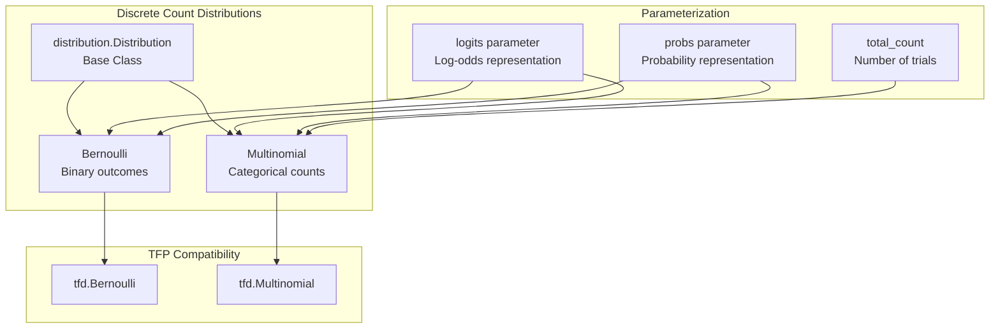
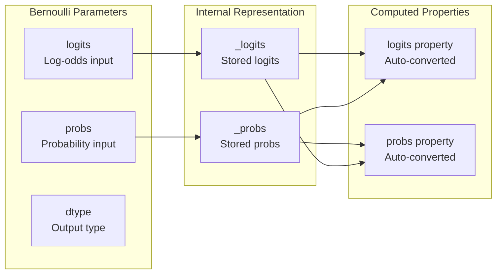
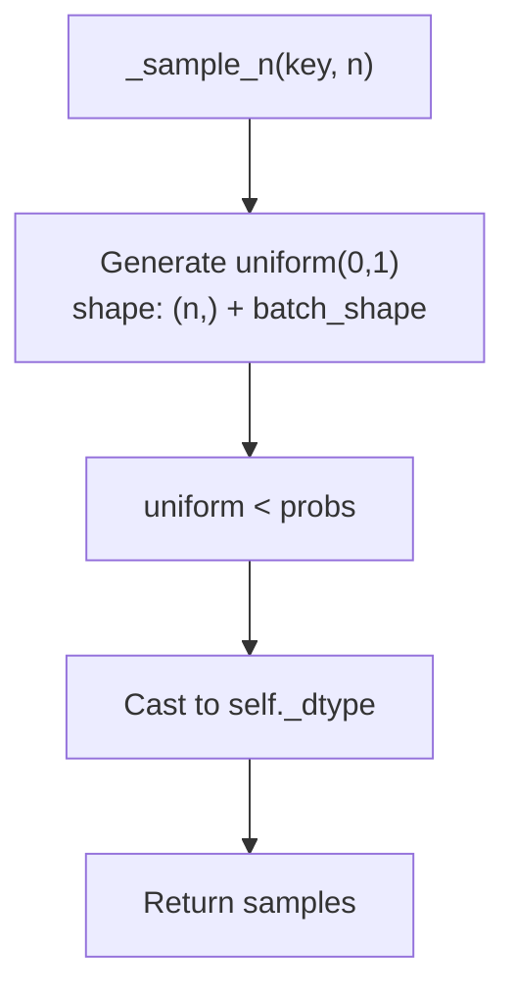
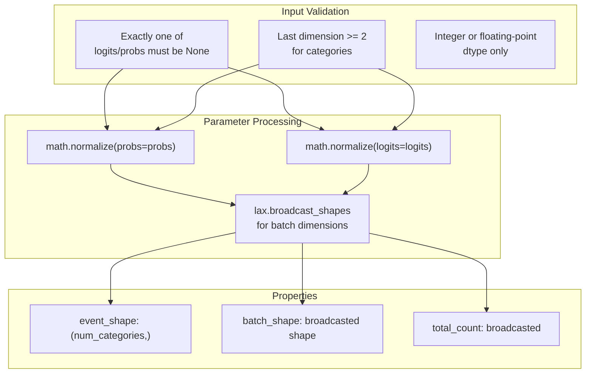
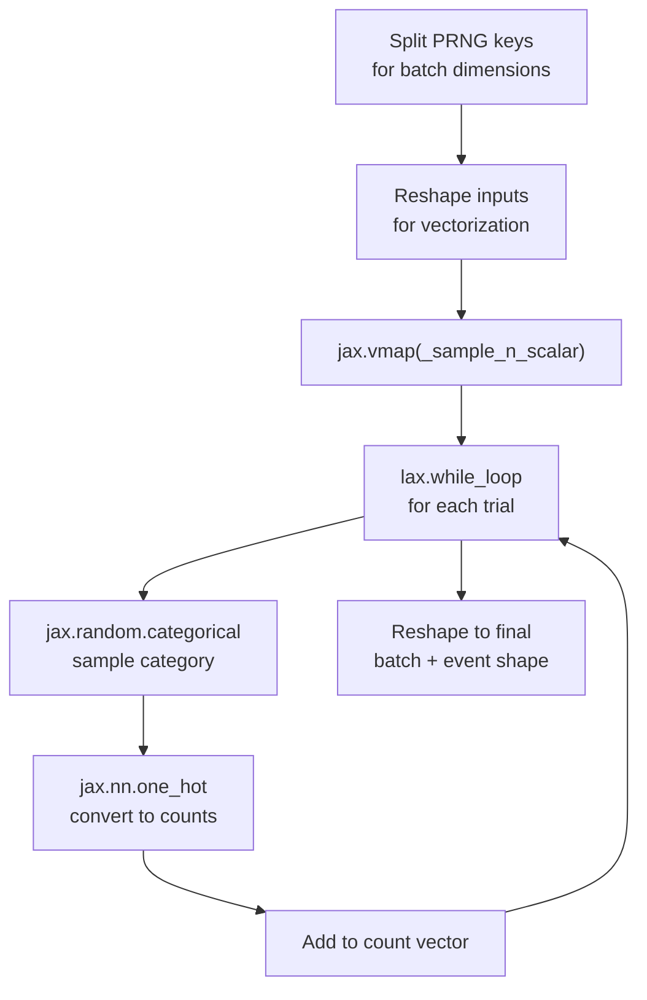

<!-- source: DeepWiki mcp.deepwiki.com · repo google-deepmind/distrax · extra page Bernoulli and Multinomial · fetched 2026-10-26 -->

# Bernoulli and Multinomial

<details>
<summary>Relevant source files</summary>

The following files were used as context for generating this wiki page:

- [distrax/_src/distributions/bernoulli.py](distrax/_src/distributions/bernoulli.py)
- [distrax/_src/distributions/log_stddev_normal_test.py](distrax/_src/distributions/log_stddev_normal_test.py)
- [distrax/_src/distributions/multinomial.py](distrax/_src/distributions/multinomial.py)
- [distrax/_src/distributions/multinomial_test.py](distrax/_src/distributions/multinomial_test.py)

</details>


This document covers the discrete probability distributions for binary outcomes (Bernoulli) and categorical count data (Multinomial) in Distrax. These distributions are fundamental building blocks for modeling categorical data and binary decisions in probabilistic machine learning.

For continuous probability distributions, see [Normal and Uniform Distributions](#3.2.1). For categorical distributions without fixed trial counts, see [Categorical Distribution](#3.1.1).

## Overview

Distrax provides two key discrete count distributions:

- **Bernoulli**: Models binary outcomes (0 or 1) with a single probability parameter
- **Multinomial**: Models count data across multiple categories with a fixed number of trials

Both distributions support parameterization via either probabilities or logits, follow the standard Distrax distribution interface, and maintain compatibility with TensorFlow Probability.



Sources: [distrax/_src/distributions/bernoulli.py:36-43](), [distrax/_src/distributions/multinomial.py:40-43]()

## Bernoulli Distribution

The `Bernoulli` class models binary random variables that take values 0 or 1. It inherits from `distribution.Distribution` and provides the standard distribution interface.

### Parameters and Properties

| Parameter | Type | Description |
|-----------|------|-------------|
| `logits` | `Optional[Numeric]` | Log-odds of success (mutually exclusive with `probs`) |
| `probs` | `Optional[Numeric]` | Probability of success (mutually exclusive with `logits`) |
| `dtype` | `Union[jnp.dtype, type[Any]]` | Output data type (bool, integer, or floating-point) |



Sources: [distrax/_src/distributions/bernoulli.py:44-74](), [distrax/_src/distributions/bernoulli.py:88-99]()

### Key Methods

The Bernoulli distribution implements all required distribution methods:

| Method | Purpose | Key Implementation Details |
|--------|---------|---------------------------|
| `_sample_n` | Generate samples | Uses uniform random variables with threshold comparison |
| `log_prob` | Log probability density | Numerically stable computation using `multiply_no_nan` |
| `prob` | Probability density | Direct probability computation |
| `cdf` | Cumulative distribution | Piecewise function based on support {0, 1} |
| `entropy` | Shannon entropy | Uses both probabilities and log probabilities |
| `mean` | Expected value | Returns `probs` directly |
| `variance` | Variance | Formula: `(1 - probs) * probs` |
| `mode` | Most likely value | Returns 1 if `probs > 0.5`, else 0 |

Sources: [distrax/_src/distributions/bernoulli.py:108-161]()

### Sampling Implementation



Sources: [distrax/_src/distributions/bernoulli.py:108-114]()

## Multinomial Distribution

The `Multinomial` class models the number of successes in each category over a fixed number of independent trials. Each sample is a vector of counts that sum to `total_count`.

### Parameters and Properties

| Parameter | Type | Description |
|-----------|------|-------------|
| `total_count` | `Numeric` | Number of trials per sample |
| `logits` | `Optional[Array]` | Logits for each category (mutually exclusive with `probs`) |
| `probs` | `Optional[Array]` | Probabilities for each category (mutually exclusive with `logits`) |
| `dtype` | `Union[jnp.dtype, type[Any]]` | Output data type (integer or floating-point) |

The implementation automatically normalizes probabilities and handles broadcasting between `total_count` and the category parameters.



Sources: [distrax/_src/distributions/multinomial.py:60-93]()

### Sampling Strategy

The multinomial sampling uses a sequential approach that handles variable `total_count` values efficiently:



Sources: [distrax/_src/distributions/multinomial.py:152-181]()

### Statistical Methods

The multinomial distribution provides comprehensive statistical computations:

| Method | Formula/Implementation |
|--------|----------------------|
| `log_prob` | `lgamma(total_count + 1) - sum(lgamma(counts + 1)) + sum(log_probs * counts)` |
| `entropy` | Uses vectorized computation with `lax.while_loop` for numerical stability |
| `mean` | `total_count * probs` |
| `variance` | `total_count * probs * (1 - probs)` |
| `covariance` | `total_count * (-probs_i * probs_j + diag(probs))` |

Sources: [distrax/_src/distributions/multinomial.py:143-281]()

## TensorFlow Probability Integration

Both distributions maintain full compatibility with TensorFlow Probability through:

### Equivalence Classes

```python
# Bernoulli
equiv_tfp_cls = tfd.Bernoulli

# Multinomial  
equiv_tfp_cls = tfd.Multinomial
```

### KL Divergence Registration

The Bernoulli distribution registers KL divergence computations with TFP's dispatch system:


Sources: [distrax/_src/distributions/bernoulli.py:42](), [distrax/_src/distributions/bernoulli.py:214-221](), [distrax/_src/distributions/multinomial.py:43]()

## Usage Patterns

### Bernoulli Distribution

```python
# Create from probabilities
bernoulli_probs = Bernoulli(probs=0.3)

# Create from logits
bernoulli_logits = Bernoulli(logits=0.5)

# Different output types
bernoulli_bool = Bernoulli(probs=0.7, dtype=bool)
bernoulli_int = Bernoulli(probs=0.7, dtype=int)
```

### Multinomial Distribution

```python
# Simple case: 10 trials, 3 categories
multinomial = Multinomial(total_count=10, probs=[0.2, 0.3, 0.5])

# Batch processing: different trial counts
multinomial_batch = Multinomial(
    total_count=[5, 10], 
    logits=[[0.1, -0.2, 0.3], [0.0, 0.5, -0.1]]
)
```

### Indexing and Slicing

Both distributions support advanced indexing that preserves the distribution type:

```python
# Batch indexing
batch_bernoulli = Bernoulli(probs=[[0.3, 0.7], [0.1, 0.9]])
single_bernoulli = batch_bernoulli[0]  # Returns Bernoulli with probs=[0.3, 0.7]

# Multinomial slicing
batch_multinomial = Multinomial(total_count=[3, 5], probs=[[0.2, 0.8], [0.4, 0.6]])
sliced_multinomial = batch_multinomial[..., -1]  # Proper indexing handling
```

Sources: [distrax/_src/distributions/bernoulli.py:162-167](), [distrax/_src/distributions/multinomial.py:282-291]()

---

