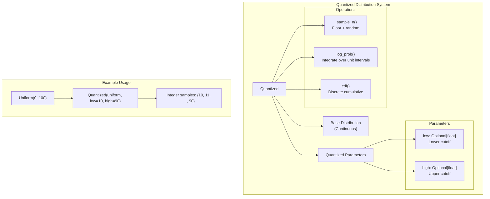
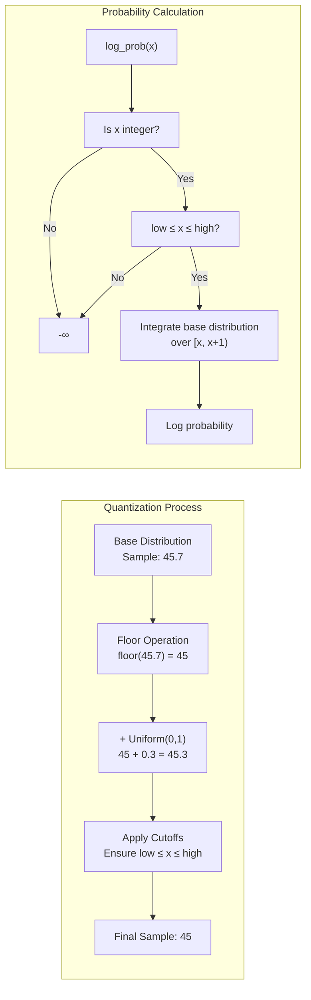
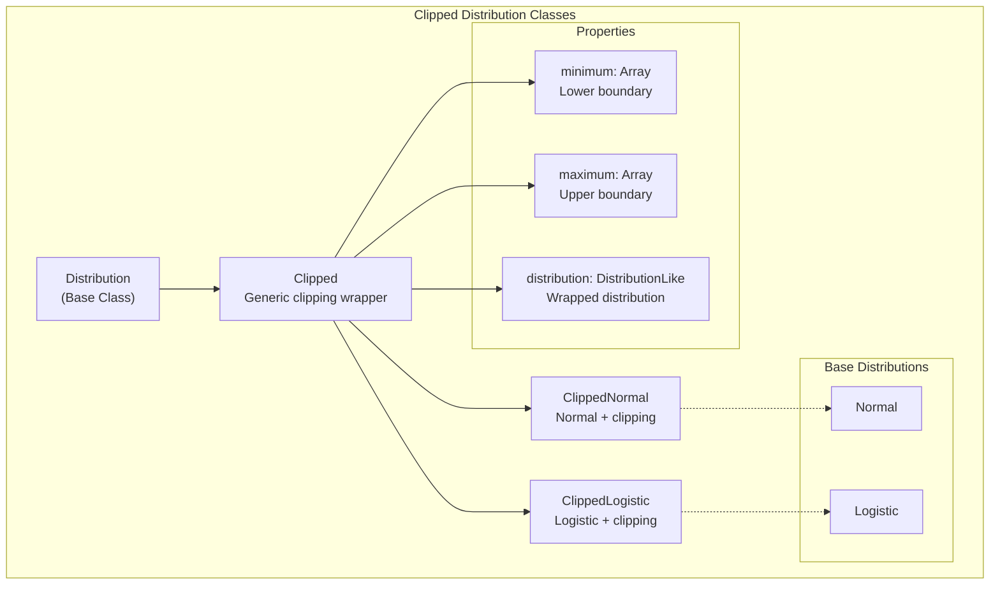
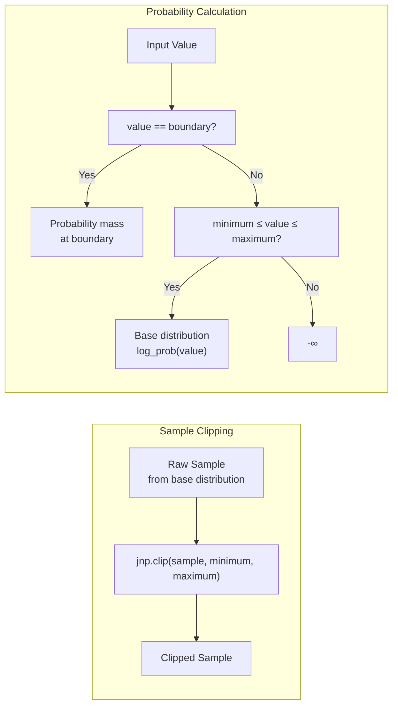
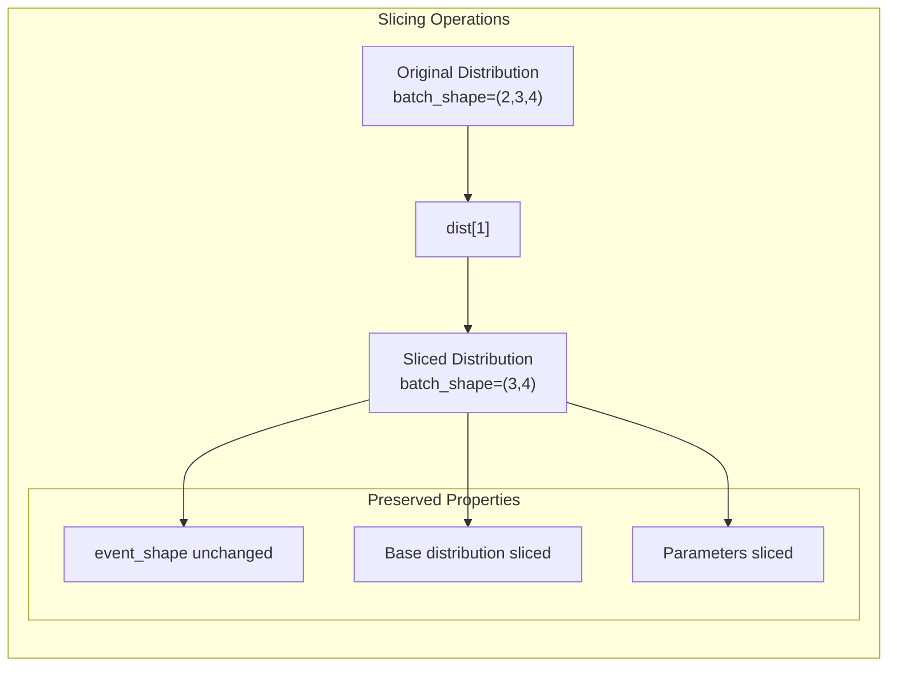

<!-- source: DeepWiki mcp.deepwiki.com · repo google-deepmind/distrax · extra page Quantized and Clipped Distributions · fetched 2026-10-26 -->

# Quantized and Clipped Distributions

<details>
<summary>Relevant source files</summary>

The following files were used as context for generating this wiki page:

- [distrax/__init__.py](distrax/__init__.py)
- [distrax/_src/distributions/clipped.py](distrax/_src/distributions/clipped.py)
- [distrax/_src/distributions/clipped_test.py](distrax/_src/distributions/clipped_test.py)
- [distrax/_src/distributions/quantized_test.py](distrax/_src/distributions/quantized_test.py)
- [distrax/_src/utils/jittable.py](distrax/_src/utils/jittable.py)
- [distrax/_src/utils/jittable_test.py](distrax/_src/utils/jittable_test.py)

</details>


This document covers composite distributions that modify the behavior of base distributions by constraining or transforming their sample spaces. Specifically, it covers the `Quantized` distribution which discretizes continuous distributions, and the `Clipped` distribution which truncates distributions to specified ranges.

For information about other composite distributions like `Transformed` and `Independent`, see [Independent and Joint Distributions](#3.4.2). For basic distribution concepts, see [Distribution Base Class](#2.1).

## Overview

Distrax provides two main types of constraining distributions that wrap existing distributions:

| Distribution Type | Purpose | Sample Transformation | Use Case |
|------------------|---------|----------------------|----------|
| `Quantized` | Discretizes continuous distributions | Rounds to integers, applies cutoffs | Converting continuous to discrete |
| `Clipped` | Truncates to specified range | Clips to boundaries | Bounded support from unbounded distributions |

Both distributions modify the sample space and probability calculations of their underlying base distributions while preserving the batch and event shapes.

## Quantized Distributions

The `Quantized` distribution converts continuous distributions into discrete distributions by rounding samples to integers and optionally applying lower and upper cutoffs.

### Architecture and Components



Sources: [distrax/__init__.py:70](), [distrax/_src/distributions/quantized_test.py:22]()

### Key Properties

The `Quantized` distribution has several important characteristics:

- **Sample Space**: Always produces integer values within the specified range
- **Cutoffs**: Optional `low` and `high` parameters that constrain the support
- **Probability Calculation**: Integrates the base distribution's probability over unit intervals
- **Invalid Values**: Returns `-inf` log probability for non-integers and out-of-range values

### Sample Transformation Process



Sources: [distrax/_src/distributions/quantized_test.py:100-107](), [distrax/_src/distributions/quantized_test.py:147-164]()

### Usage Patterns

The `Quantized` distribution is commonly used in scenarios requiring discrete versions of continuous distributions:

```python
# Basic quantization without cutoffs
uniform_base = distrax.Uniform(0., 100.)
quantized = distrax.Quantized(uniform_base)  # Supports integers 0 to 100

# With cutoffs to restrict range
quantized_bounded = distrax.Quantized(uniform_base, low=10., high=90.)

# Batch operations supported
batch_uniform = distrax.Uniform(low=[0., 10.], high=[100., 90.])
batch_quantized = distrax.Quantized(batch_uniform, low=5., high=80.)
```

Sources: [distrax/_src/distributions/quantized_test.py:62-66](), [distrax/_src/distributions/quantized_test.py:217-245]()

## Clipped Distributions

The `Clipped` distribution constrains samples from any distribution to lie within a specified `[minimum, maximum]` range by clipping values that fall outside this range to the nearest boundary.

### Class Hierarchy



Sources: [distrax/_src/distributions/clipped.py:34](), [distrax/_src/distributions/clipped.py:126](), [distrax/_src/distributions/clipped.py:135]()

### Clipping Mechanism

The clipping operation affects both sampling and probability calculation:



Sources: [distrax/_src/distributions/clipped.py:69-72](), [distrax/_src/distributions/clipped.py:79-95]()

### Boundary Probability Handling

The `Clipped` distribution correctly handles probability mass that accumulates at the boundaries:

| Condition | Log Probability Calculation |
|-----------|----------------------------|
| `value == minimum` | `log_cdf(minimum)` of base distribution |
| `value == maximum` | `log_survival_function(maximum)` of base distribution |
| `minimum < value < maximum` | `log_prob(value)` of base distribution |
| `value < minimum` or `value > maximum` | `-∞` |

This ensures that the total probability mass is preserved while correctly accounting for the truncation.

Sources: [distrax/_src/distributions/clipped.py:85-95](), [distrax/_src/distributions/clipped.py:66-67]()

### Broadcasting and Batch Support

The `Clipped` distribution supports flexible broadcasting of minimum and maximum boundaries:

```python
# Scalar boundaries with batched distribution
batch_normal = distrax.Normal(loc=[0., 1., 2.], scale=[1., 1., 1.])
clipped = distrax.Clipped(batch_normal, minimum=-1., maximum=3.)

# Vector boundaries that broadcast to batch shape  
clipped_vector = distrax.Clipped(
    batch_normal, 
    minimum=[-0.5, 0., 1.], 
    maximum=[2., 2.5, 3.]
)
```

The implementation validates that minimum and maximum arrays have fewer dimensions than the distribution's batch shape and can be broadcast to it.

Sources: [distrax/_src/distributions/clipped.py:57-62](), [distrax/_src/distributions/clipped.py:64-65]()

## Implementation Details

### Jittable Interface

Both `Quantized` and `Clipped` distributions inherit from the `Jittable` base class, making them compatible with JAX transformations:

- **JIT Compilation**: All methods can be compiled with `jax.jit`
- **Vectorization**: Support for `jax.vmap` operations
- **Gradient Computation**: Compatible with `jax.grad` for differentiable operations

Sources: [distrax/_src/utils/jittable.py:21-22](), [distrax/_src/distributions/quantized_test.py:195-196](), [distrax/_src/distributions/clipped_test.py:143-160]()

### Index Slicing Support

Both distributions support array-style indexing for batch dimensions:



Sources: [distrax/_src/distributions/clipped.py:117-123](), [distrax/_src/distributions/quantized_test.py:362-399]()

### Error Handling

Both distributions include validation for common misuse patterns:

- **Event Shape Validation**: `Clipped` requires base distributions with scalar event shapes
- **Broadcasting Validation**: Boundary parameters must be broadcastable to batch dimensions
- **Multivariate Rejection**: `Quantized` only accepts univariate distributions

Sources: [distrax/_src/distributions/clipped.py:55-56](), [distrax/_src/distributions/quantized_test.py:342-347]()

## Key Differences and Usage Guidelines

| Aspect | Quantized | Clipped |
|--------|-----------|---------|
| **Primary Purpose** | Discretization | Range truncation |
| **Sample Type** | Always integers | Same as base distribution |
| **Boundary Behavior** | Hard cutoffs (excludes values) | Accumulates probability mass |
| **Base Distribution** | Continuous only | Any distribution |
| **Event Shape** | Preserves scalar events | Requires scalar events |
| **Common Use Cases** | Discrete approximations, categorical modeling | Bounded parameter spaces, safety constraints |

Choose `Quantized` when you need discrete versions of continuous distributions, and `Clipped` when you need to enforce hard boundaries on any distribution type while preserving the continuous nature of the samples.

Sources: [distrax/_src/distributions/quantized_test.py:1-444](), [distrax/_src/distributions/clipped_test.py:1-205]()

---

