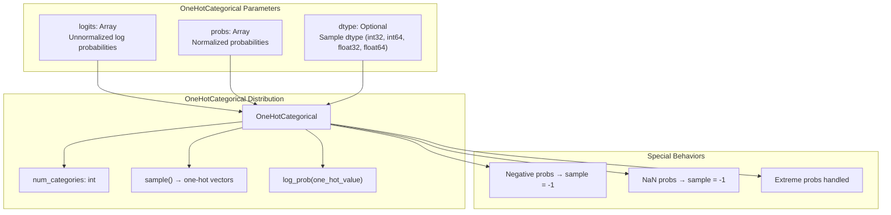
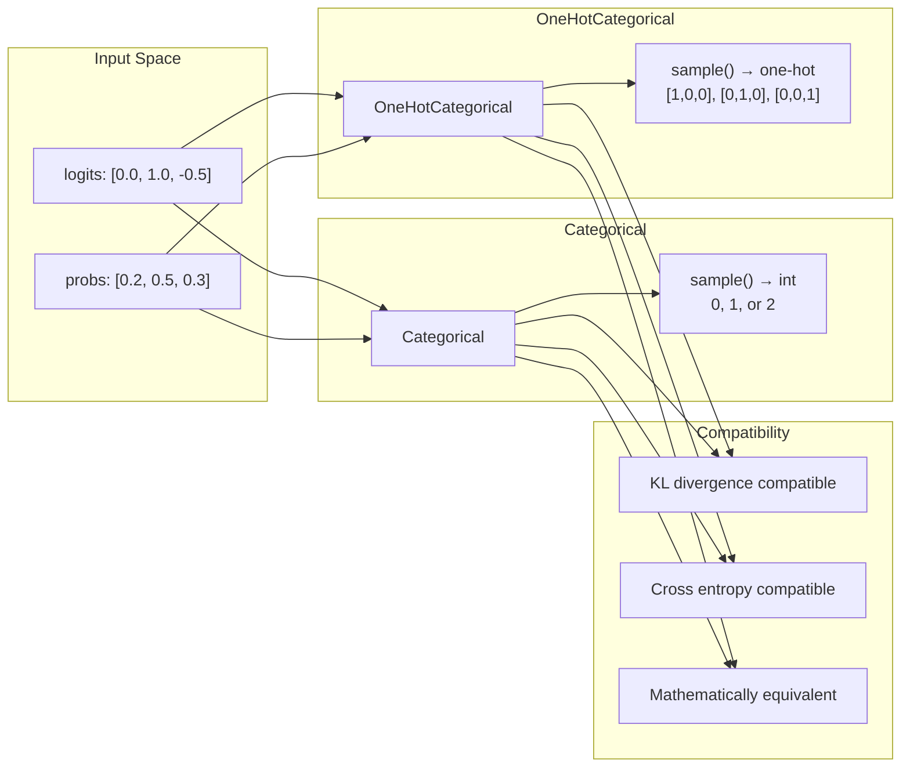
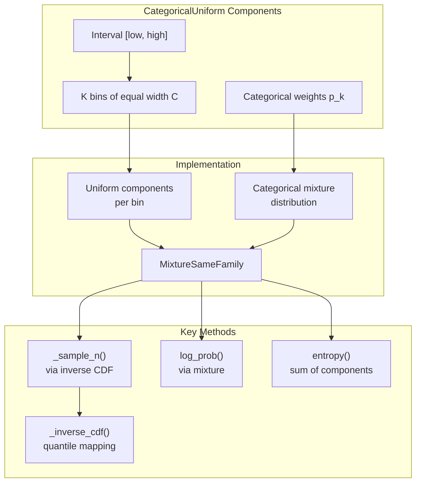
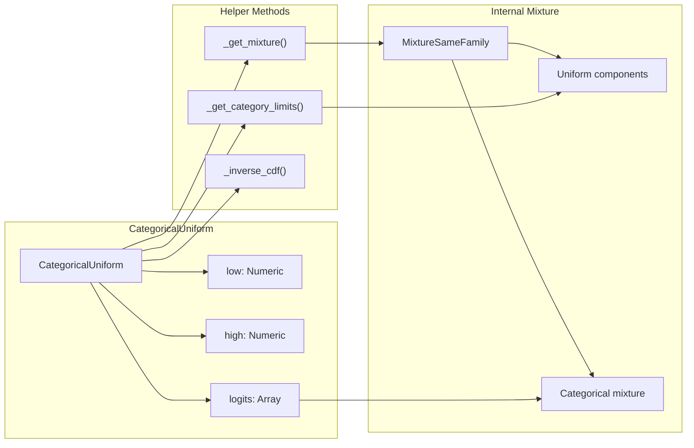
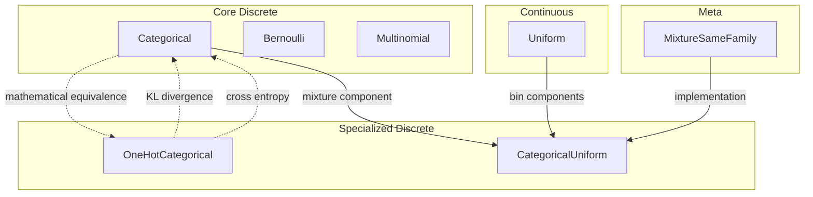

<!-- source: DeepWiki mcp.deepwiki.com · repo google-deepmind/distrax · extra page Specialized Discrete Distributions · fetched 2026-10-26 -->

# Specialized Discrete Distributions

Relevant source files

The following files were used as context for generating this wiki page:

- [distrax/_src/distributions/categorical_uniform.py](distrax/_src/distributions/categorical_uniform.py)
- [distrax/_src/distributions/categorical_uniform_test.py](distrax/_src/distributions/categorical_uniform_test.py)
- [distrax/_src/distributions/mvn_diag_plus_low_rank_test.py](distrax/_src/distributions/mvn_diag_plus_low_rank_test.py)
- [distrax/_src/distributions/mvn_diag_test.py](distrax/_src/distributions/mvn_diag_test.py)
- [distrax/_src/distributions/one_hot_categorical_test.py](distrax/_src/distributions/one_hot_categorical_test.py)

This section covers specialized discrete distributions that extend beyond the fundamental discrete distributions. These distributions provide specific sampling behaviors and parameterizations for specialized use cases. For basic discrete distributions like Categorical, Bernoulli, and Multinomial, see [Categorical Distribution](#3.1.1) and [Bernoulli and Multinomial](#3.1.2).

## Overview

Distrax provides specialized discrete distributions that offer alternative representations or hybrid behaviors:

| Distribution | Purpose | Key Features |
|--------------|---------|-------------|
| `OneHotCategorical` | One-hot encoded categorical sampling | Samples vectors instead of indices |
| `CategoricalUniform` | Categorical-uniform mixture | Combines discrete choice with continuous uniform components |

These distributions maintain compatibility with JAX transformations and follow the standard Distribution interface.

## OneHotCategorical Distribution

The `OneHotCategorical` distribution extends the categorical distribution by sampling one-hot encoded vectors instead of integer indices. This is particularly useful in scenarios where downstream computations expect one-hot representations.

### Basic Usage and Parameterization

Sources: [distrax/_src/distributions/one_hot_categorical_test.py:35-65](), [distrax/_src/distributions/one_hot_categorical_test.py:43-54]()

### Relationship to Categorical Distribution

The `OneHotCategorical` distribution maintains mathematical equivalence with `Categorical` while changing the sample representation:

Sources: [distrax/_src/distributions/one_hot_categorical_test.py:379-412](), [distrax/_src/distributions/one_hot_categorical_test.py:21-22]()

### Error Handling and Edge Cases

The `OneHotCategorical` distribution includes robust error handling for invalid probability configurations:

- **Negative probabilities after normalization**: Returns sample values of `-1`
- **NaN probabilities**: Returns sample values of `-1` 
- **Extreme probability values**: Handled gracefully with appropriate log probability calculations
- **Invalid dtype specifications**: Raises `ValueError` for boolean or complex dtypes

Sources: [distrax/_src/distributions/one_hot_categorical_test.py:67-86](), [distrax/_src/distributions/one_hot_categorical_test.py:55-64]()

## CategoricalUniform Distribution

The `CategoricalUniform` distribution represents a mixture of categorical and uniform distributions. It divides a continuous interval into discrete bins, each with uniform probability density within the bin and categorical probability weights between bins.

### Mathematical Formulation

Given an interval `[a, b]` and probability vector `p = [p_1, ..., p_K]`, the PDF is:
- `p(x) = p_k / C` if `(k-1)C ≤ x - a < kC` for `k = 1, ..., K`
- `p(x) = 0` otherwise
- Where `C = (b-a) / K`

Sources: [distrax/_src/distributions/categorical_uniform.py:35-46](), [distrax/_src/distributions/categorical_uniform.py:119-126]()

### Implementation Architecture

The `CategoricalUniform` distribution is implemented as a wrapper around `MixtureSameFamily`:

Sources: [distrax/_src/distributions/categorical_uniform.py:115-126](), [distrax/_src/distributions/categorical_uniform.py:85-89]()

### Broadcasting and Batch Operations

The `CategoricalUniform` distribution supports flexible broadcasting across its parameters:

| Parameter | Shape Requirements | Broadcast Behavior |
|-----------|-------------------|-------------------|
| `low` | Scalar or batch shape | Broadcasted to batch shape |
| `high` | Scalar or batch shape | Broadcasted to batch shape |  
| `logits` | `(..., K)` where K > 0 | Last dimension determines `num_bins` |

The batch shape is determined by: `jax.lax.broadcast_shapes(low.shape, high.shape, logits.shape[:-1])`

Sources: [distrax/_src/distributions/categorical_uniform.py:80-83](), [distrax/_src/distributions/categorical_uniform_test.py:26-123]()

## Distribution Relationships

These specialized discrete distributions maintain important relationships with core Distrax distributions:

Sources: [distrax/_src/distributions/one_hot_categorical_test.py:379-412](), [distrax/_src/distributions/categorical_uniform.py:22-23]()

---

