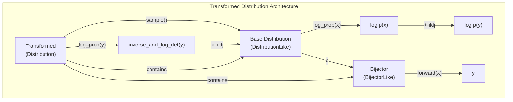
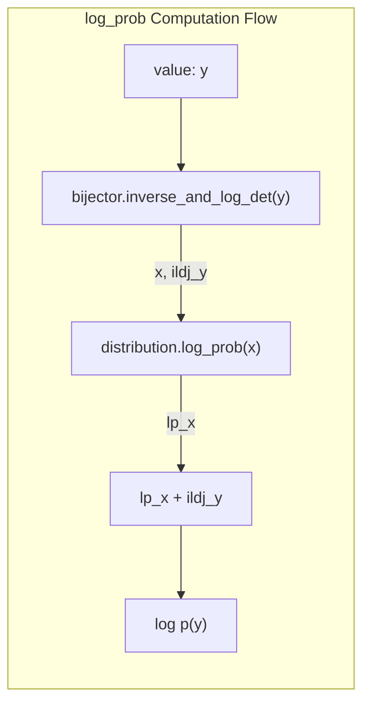
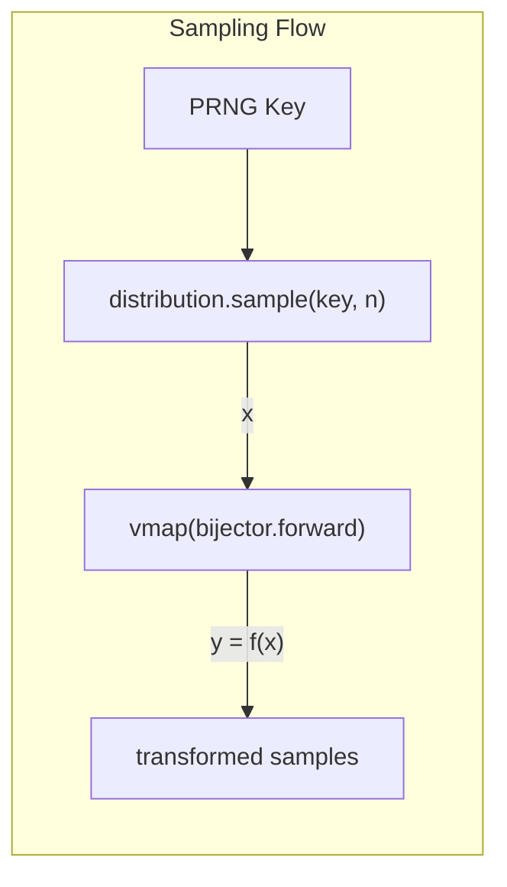
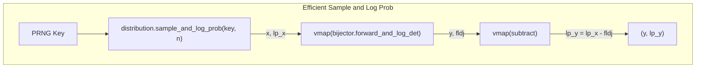
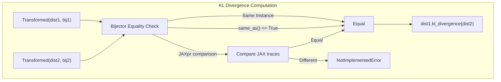

<!-- source: DeepWiki mcp.deepwiki.com · repo google-deepmind/distrax · extra page Transformed Distributions · fetched 2026-10-26 -->

# Transformed Distributions

<details>
<summary>Relevant source files</summary>

The following files were used as context for generating this wiki page:

- [distrax/_src/bijectors/scalar_affine.py](distrax/_src/bijectors/scalar_affine.py)
- [distrax/_src/distributions/transformed.py](distrax/_src/distributions/transformed.py)
- [distrax/_src/utils/equivalence.py](distrax/_src/utils/equivalence.py)

</details>


This document covers the `Transformed` distribution class, which implements distributions created by applying bijective transformations (bijectors) to base distributions. This enables creating complex distributions by transforming simpler ones through differentiable, invertible functions.

For information about bijectors themselves, see [Bijectors and Transformations](#2.2). For other composite distributions, see [Independent and Joint Distributions](#3.4.2).

## Mathematical Foundation

The `Transformed` distribution implements the mathematical concept of a pushforward distribution. Given a base distribution with density `p(x)` and a bijective transformation `f`, the transformed distribution has density:

```
log p(y) = log p(x) - log|det J(f)(x)|
```

where `x = f^{-1}(y)` and `J(f)(x)` is the Jacobian matrix of `f` evaluated at `x`.

## Implementation Overview

The core implementation resides in the `Transformed` class, which inherits from the base `Distribution` class and orchestrates the interaction between a base distribution and a bijector.



**Key Class Structure:**
- `Transformed.__init__()` validates compatibility between base distribution and bijector
- Properties are computed lazily via JAX tracing for shape and dtype inference
- The class maintains TFP compatibility through `equiv_tfp_cls = tfd.TransformedDistribution`

Sources: [distrax/_src/distributions/transformed.py:35-109]()

## Core Methods and Operations

### Probability Computation

The `log_prob` method implements the change of variables formula:



Sources: [distrax/_src/distributions/transformed.py:161-166]()

### Sampling

Sampling follows a two-step process: sample from base distribution, then apply forward transformation:



The implementation uses `jax.vmap` to vectorize the bijector's forward function across samples.

Sources: [distrax/_src/distributions/transformed.py:168-172]()

### Efficient Sample and Log Prob

The `_sample_n_and_log_prob` method provides an optimized path that avoids inverse computation:



This method is particularly useful for bijectors that don't implement inverse methods or when inverse computation is expensive.

Sources: [distrax/_src/distributions/transformed.py:174-191]()

## Shape and Type Inference

The `Transformed` class uses JAX tracing to infer shapes and dtypes dynamically:

| Property | Computation Method |
|----------|-------------------|
| `dtype` | Traced from `bijector.forward` on dummy input |
| `event_shape` | Last `event_ndims_out` dimensions of forward output |
| `batch_shape` | Remaining dimensions after event dimensions |

The inference process creates a dummy array matching the base distribution's shape and dtype, then traces the bijector's forward function to determine the output characteristics.

Sources: [distrax/_src/distributions/transformed.py:120-159]()

## Special Cases for Constant Jacobian Bijectors

When bijectors have constant Jacobian properties, certain operations become more efficient:

### Mean Computation
- **Constant Jacobian**: `mean = bijector.forward(base_distribution.mean())`
- **Variable Jacobian**: Not implemented (raises `NotImplementedError`)

### Mode Computation  
- **Constant log-determinant**: `mode = bijector.forward(base_distribution.mode())`
- **Variable log-determinant**: Not implemented

### Entropy Computation
- **Constant log-determinant**: `entropy = base_entropy + forward_log_det_jacobian`
- **Variable log-determinant**: Not implemented

Sources: [distrax/_src/distributions/transformed.py:193-243]()

## KL Divergence Between Transformed Distributions

The library implements KL divergence computation between two `Transformed` distributions with the same bijector:



The bijector equality check follows a hierarchy:
1. Object identity (`bij1 is bij2`)
2. Semantic equality (`bij1.same_as(bij2)`)
3. JAX trace comparison (`str(jaxpr1) == str(jaxpr2)`)

Sources: [distrax/_src/distributions/transformed.py:246-314]()

## Integration and Compatibility

### TensorFlow Probability Integration

The `Transformed` class maintains full compatibility with TFP through:
- `equiv_tfp_cls = tfd.TransformedDistribution`
- Registered KL divergence functions for cross-library compatibility
- Support for TFP distributions and bijectors as inputs

### JAX Integration

Key JAX features leveraged:
- `jax.eval_shape` for shape inference without computation
- `jax.vmap` for efficient vectorized transformations  
- `jax.make_jaxpr` for bijector comparison
- Full JIT compatibility through traceable operations

Sources: [distrax/_src/distributions/transformed.py:73-74](), [distrax/_src/distributions/transformed.py:309-314]()

## Usage Patterns

### Basic Transformation
```python
# Example from documentation
dist = distrax.Normal(loc=0., scale=1.)
bij = distrax.ScalarAffine(shift=jnp.asarray([3., 3., 3.]))
transformed_dist = distrax.Transformed(distribution=dist, bijector=bij)
```

### Validation Requirements
- Base distribution must have array events (not nested structures)
- Bijector's `event_ndims_in` must match base distribution's event shape length
- Bijector must be differentiable and invertible for probability computations

Sources: [distrax/_src/distributions/transformed.py:55-61](), [distrax/_src/distributions/transformed.py:88-102]()

---

