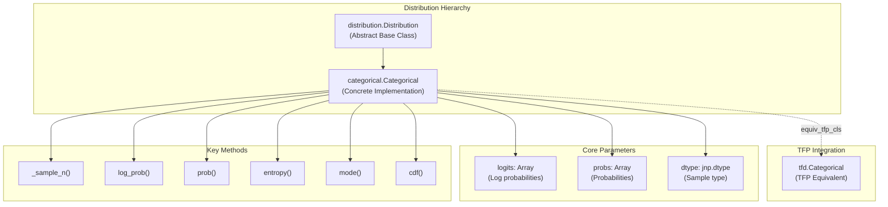
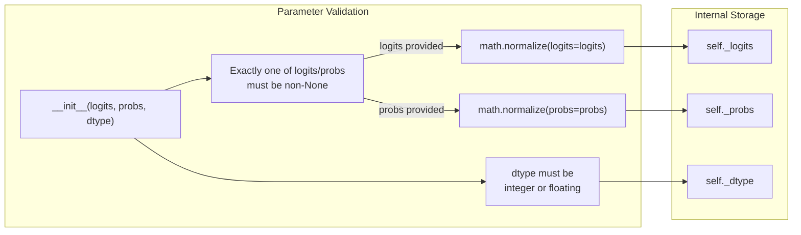
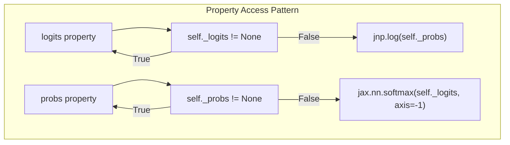
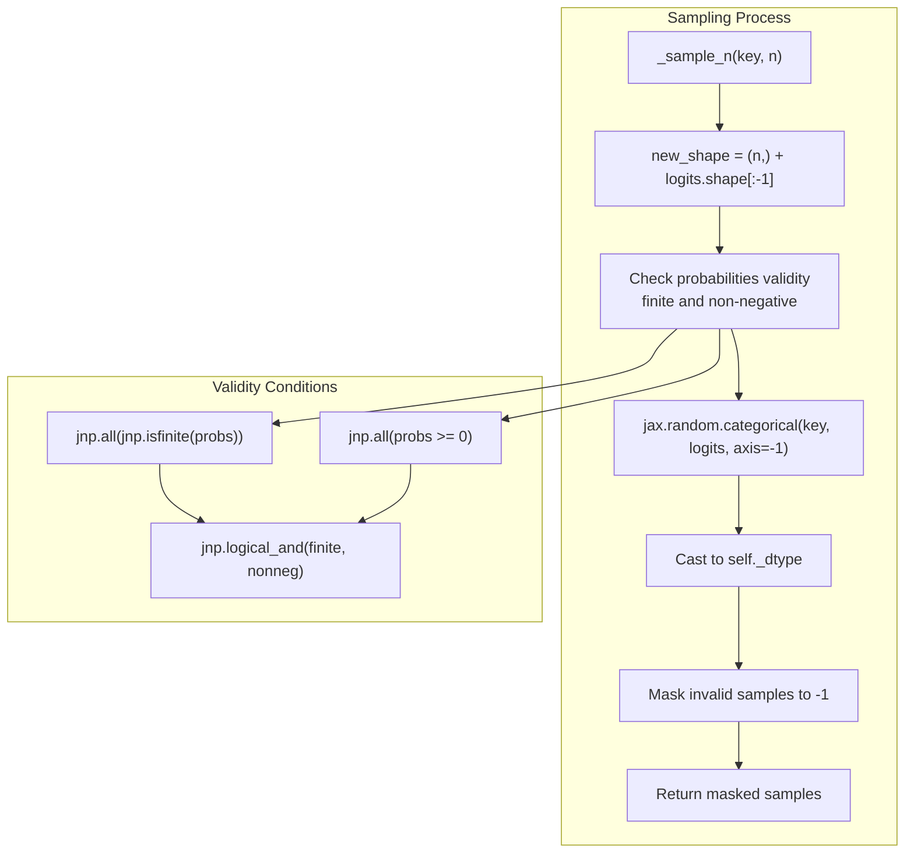
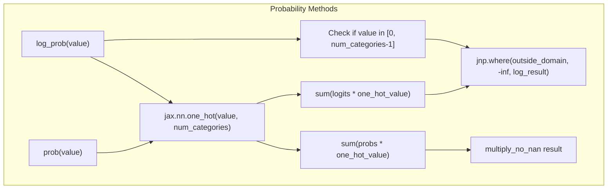
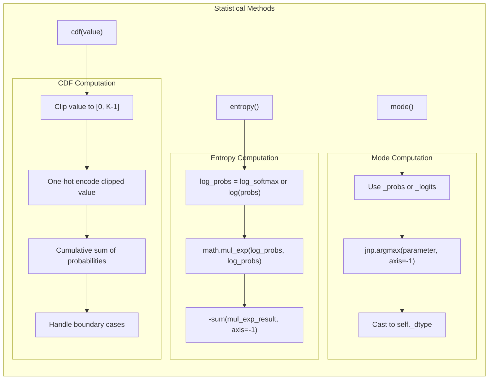
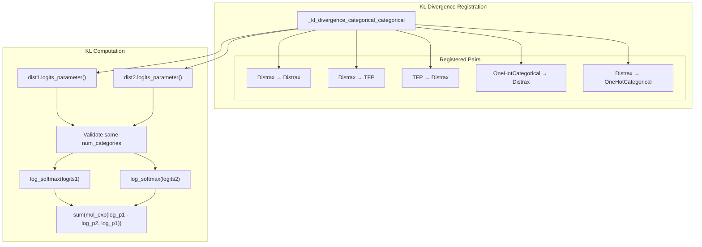
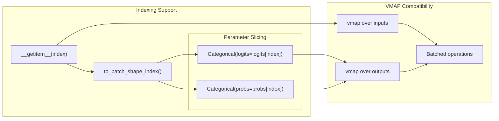

<!-- source: DeepWiki mcp.deepwiki.com · repo google-deepmind/distrax · extra page Categorical Distribution · fetched 2026-10-26 -->

# Categorical Distribution

Relevant source files

The following files were used as context for generating this wiki page:

- [distrax/_src/distributions/categorical.py](distrax/_src/distributions/categorical.py)
- [distrax/_src/distributions/categorical_test.py](distrax/_src/distributions/categorical_test.py)
- [distrax/_src/distributions/distribution_from_tfp_test.py](distrax/_src/distributions/distribution_from_tfp_test.py)

This document covers the `Categorical` distribution implementation in Distrax, a discrete probability distribution over categorical outcomes. The `Categorical` distribution models random variables that can take on one of K possible discrete values (categories), making it fundamental for classification tasks, sampling from discrete probability vectors, and multinomial modeling.

For information about other discrete distributions like `Bernoulli` and `Multinomial`, see [Bernoulli and Multinomial](#3.1.2). For the base distribution interface and common methods, see [Distribution Base Class](#2.1).

## Class Architecture

The `Categorical` class inherits from the base `Distribution` class and provides a JAX-native implementation of the categorical distribution with full TensorFlow Probability compatibility.

Sources: [distrax/_src/distributions/categorical.py:33-36](), [distrax/_src/distributions/categorical.py:20]()

## Parameterization

The `Categorical` distribution supports two mutually exclusive parameterization methods: logits or probabilities. Exactly one parameter must be provided during initialization.

| Parameter | Type | Description | Constraints |
|-----------|------|-------------|-------------|
| `logits` | `Array` | Log-probabilities (unnormalized) | Real values, automatically normalized |
| `probs` | `Array` | Probabilities (unnormalized) | Non-negative values, automatically normalized |
| `dtype` | `jnp.dtype` | Output sample type | Integer or floating-point types |

Sources: [distrax/_src/distributions/categorical.py:38-64](), [distrax/_src/distributions/categorical.py:52-55]()

### Dynamic Property Access

The distribution provides seamless conversion between logits and probabilities through computed properties:

Sources: [distrax/_src/distributions/categorical.py:72-83]()

## Core Operations

### Sampling

The `_sample_n` method generates random categorical samples using JAX's efficient categorical sampling with automatic validity checking.

Sources: [distrax/_src/distributions/categorical.py:92-99]()

### Probability Calculations

The distribution provides both probability and log-probability computations with proper handling of out-of-domain values:

Sources: [distrax/_src/distributions/categorical.py:101-115]()

## Statistical Properties

The `Categorical` class implements key statistical methods with numerically stable computations:

| Method | Description | Implementation Detail |
|--------|-------------|----------------------|
| `entropy()` | Shannon entropy | Uses `mul_exp` for numerical stability |
| `mode()` | Most likely outcome | `argmax` of parameters |
| `cdf(value)` | Cumulative distribution | Cumulative sum with boundary handling |
| `num_categories` | Number of categories | Shape of last dimension |

Sources: [distrax/_src/distributions/categorical.py:117-148]()

## TensorFlow Probability Integration

The `Categorical` distribution provides comprehensive TFP compatibility through KL divergence registration and API equivalence:

Sources: [distrax/_src/distributions/categorical.py:165-215](), [distrax/_src/distributions/categorical.py:204-215]()

## JAX Integration Features

The `Categorical` distribution is designed for seamless JAX integration with support for key transformations:

### Indexing and Slicing

The distribution supports advanced indexing operations that preserve the distribution type:

Sources: [distrax/_src/distributions/categorical.py:154-159](), [distrax/_src/distributions/categorical_test.py:412-453]()

### Numerical Stability

The implementation includes several numerical stability features for gradient computation and extreme values:

| Feature | Implementation | Purpose |
|---------|---------------|---------|
| `mul_exp` usage | Replaces `exp(log_probs) * log_probs` | Handles -inf logits gracefully |
| `multiply_no_nan` | Safe multiplication with zeros | Prevents NaN propagation |
| Gradient clipping | Automatic handling of -inf logits | Maintains finite gradients |
| Validity masking | Sample masking for invalid distributions | Robust sampling behavior |

Sources: [distrax/_src/distributions/categorical.py:123](), [distrax/_src/distributions/categorical.py:109](), [distrax/_src/distributions/categorical_test.py:462-497]()

---

