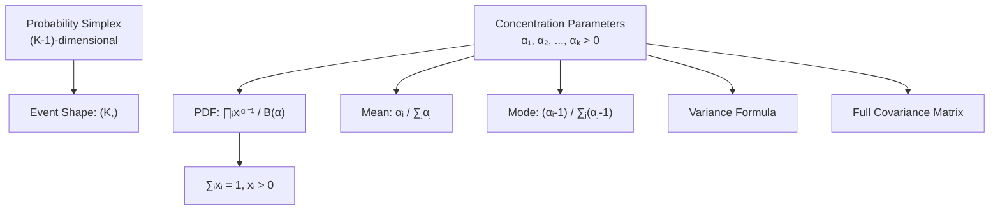
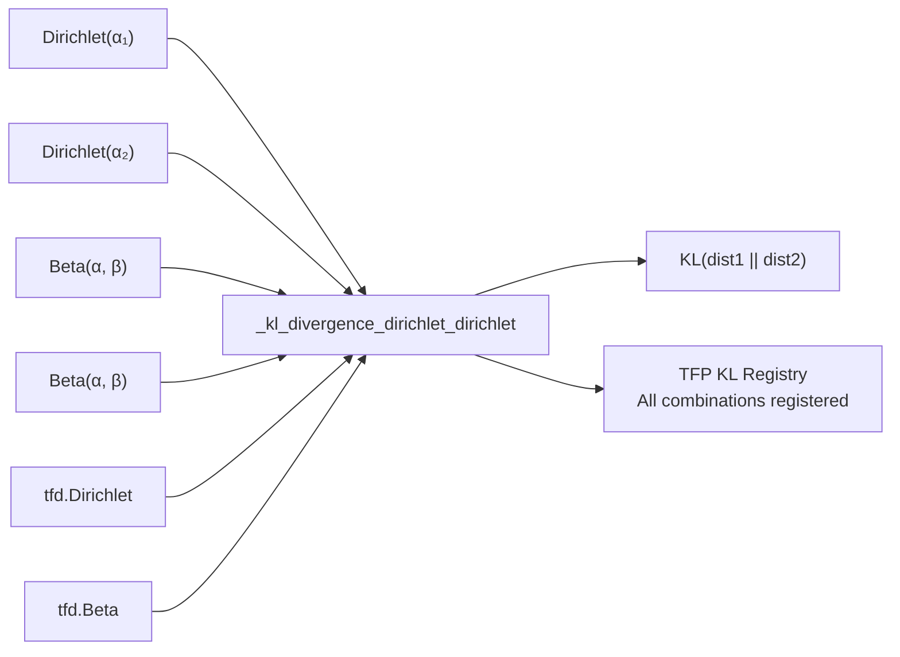
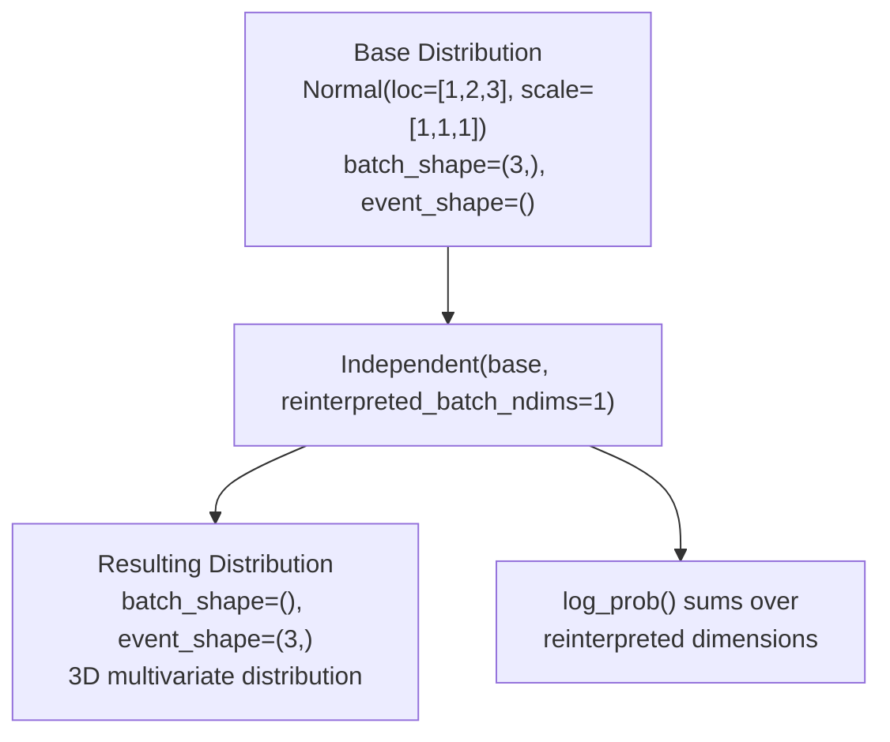
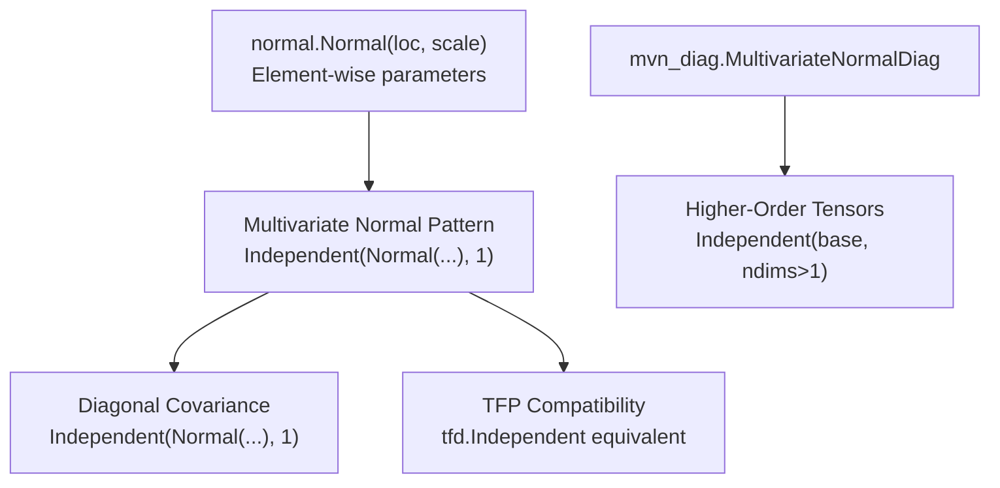
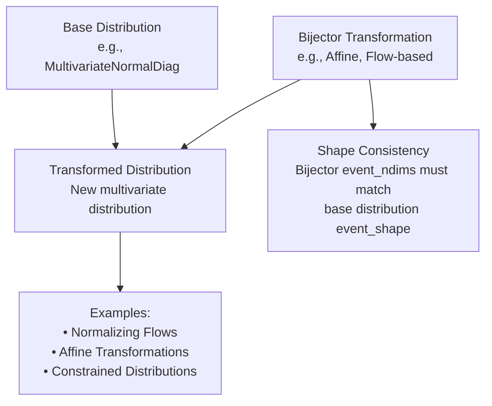

<!-- source: DeepWiki mcp.deepwiki.com · repo google-deepmind/distrax · extra page Dirichlet and Other Multivariate · fetched 2026-10-26 -->

# Dirichlet and Other Multivariate

<details>
<summary>Relevant source files</summary>

The following files were used as context for generating this wiki page:

- [distrax/_src/distributions/dirichlet.py](distrax/_src/distributions/dirichlet.py)
- [distrax/_src/distributions/dirichlet_test.py](distrax/_src/distributions/dirichlet_test.py)
- [distrax/_src/distributions/independent_test.py](distrax/_src/distributions/independent_test.py)
- [distrax/_src/distributions/transformed_test.py](distrax/_src/distributions/transformed_test.py)

</details>


This section covers multivariate distributions in Distrax beyond the Multivariate Normal family. The primary focus is the `Dirichlet` distribution for modeling probability vectors on the simplex, along with utility distributions like `Independent` that convert univariate distributions into multivariate ones. For Multivariate Normal distributions, see [Multivariate Normal Distributions](#3.3.1).

## Dirichlet Distribution

The `Dirichlet` distribution models random vectors on the probability simplex where components are non-negative and sum to 1. It is commonly used for modeling probability distributions, topic proportions, and categorical priors.

### Mathematical Foundation



The Dirichlet distribution is parameterized by concentration parameters `α = [α₁, α₂, ..., αₖ]` where each `αᵢ > 0`. Higher concentration values create distributions more concentrated around the mean.

Sources: [distrax/_src/distributions/dirichlet.py:36-49]()

### Implementation Architecture

```mermaid
graph TB
    DirichletClass["Dirichlet"]
    BaseDistribution["distribution.Distribution"]
    TFPEquiv["tfd.Dirichlet"]
    
    DirichletClass --|"inherits from"--> BaseDistribution
    DirichletClass --|"equiv_tfp_cls"--> TFPEquiv
    
    ConcentrationParam["concentration: Array<br/>Shape: batch_shape + (K,)"]
    LogNorm["_log_normalization_constant<br/>math.log_beta_multivariate"]
    
    ConcentrationParam --> DirichletClass
    LogNorm --> DirichletClass
    
    SampleMethod["_sample_n()<br/>jax.random.dirichlet"]
    LogProbMethod["log_prob()<br/>Uses concentration - 1"]
    StatMethods["entropy(), mean(), mode()<br/>variance(), covariance()"]
    
    DirichletClass --> SampleMethod
    DirichletClass --> LogProbMethod
    DirichletClass --> StatMethods
```

The `Dirichlet` class is implemented in [distrax/_src/distributions/dirichlet.py:36]() and inherits from the base `Distribution` class. Key implementation details:

- **Concentration Parameter**: Stored as `_concentration` with validation for minimum dimensionality and positivity
- **Normalization**: Pre-computed `_log_normalization_constant` using multivariate log-beta function
- **Shape Properties**: Event shape is `(K,)` while batch shape is all leading dimensions

Sources: [distrax/_src/distributions/dirichlet.py:53-72]()

### Core Methods and Properties

| Method | Purpose | Implementation Notes |
|--------|---------|---------------------|
| `concentration` | Access concentration parameters | Property returning `_concentration` |
| `_sample_n()` | Generate samples | Uses `jax.random.dirichlet` |
| `log_prob()` | Compute log probability | `∑(α-1)log(x) - log_beta(α)` |
| `entropy()` | Shannon entropy | Uses digamma functions |
| `mean()` | Expected value | `α / ∑α` |
| `mode()` | Most likely value | `(α-1) / ∑(α-1)` with NaN handling |
| `variance()` | Component variances | Diagonal of covariance |
| `covariance()` | Full covariance matrix | `batch_shape + (K, K)` output |

The implementation handles edge cases carefully. For example, the `mode()` method returns `jnp.nan` when any `αᵢ ≤ 1` since the mode is undefined in this case.

Sources: [distrax/_src/distributions/dirichlet.py:88-151]()

### KL Divergence and Cross-Entropy



The Dirichlet distribution supports KL divergence computation with:
- Other Dirichlet distributions
- Beta distributions (treated as 2-dimensional Dirichlet)
- TensorFlow Probability equivalents

The KL divergence formula uses the multivariate log-beta function and digamma functions for efficient computation.

Sources: [distrax/_src/distributions/dirichlet.py:178-222]()

## Independent Distribution

The `Independent` distribution converts univariate or lower-dimensional multivariate distributions into higher-dimensional multivariate distributions by reinterpreting batch dimensions as event dimensions.

### Conceptual Model



This pattern is commonly used to:
- Create multivariate distributions from independent univariate components
- Control which dimensions are treated as batch vs event dimensions
- Aggregate log probabilities across specified dimensions

Sources: [distrax/_src/distributions/independent_test.py:33-41]()

### Usage Patterns



The `Independent` distribution provides flexibility in dimension interpretation and maintains compatibility with TensorFlow Probability's equivalent functionality.

Sources: [distrax/_src/distributions/independent_test.py:126-144]()

## Transformed Multivariate Distributions

While not strictly a distinct multivariate distribution class, the `Transformed` distribution can create multivariate distributions by applying bijectors to base distributions.

### Transformation Patterns



This approach enables creation of complex multivariate distributions through bijective transformations, particularly useful for normalizing flows and constrained distributions.

Sources: [distrax/_src/distributions/transformed_test.py:222-248]()

## Testing and Validation

All multivariate distributions in this category use the equivalence testing framework to ensure compatibility with TensorFlow Probability:

| Distribution | TFP Equivalent | Key Test Areas |
|-------------|----------------|----------------|
| `Dirichlet` | `tfd.Dirichlet` | Sample shapes, log_prob, KL divergence |
| `Independent` | `tfd.Independent` | Shape reinterpretation, vmap compatibility |
| `Transformed` | `tfd.TransformedDistribution` | Bijector composition, batch handling |

The testing framework validates mathematical correctness, shape consistency, and JAX transformation compatibility across all implementations.

Sources: [distrax/_src/distributions/dirichlet_test.py:31-35](), [distrax/_src/distributions/independent_test.py:126-144](), [distrax/_src/distributions/transformed_test.py:57-61]()

---

