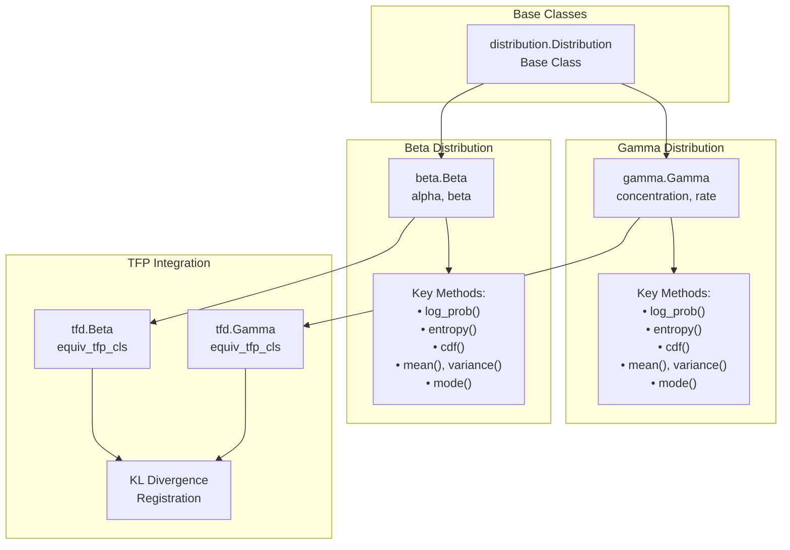
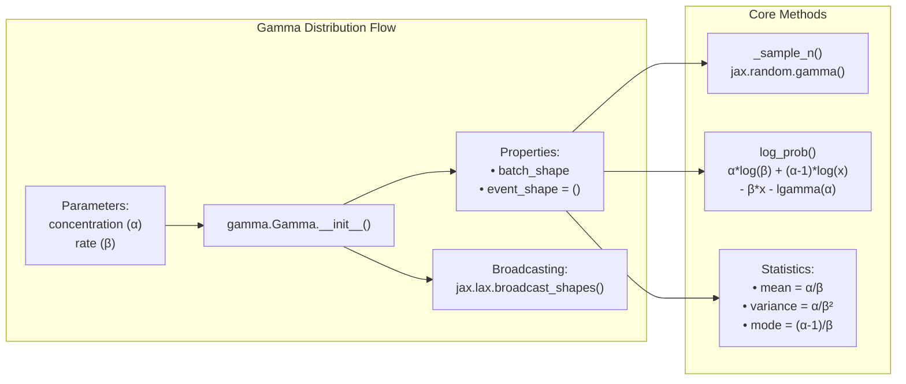
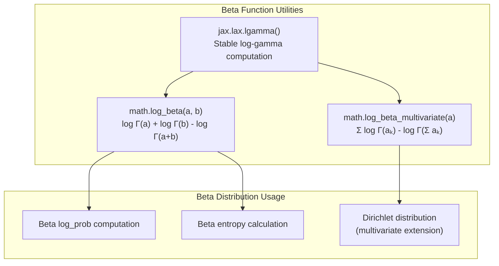
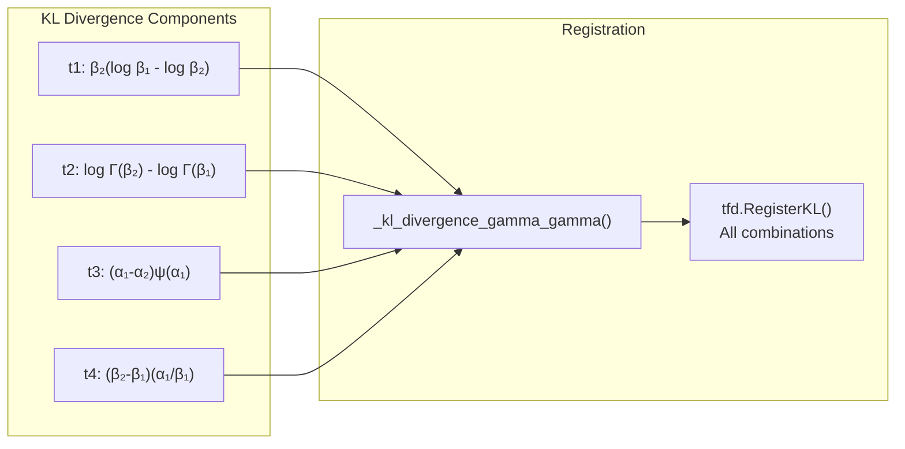
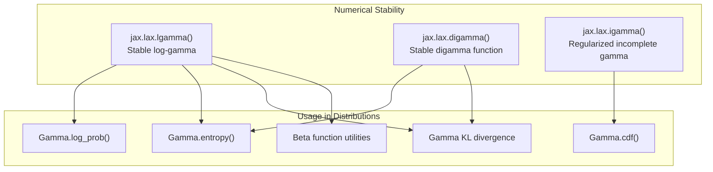

<!-- source: DeepWiki mcp.deepwiki.com · repo google-deepmind/distrax · extra page Gamma and Beta Distributions · fetched 2026-10-26 -->

# Gamma and Beta Distributions

Relevant source files

The following files were used as context for generating this wiki page:

- [distrax/_src/distributions/beta_test.py](distrax/_src/distributions/beta_test.py)
- [distrax/_src/distributions/gamma.py](distrax/_src/distributions/gamma.py)
- [distrax/_src/distributions/gamma_test.py](distrax/_src/distributions/gamma_test.py)
- [distrax/_src/utils/math.py](distrax/_src/utils/math.py)
- [distrax/_src/utils/math_test.py](distrax/_src/utils/math_test.py)

This document covers the implementation of Gamma and Beta distributions in Distrax, including their parameterizations, mathematical properties, and integration with TensorFlow Probability. These are continuous probability distributions commonly used in Bayesian statistics and machine learning applications.

For information about other continuous distributions like Normal and Uniform, see [Normal and Uniform Distributions](#3.2.1). For multivariate extensions, see [Multivariate Distributions](#3.3).

## Distribution Class Hierarchy

The Gamma and Beta distributions follow Distrax's standard distribution architecture, inheriting from the base `Distribution` class and implementing the required interface methods.

**Sources:** [distrax/_src/distributions/gamma.py:34-38](), [distrax/_src/distributions/gamma.py:158-161]()

## Gamma Distribution Implementation

The `Gamma` class implements the Gamma distribution with shape-rate parameterization, where samples are drawn from the positive real line.

### Parameters and Properties

The Gamma distribution is parameterized by two positive values:

| Parameter | Description | Mathematical Role |
|-----------|-------------|-------------------|
| `concentration` | Shape parameter (α) | Controls distribution shape |
| `rate` | Inverse scale parameter (β) | Controls distribution scale |

**Sources:** [distrax/_src/distributions/gamma.py:39-50](), [distrax/_src/distributions/gamma.py:84-91](), [distrax/_src/distributions/gamma.py:111-126]()

### Key Implementation Details

The Gamma distribution implements several mathematical functions with numerical stability considerations:

**Sampling:** Uses JAX's native `jax.random.gamma` for standard Gamma sampling, then scales by the rate parameter:
[distrax/_src/distributions/gamma.py:72-82]()

**Log Probability:** Computes the log PDF using the standard Gamma formula with `jax.lax.lgamma` for numerical stability:
[distrax/_src/distributions/gamma.py:84-91]()

**Statistics:** Provides closed-form expressions for mean, variance, and mode:
[distrax/_src/distributions/gamma.py:111-126]()

## Beta Distribution Implementation

The Beta distribution is parameterized by two positive shape parameters and produces samples in the interval [0, 1].

### Parameters and Mathematical Properties

| Parameter | Description | Mathematical Role |
|-----------|-------------|-------------------|
| `alpha` | First shape parameter (α) | Controls left skewness |
| `beta` | Second shape parameter (β) | Controls right skewness |

The Beta distribution uses the mathematical utilities in `math.py` for computing the beta function and its logarithm.

**Sources:** [distrax/_src/utils/math.py:162-174](), [distrax/_src/utils/math.py:177-190](), [distrax/_src/distributions/beta_test.py:208-212]()

## TensorFlow Probability Integration

Both Gamma and Beta distributions maintain full compatibility with TensorFlow Probability through the equivalence system and KL divergence registration.

### KL Divergence Implementation

The Gamma distribution includes a specialized KL divergence computation for improved numerical stability:

**Sources:** [distrax/_src/distributions/gamma.py:135-155](), [distrax/_src/distributions/gamma.py:158-161]()

### Equivalence Testing Framework

Both distributions use the `EquivalenceTest` framework to ensure mathematical consistency with TensorFlow Probability:

| Test Category | Purpose | Implementation |
|---------------|---------|----------------|
| Parameter Broadcasting | Verify shape handling | [distrax/_src/distributions/gamma_test.py:34-50]() |
| Sampling Consistency | Cross-validate sampling | [distrax/_src/distributions/gamma_test.py:67-82]() |
| Statistical Properties | Verify moments and entropy | [distrax/_src/distributions/gamma_test.py:135-143]() |
| KL Divergence | Cross-validate KL computations | [distrax/_src/distributions/gamma_test.py:146-171]() |

## Mathematical Stability Features

The implementations include several numerical stability enhancements:

**Sources:** [distrax/_src/distributions/gamma.py:90](), [distrax/_src/distributions/gamma.py:100](), [distrax/_src/distributions/gamma.py:105](), [distrax/_src/utils/math.py:174]()

## Usage Patterns and Broadcasting

Both distributions support JAX's broadcasting semantics for batch operations:

**Parameter Broadcasting:** Parameters can have different shapes and will be broadcast to a common batch shape [distrax/_src/distributions/gamma.py:49-50]()

**Slicing Support:** Both distributions implement `__getitem__` for easy batch manipulation [distrax/_src/distributions/gamma.py:128-132]()

**JAX Integration:** Full compatibility with `jit`, `vmap`, and automatic differentiation through the JAX ecosystem [distrax/_src/distributions/gamma_test.py:173-175]()

**Sources:** [distrax/_src/distributions/gamma_test.py:34-50](), [distrax/_src/distributions/gamma_test.py:177-196](), [distrax/_src/distributions/beta_test.py:214-239]()

---

