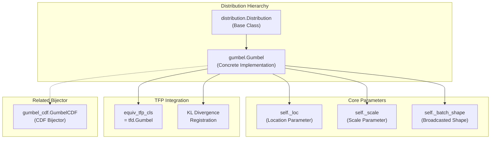
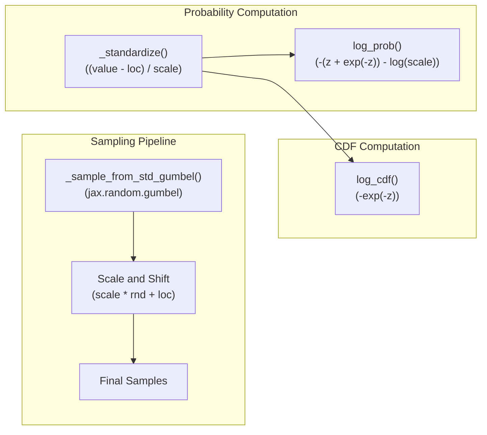
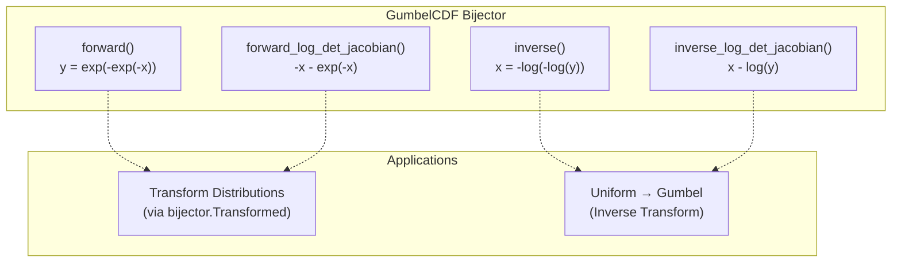

<!-- source: DeepWiki mcp.deepwiki.com · repo google-deepmind/distrax · extra page Gumbel Distribution · fetched 2026-10-26 -->

# Gumbel Distribution

<details>
<summary>Relevant source files</summary>

The following files were used as context for generating this wiki page:

- [distrax/_src/bijectors/gumbel_cdf.py](distrax/_src/bijectors/gumbel_cdf.py)
- [distrax/_src/bijectors/gumbel_cdf_test.py](distrax/_src/bijectors/gumbel_cdf_test.py)
- [distrax/_src/distributions/gumbel.py](distrax/_src/distributions/gumbel.py)
- [distrax/_src/distributions/gumbel_test.py](distrax/_src/distributions/gumbel_test.py)
- [distrax/_src/distributions/mvn_full_covariance_test.py](distrax/_src/distributions/mvn_full_covariance_test.py)

</details>


This document covers the Gumbel distribution implementation in Distrax, including its parameterization, statistical properties, and associated bijector. The Gumbel distribution is a continuous probability distribution used in extreme value statistics and modeling maximum/minimum values.

For other continuous distributions like Normal and Uniform, see [Normal and Uniform Distributions](#3.2.1). For information about bijectors and transformations in general, see [Bijectors and Transformations](#2.2).

## Mathematical Definition

The Gumbel distribution is parameterized by location `loc` and scale `scale` parameters. For a random variable X following a Gumbel distribution:

- **Probability Density Function**: `f(x) = (1/scale) * exp(-(z + exp(-z)))` where `z = (x - loc) / scale`
- **Cumulative Distribution Function**: `F(x) = exp(-exp(-z))` where `z = (x - loc) / scale`
- **Support**: Real numbers (-∞, ∞)

The distribution is commonly used in extreme value theory and appears naturally when modeling the maximum of a large number of random variables.

Sources: [distrax/_src/distributions/gumbel.py:77-81](), [distrax/_src/distributions/gumbel.py:103-106]()

## Implementation Overview



The `Gumbel` class inherits from the base `Distribution` class and implements the standard distribution interface. It maintains compatibility with TensorFlow Probability through the `equiv_tfp_cls` attribute and provides KL divergence registration.

Sources: [distrax/_src/distributions/gumbel.py:35-52](), [distrax/_src/distributions/gumbel.py:156-158]()

## Core Functionality

### Initialization and Parameters

The `Gumbel` distribution is initialized with two parameters:

```python
# From gumbel.py constructor
def __init__(self, loc: Numeric, scale: Numeric):
```

- `loc`: The location parameter (mean of the distribution)
- `scale`: The scale parameter (spread of the distribution)

The implementation automatically broadcasts the parameters and computes the batch shape using JAX's broadcasting rules.

Sources: [distrax/_src/distributions/gumbel.py:40-51]()

### Sampling and Probability Computation



The sampling process uses JAX's built-in `jax.random.gumbel` function to generate standard Gumbel samples, then transforms them using the location and scale parameters. Probability computation involves standardizing the input and applying the Gumbel log-probability formula.

Sources: [distrax/_src/distributions/gumbel.py:82-97](), [distrax/_src/distributions/gumbel.py:73-80](), [distrax/_src/distributions/gumbel.py:103-106]()

## Statistical Properties

The `Gumbel` class implements all standard statistical methods:

| Method | Formula | Implementation |
|--------|---------|----------------|
| `mean()` | `loc + scale * γ` | Uses Euler's gamma constant |
| `mode()` | `loc` | Returns the location parameter |
| `median()` | `loc - scale * log(log(2))` | Closed-form expression |
| `variance()` | `(scale * π)² / 6` | Uses π²/6 factor |
| `stddev()` | `scale * π / √6` | Square root of variance |
| `entropy()` | `log(scale) + 1 + γ` | Uses Euler's gamma constant |

Where γ is Euler's gamma constant (`jnp.euler_gamma` ≈ 0.5772).

Sources: [distrax/_src/distributions/gumbel.py:99-127]()

### KL Divergence

The implementation provides a custom KL divergence function for computing `KL(dist1 || dist2)` between two Gumbel distributions:

```python
def _kl_divergence_gumbel_gumbel(dist1, dist2):
    # Closed-form KL divergence computation
```

This function is registered with TensorFlow Probability for seamless integration and supports cross-compatibility between Distrax and TFP Gumbel distributions.

Sources: [distrax/_src/distributions/gumbel.py:134-158]()

## GumbelCDF Bijector

The related `GumbelCDF` bijector implements the cumulative distribution function transformation:



The `GumbelCDF` bijector enables:
- Converting uniform random variables to Gumbel-distributed variables
- Creating transformed distributions with Gumbel CDF as the transformation
- Normalizing flows that incorporate Gumbel CDF layers

Sources: [distrax/_src/bijectors/gumbel_cdf.py:25-52]()

## JAX Integration

The `Gumbel` distribution is fully compatible with JAX transformations:

- **JIT Compilation**: All methods support `jax.jit` compilation
- **Vectorization**: Supports `jax.vmap` for batch operations  
- **Automatic Differentiation**: Compatible with `jax.grad` and related functions
- **Numerical Stability**: Uses numerically stable implementations for extreme values

The implementation leverages JAX's broadcasting capabilities and uses JAX-native functions like `jnp.exp`, `jnp.log`, and `jax.random.gumbel`.

Sources: [distrax/_src/distributions/gumbel_test.py:191-193](), [distrax/_src/bijectors/gumbel_cdf_test.py:146-153]()

## TensorFlow Probability Compatibility

The `Gumbel` class maintains full compatibility with TensorFlow Probability:

- **Equivalence Testing**: Comprehensive test suite validates equivalent behavior
- **KL Divergence Registration**: Cross-compatible KL divergence computations
- **API Consistency**: Identical method signatures and behavior
- **Type Compatibility**: Works seamlessly in functions expecting TFP distributions

This compatibility enables users to mix Distrax and TFP distributions in the same codebase without modification.

Sources: [distrax/_src/distributions/gumbel_test.py:28-32](), [distrax/_src/distributions/gumbel_test.py:166-189]()

---

