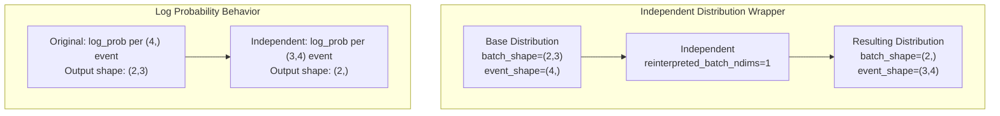
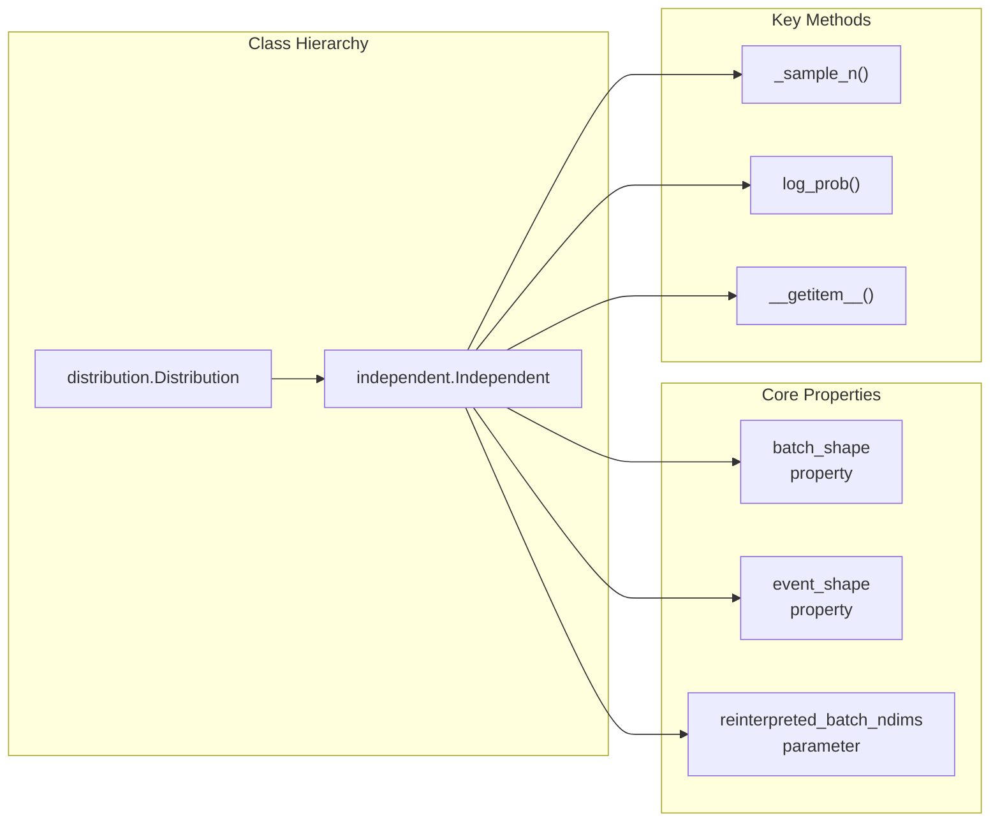
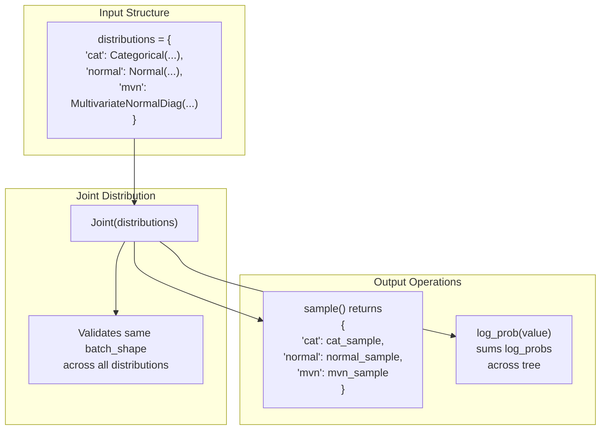
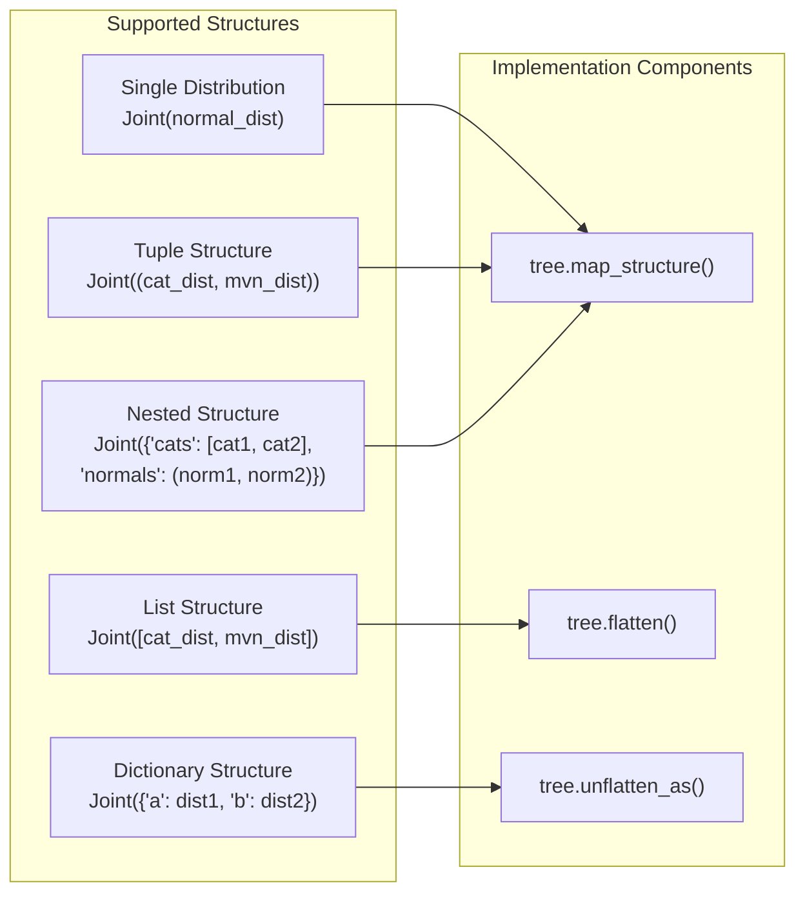
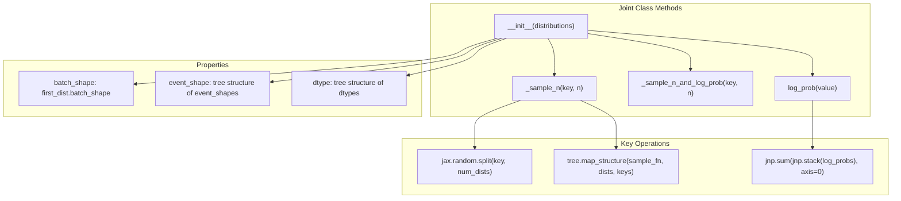

<!-- source: DeepWiki mcp.deepwiki.com · repo google-deepmind/distrax · extra page Independent and Joint Distributions · fetched 2026-10-26 -->

# Independent and Joint Distributions

Relevant source files

The following files were used as context for generating this wiki page:

- [distrax/_src/bijectors/masked_coupling.py](distrax/_src/bijectors/masked_coupling.py)
- [distrax/_src/bijectors/masked_coupling_test.py](distrax/_src/bijectors/masked_coupling_test.py)
- [distrax/_src/distributions/dirichlet.py](distrax/_src/distributions/dirichlet.py)
- [distrax/_src/distributions/dirichlet_test.py](distrax/_src/distributions/dirichlet_test.py)
- [distrax/_src/distributions/independent_test.py](distrax/_src/distributions/independent_test.py)
- [distrax/_src/distributions/joint.py](distrax/_src/distributions/joint.py)
- [distrax/_src/distributions/joint_test.py](distrax/_src/distributions/joint_test.py)
- [distrax/_src/distributions/transformed_test.py](distrax/_src/distributions/transformed_test.py)

This document covers composite distributions that modify or combine other distributions: the `Independent` distribution, which reinterprets batch dimensions as event dimensions, and the `Joint` distribution, which combines multiple distributions into a single joint distribution. For information about bijector-based transformations, see [Transformed Distributions](#3.4.1). For information about discretization and truncation, see [Quantized and Clipped Distributions](#3.4.3).

## Independent Distribution

The `Independent` distribution wrapper reinterprets some number of rightmost batch dimensions of a base distribution as event dimensions. This is commonly used to create multivariate distributions from univariate ones or to change the statistical interpretation of existing distributions.

### Core Concept

The `Independent` distribution takes a base distribution and a parameter `reinterpreted_batch_ndims` that specifies how many batch dimensions to move into the event shape. This changes how log probabilities and other statistics are computed.

Sources: [distrax/_src/distributions/independent_test.py:41](), [distrax/_src/distributions/independent_test.py:184-207]()

### Key Implementation Classes

Sources: [distrax/_src/distributions/independent_test.py:41](), [distrax/_src/distributions/independent_test.py:56-77]()

### Usage Patterns

The `Independent` distribution is commonly used in several scenarios:

| Use Case | Base Distribution | `reinterpreted_batch_ndims` | Result |
|----------|-------------------|----------------------------|---------|
| Multivariate from Univariate | `Normal(loc=[1,2,3], scale=[4,5,6])` | `1` | Multivariate Normal with independence assumption |
| Change Event Interpretation | `MultivariateNormalDiag` with batch dims | `1` or `2` | Different event/batch structure |
| TFP Compatibility | Any batched distribution | Variable | Match TFP `Independent` behavior |

The constructor supports both explicit `reinterpreted_batch_ndims` values and `None` for automatic inference.

Sources: [distrax/_src/distributions/independent_test.py:177-199](), [distrax/_src/distributions/independent_test.py:347-396]()

## Joint Distribution

The `Joint` distribution creates a single distribution over a tree structure of independent component distributions. All component distributions must have the same `batch_shape`, and the resulting samples maintain the tree structure of the input distributions.

### Core Concept

Sources: [distrax/_src/distributions/joint.py:34-67](), [distrax/_src/distributions/joint_test.py:30-76]()

### Tree Structure Support

The `Joint` distribution supports arbitrary tree structures using JAX's `tree` utilities:

Sources: [distrax/_src/distributions/joint.py:53-54](), [distrax/_src/distributions/joint_test.py:243-291](), [distrax/_src/distributions/joint_test.py:115-153]()

### Core Methods Implementation

Sources: [distrax/_src/distributions/joint.py:68-117](), [distrax/_src/distributions/joint.py:144-152]()

## Implementation Details

### Independent Distribution Architecture

The `Independent` distribution primarily modifies how dimensions are interpreted without changing the underlying sampling or probability computation logic:

| Operation | Base Distribution | Independent Wrapper |
|-----------|-------------------|-------------------|
| `sample()` | Returns samples with original shape | Same samples, same shape |
| `log_prob()` | Per-event log probability | Sums over reinterpreted dimensions |
| `batch_shape` | Original batch shape | Reduced by `reinterpreted_batch_ndims` |
| `event_shape` | Original event shape | Extended with reinterpreted dimensions |

Sources: [distrax/_src/distributions/independent_test.py:79-124]()

### Joint Distribution Architecture

The `Joint` distribution coordinates multiple independent distributions:

```mermaid
graph TB
    subgraph "Joint Distribution Internal Flow"
        INPUT["Tree of Distributions"]
        VALIDATE["Batch Shape Validation<br/>all dists must have same batch_shape"]
        STORE["Store as self._distributions"]
        
        INPUT --> VALIDATE
        VALIDATE --> STORE
    end
    
    subgraph "Sampling Flow"
        KEY_IN["Input PRNG Key"]
        SPLIT["jax.random.split(key, num_dists)"]
        MAP_SAMPLE["tree.map_structure(sample_fn)"]
        TREE_OUT["Tree-structured Output"]
        
        KEY_IN --> SPLIT
        SPLIT --> MAP_SAMPLE
        MAP_SAMPLE --> TREE_OUT
    end
    
    subgraph "Log Probability Flow"
        VALUE_IN["Tree-structured Input"]
        MAP_LOGPROB["tree.map_structure(log_prob_fn)"]
        FLATTEN["tree.flatten(log_probs)"]
        SUM["jnp.sum(log_probs, axis=0)"]
        SCALAR_OUT["Scalar Output"]
        
        VALUE_IN --> MAP_LOGPROB
        MAP_LOGPROB --> FLATTEN
        FLATTEN --> SUM
        SUM --> SCALAR_OUT
    end
```

Sources: [distrax/_src/distributions/joint.py:68-99](), [distrax/_src/distributions/joint.py:46-67]()

### KL Divergence and Advanced Operations

Both distributions support KL divergence computation:

- **Independent**: Uses the base distribution's KL divergence, with TFP compatibility through equivalence testing
- **Joint**: Implements `_kl_divergence_joint_joint` that sums KL divergences across corresponding tree elements

Sources: [distrax/_src/distributions/independent_test.py:304-344](), [distrax/_src/distributions/joint.py:144-152](), [distrax/_src/distributions/joint_test.py:331-344]()

---

