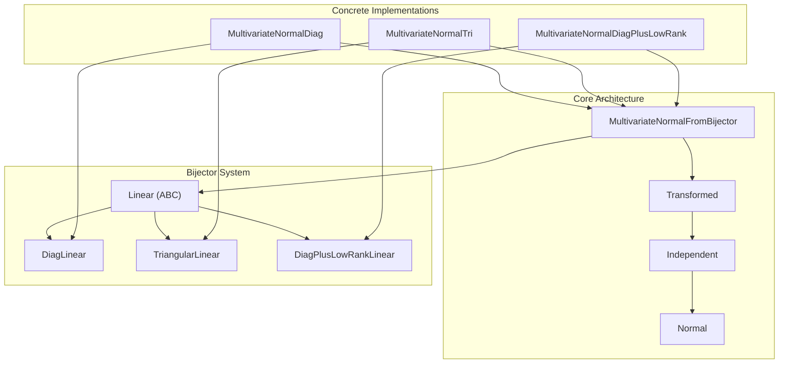
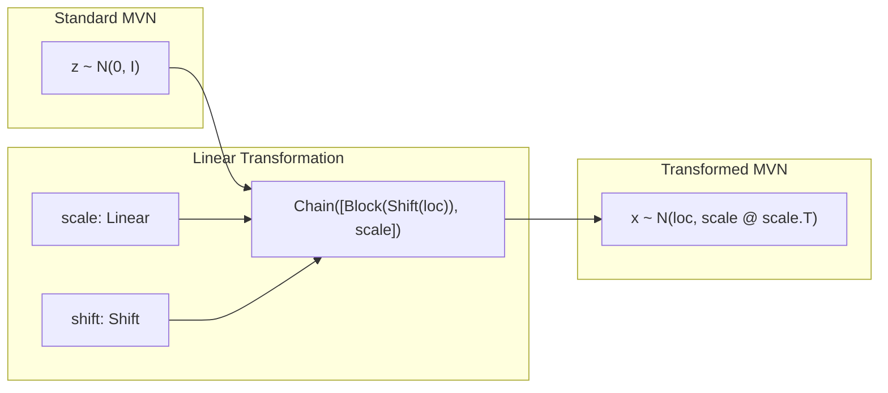
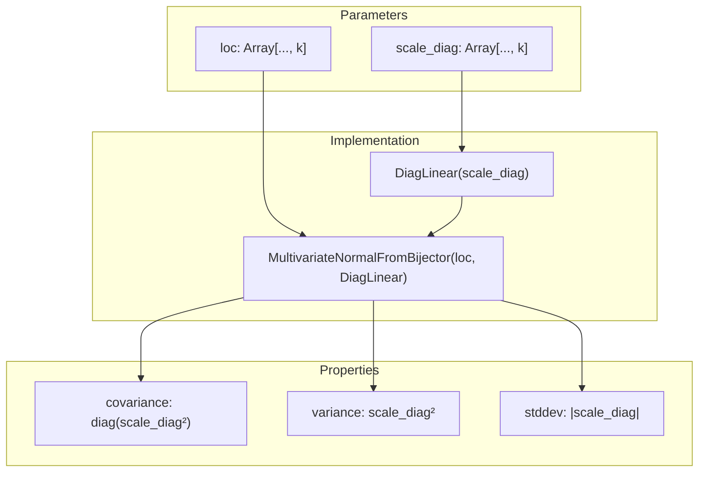
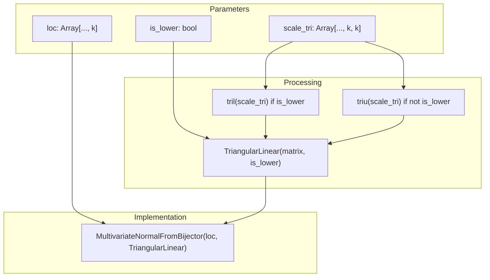
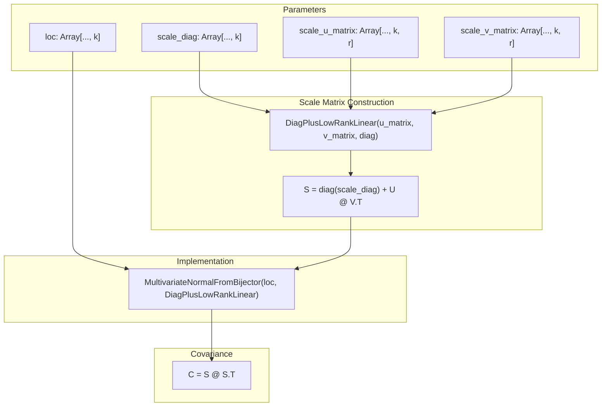
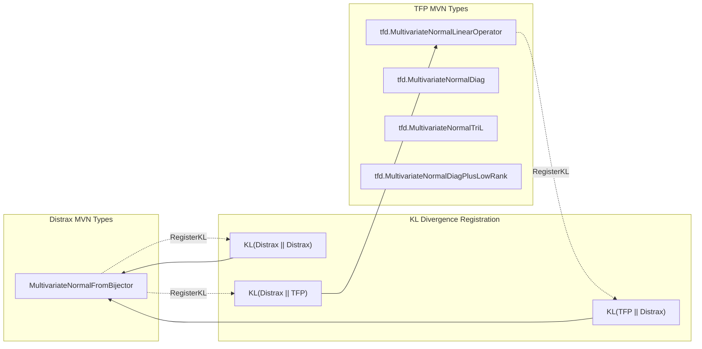
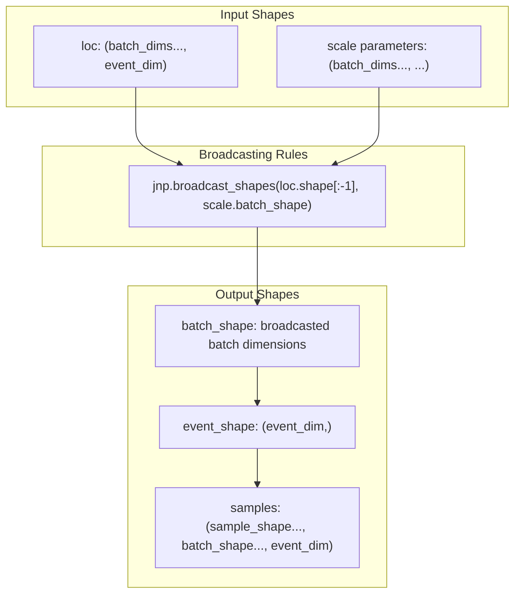

<!-- source: DeepWiki mcp.deepwiki.com · repo google-deepmind/distrax · extra page Multivariate Normal Distributions · fetched 2026-10-26 -->

# Multivariate Normal Distributions

Relevant source files

The following files were used as context for generating this wiki page:

- [distrax/_src/distributions/mvn_diag_plus_low_rank.py](distrax/_src/distributions/mvn_diag_plus_low_rank.py)
- [distrax/_src/distributions/mvn_diag_plus_low_rank_test.py](distrax/_src/distributions/mvn_diag_plus_low_rank_test.py)
- [distrax/_src/distributions/mvn_diag_test.py](distrax/_src/distributions/mvn_diag_test.py)
- [distrax/_src/distributions/mvn_from_bijector.py](distrax/_src/distributions/mvn_from_bijector.py)
- [distrax/_src/distributions/mvn_from_bijector_test.py](distrax/_src/distributions/mvn_from_bijector_test.py)
- [distrax/_src/distributions/mvn_tri.py](distrax/_src/distributions/mvn_tri.py)
- [distrax/_src/distributions/one_hot_categorical_test.py](distrax/_src/distributions/one_hot_categorical_test.py)

This document covers Distrax's multivariate normal distribution implementations, which provide efficient, JAX-native distributions over vector-valued random variables. These distributions support various covariance structures including diagonal, full covariance via triangular decomposition, and diagonal-plus-low-rank parameterizations.

For discrete distributions over categorical variables, see [Discrete Distributions](#3.1). For univariate continuous distributions, see [Continuous Distributions](#3.2). For general information about bijectors and transformations used in these implementations, see [Bijectors and Transformations](#2.2).

## Architecture Overview

Distrax's multivariate normal distributions are built on a unified bijector-based architecture. All implementations extend `MultivariateNormalFromBijector`, which transforms a standard multivariate normal using linear bijectors to create distributions with different covariance structures.

**Sources:** [distrax/_src/distributions/mvn_from_bijector.py:51-93](), [distrax/_src/distributions/mvn_tri.py:62-118](), [distrax/_src/distributions/mvn_diag_plus_low_rank.py:88-176]()

## Core Implementation: MultivariateNormalFromBijector

The `MultivariateNormalFromBijector` class implements the mathematical transformation `x = A @ z + b`, where `z ~ N(0, I)` is a standard multivariate normal, `A` is a linear transformation matrix, and `b` is the location vector. This results in `x ~ N(b, A @ A.T)`.

**Key Components:**

| Component | Type | Purpose |
|-----------|------|---------|
| `loc` | `Array` | Mean vector (location parameter) |
| `scale` | `Linear` | Bijector implementing matrix multiplication |
| `bijector` | `Chain` | Composed transformation: shift then scale |
| `distribution` | `Independent` | Standard MVN base distribution |

**Sources:** [distrax/_src/distributions/mvn_from_bijector.py:51-93](), [distrax/_src/distributions/mvn_from_bijector.py:78-87]()

## Diagonal Covariance: MultivariateNormalDiag

For diagonal covariance matrices, `MultivariateNormalDiag` uses the `DiagLinear` bijector, making the transformation `x = diag(scale_diag) @ z + loc`. This is efficient for independent components with different variances.

**Sources:** [distrax/_src/distributions/mvn_diag_test.py:30-50](), [distrax/_src/distributions/mvn_from_bijector.py:128-134]()

## Triangular Scale: MultivariateNormalTri

`MultivariateNormalTri` uses triangular matrices for the scale parameter, typically the Cholesky decomposition of the covariance matrix. The `TriangularLinear` bijector handles either lower or upper triangular matrices.

**Sources:** [distrax/_src/distributions/mvn_tri.py:72-118](), [distrax/_src/distributions/mvn_tri.py:113-116]()

## Diagonal Plus Low-Rank: MultivariateNormalDiagPlusLowRank

This implementation supports covariance structures of the form `C = S @ S.T` where `S = diag(D) + U @ V.T`. This is efficient for modeling correlations with a low-rank structure plus independent noise.

**Sources:** [distrax/_src/distributions/mvn_diag_plus_low_rank.py:88-176](), [distrax/_src/distributions/mvn_diag_plus_low_rank.py:168-175]()

## Statistical Methods and Properties

All multivariate normal implementations provide consistent statistical methods through the base `MultivariateNormalFromBijector` class:

| Method | Returns | Description |
|--------|---------|-------------|
| `mean()` | `Array[..., k]` | Distribution mean (equals `loc`) |
| `median()` | `Array[..., k]` | Distribution median (equals `loc`) |
| `mode()` | `Array[..., k]` | Distribution mode (equals `loc`) |
| `variance()` | `Array[..., k]` | Marginal variances |
| `stddev()` | `Array[..., k]` | Marginal standard deviations |
| `covariance()` | `Array[..., k, k]` | Full covariance matrix |
| `sample()` | `Array[..., k]` | Random samples |
| `log_prob()` | `Array[...]` | Log probability density |

The implementations optimize these methods based on the covariance structure. For example, diagonal distributions avoid constructing full covariance matrices when computing variance.

**Sources:** [distrax/_src/distributions/mvn_from_bijector.py:105-152](), [distrax/_src/distributions/mvn_from_bijector.py:128-134]()

## TensorFlow Probability Integration

Distrax multivariate normal distributions integrate seamlessly with TensorFlow Probability through KL divergence registration and type compatibility:

The KL divergence implementation in `_kl_divergence_mvn_mvn` handles different scale matrix structures efficiently, using diagonal optimizations when possible.

**Sources:** [distrax/_src/distributions/mvn_from_bijector.py:214-265](), [distrax/_src/distributions/mvn_from_bijector.py:241-253]()

## Usage Patterns and Broadcasting

All multivariate normal distributions support JAX broadcasting semantics for batch processing:

**Parameter Validation:**
- `loc` must have at least 1 dimension with the last dimension as the event dimension
- Scale parameters must be compatible with `loc.shape[-1]`
- Matrices must be square and properly sized for the event dimension

**Sources:** [distrax/_src/distributions/mvn_from_bijector.py:40-48](), [distrax/_src/distributions/mvn_from_bijector.py:75-77]()

---

