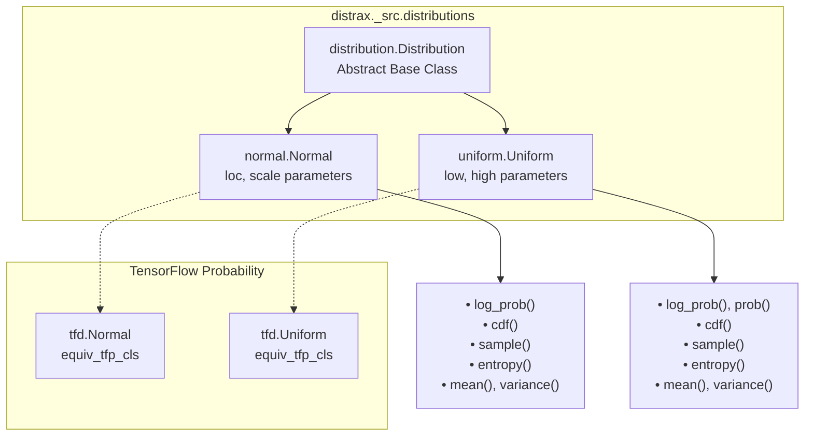
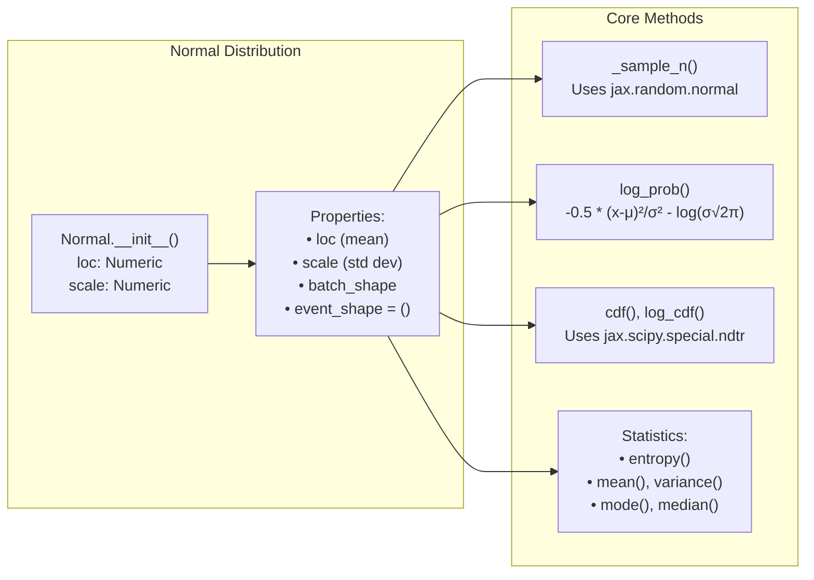
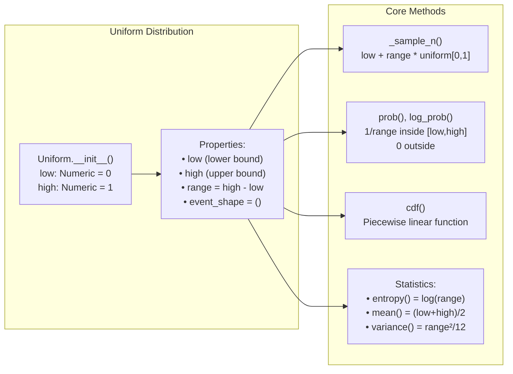
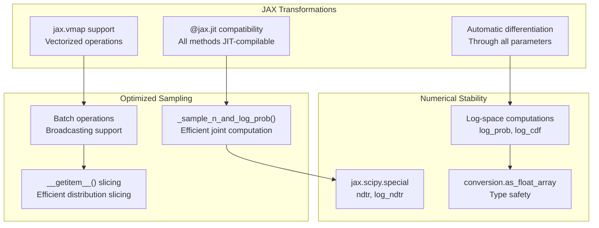
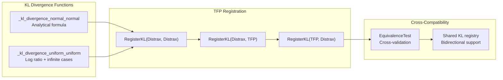

<!-- source: DeepWiki mcp.deepwiki.com · repo google-deepmind/distrax · extra page Normal and Uniform Distributions · fetched 2026-10-26 -->

# Normal and Uniform Distributions

Relevant source files

The following files were used as context for generating this wiki page:

- [distrax/_src/distributions/normal.py](distrax/_src/distributions/normal.py)
- [distrax/_src/distributions/normal_test.py](distrax/_src/distributions/normal_test.py)
- [distrax/_src/distributions/uniform.py](distrax/_src/distributions/uniform.py)
- [distrax/_src/distributions/uniform_test.py](distrax/_src/distributions/uniform_test.py)

This document covers the fundamental continuous probability distributions in Distrax: Normal (Gaussian) and Uniform distributions. These are univariate distributions that extend the base `Distribution` class and provide core building blocks for probabilistic modeling. For discrete distributions, see [Discrete Distributions](#3.1). For multivariate extensions, see [Multivariate Normal Distributions](#3.3.1).

## Distribution Class Hierarchy

Both Normal and Uniform distributions inherit from the base `Distribution` class and follow the same interface patterns.

Sources: [distrax/_src/distributions/normal.py:37-42](), [distrax/_src/distributions/uniform.py:35-38]()

## Normal Distribution

The `Normal` class implements the Gaussian distribution with location parameter `loc` (mean) and scale parameter `scale` (standard deviation).

### Class Definition and Parameters

Sources: [distrax/_src/distributions/normal.py:42-51](), [distrax/_src/distributions/normal.py:78-90](), [distrax/_src/distributions/normal.py:92-96]()

### Key Implementation Details

| Method | Implementation | Line Reference |
|--------|---------------|----------------|
| `__init__(loc, scale)` | Converts parameters using `conversion.as_float_array` | [normal.py:42-51]() |
| `_sample_n(key, n)` | `scale * rnd + loc` where `rnd ~ N(0,1)` | [normal.py:78-83]() |
| `log_prob(value)` | `-0.5 * square((value - loc) / scale) - log_normalization` | [normal.py:92-96]() |
| `cdf(value)` | `jax.scipy.special.ndtr(standardize(value))` | [normal.py:98-100]() |
| `entropy()` | `0.5 + half_log2pi + log(scale)` | [normal.py:117-121]() |

The distribution uses efficient standardization via the `_standardize` method that computes `(value - loc) / scale`.

Sources: [distrax/_src/distributions/normal.py:114-115](), [distrax/_src/distributions/normal.py:34]()

## Uniform Distribution

The `Uniform` class implements the continuous uniform distribution over the interval `[low, high]`.

### Class Definition and Parameters

Sources: [distrax/_src/distributions/uniform.py:40-51](), [distrax/_src/distributions/uniform.py:76-83](), [distrax/_src/distributions/uniform.py:96-101]()

### Key Implementation Details

| Method | Implementation | Line Reference |
|--------|---------------|----------------|
| `__init__(low, high)` | Default parameters `low=0.0, high=1.0` | [uniform.py:40-51]() |
| `_sample_n(key, n)` | `low + range * jax.random.uniform(key, ...)` | [uniform.py:76-83]() |
| `prob(value)` | `1/range` if `low ≤ value ≤ high`, else `0` | [uniform.py:96-101]() |
| `cdf(value)` | Piecewise: `0`, `(value-low)/range`, `1` | [uniform.py:123-129]() |
| `variance()` | `range² / 12` | [uniform.py:111-113]() |

The uniform distribution implements both `prob()` and `log_prob()` methods, where `log_prob` calls `log(prob(value))`.

Sources: [distrax/_src/distributions/uniform.py:92-94]()

## JAX Integration and Performance Features

Both distributions fully support JAX transformations and provide optimized implementations for common operations.

Sources: [distrax/_src/distributions/normal.py:85-90](), [distrax/_src/distributions/uniform.py:85-90](), [distrax/_src/distributions/normal.py:143-146]()

### Broadcasting and Slicing Support

Both distributions support flexible parameter broadcasting and efficient slicing:

- **Broadcasting**: Parameters with different shapes are automatically broadcast to compatible batch shapes
- **Slicing**: The `__getitem__` method enables efficient extraction of distribution slices
- **Batch operations**: All methods work seamlessly with batched parameters

Example usage patterns tested in the test suites include:
- Broadcasting location/scale or low/high parameters
- Slicing with various index types (`int`, `slice`, `Ellipsis`)
- VMAP operations across different axes

Sources: [distrax/_src/distributions/normal_test.py:175-186](), [distrax/_src/distributions/uniform_test.py:152-165]()

## KL Divergence and TensorFlow Probability Integration

Both distributions provide KL divergence computations and seamless TFP integration.

The KL divergence implementations use analytical formulas:
- **Normal**: `0.5 * ((μ₁-μ₂)/σ₂)² + 0.5 * (exp(2*(log σ₁ - log σ₂)) - 1) - (log σ₁ - log σ₂)`
- **Uniform**: `log((b₂-a₂)/(b₁-a₁))` if support of dist1 ⊆ support of dist2, else `∞`

Sources: [distrax/_src/distributions/normal.py:149-167](), [distrax/_src/distributions/uniform.py:141-161](), [distrax/_src/distributions/normal.py:171-173]()

---

