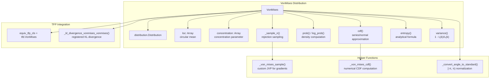
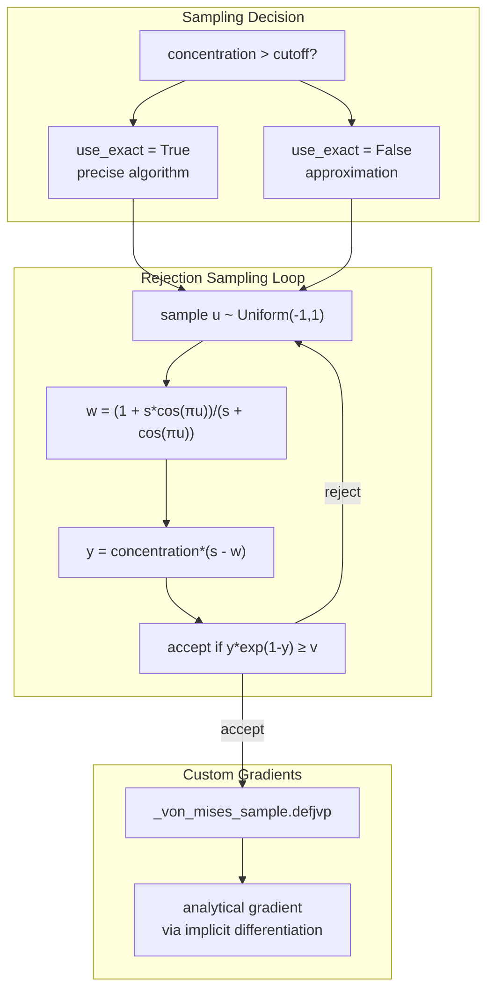
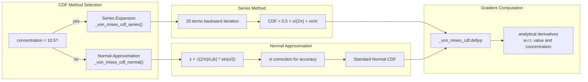

<!-- source: DeepWiki mcp.deepwiki.com · repo google-deepmind/distrax · extra page Other Continuous Distributions · fetched 2026-10-26 -->

# Other Continuous Distributions

<details>
<summary>Relevant source files</summary>

The following files were used as context for generating this wiki page:

- [distrax/_src/bijectors/linear_test.py](distrax/_src/bijectors/linear_test.py)
- [distrax/_src/distributions/von_mises.py](distrax/_src/distributions/von_mises.py)
- [distrax/_src/distributions/von_mises_test.py](distrax/_src/distributions/von_mises_test.py)
- [distrax/_src/utils/conversion.py](distrax/_src/utils/conversion.py)

</details>


This page documents additional continuous distributions in Distrax beyond the fundamental ones covered in previous sections. Currently, this includes the VonMises distribution for circular data and serves as a foundation for other specialized continuous distributions like Laplace and Logistic distributions.

For basic continuous distributions like Normal and Uniform, see [Normal and Uniform Distributions](#3.2.1). For extreme value modeling with Gumbel distribution, see [Gumbel Distribution](#3.2.2). For shape-based distributions, see [Gamma and Beta Distributions](#3.2.3).

## VonMises Distribution

The `VonMises` distribution is a continuous probability distribution over angles, representing the circular analog of the Normal distribution. It is the maximum entropy distribution on the circle given a circular mean and variance.

### Distribution Properties

The VonMises distribution is parameterized by:
- `loc`: The circular mean in radians (can take any real value)
- `concentration`: The concentration parameter (≥ 0), analogous to 1/σ in Normal distributions

**Key Mathematical Properties:**
- **Support**: [-π, π) with periodic extension
- **PDF**: `exp(concentration * cos(x - loc)) / (2π * I₀(concentration))`
- **Special Cases**: 
  - When `concentration = 0`: Uniform distribution over [-π, π)
  - When `concentration → ∞`: Approximates Normal distribution

Sources: [distrax/_src/distributions/von_mises.py:40-90]()

### Class Structure and Methods



Sources: [distrax/_src/distributions/von_mises.py:39-209](), [distrax/_src/distributions/von_mises.py:488-496]()

### Sampling Algorithm

The VonMises distribution uses a sophisticated rejection sampling algorithm with custom gradient computation for differentiability.

**Sampling Strategy Diagram:**



Sources: [distrax/_src/distributions/von_mises.py:218-278](), [distrax/_src/distributions/von_mises.py:281-308]()

### CDF Computation

The CDF computation uses different numerical strategies based on the concentration parameter value.

**CDF Computation Strategy:**



Sources: [distrax/_src/distributions/von_mises.py:310-458](), [distrax/_src/distributions/von_mises.py:389-421](), [distrax/_src/distributions/von_mises.py:423-458]()

## Implementation Details

### Core Methods and Properties

| Method | Description | Key Implementation Details |
|--------|-------------|---------------------------|
| `__init__(loc, concentration)` | Constructor | Broadcasts parameters, validates shapes |
| `prob(value)` / `log_prob(value)` | Density evaluation | Uses modified Bessel functions I₀, I₁ |
| `_sample_n(key, n)` | Sampling | Rejection sampling with custom JVP |
| `cdf(value)` | Cumulative distribution | Dual-strategy: series vs normal approximation |
| `entropy()` | Shannon entropy | Analytical formula using Bessel function ratios |
| `variance()` | Circular variance | `1 - I₁(k)/I₀(k)` where k is concentration |
| `mean()` / `mode()` | Central tendencies | Both return the `loc` parameter |

Sources: [distrax/_src/distributions/von_mises.py:93-209]()

### Numerical Stability Features

**Angle Normalization:**
- All angles are converted to the standard range [-π, π) using `_convert_angle_to_standard()`
- CDF values are clipped to [0, 1] to handle numerical edge cases
- Special handling for extreme concentration values in sampling

**Gradient Computation:**
- Custom JVP implementations for both sampling and CDF to ensure differentiability
- Analytical gradients prevent issues with rejection sampling's discrete nature
- Vectorized gradient operations for efficiency

Sources: [distrax/_src/distributions/von_mises.py:211-216](), [distrax/_src/distributions/von_mises.py:281-308](), [distrax/_src/distributions/von_mises.py:350-387]()

## TensorFlow Probability Integration

The VonMises distribution maintains full compatibility with TensorFlow Probability through:

### Equivalence Class Registration
```python
equiv_tfp_cls = tfd.VonMises
```

### KL Divergence Registration
The implementation includes analytical KL divergence computation between VonMises distributions:
- Registered for all combinations: Distrax↔Distrax, Distrax↔TFP, TFP↔Distrax
- Uses Bessel function ratios: `I₁(k₁)/I₀(k₁)` for efficient computation
- Handles circular mean differences: `cos(loc₁ - loc₂)` terms

Sources: [distrax/_src/distributions/von_mises.py:91](), [distrax/_src/distributions/von_mises.py:461-496]()

## Testing and Validation

The VonMises implementation includes comprehensive testing covering:

### Statistical Accuracy
- Cross-validation against SciPy's `vonmises` distribution
- Kolmogorov-Smirnov tests for sampling accuracy
- Moment matching tests for mean and variance
- Special case validation (uniform distribution when concentration=0)

### Gradient Correctness
- JAX gradient checking for all differentiable operations
- Comparison against TensorFlow Probability reference implementations
- Implicit differentiation validation for sampling gradients

### Edge Cases
- Extreme concentration values (near zero and near infinity)
- NaN and infinite input handling
- Numerical precision across different dtypes (float16, float32, float64)

Sources: [distrax/_src/distributions/von_mises_test.py:34-555]()

## Future Extensions

This section serves as the foundation for additional continuous distributions that may be added to Distrax, such as:
- **Laplace Distribution**: Exponential-based distribution for robust modeling
- **Logistic Distribution**: S-shaped CDF distribution for classification applications  
- **Wrapped Normal**: Another circular distribution alternative to VonMises
- **Beta Prime**: Related to Beta distribution for ratio modeling

The patterns established in VonMises (custom JVP, TFP integration, comprehensive testing) provide templates for implementing these additional distributions.

---

