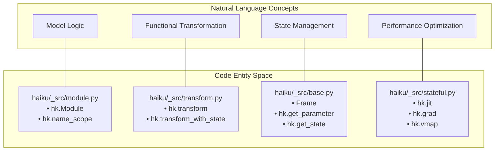
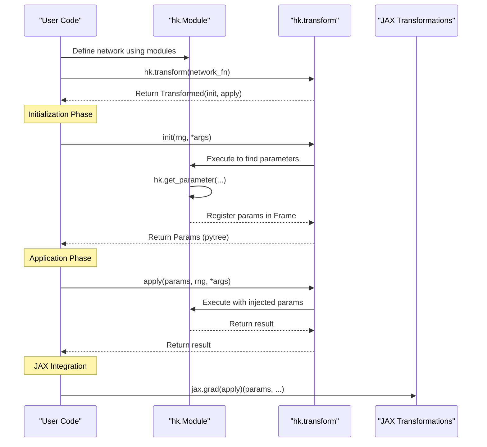

<!-- source: DeepWiki mcp.deepwiki.com · repo google-deepmind/dm-haiku · page 1 Overview · fetched 2026-10-26 -->

# Overview

Relevant source files

The following files were used as context for generating this wiki page:

- [README.md](README.md)
- [docs/api.rst](docs/api.rst)
- [examples/README.md](examples/README.md)
- [examples/requirements.txt](examples/requirements.txt)
- [haiku/BUILD](haiku/BUILD)
- [haiku/__init__.py](haiku/__init__.py)
- [haiku/_src/BUILD](haiku/_src/BUILD)
- [haiku/_src/integration/BUILD](haiku/_src/integration/BUILD)

Haiku is a neural network library for JAX that enables object-oriented programming while preserving JAX's functional transformations and performance benefits. It provides a simple yet powerful interface for building neural networks with modules, parameters, and state management while maintaining compatibility with JAX's transformation system.

> [!IMPORTANT]
> As of July 2023, Google DeepMind recommends that new projects adopt **Flax** instead of Haiku. Haiku is currently in **maintenance mode**, focusing on bug fixes and compatibility with new JAX releases [README.md:16-39]().

## Core Architecture

Haiku bridges the gap between object-oriented programming and JAX's functional programming model through three key concepts:
1. **Modules**: Object-oriented building blocks for neural networks.
2. **Transformations**: Functions that convert modules into pure functions.
3. **State Management**: Systems for managing parameters and other state.

### System Entity Map

The following diagram maps high-level concepts to the specific code entities that implement them within the Haiku source tree.

Sources: [haiku/__init__.py:15-146](), [haiku/_src/base.py](), [haiku/_src/module.py](), [haiku/_src/transform.py](), [haiku/_src/stateful.py]()

## Module System

The core concept in Haiku is the `Module` class [haiku/_src/module.py:421-423](). All neural network components in Haiku inherit from this base class, allowing for a familiar object-oriented interface.

Modules encapsulate parameters and behaviors, provide automatic hierarchical name scoping via `name_scope` [haiku/_src/module.py:1010-1012](), and can be composed to create complex networks. Unlike traditional object-oriented frameworks, Haiku modules are designed to work within JAX's functional paradigm through transformations.

Sources: [haiku/_src/module.py](), [README.md:64-68]()

## Transformation System

Haiku transformations convert your object-oriented code into pure functions compatible with JAX transformations like `jax.jit`, `jax.grad`, and `jax.vmap`.

The primary transformations are:
- `hk.transform`: For pure functional transformations with parameters [haiku/_src/transform.py:383-385]().
- `hk.transform_with_state`: For transformations that involve mutable state (e.g., BatchNorm statistics) [haiku/_src/transform.py:431-433]().

These return a `Transformed` [haiku/_src/transform.py:73-77]() or `TransformedWithState` [haiku/_src/transform.py:80-85]() namedtuple containing `init` and `apply` functions.

Sources: [haiku/_src/transform.py](), [README.md:160-175]()

## Parameter and State Management

Haiku provides a system for handling parameters and state in a functional setting using a `Frame` [haiku/_src/base.py:168-170]() which is managed by the `HaikuContext` [haiku/_src/base.py:612-614]().

### Parameter Lifecycle
1. **Request**: Inside a transformed function, `hk.get_parameter` is called [haiku/_src/base.py:805-807]().
2. **Creation**: If in `init`, Haiku uses the provided initializer to create the array [haiku/_src/base.py:839-841]().
3. **Retrieval**: If in `apply`, Haiku looks up the value in the provided `params` pytree using the module's unique name [haiku/_src/base.py:829-831]().

State is managed similarly via `hk.get_state` [haiku/_src/base.py:1003-1005]() and `hk.set_state` [haiku/_src/base.py:1049-1051]().

Sources: [haiku/_src/base.py](), [README.md:356-387]()

## Module Library and Common Components

Haiku includes a wide array of pre-built modules available in the top-level namespace:

| Category | Key Entities | File Path |
| --- | --- | --- |
| **Basic** | `Linear`, `Sequential`, `Dropout` | [haiku/_src/basic.py]() |
| **Convolution** | `Conv2D`, `Conv2DTranspose` | [haiku/_src/conv.py]() |
| **Normalization** | `BatchNorm`, `LayerNorm`, `RMSNorm` | [haiku/_src/batch_norm.py](), [haiku/_src/layer_norm.py](), [haiku/_src/rms_norm.py]() |
| **Recurrent** | `LSTM`, `GRU`, `DeepRNN` | [haiku/_src/recurrent.py]() |
| **Attention** | `MultiHeadAttention` | [haiku/_src/attention.py]() |
| **Architectures** | `ResNet`, `MobileNetV1`, `MLP` | [haiku/_src/nets/]() |

Sources: [haiku/__init__.py:48-146](), [haiku/BUILD:22-83]()

## JAX Integration

Haiku provides specialized wrappers for JAX transformations in `haiku/_src/stateful.py`. These wrappers ensure that Haiku's internal state (like the `Frame` and RNG state) is correctly "threaded" through JAX transformations.

- `hk.jit`: Wraps `jax.jit` [haiku/_src/stateful.py:596-598]().
- `hk.grad`: Wraps `jax.grad` [haiku/_src/stateful.py:115-117]().
- `hk.vmap`: Wraps `jax.vmap` [haiku/_src/stateful.py:431-433]().
- `hk.scan`: Wraps `jax.lax.scan` for stateful loops [haiku/_src/stateful.py:238-240]().

Sources: [haiku/_src/stateful.py]()

## Random Number Generation

Haiku simplifies RNG management within transformed functions. Instead of manually splitting `jax.random.PRNGKey`s, users call `hk.next_rng_key()` [haiku/_src/base.py:1162-1164]().

- `hk.next_rng_key()`: Deterministically splits the key currently held in the `Frame` [haiku/_src/base.py:1182-1184]().
- `hk.PRNGSequence`: A helper class to generate an infinite stream of keys outside of transformed functions [haiku/_src/base.py:1268-1270]().

Sources: [haiku/_src/base.py](), [README.md:112-118]()

---

