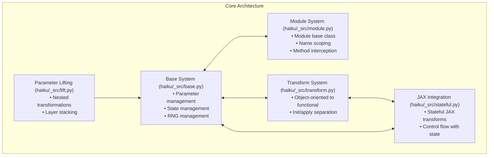
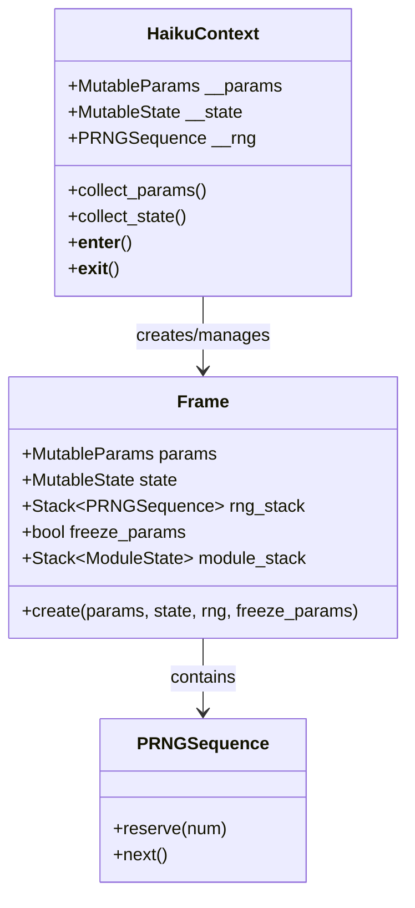
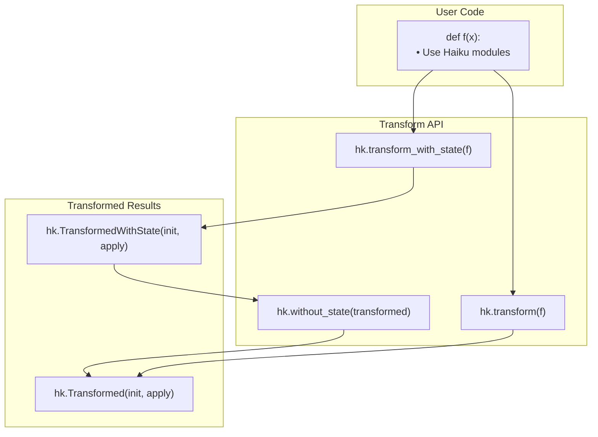
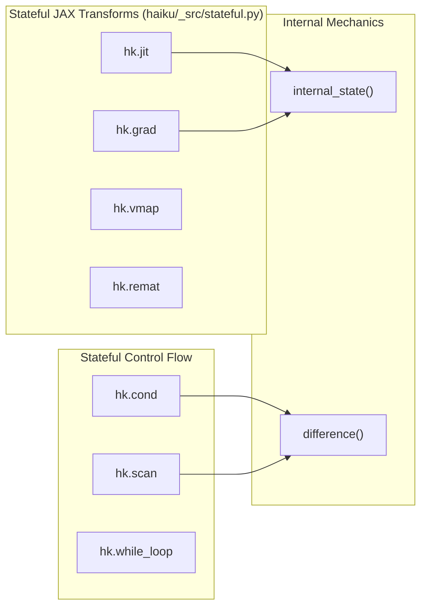
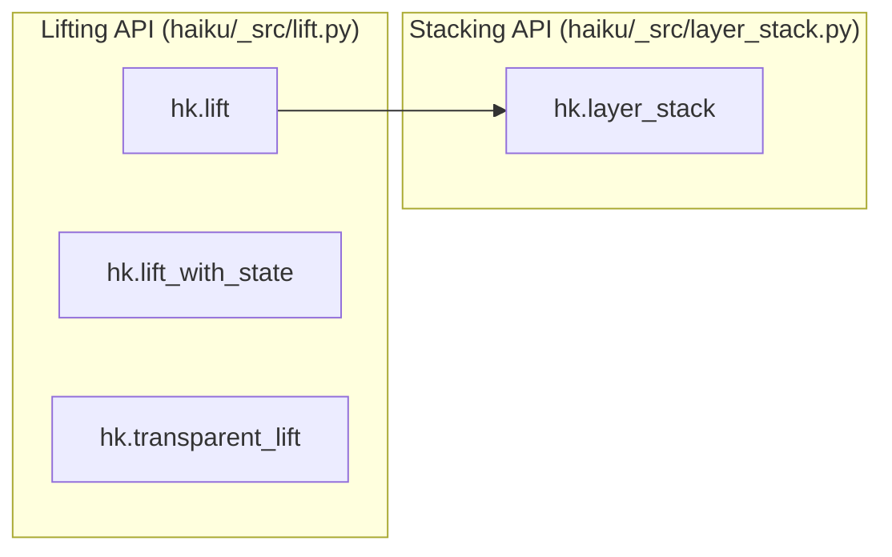
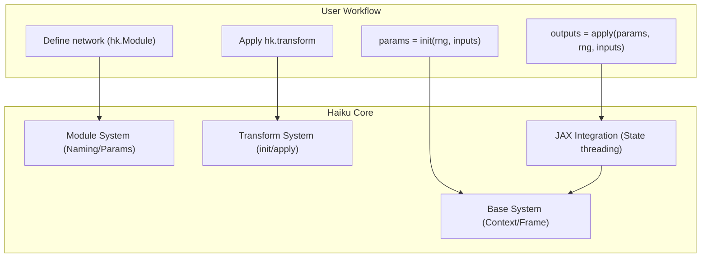

<!-- source: DeepWiki mcp.deepwiki.com · repo google-deepmind/dm-haiku · page 2 Core Architecture · fetched 2026-10-26 -->

# Core Architecture

<details>
<summary>Relevant source files</summary>

The following files were used as context for generating this wiki page:

- [docs/api.rst](docs/api.rst)
- [haiku/BUILD](haiku/BUILD)
- [haiku/__init__.py](haiku/__init__.py)
- [haiku/_src/BUILD](haiku/_src/BUILD)
- [haiku/_src/integration/BUILD](haiku/_src/integration/BUILD)

</details>


This page provides an overview of Haiku's core architectural components and explains how they fit together to create a neural network library that combines JAX's functional programming paradigm with an object-oriented API. For specific details about the module library provided by Haiku, see [Module Library](#3).

## Overview of Core Systems

Haiku's architecture is built around five core systems that work together to allow neural network construction with an object-oriented API while leveraging JAX's functional transformations:



Sources: [haiku/_src/base.py:1-44](), [haiku/_src/module.py:1-35](), [haiku/_src/transform.py:1-42](), [haiku/_src/stateful.py:1-32](), [haiku/_src/lift.py:1-30]()

## Base System

The Base system is the foundation of Haiku, responsible for managing parameters, state, and random number generation. It provides the context management necessary for tracking and accessing these elements in a functional programming environment. For details, see [Parameter and State Management](#2.1).

### Frame and Context Management



Sources: [haiku/_src/base.py:86-154](), [haiku/_src/base.py:161-215](), [haiku/_src/base.py:1016-1098]()

The `Frame` [haiku/_src/base.py:86-154]() serves as the central data store for parameters, state, and random number generation during a Haiku computation. The `HaikuContext` [haiku/_src/base.py:161-215]() creates and manages frames during initialization and application phases. These components allow Haiku to track the execution context and manage parameters and state in a way that's compatible with JAX's functional paradigm.

## Module System

The Module system provides the object-oriented interface for Haiku, allowing users to define reusable neural network components. For details, see [Module System](#2.2).

### Module Class and Module Hierarchy

```mermaid
flowchart TD
    subgraph "Module Hierarchy"
        Module["hk.Module (haiku/_src/module.py)
        • Base class for all modules
        • Name scoping
        • Parameter collection"]
        
        LinearModule["hk.Linear, hk.Conv2D, etc.
        • Standard neural network layers"]
        
        CustomModule["Custom user-defined modules
        • Inherit from hk.Module"]
    end
    
    subgraph "Metaclass Logic"
        ModuleMetaclass["ModuleMetaclass
        • Wraps methods for tracking
        • Adds name scoping"]
        
        intercept_methods["hk.intercept_methods
        • Customizes method behavior"]
    end
    
    Module --> LinearModule
    Module --> CustomModule
    ModuleMetaclass --> Module : creates
    Module --> intercept_methods : supports
```

Sources: [haiku/_src/module.py:419-683](), [haiku/_src/module.py:61-160](), [haiku/_src/module.py:244-322]()

The `Module` class [haiku/_src/module.py:419-683]() serves as the base class for all Haiku modules. It manages module naming, parameter creation, and method interception. The `ModuleMetaclass` [haiku/_src/module.py:61-160]() handles the wrapping of methods to ensure they operate within the correct context and track parameters and state correctly.

## Transformation System

The transformation system is responsible for converting Haiku's object-oriented code into JAX's functional style. For details, see [Transformation System](#2.3).

### Transform Functions and Workflow



Sources: [haiku/_src/transform.py:264-339](), [haiku/_src/transform.py:360-476](), [haiku/_src/transform.py:143-201]()

The transformation system converts Haiku's object-oriented API into JAX's functional style through the `transform` [haiku/_src/transform.py:264-339]() and `transform_with_state` [haiku/_src/transform.py:360-476]() functions. These functions return pairs of pure functions: `init` for creating parameters, and `apply` for using those parameters in computation.

## JAX Integration

Haiku integrates with JAX by providing stateful versions of JAX transformations that correctly handle Haiku's internal state. For details, see [JAX Integration](#2.4).

### Stateful JAX Transformations



Sources: [haiku/_src/stateful.py:38-46](), [haiku/_src/stateful.py:60-67](), [haiku/_src/stateful.py:276-340](), [haiku/_src/stateful.py:476-585]()

Haiku provides stateful versions of JAX transformations like `hk.jit`, `hk.grad`, and control flow operations like `hk.cond` and `hk.scan`. These functions capture and update Haiku's internal state [haiku/_src/stateful.py:246-273](), allowing for stateful operations within JAX's functional framework.

## Parameter Lifting

Parameter lifting enables nested transformations and layer stacking, allowing for more modular and reusable code. For details, see [Parameter Lifting](#2.5).



Sources: [haiku/_src/lift.py:45-132](), [haiku/_src/lift.py:157-234](), [haiku/_src/layer_stack.py:155-275]()

Parameter lifting [haiku/_src/lift.py:45-132]() allows for nesting transformed functions, where parameters from an inner transformation are "lifted" to be managed by an outer transformation. `hk.layer_stack` [haiku/_src/layer_stack.py:155-275]() uses these lifting mechanisms to efficiently stack identical layers using `jax.lax.scan`.

## Putting It All Together

The following diagram shows how all components work together in a typical Haiku workflow:



Sources: [haiku/_src/transform.py:264-339](), [haiku/_src/base.py:161-215](), [haiku/_src/stateful.py:38-46]()

---

