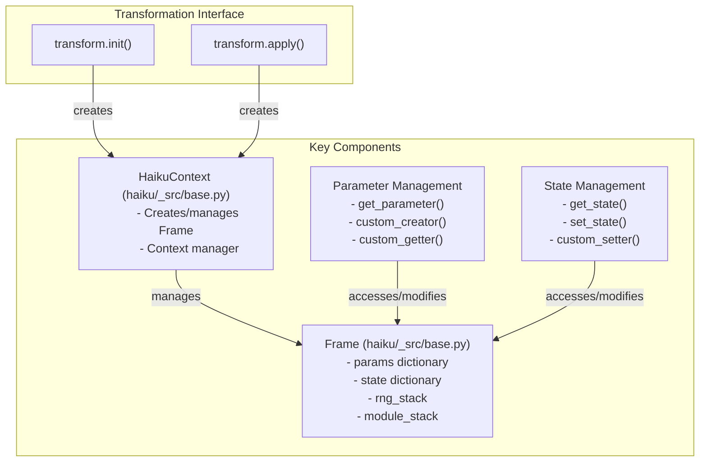
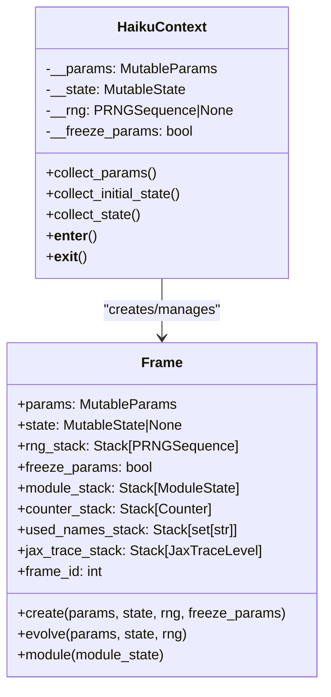
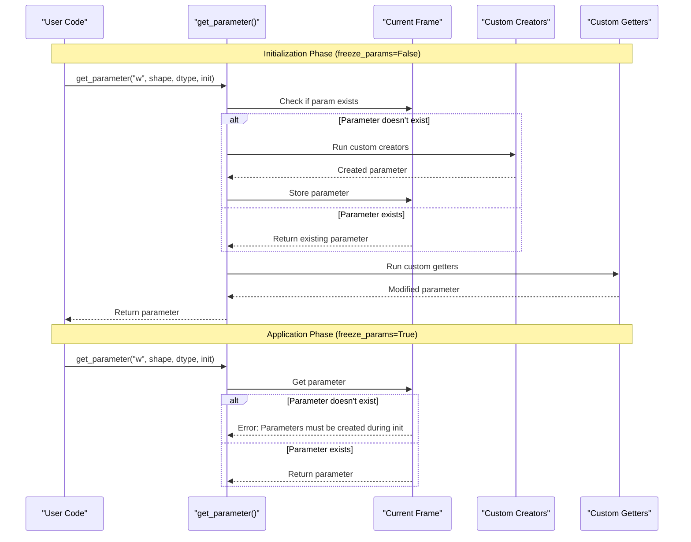
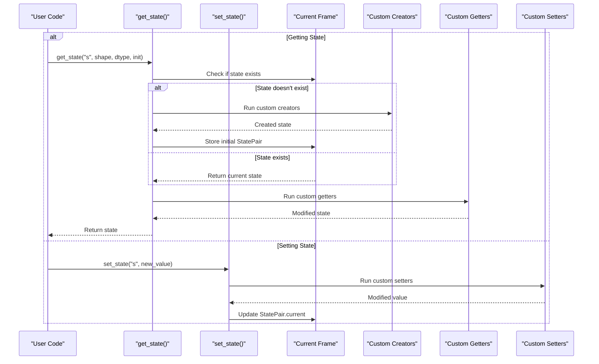

<!-- source: DeepWiki mcp.deepwiki.com · repo google-deepmind/dm-haiku · page 2.1 Parameter and State Management · fetched 2026-10-26 -->

# Parameter and State Management

<details>
<summary>Relevant source files</summary>

The following files were used as context for generating this wiki page:

- [haiku/_src/base.py](haiku/_src/base.py)
- [haiku/_src/base_test.py](haiku/_src/base_test.py)
- [haiku/_src/data_structures.py](haiku/_src/data_structures.py)
- [haiku/_src/data_structures_test.py](haiku/_src/data_structures_test.py)
- [haiku/_src/filtering.py](haiku/_src/filtering.py)
- [haiku/_src/filtering_test.py](haiku/_src/filtering_test.py)

</details>


This page documents how Haiku manages parameters (such as weights and biases) and state (such as running averages in batch normalization) within JAX's pure functional paradigm. For details on the transformation system that enables this management, see [Transformation System](#2.3), and for the module system that leverages these parameters, see [Module System](#2.2).

## Core Concepts

Haiku provides a way to maintain object-oriented parameter management in the functional JAX framework. Parameters are created during initialization and reused during application, while state can be both read and updated during application.



Sources: [haiku/_src/base.py:89-126](), [haiku/_src/base.py:164-216]()

## Frame and HaikuContext

The `Frame` and `HaikuContext` classes form the foundation of Haiku's parameter and state management.



Sources: [haiku/_src/base.py:89-158](), [haiku/_src/base.py:164-216]()

### Frame

`Frame` is a named tuple that stores all per-transform values [haiku/_src/base.py:89-103]():

- `params`: The parameter dictionary (mapping module names to parameter names and values) [haiku/_src/base.py:93]().
- `state`: The state dictionary (mapping module names to state names and `StatePair` objects) [haiku/_src/base.py:94]().
- `rng_stack`: A stack of `PRNGSequence` objects for random number generation [haiku/_src/base.py:95]().
- `freeze_params`: Boolean indicating if we're in apply mode (params frozen) [haiku/_src/base.py:98]().
- `module_stack`: Stack tracking the current module path [haiku/_src/base.py:99]().
- `counter_stack`, `used_names_stack`: Used for unique name management [haiku/_src/base.py:100-101]().
- `jax_trace_stack`: Stores JAX trace state to detect leaking tracers [haiku/_src/base.py:102]().
- `frame_id`: Unique identifier for the frame [haiku/_src/base.py:103]().

### HaikuContext

`HaikuContext` creates and manages frames through a context manager interface [haiku/_src/base.py:164-187]():

- During `__enter__`, it creates a new `Frame` and pushes it onto the `frame_stack` [haiku/_src/base.py:201-207]().
- During `__exit__`, it pops the frame off the stack and executes teardown callbacks [haiku/_src/base.py:209-216]().
- It provides methods to collect parameters (`collect_params`) and state (`collect_state`) from the internal mutable storage [haiku/_src/base.py:189-196]().

## Parameter Management

Parameters in Haiku are managed through `get_parameter()`, with different behaviors during initialization and application phases [haiku/_src/base.py:603-692]().



Sources: [haiku/_src/base.py:603-692](), [haiku/_src/base_test.py:116-130]()

### Key Functions

- `get_parameter(name, shape, dtype, init)`: Retrieves an existing parameter or creates a new one if allowed [haiku/_src/base.py:603-692]().
- `custom_creator(creator, params=True, state=False)`: Registers a custom creator hook [haiku/_src/base.py:770-803]().
- `custom_getter(getter, params=True, state=False)`: Registers a custom getter hook [haiku/_src/base.py:840-883]().

### Init vs Apply Behavior

- During **init** (`freeze_params=False`): If the parameter doesn't exist, it is created using the provided `init` function [haiku/_src/base.py:643-652]().
- During **apply** (`freeze_params=True`): Parameters must already exist in the frame. Requesting a non-existent parameter raises a `ValueError` [haiku/_src/base.py:633-640]().

## State Management

State enables modules to maintain values that change during the `apply` phase (like running statistics in `BatchNorm`) [haiku/_src/base.py:419-514]().



Sources: [haiku/_src/base.py:419-514](), [haiku/_src/base.py:884-969]()

### StatePair

State is internally tracked using a `StatePair` named tuple with `initial` and `current` fields [haiku/_src/base.py:54]():

- `initial`: The state value at the start of the transform (returned by `collect_initial_state`) [haiku/_src/base.py:192-193]().
- `current`: The latest state value updated via `set_state` (returned by `collect_state`) [haiku/_src/base.py:195-196]().

### Key Functions

- `get_state(name, shape, dtype, init)`: Gets or creates state [haiku/_src/base.py:419-466]().
- `set_state(name, value)`: Updates the `current` value of the state [haiku/_src/base.py:467-514]().
- `custom_setter(setter)`: Registers a custom state setter hook [haiku/_src/base.py:945-969]().

## Custom Parameter/State Handling

Haiku provides powerful customization capabilities through stackable hooks.

### Custom Creators

Custom creators allow intercepting the creation of parameters or state [haiku/_src/base.py:770-803]().

```python
def zeros_creator(next_creator, shape, dtype, init, context):
    return next_creator(shape, dtype, jnp.zeros)

with hk.custom_creator(zeros_creator):
    # Initialized with zeros despite init=jnp.ones
    w = hk.get_parameter("w", [], init=jnp.ones)
```

Sources: [haiku/_src/base.py:770-803](), [haiku/_src/base_test.py:32-33]()

### Custom Getters and Setters

- **Custom Getters**: Intercept every call to `get_parameter` or `get_state` to modify the returned value (e.g., for quantization or casting) [haiku/_src/base.py:840-883]().
- **Custom Setters**: Intercept calls to `set_state` to modify values before they are stored in the frame (e.g., for clipping) [haiku/_src/base.py:945-969]().

## Special Features

### DO_NOT_STORE

`DO_NOT_STORE` is a special sentinel value [haiku/_src/base.py:516](). If a creator returns this, the parameter/state is not stored in the Haiku frame dictionaries. This is useful for parameters managed by external systems or for "lifting" parameters from one scope to another [haiku/_src/base.py:516-589]().

### RNG Management

Random number generation is managed through a `PRNGSequence` stored in the frame's `rng_stack` [haiku/_src/base.py:95]().

- `next_rng_key()`: Splits the current RNG and returns a new key [haiku/_src/base.py:1016-1043]().
- `reserve_rng_keys(n)`: Pre-splits `n` keys for use in JAX control flow where side-effects are restricted [haiku/_src/base.py:1137-1161]().

Sources: [haiku/_src/base.py:1016-1043](), [haiku/_src/base.py:1137-1161]()

## Data Structures and Filtering

Haiku uses specialized data structures for parameters and state to ensure compatibility with JAX transformations.

- `FlatMap`: An immutable mapping optimized for JAX `tree_util` operations [haiku/_src/data_structures.py:180-214]().
- `partition`: Splits a parameter/state dictionary into two based on a predicate (e.g., separating weights and biases) [haiku/_src/filtering.py:50-81]().
- `traverse`: Generator that yields `(module_name, name, value)` tuples in sorted order [haiku/_src/filtering.py:30-47]().

Sources: [haiku/_src/data_structures.py:180-214](), [haiku/_src/filtering.py:30-81]()

---

