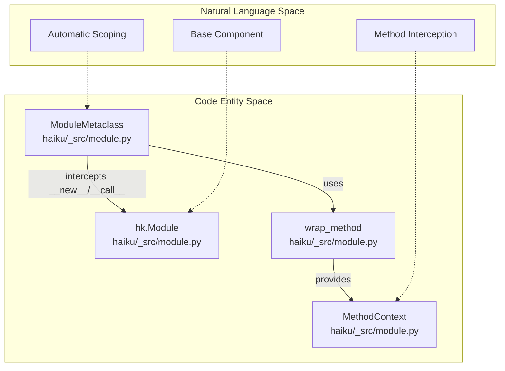
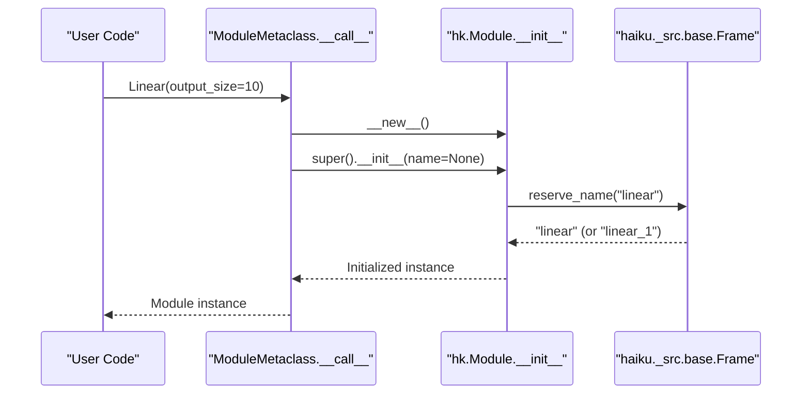
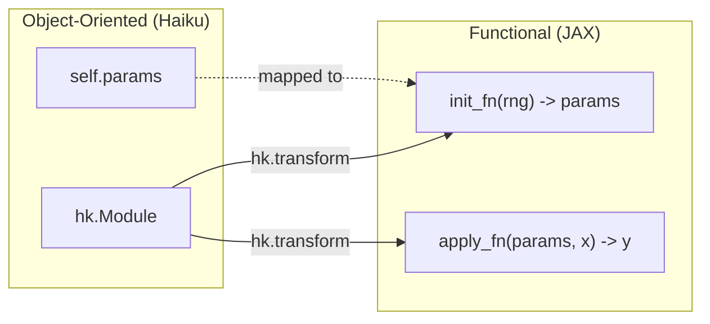

<!-- source: DeepWiki mcp.deepwiki.com · repo google-deepmind/dm-haiku · page 2.2 Module System · fetched 2026-10-26 -->

# Module System

Relevant source files

The following files were used as context for generating this wiki page:

- [haiku/_src/basic.py](haiku/_src/basic.py)
- [haiku/_src/basic_test.py](haiku/_src/basic_test.py)
- [haiku/_src/bias_test.py](haiku/_src/bias_test.py)
- [haiku/_src/module.py](haiku/_src/module.py)
- [haiku/_src/module_test.py](haiku/_src/module_test.py)

The Haiku Module System provides the foundation for building neural networks in an object-oriented style while maintaining JAX's functional transformation capabilities. This page explains how modules are defined, named, and organized, as well as how method interception works within the module hierarchy.

## Overview of the Module System

The Module System in Haiku allows developers to create reusable neural network components through an object-oriented paradigm. The core of this system is the `Module` class, which serves as the base class for all neural network components in Haiku. Modules manage their own parameters and state while providing a consistent interface for defining neural network operations.

### Core Class Relationships

The module system relies on a metaclass to orchestrate method wrapping and name scoping.

Title: Module System Entity Mapping

Sources: [haiku/_src/module.py:419-480](), [haiku/_src/module.py:62-166](), [haiku/_src/module.py:169-235]()

## Module Creation and Naming

When you create a Haiku module, it is automatically assigned a unique name derived from its class name (converted to `snake_case`) or a custom name if provided via the `name` argument [haiku/_src/module.py:496-529](). This name is used to organize parameters and state in a hierarchical structure.

The `ModuleMetaclass` overrides `__call__` to ensure that `__init__` runs within a protected name scope, even if an exception occurs [haiku/_src/module.py:127-160]().

### Naming Logic and Conflict Resolution

1.  **Class to Name**: If no name is provided, `utils.class_to_name` converts the class name to snake case [haiku/_src/module.py:643-644]().
2.  **Uniqueness**: Haiku checks the current `Frame` to see if a name is already in use. If it is, it appends an index (e.g., `linear_1`) [haiku/_src/module.py:656-663]().
3.  **Validation**: Module names must be valid Python identifiers and cannot contain reserved characters like `/` [haiku/_src/module.py:532-544]().

Title: Module Initialization Sequence

Sources: [haiku/_src/module.py:127-160](), [haiku/_src/module.py:638-668](), [haiku/_src/module_test.py:41-52]()

## Module Hierarchy and Parameter Organization

Modules automatically track their submodules and organize parameters and state in a tree structure. When a module method is called, Haiku enters a `name_scope` corresponding to that module [haiku/_src/module.py:441-443]().

The hierarchy is represented by `/` separators. Parameters created within a module's `__call__` method typically appear as `module_name/parameter_name`. Parameters created in other methods (like `__init__`) are prefixed with a tilde `~` to indicate they are not part of the primary forward pass scope [haiku/_src/module_test.py:141-148]().

Sources: [haiku/_src/module.py:673-687](), [haiku/_src/module_test.py:149-155]()

## Name Scopes and Manual Naming

### Name Scopes
The `hk.name_scope` context manager allows grouping operations under a common namespace without defining a full module [haiku/_src/module.py:827-828](). Internally, this uses a `NameScopeModule` to hook into the standard module naming logic [haiku/_src/module.py:367-416]().

### Forced Naming
The `hk.force_name(name)` function can be passed to a module's `name` argument to bypass uniqueness checks and hierarchy rules [haiku/_src/module.py:558-596](). This is primarily used for parameter sharing across different parts of a model [haiku/_src/module_test.py:715-770]().

Sources: [haiku/_src/module.py:331-366](), [haiku/_src/module.py:558-596]()

## Method Interception

Haiku provides a powerful interception system via `hk.intercept_methods`. This allows wrapping every method call on a module with a custom function.

### Interceptor Components
-   **`MethodContext`**: A `NamedTuple` containing the `module` instance, `method_name`, the `orig_method` being called, and the `orig_class` where it was defined [haiku/_src/module.py:169-176]().
-   **`intercept_methods`**: A context manager that pushes an interceptor onto a thread-local stack [haiku/_src/module.py:295-322]().

### Implementation Detail
The `ModuleMetaclass` uses `wrap_method` to wrap all public methods of a class [haiku/_src/module.py:113-123](). When a wrapped method is called, it checks `base.current_frame().interceptor_stack`. If interceptors exist, they are called in LIFO order [haiku/_src/module.py:255-271]().

Sources: [haiku/_src/module.py:169-235](), [haiku/_src/module.py:242-288](), [haiku/_src/module_test.py:392-456]()

## Method Wrapping via Metaclass

The `ModuleMetaclass` is responsible for transforming standard Python classes into Haiku Modules.

| Feature | Metaclass Implementation |
| :--- | :--- |
| **Method Wrapping** | Iterates through `clsdict` and wraps functions with `wrap_method` [haiku/_src/module.py:71-125](). |
| **Property Support** | Wraps property getters, setters, and deleters [haiku/_src/module.py:84-91](). |
| **Auto Repr** | Automatically generates a string representation using `utils.auto_repr` unless disabled [haiku/_src/module.py:139-142](). |
| **Signature** | Overrides `__signature__` to match `__init__` but excluding `self` [haiku/_src/module.py:162-166](). |

Sources: [haiku/_src/module.py:62-166](), [haiku/_src/module.py:419-480]()

## Special Module Features

### Transparent Methods
The `@hk.transparent` decorator marks a method so that it does not create a new level in the naming hierarchy [haiku/_src/module.py:709-724](). This is useful for internal helper methods that should share the scope of the calling method [haiku/_src/module_test.py:290-294]().

### Name Customization with `name_like`
The `@hk.name_like(other_method_name)` decorator allows a method to "pretend" it is another method for naming purposes [haiku/_src/module.py:727-807](). This is frequently used to make methods like `encode` or `decode` behave like `__call__` regarding parameter naming [haiku/_src/module_test.py:603-631]().

### Hook Methods
`hk.hook_methods` allows attaching pre- and post-call hooks to module methods. Unlike interceptors, hooks cannot modify the arguments or return values, making them safer for logging or state tracking [haiku/_src/module.py:325-328]().

## Integration with JAX

The module system bridges the gap between Object-Oriented Design and JAX's Functional requirement.

Title: OO to Functional Bridge

Sources: [haiku/__init__.py:133-146](), [haiku/_src/module.py:610-668]()

## Best Practices

1.  **Super Constructor**: Always call `super().__init__(name=name)` as the first line of a module's `__init__`. Failure to do so will raise a `ValueError` [haiku/_src/module.py:153-158]().
2.  **Naming Validation**: Avoid using `/` or `~` in custom names, as these are reserved for hierarchy and internal scoping [haiku/_src/module.py:532-544]().
3.  **Lazy Initialization**: Define parameters inside `__call__` or other methods rather than `__init__` to allow for automatic shape inference [haiku/_src/basic.py:177-182]().
4.  **Metaclass Conflicts**: If inheriting from a class with its own metaclass (like `abc.ABC`), ensure compatibility. `ModuleMetaclass` inherits from `type(Protocol)` to minimize these conflicts [haiku/_src/module.py:59-62]().

Sources: [haiku/_src/module.py:153-158](), [haiku/_src/module_test.py:1-105]()

---

