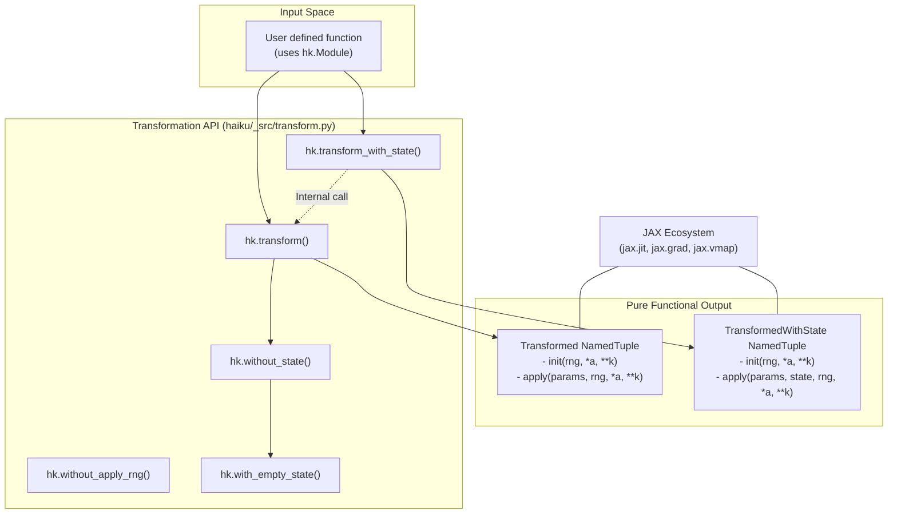
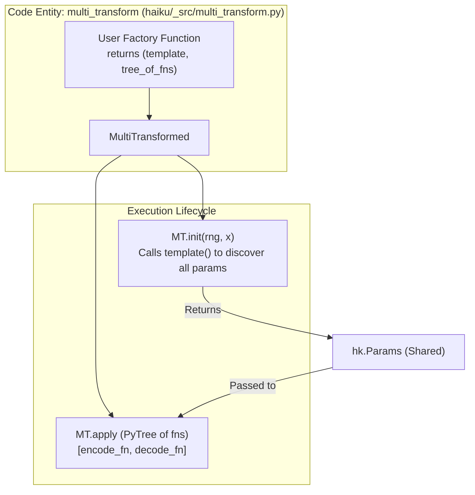

<!-- source: DeepWiki mcp.deepwiki.com · repo google-deepmind/dm-haiku · page 2.3 Transformation System · fetched 2026-10-26 -->

# Transformation System

Relevant source files

The following files were used as context for generating this wiki page:

- [haiku/BUILD](haiku/BUILD)
- [haiku/_src/BUILD](haiku/_src/BUILD)
- [haiku/_src/integration/BUILD](haiku/_src/integration/BUILD)
- [haiku/_src/multi_transform.py](haiku/_src/multi_transform.py)
- [haiku/_src/multi_transform_test.py](haiku/_src/multi_transform_test.py)
- [haiku/_src/transform.py](haiku/_src/transform.py)
- [haiku/_src/transform_test.py](haiku/_src/transform_test.py)

The Transformation System is a core component of Haiku that bridges object-oriented programming (using Haiku modules) and functional programming (required by JAX). It converts functions that use Haiku modules into pure functions that explicitly manage parameters and state, making them compatible with JAX transformations like `jit`, `grad`, and `vmap`.

## Purpose and Functionality

The transformation system serves two main purposes:

1.  **Parameter Management**: It extracts parameters from the object-oriented model into explicit data structures (`hk.Params`) that can be passed around functionally.
2.  **State Handling**: It supports maintaining and updating state variables (`hk.State`) in a functional paradigm for modules like `BatchNorm`.

### System Overview Diagram
"Natural Language Space" to "Code Entity Space" mapping:

Sources: [haiku/_src/transform.py:91-119](), [haiku/_src/transform.py:264-339](), [haiku/_src/transform.py:360-476]()

## Core Transformation Functions

### `hk.transform`
The `transform` function converts a function using Haiku modules into a `Transformed` named tuple. This is used for models that do not require mutable state updates (e.g., standard MLPs).

**Data Flow:**
1.  **Init Phase**: The `init` function runs the user code inside a `HaikuContext` to collect all parameters created via `hk.get_parameter`.
2.  **Apply Phase**: The `apply` function runs the user code, injecting the provided `Params` into the modules.

Sources: [haiku/_src/transform.py:264-339](), [haiku/_src/transform_test.py:45-52]()

### `hk.transform_with_state`
`transform_with_state` handles both parameters and mutable state (e.g., moving averages in `BatchNorm`). It returns a `TransformedWithState` named tuple.

**Data Flow:**
1.  **Init Phase**: Returns both `Params` and initial `State`.
2.  **Apply Phase**: Accepts `Params` and `State`, and returns the function output plus the updated `State`.

Sources: [haiku/_src/transform.py:360-476](), [haiku/_src/transform_test.py:106-114]()

## Transformation Data Structures

The system relies on specific `NamedTuple` structures to provide a consistent interface for JAX.

| Class | Attributes | Use Case |
| :--- | :--- | :--- |
| `Transformed` | `init`, `apply` | Stateless modules (Params only) |
| `TransformedWithState` | `init`, `apply` | Stateful modules (Params + State) |
| `MultiTransformed` | `init`, `apply` (tree) | Shared parameters across multiple functions |
| `MultiTransformedWithState`| `init`, `apply` (tree) | Shared parameters + state across multiple functions |

Sources: [haiku/_src/transform.py:91-119](), [haiku/_src/multi_transform.py:50-89]()

## Multi-Transformation System

`hk.multi_transform` allows multiple functions to share a single set of parameters. This is essential for architectures like Autoencoders where an `encode` and `decode` function must share the same weights.

Sources: [haiku/_src/multi_transform.py:176-237](), [haiku/_src/multi_transform_test.py:58-74]()

## Lifecycle and Utilities

### `hk.running_init`
This utility returns `True` if the current code is executing inside an `init` function. It is used to guard logic that should only happen during parameter initialization, such as certain shape-dependent setup.
Sources: [haiku/_src/transform.py:514-541]()

### `hk.without_state` and `hk.without_apply_rng`
These wrappers simplify the functional interface:
-   **`without_state`**: Converts `TransformedWithState` to `Transformed`. It raises `base.NonEmptyStateError` if the function actually attempts to use state. [haiku/_src/transform.py:141-199]()
-   **`without_apply_rng`**: Removes the `rng` argument from the `apply` function. This is useful when the model is deterministic during inference. [haiku/_src/multi_transform.py:240-305]()

### RNG Handling
Haiku transforms automatically handle JAX PRNGKeys. The system converts the input `rng` into a `hk.PRNGSequence` internally during the transformation lifecycle to allow modules to call `hk.next_rng_key()` without manually splitting keys.
Sources: [haiku/_src/transform.py:121-129](), [haiku/_src/transform.py:402-425]()

## Implementation Details

### Signature Preservation
Haiku uses `inspect.Signature` manipulation to ensure that transformed functions (`init` and `apply`) retain the parameter names and default values of the original user-defined function, while prepending the necessary JAX-compatible arguments (`params`, `state`, `rng`).
Sources: [haiku/_src/transform.py:45-60](), [haiku/_src/transform.py:427-438]()

### Error Handling and Validation
The system validates inputs to prevent common JAX/Haiku integration errors:
-   **Tracing Errors**: Detects if JAX transformations (like `jax.vmap`) are used directly on Haiku modules instead of using `hk.vmap`. [haiku/_src/transform.py:345-357]()
-   **Late Parameter Creation**: Ensures parameters are not created during the `apply` phase, which would violate JAX's requirement for pure functions. [haiku/_src/transform_test.py:72-79]()
-   **RNG Validation**: Validates that a non-None `PRNGKey` is provided if the model is stochastic. [haiku/_src/transform_test.py:97-104]()

Sources: `haiku/_src/transform.py`, `haiku/_src/multi_transform.py`, `haiku/_src/transform_test.py`.

---

