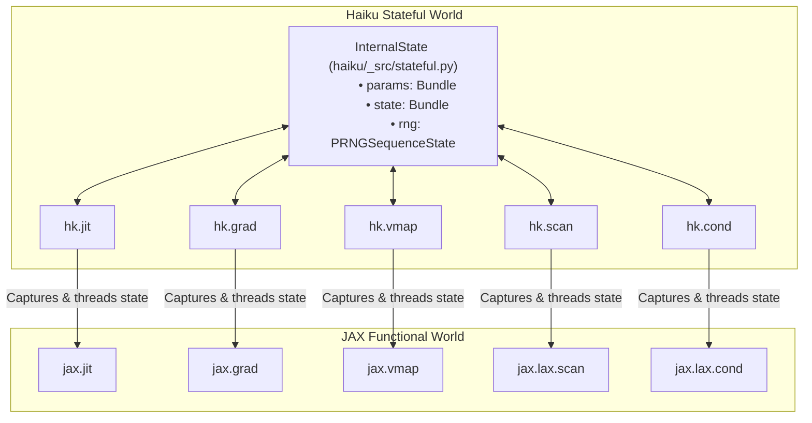
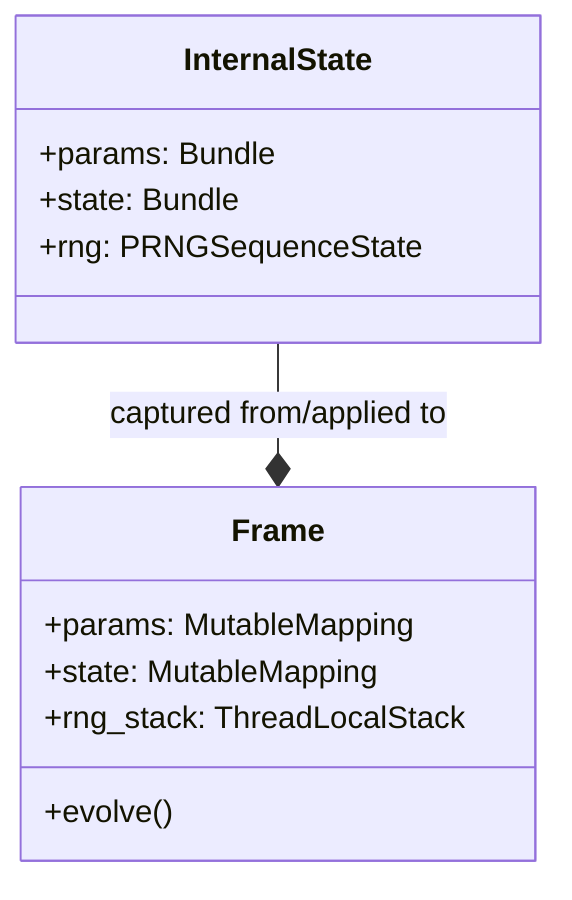
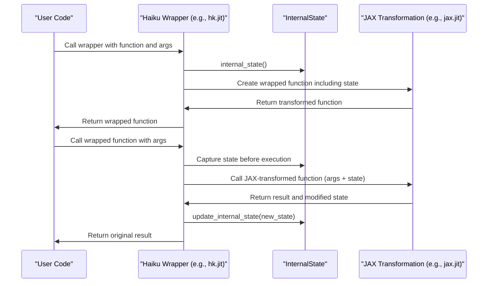

<!-- source: DeepWiki mcp.deepwiki.com · repo google-deepmind/dm-haiku · page 2.4 JAX Integration · fetched 2026-10-26 -->

# JAX Integration

<details>
<summary>Relevant source files</summary>

The following files were used as context for generating this wiki page:

- [haiku/_src/integration/hk_transforms_test.py](haiku/_src/integration/hk_transforms_test.py)
- [haiku/_src/integration/jax_transforms_test.py](haiku/_src/integration/jax_transforms_test.py)
- [haiku/_src/integration/numpy_inputs_test.py](haiku/_src/integration/numpy_inputs_test.py)
- [haiku/_src/random_test.py](haiku/_src/random_test.py)
- [haiku/_src/stateful.py](haiku/_src/stateful.py)
- [haiku/_src/stateful_test.py](haiku/_src/stateful_test.py)
- [haiku/nets.py](haiku/nets.py)
- [requirements-jax.txt](requirements-jax.txt)
- [requirements-test.txt](requirements-test.txt)

</details>


This page explains how Haiku integrates with JAX's transformations like `jit`, `grad`, and `vmap`, while managing the internal state of Haiku modules. Haiku modules maintain parameters, state, and random number generators, which must be properly threaded through JAX's functional transformations.

For information about the transformation system that converts object-oriented Haiku code to JAX-compatible functions, see **2.3. Transformation System**.

## Overview

Haiku implements an object-oriented neural network API over JAX's functional programming model. While JAX transformations expect pure functions without side effects, Haiku modules maintain internal state like parameters, module state, and random number generators. Haiku's JAX integration system bridges this gap by providing wrappers around JAX transformations that correctly handle Haiku's internal state.

### Mapping JAX Transformations to Haiku Entities

The following diagram maps JAX transformation concepts to the specific Haiku implementation entities that handle state threading.



Sources: [haiku/_src/stateful.py:15-17](), [haiku/_src/stateful.py:28-29](), [haiku/_src/stateful.py:378-380](), [haiku/_src/stateful.py:99-100]().

## Internal State Management

The core of Haiku's JAX integration is its internal state management system, which is implemented through the `InternalState` namedtuple and managed within a `Frame`.



The `InternalState` [haiku/_src/stateful.py:28-28]() manages three components:
1. **params**: Parameters of modules (e.g., weights, biases).
2. **state**: Stateful values that modules maintain (e.g., moving averages).
3. **rng**: Random number generator state for stochastic operations.

### Key Internal State Operations

- **Capture**: `internal_state()` [haiku/_src/stateful.py:38-46]() captures the current Haiku frame's state using `base.current_frame()`.
- **Update**: `update_internal_state(state)` [haiku/_src/stateful.py:60-68]() applies changes back to the frame, recursively merging updates via `update_recursive` [haiku/_src/stateful.py:49-58]().
- **Temporary Context**: `temporary_internal_state(state)` [haiku/_src/stateful.py:70-86]() creates a context with a specific state by evolving the current frame and pushing it onto the `base.frame_stack`.
- **Difference Tracking**: The `difference(before, after)` [haiku/_src/stateful.py:276-318]() function identifies changes between two `InternalState` snapshots, allowing Haiku to only propagate modified state back to JAX.

Sources: [haiku/_src/stateful.py:28-46](), [haiku/_src/stateful.py:60-86](), [haiku/_src/stateful.py:276-318]().

## JAX Transformation Wrappers

Haiku provides wrappers for JAX transformations that thread Haiku state through the transformation. These wrappers follow a common pattern facilitated by the `thread_hk_state_in_kwargs` [haiku/_src/stateful.py:343-375]() helper.

### The Threading Mechanism

Haiku intercepts the function call, extracts the current state, and injects it into the JAX transformation as an auxiliary argument.



Sources: [haiku/_src/stateful.py:343-375](), [haiku/_src/stateful.py:378-391]().

## Key JAX Transformations in Haiku

### Just-in-Time Compilation (hk.jit)

`hk.jit` [haiku/_src/stateful.py:378-391]() compiles a function for faster execution while handling Haiku state. It uses `jax.jit` internally but wraps the input function to handle the `InternalState`.

Example from test [haiku/_src/stateful_test.py:175-180]():
```python
@test_utils.transform_and_run
def test_jit(self):
  mod = SquareModule()
  x = jnp.array(2)
  y = stateful.jit(mod)(x)
  self.assertEqual(y, x ** 2)
```

### Automatic Differentiation (hk.grad)

`hk.grad` [haiku/_src/stateful.py:99-161]() and `hk.value_and_grad` [haiku/_src/stateful.py:164-233]() compute gradients while correctly managing Haiku state. This is critical when a module uses `hk.set_state` inside the function being differentiated.

### Vectorization (hk.vmap)

`hk.vmap` [haiku/_src/stateful.py:757-870]() vectorizes a function across a batch dimension. A key feature is the `split_rng` parameter:

- **split_rng=False**: The same RNG key is broadcast to all mapped function calls.
- **split_rng=True**: The RNG key is split into independent keys for each mapped element using `jax.random.split`.

Sources: [haiku/_src/stateful.py:99-233](), [haiku/_src/stateful.py:757-870]().

### Control Flow Operators

Haiku provides several control flow operators that ensure module state updates within branches or loops are properly captured:

| Haiku Function | JAX Equivalent | Purpose |
|:---|:---|:---|
| `hk.cond` [haiku/_src/stateful.py:411-482]() | `jax.lax.cond` | Conditional execution of stateful functions. |
| `hk.switch` [haiku/_src/stateful.py:546-585]() | `jax.lax.switch` | Multi-way conditional branch. |
| `hk.scan` [haiku/_src/stateful.py:588-653]() | `jax.lax.scan` | Iterative loop with state threading. |
| `hk.while_loop` [haiku/_src/stateful.py:875-918]() | `jax.lax.while_loop` | Dynamic loop with state. |
| `hk.fori_loop` [haiku/_src/stateful.py:665-698]() | `jax.lax.fori_loop` | Counted loop with state. |

Sources: [haiku/_src/stateful.py:411-698](), [haiku/_src/stateful.py:875-918]().

## Usage Patterns and RNG Handling

### RNG Reservation

When using stateful control flow (like `hk.scan` or `hk.cond`), Haiku uses `reserve_up_to_full_rng_block()` [haiku/_src/stateful.py:89-97]() to ensure that the PRNG sequence has a consistent block of keys available, preventing unexpected behavior when the RNG is active across branches.

### Initialization vs. Application

A common pitfall is creating parameters inside conditional branches. Haiku's `hk.cond` implementation includes logic to detect if it is being run during `hk.running_init()` [haiku/_src/stateful.py:434-458](). If so, it may execute branches to ensure parameters are initialized, even if the condition would otherwise skip them.

### State Tracking and Difference

To optimize performance and avoid unnecessary state updates, Haiku uses a "difference-tracking" mechanism. The `difference` function [haiku/_src/stateful.py:276-318]() compares the state before and after a transformation, returning only the modified leaves. This is used in `thread_hk_state_in_kwargs` to return only changed state back to the JAX transformation.

Sources: [haiku/_src/stateful.py:89-97](), [haiku/_src/stateful.py:276-318](), [haiku/_src/stateful.py:434-458]().

---

