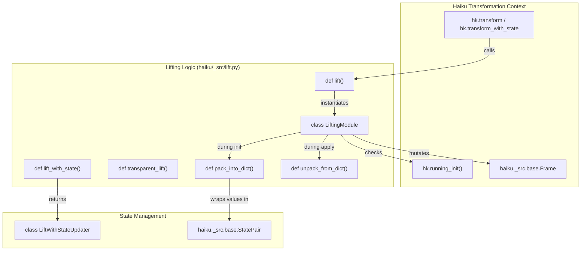
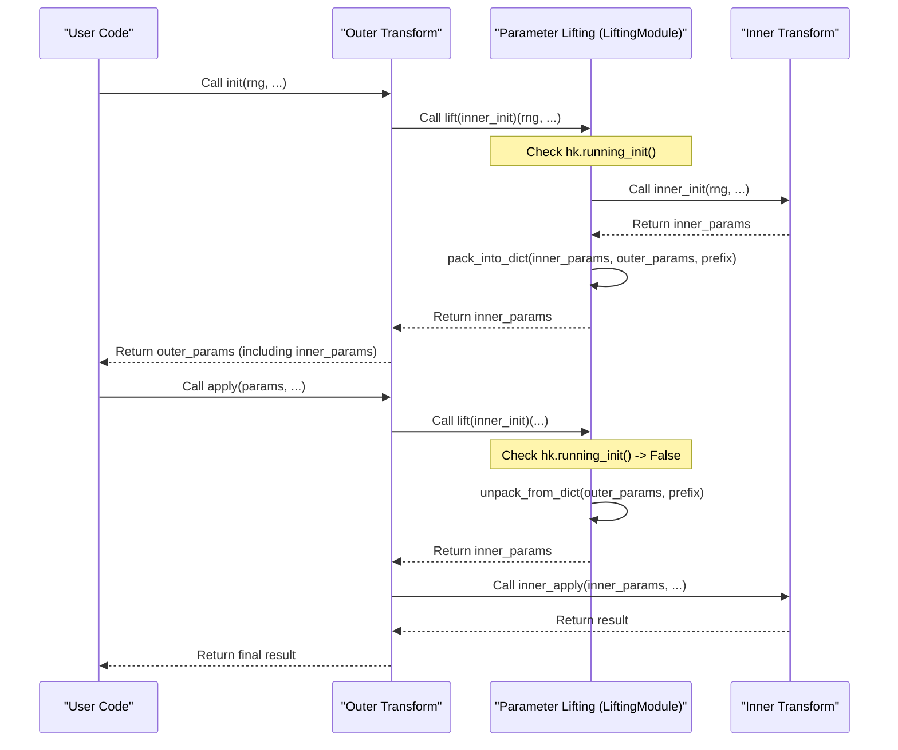
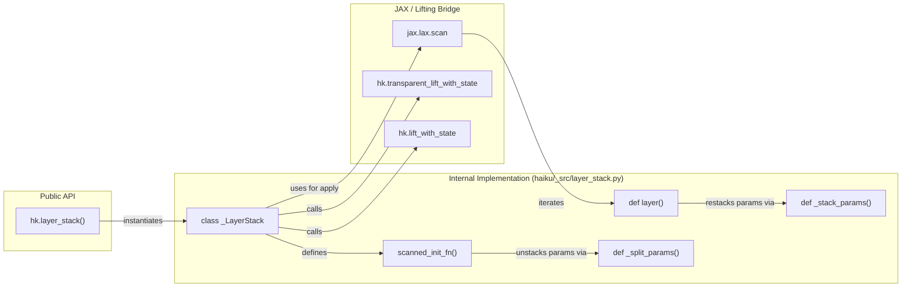

<!-- source: DeepWiki mcp.deepwiki.com · repo google-deepmind/dm-haiku · page 2.5 Parameter Lifting · fetched 2026-10-26 -->

# Parameter Lifting

<details>
<summary>Relevant source files</summary>

The following files were used as context for generating this wiki page:

- [haiku/_src/layer_stack.py](haiku/_src/layer_stack.py)
- [haiku/_src/layer_stack_test.py](haiku/_src/layer_stack_test.py)
- [haiku/_src/lift.py](haiku/_src/lift.py)
- [haiku/_src/lift_test.py](haiku/_src/lift_test.py)

</details>


Parameter lifting is a mechanism in Haiku that enables nested transformations by properly connecting parameters between inner and outer transformed functions. It is primarily used when you need to apply JAX transformations (like `jax.vmap` or `jax.scan`) inside a Haiku transformed function. This page covers the parameter lifting system and related layer stacking functionality.

For information about the broader transformation system, see [Transformation System](2.3).

## Overview of Parameter Lifting

Parameter lifting allows you to register parameters from an inner transformed function within an outer transform's parameter collection. This solves the problem of parameter management in nested transformations, which commonly occurs when using JAX transformations like `vmap` or `scan` inside Haiku modules.

### Natural Language to Code Entity Space: Lifting Components
The following diagram maps the conceptual lifting process to the specific classes and functions in the Haiku codebase.



Sources: [haiku/_src/lift.py:85-130](), [haiku/_src/lift.py:133-167](), [haiku/_src/lift.py:367-428](), [haiku/_src/lift.py:43-61](), [haiku/_src/lift.py:63-69]()

### Problem Solved by Parameter Lifting

Without parameter lifting, when you transform a function that itself uses another transformed function, you would need to manually handle parameter passing between the transforms. Parameter lifting automates this process, making nested transformations seamless and avoiding parameter duplication or loss.



Sources: [haiku/_src/lift.py:101-130](), [haiku/_src/lift.py:43-61](), [haiku/_src/lift.py:63-69]()

## Lifting Functions

Haiku provides four primary lifting functions for different scenarios:

| Function | Purpose | Adds Namespace | Handles State | Implementation |
|----------|---------|----------------|---------------|----------------|
| `lift` | Basic parameter lifting | Yes | No | [haiku/_src/lift.py:133-254]() |
| `lift_with_state` | Lifts parameters and state | Yes | Yes | [haiku/_src/lift.py:367-428]() |
| `transparent_lift` | Lifts parameters without namespace | No | No | [haiku/_src/lift.py:257-296]() |
| `transparent_lift_with_state` | Lifts parameters and state without namespace | No | Yes | [haiku/_src/lift.py:438-477]() |

### Basic Parameter Lifting

The `lift` function is used to lift parameters from an inner transformation to an outer one. It creates a `LiftingModule` that handles the logic of whether to run the inner `init` or pull from existing parameters based on `hk.running_init()` [haiku/_src/lift.py:105-130]().

The `lift` function wraps the parameters in a namespace (by default named "lifted") to prevent name collisions [haiku/_src/lift.py:137]().

### Lifting with State

When your inner function has state that needs to be tracked, use `lift_with_state`. This returns two objects: a function to retrieve parameters/state and a `LiftWithStateUpdater` [haiku/_src/lift.py:427]().

```python
# Inside a transformed_with_state function
inner_fn = hk.transform_with_state(...)
params_and_state_fn, updater = hk.lift_with_state(inner_fn.init)
params, state = params_and_state_fn(rng, x)
out, new_state = inner_fn.apply(params, state, rng, x)
updater.update(new_state)  # Updates the outer state with the new inner state
```

The `LiftWithStateUpdater` ensures that the state update is called exactly once during the execution of the outer transform [haiku/_src/lift.py:343-348]().

Sources: [haiku/_src/lift.py:323-359](), [haiku/_src/lift.py:367-428]()

## Layer Stack

The `layer_stack` functionality builds on parameter lifting to create stacks of layers with non-shared parameters using `jax.lax.scan`. This is highly efficient for deep networks with repeated layers.

### Natural Language to Code Entity Space: Layer Stacking Implementation
This diagram maps the high-level `layer_stack` API to the internal scanning and lifting mechanisms.



Sources: [haiku/_src/layer_stack.py:132-223](), [haiku/_src/layer_stack.py:284-412](), [haiku/_src/layer_stack.py:84-130]()

### How Layer Stack Works

1. **Initialization**: `layer_stack` creates a `scanned_init_fn` that uses `jax.lax.scan` to run the layer's `init` function `count` times [haiku/_src/layer_stack.py:164-171]().
2. **Lifting**: It uses `lift.lift_with_state` (or `transparent_lift_with_state`) to register the resulting stacked parameters and state in the outer Haiku context [haiku/_src/layer_stack.py:174-182]().
3. **Application**: During the `apply` phase, it uses `jax.lax.scan` to iterate through the layers, passing the relevant slice of parameters and state to each step [haiku/_src/layer_stack.py:186-215]().

### Transparency in Layer Stack

Layer stack supports "transparent" mode which allows parameters to appear as if they were created in a standard loop. This requires a `LayerStackTransparencyMapping` to define how stacked names map to flat names [haiku/_src/layer_stack.py:58-83]().

The `_split_params` function converts stacked parameters (with an extra dimension) into a flat Haiku dictionary during init [haiku/_src/layer_stack.py:84-100](). Conversely, `_stack_params` aggregates them back into a stacked format for the scan operation [haiku/_src/layer_stack.py:103-129]().

Sources: [haiku/_src/layer_stack.py:132-223](), [haiku/_src/layer_stack.py:284-412]()

## Common Use Cases

### Using JAX vmap Inside Haiku

A common usage of `lift` is to use `jax.vmap` to create an ensemble where each member has its own parameters [haiku/_src/lift.py:170-180]().

```python
def ensemble_fn(x):
    model = hk.transform(MyModel)
    # vmap the init to create 'size' sets of parameters
    init_fn = jax.vmap(model.init, in_axes=(0, None))
    # Lift the vmapped init
    params = hk.lift(init_fn)(hk.next_rng_keys(size), x)
    # vmap the apply
    return jax.vmap(model.apply, in_axes=(0, None, None))(params, None, x)
```

Sources: [haiku/_src/lift.py:181-227](), [haiku/_src/lift_test.py:95-120]()

### Implementation of Recurrent Structures

Parameter lifting is the foundation for stateful scanning, allowing Haiku modules to maintain state across iterations of a `jax.lax.scan` while keeping the parameters correctly registered [haiku/_src/lift_test.py:122-161]().

Sources: [haiku/_src/lift.py:15-16](), [haiku/_src/layer_stack.py:15-16]()

---

