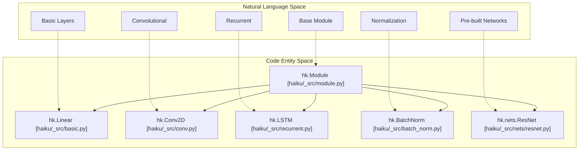
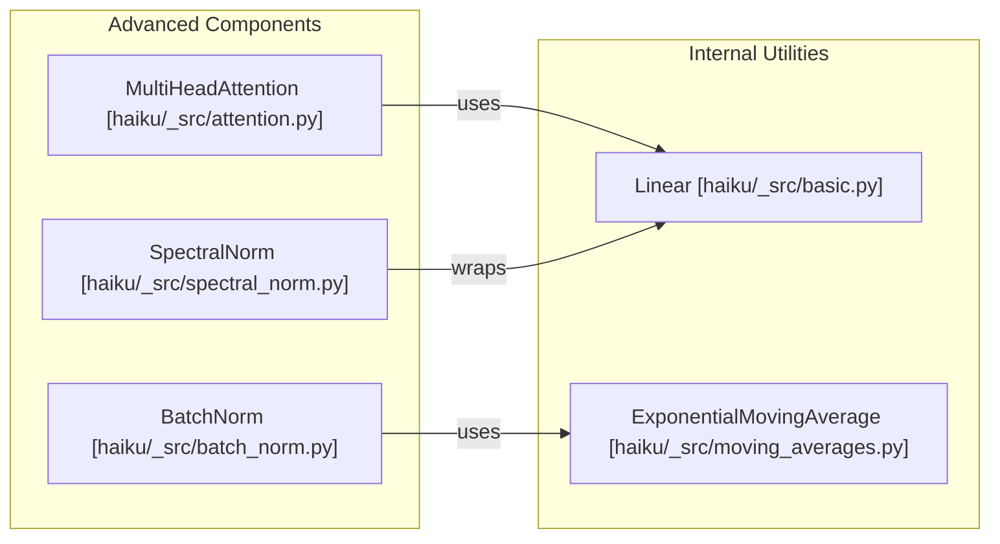

<!-- source: DeepWiki mcp.deepwiki.com · repo google-deepmind/dm-haiku · page 3 Module Library · fetched 2026-10-26 -->

# Module Library

Relevant source files

The following files were used as context for generating this wiki page:

- [docs/api.rst](docs/api.rst)
- [haiku/BUILD](haiku/BUILD)
- [haiku/__init__.py](haiku/__init__.py)
- [haiku/_src/BUILD](haiku/_src/BUILD)
- [haiku/_src/integration/BUILD](haiku/_src/integration/BUILD)

This page provides a comprehensive overview of the neural network building blocks available in the DeepMind Haiku (`dm-haiku`) library. The Module Library contains a diverse set of components that can be combined to build various neural network architectures, from simple multi-layer perceptrons to complex transformer models.

For detailed information about the core architecture and how modules integrate with the transformation system, see [Core Architecture](#2). For information about specific module categories, see their dedicated pages: [Basic Modules](#3.1), [Convolutional Modules](#3.2), [Recurrent Modules](#3.3), and [Advanced Modules](#3.4).

## Module Hierarchy

Haiku provides a clean, hierarchical organization of neural network components. All modules inherit from the base `hk.Module` class, which provides common functionality like name scoping, parameter management, and method interception [haiku/_src/module.py:35-43]().

### Haiku Module Map
The following diagram maps high-level module categories to their primary code implementations and file locations.

Sources: [haiku/_src/module.py:35-43](), [haiku/_src/basic.py:88-187](), [haiku/_src/conv.py:228-258](), [haiku/_src/recurrent.py:461-543](), [haiku/_src/batch_norm.py:44-96](), [haiku/_src/nets/resnet.py:321-365]()

## Basic Modules

Basic modules form the foundation of neural networks in Haiku. These include:

- **Linear**: Applies a linear transformation to the input [haiku/_src/basic.py:88-187]().
- **Sequential**: Chains multiple modules together in a sequence [haiku/_src/basic.py:227-268]().
- **Bias**: Adds a trainable bias to inputs [haiku/_src/bias.py:30-68]().
- **Dropout**: Randomly zeros elements of the input tensor during training [haiku/_src/basic.py:433-475]().

For details, see [Basic Modules](#3.1).

Sources: [haiku/_src/basic.py](), [haiku/_src/bias.py]()

## Convolutional Modules

Convolutional modules are specialized for processing grid-like data such as images:

- **Conv1D/2D/3D**: Applies N-dimensional convolution operations [haiku/_src/conv.py:228-360]().
- **ConvTranspose**: Performs transposed convolution [haiku/_src/conv.py:534-666]().
- **DepthwiseConv**: Applies depthwise convolution [haiku/_src/depthwise_conv.py:43-125]().

For details, see [Convolutional Modules](#3.2).

Sources: [haiku/__init__.py:58-70](), [haiku/_src/conv.py](), [haiku/_src/depthwise_conv.py]()

## Recurrent Modules

Recurrent modules are designed for sequence processing tasks and typically implement the `RNNCore` interface [haiku/_src/recurrent.py:73-104]():

- **LSTM**: Long Short-Term Memory cell [haiku/_src/recurrent.py:461-543]().
- **GRU**: Gated Recurrent Unit [haiku/_src/recurrent.py:596-654]().
- **ConvLSTM**: Combines convolutional and LSTM layers [haiku/_src/recurrent.py:928-984]().
- **DeepRNN**: Allows stacking multiple `RNNCore` instances [haiku/_src/recurrent.py:255-288]().

For details, see [Recurrent Modules](#3.3).

Sources: [haiku/_src/recurrent.py]()

## Normalization and Advanced Modules

Haiku provides several specialized modules for stabilization and complex architectures:

- **Normalization**: Includes `BatchNorm` [haiku/_src/batch_norm.py:44-96](), `LayerNorm` [haiku/_src/layer_norm.py:35-85](), and `RMSNorm` [haiku/_src/rms_norm.py:31-70]().
- **Attention**: `MultiHeadAttention` for transformer-based architectures [haiku/_src/attention.py:36-118]().
- **Pre-built Networks**: Standard implementations like `ResNet` [haiku/_src/nets/resnet.py]() and `MobileNetV1` [haiku/_src/nets/mobilenetv1.py]().

For details, see [Advanced Modules](#3.4).

### Specialized Module Architecture
This diagram illustrates the relationship between advanced modules and their internal dependencies.

Sources: [haiku/_src/attention.py:155-162](), [haiku/_src/batch_norm.py:214-219](), [haiku/_src/spectral_norm.py:108-115]()

## Module Creation Patterns

Haiku supports several patterns for creating and composing modules.

### Standard Pattern
Users typically define a class inheriting from `hk.Module` and implement the `__call__` method [haiku/_src/module.py:35-43](). Parameters are often initialized lazily using `hk.get_parameter` [haiku/_src/base.py:554-601]().

### Function to Module Pattern
The `hk.to_module` utility converts a function into a full Haiku module, enabling quick prototyping of stateless or simple stateful logic [haiku/_src/basic.py:353-403]().

Sources: [haiku/_src/module.py](), [haiku/_src/basic.py](), [haiku/_src/base.py]()

## Using Modules with Transformations

To use modules in a JAX functional context, Haiku uses a transformation pipeline:

1.  **Define**: Create a function that instantiates and calls modules.
2.  **Transform**: Use `hk.transform` [haiku/_src/transform.py:211-264]() or `hk.transform_with_state` [haiku/_src/transform.py:333-388]().
3.  **Initialize**: Call the `init` function to generate the initial `Params` and `State`.
4.  **Apply**: Call the `apply` function to perform inference or training steps.

Sources: [haiku/_src/transform.py]()

---

