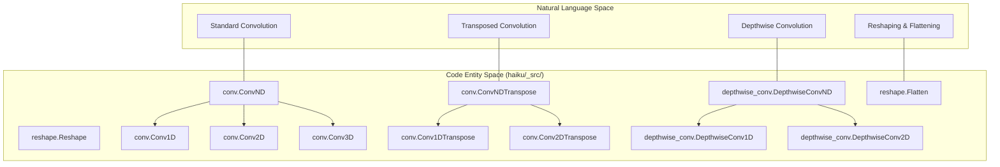
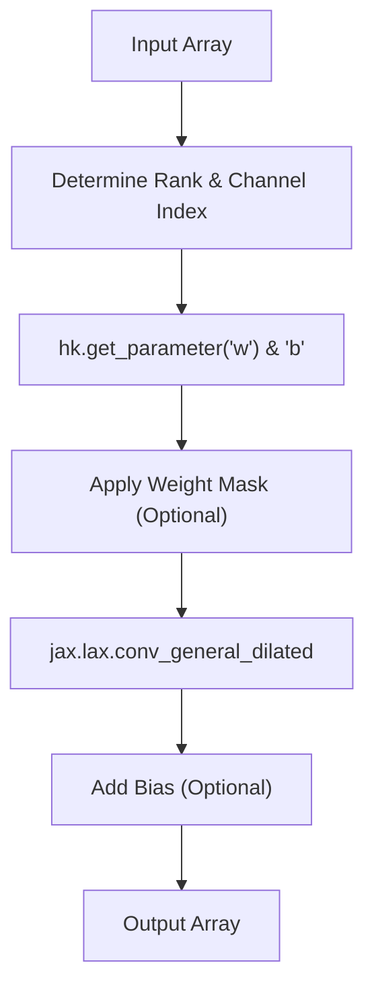

<!-- source: DeepWiki mcp.deepwiki.com · repo google-deepmind/dm-haiku · page 3.2 Convolutional Modules · fetched 2026-10-26 -->

# Convolutional Modules

<details>
<summary>Relevant source files</summary>

The following files were used as context for generating this wiki page:

- [haiku/_src/conv.py](haiku/_src/conv.py)
- [haiku/_src/conv_test.py](haiku/_src/conv_test.py)
- [haiku/_src/depthwise_conv.py](haiku/_src/depthwise_conv.py)
- [haiku/_src/depthwise_conv_test.py](haiku/_src/depthwise_conv_test.py)
- [haiku/_src/integration/checkpoints/DepthwiseConv1D.json](haiku/_src/integration/checkpoints/DepthwiseConv1D.json)
- [haiku/_src/integration/checkpoints/DepthwiseConv3D.json](haiku/_src/integration/checkpoints/DepthwiseConv3D.json)
- [haiku/_src/pad.py](haiku/_src/pad.py)
- [haiku/_src/reshape.py](haiku/_src/reshape.py)
- [haiku/_src/reshape_test.py](haiku/_src/reshape_test.py)
- [haiku/_src/rms_norm.py](haiku/_src/rms_norm.py)
- [haiku/_src/rms_norm_test.py](haiku/_src/rms_norm_test.py)

</details>


This page explains the convolutional modules in Haiku, covering standard convolutions (1D, 2D, 3D), transposed variants, depthwise operations, and associated utility modules for padding and reshaping.

## Overview of Convolutional Modules

Haiku provides a consistent interface for convolutional layers across different dimensionalities. The implementation follows a hierarchical structure where general `ND` base classes handle logic for arbitrary spatial dimensions, while specific `1D`, `2D`, and `3D` classes provide convenient wrappers.

### Class Hierarchy and Entity Mapping

The following diagram maps the Natural Language concepts to the specific Code Entities within the Haiku library.


Sources: [haiku/_src/conv.py:66-446](), [haiku/_src/conv.py:485-793](), [haiku/_src/depthwise_conv.py:52-143](), [haiku/_src/reshape.py:54-179]()

## Standard Convolutional Modules

Standard convolutions are implemented via `ConvND` [haiku/_src/conv.py:66](). It serves as the base for `Conv1D`, `Conv2D`, and `Conv3D`.

### Implementation Details
The core logic resides in `__call__`, which:
1.  Determines weight shape based on input channels and `output_channels` [haiku/_src/conv.py:198-200]().
2.  Initializes weights using `TruncatedNormal` by default [haiku/_src/conv.py:202-206]().
3.  Calls `jax.lax.conv_general_dilated` with appropriate `dimension_numbers` [haiku/_src/conv.py:215-221]().
4.  Applies an optional weight `mask` if provided [haiku/_src/conv.py:209-210]().

### Data Flow for ConvND


Sources: [haiku/_src/conv.py:161-234]()

## Transposed Convolutional Modules

`ConvNDTranspose` [haiku/_src/conv.py:485]() implements "deconvolution" operations. Unlike standard convolution, it allows specifying an explicit `output_shape` to resolve ambiguity when using strides [haiku/_src/conv.py:497]().

### Dimension Numbers
Haiku uses `to_dimension_numbers` to map `data_format` (e.g., `channels_last`) to JAX `ConvDimensionNumbers` [haiku/_src/conv.py:42-63]().

| Format | Dimension Numbers (LHS, RHS, Out) |
| :--- | :--- |
| `channels_last` (Standard) | `(0, N+1, 1...N)` |
| `channels_last` (Transpose) | `(0, N+1, 1...N)` |
| `channels_first` | `(0, 1, 2...N+1)` |

Sources: [haiku/_src/conv.py:42-63](), [haiku/_src/conv.py:147-149]()

## Depthwise and Separable Convolutions

### DepthwiseConvND
`DepthwiseConvND` [haiku/_src/depthwise_conv.py:52]() applies a single filter to each input channel independently. The number of output channels is `input_channels * channel_multiplier` [haiku/_src/depthwise_conv.py:114-115](). It uses `feature_group_count` in `lax.conv_general_dilated` set to the number of input channels to achieve the depthwise effect [haiku/_src/depthwise_conv.py:132]().

### SeparableDepthwiseConv2D
`SeparableDepthwiseConv2D` [haiku/_src/depthwise_conv.py:146]() implements a depthwise spatial convolution followed by a point-wise (1x1) convolution. This is a common building block in architectures like MobileNet.

Sources: [haiku/_src/depthwise_conv.py:52-143](), [haiku/_src/depthwise_conv.py:146-215]()

## Reshaping and Padding Utilities

### Reshape and Flatten
*   `hk.Reshape`: Reshapes input while preserving a specified number of leading dimensions (`preserve_dims`) [haiku/_src/reshape.py:54]().
*   `hk.Flatten`: A specialized `Reshape` that collapses all non-preserved dimensions into a single vector [haiku/_src/reshape.py:137]().

### Padding Modules
The `haiku.pad` module provides functional padding strategies [haiku/_src/pad.py:15]():
*   `same`: Pads such that output size matches input for stride 1 [haiku/_src/pad.py:41]().
*   `causal`: Pads the start of a dimension so output depends only on past/current values [haiku/_src/pad.py:51]().
*   `reverse_causal`: Pads the end of a dimension [haiku/_src/pad.py:56]().
*   `valid`: No padding [haiku/_src/pad.py:35]().

Sources: [haiku/_src/reshape.py:54-179](), [haiku/_src/pad.py:35-60]()

## RMSNorm
While often categorized as a normalization layer, `RMSNorm` [haiku/_src/rms_norm.py:44]() is frequently used in convolutional pipelines (especially in modern Transformers and GenAI models). It normalizes inputs by the root-mean-square and scales them by a learned parameter without recentering [haiku/_src/rms_norm.py:47-49]().

```python
# RMSNorm implementation logic
mean_squared = jnp.mean(jnp.square(inputs), axis=axis, keepdims=True)
output = inputs * scale * jax.lax.rsqrt(mean_squared + self.eps)
```
Sources: [haiku/_src/rms_norm.py:129-132]()

---

