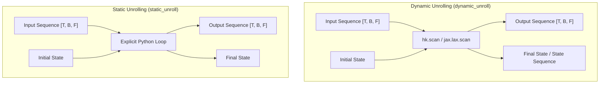
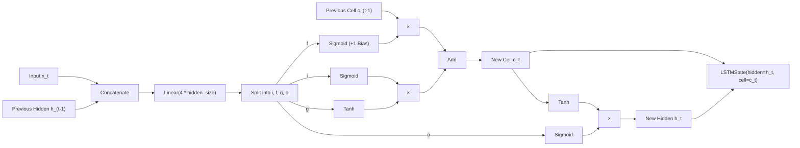
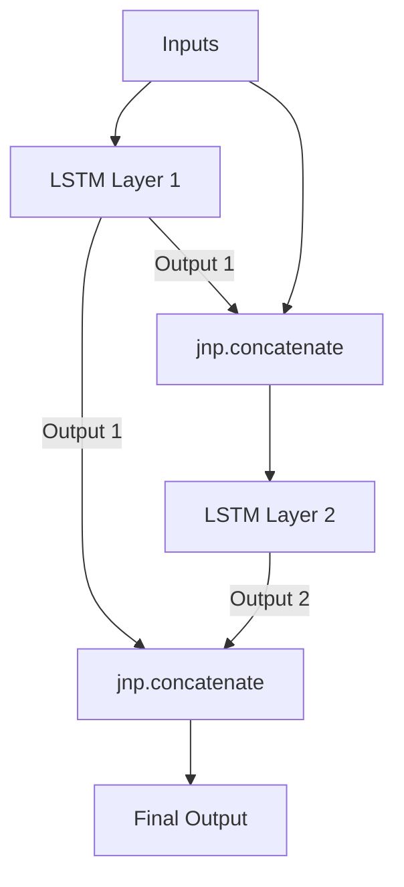

<!-- source: DeepWiki mcp.deepwiki.com · repo google-deepmind/dm-haiku · page 3.3 Recurrent Modules · fetched 2026-10-26 -->

# Recurrent Modules

<details>
<summary>Relevant source files</summary>

The following files were used as context for generating this wiki page:

- [examples/rnn/BUILD](examples/rnn/BUILD)
- [examples/rnn/dataset.py](examples/rnn/dataset.py)
- [examples/rnn/train.py](examples/rnn/train.py)
- [haiku/_src/integration/descriptors.py](haiku/_src/integration/descriptors.py)
- [haiku/_src/recurrent.py](haiku/_src/recurrent.py)
- [haiku/_src/recurrent_test.py](haiku/_src/recurrent_test.py)

</details>


This page documents Haiku's recurrent neural network modules, which enable sequential data processing and modeling with state persistence. We cover the core `RNNCore` interface, standard implementations (LSTM, GRU, VanillaRNN), convolutional variants, and utilities for dynamic and static unrolling of recurrent computations.

For information about basic modules like Linear layers, see [Basic Modules](#3.1). For advanced modules like VQVAEs, see [Advanced Modules](#3.4).

## RNNCore Interface

All recurrent modules in Haiku inherit from the abstract base class `RNNCore` [haiku/_src/recurrent.py:47-47](). This interface requires implementing two methods:

1. `__call__(inputs, prev_state)`: Processes one timestep, returning a tuple of `(outputs, next_state)` [haiku/_src/recurrent.py:60-71]().
2. `initial_state(batch_size)`: Constructs an initial state for the core, optionally batched [haiku/_src/recurrent.py:74-84]().

### Code Entity Mapping: RNN Hierarchy
The following diagram maps the conceptual RNN components to their specific implementations in the Haiku codebase.

```mermaid
classDiagram
    class "RNNCore" {
        <<abstract>>
        +__call__(inputs, prev_state) tuple[Any, Any]
        +initial_state(batch_size: Optional[int]) Any
    }
    
    "RNNCore" <|-- "VanillaRNN"
    "RNNCore" <|-- "LSTM"
    "RNNCore" <|-- "GRU"
    "RNNCore" <|-- "ConvNDLSTM"
    "RNNCore" <|-- "IdentityCore"
    "RNNCore" <|-- "ResetCore"
    "RNNCore" <|-- "DeepRNN"
    
    "ConvNDLSTM" <|-- "Conv1DLSTM"
    "ConvNDLSTM" <|-- "Conv2DLSTM"
    "ConvNDLSTM" <|-- "Conv3DLSTM"
```

Sources: [haiku/_src/recurrent.py:47-84](), [haiku/_src/recurrent.py:227-227](), [haiku/_src/recurrent.py:273-273](), [haiku/_src/recurrent.py:522-522](), [haiku/_src/recurrent.py:592-592](), [haiku/_src/recurrent.py:617-617](), [haiku/_src/recurrent.py:723-723]()

## Unrolling RNNs

Haiku provides two methods for unrolling RNN computations over sequences:

### Static Unrolling
`static_unroll` replaces the loop with its body repeated multiple times when executed inside `jax.jit` [haiku/_src/recurrent.py:87-105](). This creates an unrolled computation graph where each timestep's operations are explicitly laid out.

```python
# Conceptual implementation of static unrolling
state = initial_state
outputs0, state = core(input_sequence[0], state)
outputs1, state = core(input_sequence[1], state)
outputs2, state = core(input_sequence[2], state)
...
```

### Dynamic Unrolling
`dynamic_unroll` preserves the loop structure when executed inside `jax.jit`, using JAX's `scan` primitive [haiku/_src/recurrent.py:147-165](). This is generally more memory-efficient for longer sequences. It supports returning all intermediate states via `return_all_states=True` [haiku/_src/recurrent.py:188-189]().

### Sequence Processing Logic
This diagram illustrates how data flows through the unroll utilities.



Key parameters for both unrolling methods:
- `core`: The `RNNCore` to unroll [haiku/_src/recurrent.py:109]().
- `input_sequence`: Sequence of inputs with shape `[T, ...]` (time-major) or `[B, T, ...]` (batch-major) [haiku/_src/recurrent.py:110-112]().
- `initial_state`: Initial state for the RNN core [haiku/_src/recurrent.py:113]().
- `time_major`: Whether inputs are time-major (default) or batch-major [haiku/_src/recurrent.py:114-115]().

Sources: [haiku/_src/recurrent.py:87-218](), [haiku/_src/recurrent_test.py:79-135]()

## Core Implementations

### VanillaRNN
A basic fully-connected RNN core [haiku/_src/recurrent.py:227-227](). It implements a simple linear transformation followed by an activation:
$$h_t = \operatorname{ReLU}(w_i x_t + b_i + w_h h_{t-1} + b_h)$$
The output equals the new state, $h_t$ [haiku/_src/recurrent.py:255-257]().

Key parameters:
- `hidden_size`: Size of the hidden layer [haiku/_src/recurrent.py:240]().
- `double_bias`: Whether to use separate biases for input and hidden transformations [haiku/_src/recurrent.py:241]().

Sources: [haiku/_src/recurrent.py:227-270](), [haiku/_src/recurrent_test.py:137-150]()

### LSTM
Long short-term memory implementation [haiku/_src/recurrent.py:273-273](). It maintains an `LSTMState` named tuple with `hidden` and `cell` fields [haiku/_src/recurrent.py:275-276]().



Sources: [haiku/_src/recurrent.py:273-346](), [haiku/_src/recurrent_test.py:152-164]()

### GRU
Gated Recurrent Unit implementation with reset and update gates [haiku/_src/recurrent.py:522-522]().
Key parameters include `hidden_size`, `w_i_init`, and `w_h_init` [haiku/_src/recurrent.py:536-540]().

Sources: [haiku/_src/recurrent.py:522-589](), [haiku/_src/recurrent_test.py:186-194]()

### Convolutional LSTMs
`ConvNDLSTM` provides convolutional variants where matrix multiplications are replaced with convolutions [haiku/_src/recurrent.py:349-349](). Haiku provides:
- `Conv1DLSTM` [haiku/_src/recurrent.py:465-465]()
- `Conv2DLSTM` [haiku/_src/recurrent.py:483-483]()
- `Conv3DLSTM` [haiku/_src/recurrent.py:501-501]()

Key parameters:
- `input_shape`: Spatial dimensions of input [haiku/_src/recurrent.py:365]().
- `output_channels`: Number of output filters [haiku/_src/recurrent.py:366]().
- `kernel_shape`: Size of the convolutional kernel [haiku/_src/recurrent.py:367]().

Sources: [haiku/_src/recurrent.py:349-519](), [haiku/_src/recurrent_test.py:166-184]()

## Utility Cores

### IdentityCore and ResetCore
- `IdentityCore`: Forwards inputs and returns an empty state [haiku/_src/recurrent.py:592-603]().
- `ResetCore`: A wrapper that allows resetting the inner core's state during unrolling based on a boolean signal [haiku/_src/recurrent.py:617-633]().

Sources: [haiku/_src/recurrent.py:592-720](), [haiku/_src/recurrent_test.py:250-440]()

## Composing RNNs

### DeepRNN
`DeepRNN` wraps a sequence of cores and callables (e.g., activation functions) into a single `RNNCore` [haiku/_src/recurrent.py:723-744](). The state of a `DeepRNN` is a tuple containing the states of each underlying core [haiku/_src/recurrent.py:772-777]().

```python
# DeepRNN usage from examples
model = hk.DeepRNN([
    lambda x: jax.nn.one_hot(x, num_classes=dataset.NUM_CHARS),
    hk.LSTM(HIDDEN_SIZE.value),
    jax.nn.relu,
    hk.LSTM(HIDDEN_SIZE.value),
    hk.nets.MLP([HIDDEN_SIZE.value, dataset.NUM_CHARS]),
])
```

Sources: [haiku/_src/recurrent.py:723-796](), [examples/rnn/train.py:57-63]()

### Deep RNN with Skip Connections
`deep_rnn_with_skip_connections` creates a `DeepRNN` where inputs to each layer are the concatenation of the original input and the outputs of all previous layers [haiku/_src/recurrent.py:799-813]().



Sources: [haiku/_src/recurrent.py:799-826](), [haiku/_src/recurrent_test.py:475-497]()

## Performance Considerations

| Method | Advantages | Disadvantages | Best For |
|--------|------------|--------------|----------|
| `static_unroll` | Better JAX optimization [haiku/_src/recurrent.py:97-98]() | High memory usage [haiku/_src/recurrent.py:106]() | Short sequences |
| `dynamic_unroll` | Memory efficient [haiku/_src/recurrent.py:163-164]() | Loop overhead | Long sequences |

The `unroll` parameter in `dynamic_unroll` allows partial unrolling within the loop to balance speed and memory [haiku/_src/recurrent.py:181-182]().

Sources: [haiku/_src/recurrent.py:87-218]()

---

