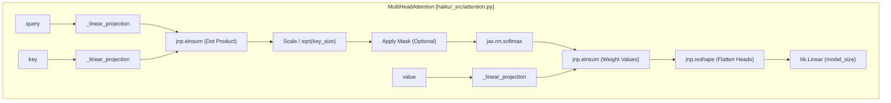
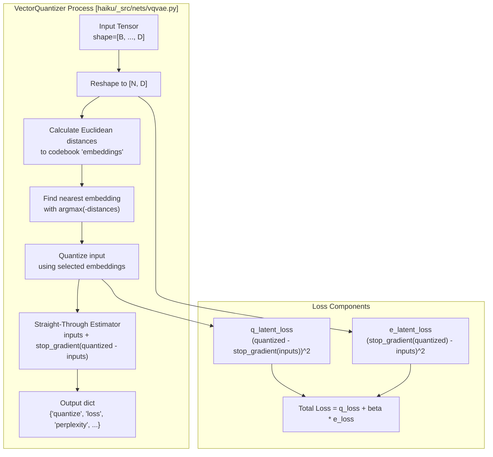

<!-- source: DeepWiki mcp.deepwiki.com · repo google-deepmind/dm-haiku · page 3.4 Advanced Modules · fetched 2026-10-26 -->

# Advanced Modules

Relevant source files

The following files were used as context for generating this wiki page:

- [haiku/_src/attention.py](haiku/_src/attention.py)
- [haiku/_src/attention_test.py](haiku/_src/attention_test.py)
- [haiku/_src/batch_norm.py](haiku/_src/batch_norm.py)
- [haiku/_src/batch_norm_test.py](haiku/_src/batch_norm_test.py)
- [haiku/_src/group_norm.py](haiku/_src/group_norm.py)
- [haiku/_src/integration/checkpoints/LayerNorm.json](haiku/_src/integration/checkpoints/LayerNorm.json)
- [haiku/_src/integration/checkpoints/MultiHeadAttention.json](haiku/_src/integration/checkpoints/MultiHeadAttention.json)
- [haiku/_src/layer_norm.py](haiku/_src/layer_norm.py)
- [haiku/_src/layer_norm_test.py](haiku/_src/layer_norm_test.py)
- [haiku/_src/moving_averages.py](haiku/_src/moving_averages.py)
- [haiku/_src/moving_averages_test.py](haiku/_src/moving_averages_test.py)
- [haiku/_src/nets/BUILD](haiku/_src/nets/BUILD)
- [haiku/_src/nets/mobilenetv1.py](haiku/_src/nets/mobilenetv1.py)
- [haiku/_src/nets/resnet.py](haiku/_src/nets/resnet.py)
- [haiku/_src/nets/resnet_test.py](haiku/_src/nets/resnet_test.py)
- [haiku/_src/nets/vqvae.py](haiku/_src/nets/vqvae.py)
- [haiku/_src/nets/vqvae_test.py](haiku/_src/nets/vqvae_test.py)
- [haiku/_src/spectral_norm.py](haiku/_src/spectral_norm.py)

This page documents specialized modules in Haiku that provide advanced functionality beyond basic neural network layers. These modules implement techniques commonly used in state-of-the-art models, including normalization variants, attention mechanisms, vector quantization, and moving averages.

## Normalization Layers

Haiku provides a comprehensive suite of normalization layers. These modules are essential for stabilizing training by controlling the distribution of activations.

### BatchNorm
`BatchNorm` normalizes inputs to maintain a mean of ~0 and standard deviation of ~1 [haiku/_src/batch_norm.py:41-44](). It supports:
*   **Trainable scale/offset**: Created and owned by the module if `create_scale` or `create_offset` are `True` [haiku/_src/batch_norm.py:115-116]().
*   **External scale/offset**: Can be passed at call time for conditional normalization [haiku/_src/batch_norm.py:132-133]().
*   **Cross-replica statistics**: Can calculate batch statistics across devices using `cross_replica_axis` [haiku/_src/batch_norm.py:93-97]().
*   **Moving Averages**: Uses `ExponentialMovingAverage` to track running mean and variance [haiku/_src/batch_norm.py:124-125]().

### LayerNorm
`LayerNorm` normalizes activations across the specified `axis` for each example independently [haiku/_src/layer_norm.py:66-70](). Unlike BatchNorm, it does not maintain moving averages of statistics and behaves identically during training and inference.
*   **Flexible Axis**: Can normalize over a single integer, a list of integers, or a slice [haiku/_src/layer_norm.py:80]().
*   **Parameter Shape**: The `param_axis` argument controls the shape of learnable scale and offset parameters [haiku/_src/layer_norm.py:108-112]().

### Other Normalization Variants
*   **GroupNorm**: Normalizes groups of channels [haiku/_src/group_norm.py:38]().
*   **InstanceNorm**: Normalizes each example and channel independently (equivalent to GroupNorm with groups equal to channels) [haiku/_src/group_norm.py:175]().
*   **RMSNorm**: A simpler, computationally efficient variant of LayerNorm that only scales by the root mean square [haiku/_src/layer_norm.py:214]().

Sources: [haiku/_src/batch_norm.py:41-152](), [haiku/_src/layer_norm.py:66-184](), [haiku/_src/group_norm.py:38-175]()

## Attention Mechanisms

### MultiHeadAttention
The `MultiHeadAttention` (MHA) module is a core component for Transformer architectures [haiku/_src/attention.py:15](). It attends over sequences of vectors by projecting inputs into keys, queries, and values.

**Data Flow in MultiHeadAttention:**
1.  **Projections**: Inputs are projected using `hk.Linear` into `query_heads`, `key_heads`, and `value_heads` [haiku/_src/attention.py:139-141]().
2.  **Logits**: Scaled dot-product attention is computed: $Softmax(\frac{QK^T}{\sqrt{d_k}})$ [haiku/_src/attention.py:144-145]().
3.  **Masking**: Optional boolean masks can be applied to attention weights [haiku/_src/attention.py:146-152]().
4.  **Output**: Weighted values are concatenated and passed through a final linear projection [haiku/_src/attention.py:160-162]().

Sources: [haiku/_src/attention.py:37-175]()

## Vector Quantized-Variational Autoencoders (VQ-VAE)

Haiku provides implementations of VQ-VAE, as introduced in ["Neural Discrete Representation Learning"](https://arxiv.org/abs/1711.00937). These modules enable discrete representation learning by quantizing continuous inputs into a finite set of learned embeddings.

### Vector Quantization Architecture

Sources: [haiku/_src/nets/vqvae.py:40-166]()

Haiku provides two implementations:
1.  **VectorQuantizer**: Uses the standard loss-based updates for the codebook [haiku/_src/nets/vqvae.py:40]().
2.  **VectorQuantizerEMA**: Uses Exponential Moving Averages to update the codebook, which is often more stable and independent of the optimizer [haiku/_src/nets/vqvae.py:175](). It tracks `cluster_size` and `ema_dw` (hidden sum of vectors) as state [haiku/_src/nets/vqvae.py:273-274]().

## Moving Averages

### ExponentialMovingAverage
The `ExponentialMovingAverage` class maintains a running average of values using the Adam debiasing procedure [haiku/_src/moving_averages.py:40-45]().
*   **State**: It stores `hidden` (raw sum), `average` (debiased result), and a `counter` [haiku/_src/moving_averages.py:90-91, 113]().
*   **Warmup**: Supports a `warmup_length` where the average is initialized to the input value after a set number of steps [haiku/_src/moving_averages.py:60-63]().

### EMAParamsTree
`EMAParamsTree` allows applying EMA to an entire JAX pytree of parameters [haiku/_src/moving_averages.py:141-146](). This is commonly used for "Polyak averaging" of model weights to improve generalization.

Sources: [haiku/_src/moving_averages.py:40-215]()

## Spectral Normalization

Spectral normalization constrains the Lipschitz constant of a layer by normalizing the weight matrix by its largest singular value (spectral norm).

*   **SpectralNorm**: Normalizes a single tensor. It uses power iteration to approximate the first singular value [haiku/_src/spectral_norm.py:65-70]().
*   **SNParamsTree**: A utility to apply spectral normalization across all parameters in a pytree [haiku/_src/spectral_norm.py:161]().

Sources: [haiku/_src/spectral_norm.py:65-207]()

## Vision Architectures

Haiku includes high-quality implementations of standard vision models:

### ResNet
Haiku provides ResNet V1 and V2 [haiku/_src/nets/resnet.py:15]().
*   **BlockV1/BlockV2**: Implement the residual units with optional bottlenecks [haiku/_src/nets/resnet.py:43, 125]().
*   **ResNet Class**: A configurable module that builds the full stack of `BlockGroup` components [haiku/_src/nets/resnet.py:240]().
*   **Pre-defined variants**: `ResNet18`, `ResNet34`, `ResNet50`, `ResNet101`, `ResNet152`, and `ResNet200` are available as ready-to-use functions [haiku/_src/nets/resnet.py:456-558]().

### MobileNetV1
A computationally efficient architecture using depthwise separable convolutions [haiku/_src/nets/mobilenetv1.py:15]().
*   **Depthwise Separable Conv**: Implemented as a combination of `DepthwiseConv2D` and `Conv2D` (1x1) [haiku/_src/nets/mobilenetv1.py:46-60]().

Sources: [haiku/_src/nets/resnet.py:43-558](), [haiku/_src/nets/mobilenetv1.py:15-135]()

---

