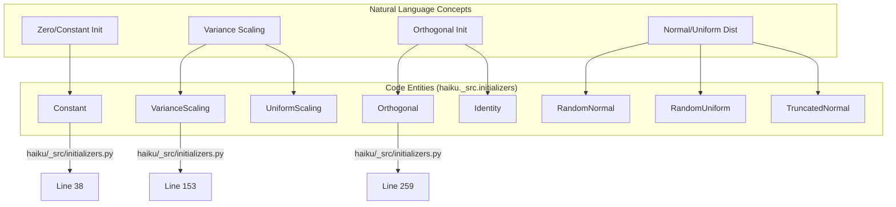
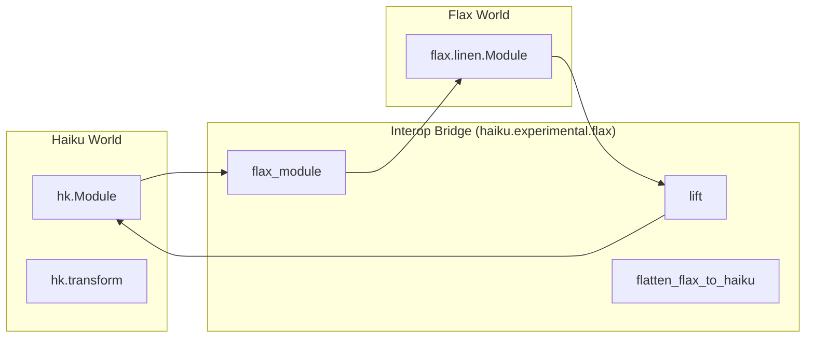

<!-- source: DeepWiki mcp.deepwiki.com · repo google-deepmind/dm-haiku · page 4 Utilities · fetched 2026-10-26 -->

# Utilities

Relevant source files

The following files were used as context for generating this wiki page:

- [docs/api.rst](docs/api.rst)
- [haiku/__init__.py](haiku/__init__.py)
- [haiku/data_structures.py](haiku/data_structures.py)
- [haiku/initializers.py](haiku/initializers.py)
- [haiku/pad.py](haiku/pad.py)
- [haiku/testing.py](haiku/testing.py)
- [haiku/typing.py](haiku/typing.py)

This page provides an overview of the utility functions and data structures in Haiku. These utilities form the foundation for parameter management, transformation, and manipulating parameter structures within the Haiku neural network library.

Haiku provides several utility components that make it easier to work with neural network parameters and state:

1. Data structures for managing parameters and state.
2. Parameter initialization utilities for creating weights and biases.
3. Visualization tools for model inspection.
4. Mixed precision and global configuration settings.
5. Interoperability layers for the Flax ecosystem.

## Data Structures and Filtering

Haiku provides specialized data structures designed to work efficiently with JAX's functional programming paradigm. These are primarily found in `hk.data_structures` [haiku/data_structures.py:1-45]().

### Core Data Structures

The most important data structure is `FlatMap`, which is central to Haiku's parameter handling. It provides an immutable mapping optimized to work with JAX's tree utilities.

| Class | Role | Source |
| :--- | :--- | :--- |
| `FlatMap` | Immutable mapping optimized for JAX tree operations (O(1) flatten). | [haiku/_src/data_structures.py:228-369]() |
| `frozendict` | Legacy immutable dictionary. | [haiku/_src/data_structures.py:108-164]() |
| `ThreadLocalStack` | Ensures isolation of Haiku contexts between threads. | [haiku/_src/data_structures.py:65-72]() |

### Filtering Utilities

Haiku provides a set of utilities for manipulating parameter and state structures (nested mappings). These allow for advanced strategies like freezing layers or applying different learning rates to specific parameter groups.

- `hk.data_structures.filter`: Returns a structure with elements matching a predicate [haiku/_src/filtering.py:40-67]().
- `hk.data_structures.partition`: Splits a structure into two parts based on a predicate [haiku/_src/filtering.py:69-95]().
- `hk.data_structures.merge`: Combines multiple structures into one [haiku/_src/filtering.py:160-186]() .
- `hk.data_structures.traverse`: Iterates over module names, parameter names, and values [haiku/_src/filtering.py:228-257]().

For details, see [Data Structures and Filtering](#4.1).

**Sources:** [haiku/data_structures.py:1-45](), [haiku/_src/data_structures.py:1-369](), [haiku/_src/filtering.py:1-257]()

## Parameter Initialization

Haiku provides a comprehensive set of initializers in `hk.initializers` [haiku/initializers.py:1-40](). These are used with `hk.get_parameter` to define how weights and biases are created.

### System Mapping: Initializers to Code Entities

Common schemes like **Glorot (Xavier)** or **He (Kaiming)** are implemented via specific configurations of `VarianceScaling` [haiku/_src/initializers.py:153-238]().

For details, see [Parameter Initialization](#4.2).

**Sources:** [haiku/initializers.py:1-40](), [haiku/_src/initializers.py:38-325]()

## Visualization Tools

Haiku includes tools to inspect and visualize the structure of transformed models.

- **Graph Visualization**: `hk.to_dot` generates Graphviz DOT graphs of the module hierarchy [haiku/_src/dot.py:1-100]().
- **Tabulation**: `hk.experimental.tabulate` (often used via `summarise`) provides a text-based summary of module parameters and shapes.
- **Shape Evaluation**: `hk.eval_shape` allows computing the output shapes of a Haiku function without actually running the computation [haiku/_src/stateful.py:214-239]().

For details, see [Visualization Tools](#4.3).

**Sources:** [haiku/_src/dot.py:1-100](), [haiku/_src/stateful.py:214-239](), [docs/api.rst:415-426]()

## Mixed Precision and Configuration

Haiku manages global state and numerical precision through the `hk.config` and `hk.mixed_precision` modules.

### Mixed Precision System

Haiku integrates with `jmp` to provide a policy-based mixed precision system. Users can use `hk.mixed_precision.push_policy` to locally override the precision of modules (e.g., forcing certain layers to `float16`).

### Global Configuration

The `hk.config` module controls library-wide behaviors:
- `check_jax_usage`: Validates that Haiku is used correctly within JAX transforms.
- `rng_reserve_size`: Controls the internal cache size for PRNG keys.

For details, see [Mixed Precision and Configuration](#4.4).

**Sources:** [haiku/__init__.py:18-22](), [haiku/_src/config.py:1-100](), [haiku/_src/mixed_precision.py:1-150]()

## Flax Interoperability

Haiku provides a bridge to the Flax library, allowing modules from one library to be used inside the other.

### Interop Entities

- `hk.experimental.flax.lift`: Allows running a Flax module inside a Haiku `transform` [docs/api.rst:288-295]().
- `hk.experimental.flax.Module`: A Flax wrapper that allows Haiku modules to behave like Flax modules [docs/api.rst:278-282]().

For details, see [Flax Interoperability](#4.5).

**Sources:** [docs/api.rst:270-295](), [haiku/experimental/flax.py:1-50]()

---

