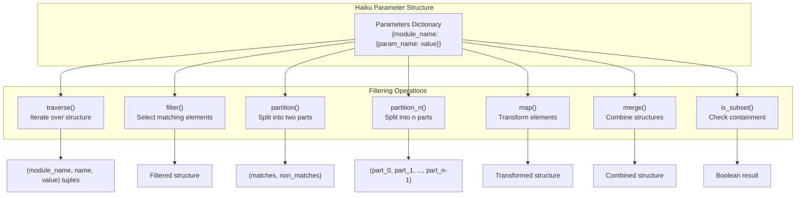

<!-- source: DeepWiki mcp.deepwiki.com · repo google-deepmind/dm-haiku · page 4.1 Data Structures and Filtering · fetched 2026-10-26 -->

# Data Structures and Filtering

<details>
<summary>Relevant source files</summary>

The following files were used as context for generating this wiki page:

- [haiku/_src/data_structures.py](haiku/_src/data_structures.py)
- [haiku/_src/data_structures_test.py](haiku/_src/data_structures_test.py)
- [haiku/_src/filtering.py](haiku/_src/filtering.py)
- [haiku/_src/filtering_test.py](haiku/_src/filtering_test.py)
- [haiku/data_structures.py](haiku/data_structures.py)
- [haiku/initializers.py](haiku/initializers.py)
- [haiku/pad.py](haiku/pad.py)
- [haiku/testing.py](haiku/testing.py)
- [haiku/typing.py](haiku/typing.py)

</details>


This page documents the data structures and filtering utilities in Haiku, which are fundamental to working with neural network parameters and state. For information about parameter initialization, see [Parameter Initialization](4.2).

## Introduction

Haiku's data structures and filtering utilities are designed to efficiently manage and manipulate the parameter and state dictionaries that are central to Haiku's implementation. These tools provide immutable data structures for JAX compatibility and powerful filtering functions to work with subsets of parameters.

Parameters and state in Haiku are typically organized in a two-level nested structure:
- The first level contains module names (e.g., `"linear1"`, `"conv2d_3"`) [haiku/_src/data_structures.py:153-166]()
- The second level contains parameter or state variable names (e.g., `"w"`, `"b"`, `"moving_mean"`) [haiku/_src/filtering.py:30-47]()

```python
# Typical parameter structure
{
  "linear1": {
    "w": jnp.array(...),  # Weights
    "b": jnp.array(...)   # Biases
  },
  "batch_norm": {
    "scale": jnp.array(...),
    "offset": jnp.array(...),
    "moving_mean": jnp.array(...),
    "moving_var": jnp.array(...)
  }
}
```

Sources: [haiku/_src/data_structures.py:15-37](), [haiku/_src/filtering.py:15-30]()

## Core Data Structures

Haiku provides several specialized data structures to optimize operations commonly performed when working with neural networks.

### Class Hierarchy and Utility Container
```mermaid
classDiagram
    class Stack {
        +_storage: collections.deque
        +__init__()
        +__len__()
        +__iter__()
        +clone()
        +map(fn)
        +push(elem)
        +pop()
        +peek(depth)
        +__call__(elem)
    }
    
    class ThreadLocalStack {
        +Inherits threading.local
        +Thread-specific stacks
    }
    
    class FlatMap {
        +_structure: PyTreeDef
        +_leaves: tuple
        +_mapping: Mapping
        +__init__(*args, **kwargs)
        +keys()
        +values()
        +items()
        +__getitem__(key)
    }
    
    class FlatComponents {
        +leaves: Sequence[Any]
        +structure: PyTreeDef
    }
    
    Stack <|-- ThreadLocalStack
    FlatMap -- FlatComponents
    
    class "Utility Functions" {
        <<container>>
        +to_immutable_dict()
        +to_mutable_dict()
        +to_haiku_dict()
        +to_dict()
    }
```
Sources: [haiku/_src/data_structures.py:38-83](), [haiku/_src/data_structures.py:175-178](), [haiku/_src/data_structures.py:180-269](), [haiku/_src/data_structures.py:83-84]()

### Stack and ThreadLocalStack

`Stack` is a general-purpose stack implementation supporting operations like `push`, `pop`, `peek`, and iteration [haiku/_src/data_structures.py:38-72](). It also provides a context manager interface for temporary stack operations via `__call__` [haiku/_src/data_structures.py:74-81](). `ThreadLocalStack` extends this with thread-specific storage using `threading.local`, which is critical for Haiku's internal state tracking across different threads [haiku/_src/data_structures.py:83-84]().

Sources: [haiku/_src/data_structures.py:38-84](), [haiku/_src/data_structures_test.py:35-152]()

### FlatMap

`FlatMap` is an immutable mapping optimized for JAX's tree utilities. It offers O(1) flatten and O(n) unflatten operations by storing the underlying `PyTreeDef` and leaves [haiku/_src/data_structures.py:180-210]().

Key features:
- Registered as a JAX pytree node (via `jax.tree_util.register_pytree_node` in the library) [haiku/_src/data_structures.py:183-184]().
- Immutable: Prevents accidental mutation of parameters or state [haiku/_src/data_structures.py:186-187]().
- Lazy Reconstruction: Reconstructs the internal mapping only when accessed via `keys()`, `values()`, or `items()` [haiku/_src/data_structures.py:211-214]().

Sources: [haiku/_src/data_structures.py:180-269](), [haiku/_src/data_structures_test.py:154-395]()

### Dictionary Conversion Functions

Haiku provides several utilities for converting between different mapping types to ensure compatibility with JAX and user expectations:

| Function | Purpose |
|----------|---------|
| `to_immutable_dict` | Converts a mapping to an immutable `FlatMap` [haiku/_src/data_structures.py:100-110]() |
| `to_mutable_dict` | Converts a `FlatMap` to a standard mutable Python `dict` [haiku/_src/data_structures.py:114-122]() |
| `to_haiku_dict` | Alias for `to_dict`, returning the mapping type used by `init` and `apply` [haiku/_src/data_structures.py:125-137]() |
| `to_dict` | Recursively returns a `dict` copy of a nested structure [haiku/_src/data_structures.py:153-166]() |

Sources: [haiku/_src/data_structures.py:100-166](), [haiku/_src/data_structures_test.py:397-425]()

## Parameter Filtering

Haiku provides a rich set of utilities for manipulating parameter and state structures, especially for filtering, partitioning, and transforming them.

### Data Flow for Filtering Operations

Sources: [haiku/_src/filtering.py:30-257]()

### Traversing Parameter Structures

The `traverse` function provides a generator yielding `(module_name, name, value)` tuples in key-sorted order [haiku/_src/filtering.py:30-47]().

```python
# Iterate through all parameters
for module_name, name, value in traverse(params):
    print(f"{module_name}/{name}: shape={value.shape}")
```

Sources: [haiku/_src/filtering.py:30-47](), [haiku/_src/filtering_test.py:180-198]()

### Filtering and Partitioning

- **`filter`**: Returns a new structure containing only elements where `predicate(module_name, name, value)` is `True` [haiku/_src/filtering.py:126-155]().
- **`partition`**: Splits a structure into two: those matching the predicate and those that do not [haiku/_src/filtering.py:50-81]().
- **`partition_n`**: Generalizes partitioning into `n` buckets based on an integer returned by a function [haiku/_src/filtering.py:84-123]().

Sources: [haiku/_src/filtering.py:50-155](), [haiku/_src/filtering_test.py:104-196]()

### Mapping and Merging

- **`map`**: Applies a transformation function to every value in the structure, returning a new structure [haiku/_src/filtering.py:158-185]().
- **`merge`**: Combines multiple parameter/state structures into one. It supports an optional `check_duplicates` flag to ensure no overlapping keys have different values [haiku/_src/filtering.py:188-232]().
- **`is_subset`**: Verifies if all keys and values in one structure exist within another [haiku/_src/filtering.py:235-257]().

Sources: [haiku/_src/filtering.py:158-257](), [haiku/_src/filtering_test.py:284-352]()

## Common Use Cases

### Regularization and Optimization
Filtering is often used to apply weight decay only to specific parameters (e.g., weights but not biases) [haiku/_src/filtering.py:50-65]().

### Parameter Freezing
By using `partition`, users can separate trainable parameters from frozen ones, passing only the trainable subset to a JAX optimizer while merging both for the forward pass [haiku/_src/filtering_test.py:34-66]().

### Model Surgery
`merge` and `filter` allow for "surgery" where parts of one model (like a backbone) are combined with another (like a new head) [haiku/_src/filtering.py:188-198]().

Sources: [haiku/_src/filtering_test.py:34-66](), [haiku/_src/filtering_test.py:224-278]()

## Integration with JAX Transformations

Haiku's `FlatMap` is compatible with JAX transformations like `jit`, `vmap`, and `grad` because it is registered as a pytree [haiku/_src/data_structures.py:183-184](). Filtering utilities like `partition` are frequently used inside or around `jax.grad` to control which parameters receive updates [haiku/_src/filtering_test.py:34-66]().

Sources: [haiku/_src/data_structures.py:271-274](), [haiku/_src/filtering_test.py:33-83]()

---

