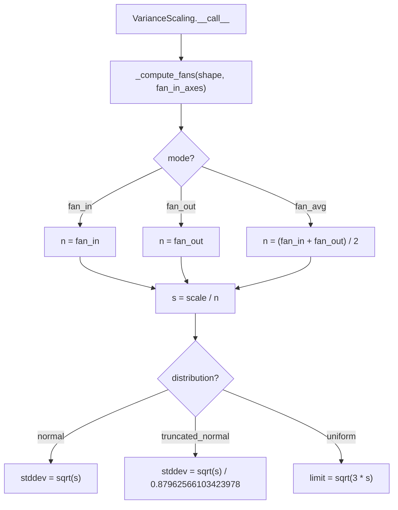
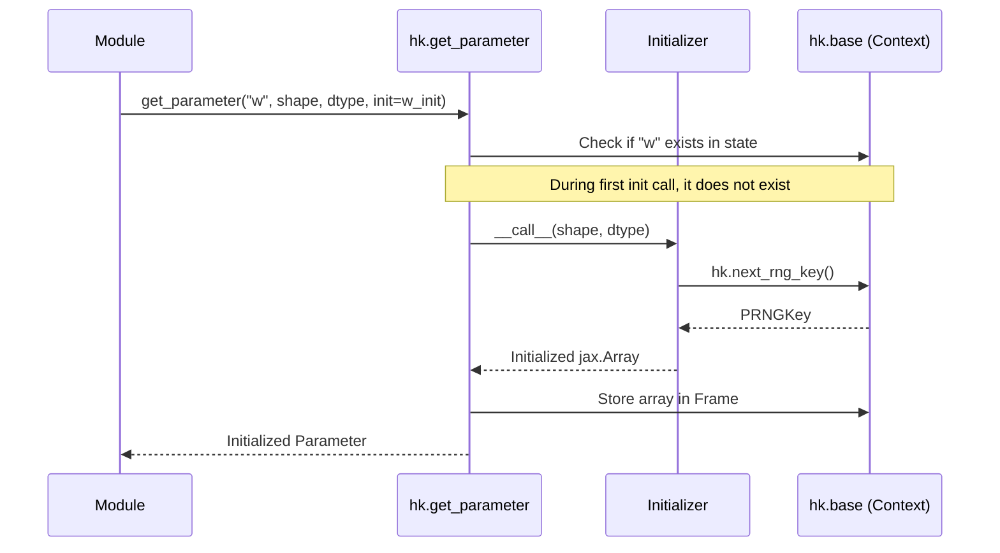

<!-- source: DeepWiki mcp.deepwiki.com · repo google-deepmind/dm-haiku · page 4.2 Parameter Initialization · fetched 2026-10-26 -->

# Parameter Initialization

<details>
<summary>Relevant source files</summary>

The following files were used as context for generating this wiki page:

- [haiku/_src/embed_test.py](haiku/_src/embed_test.py)
- [haiku/_src/initializers.py](haiku/_src/initializers.py)
- [haiku/_src/initializers_test.py](haiku/_src/initializers_test.py)
- [haiku/_src/integration/descriptors_test.py](haiku/_src/integration/descriptors_test.py)
- [haiku/_src/integration/float64_test.py](haiku/_src/integration/float64_test.py)

</details>


This page documents the parameter initialization system in Haiku, which provides a set of initializers for neural network parameters (weights and biases). Properly initializing parameters is crucial for training neural networks effectively, as it affects convergence speed, stability, and final performance.

For general information about parameter management, see [Parameter and State Management](./2.1.-Parameter-and-State-Management).

## Overview of Initializers

Haiku provides various initializer classes that implement the `Initializer` interface. Each initializer is responsible for creating initial values for parameters with a specified shape and data type.

### Initializer Class Hierarchy
```mermaid
classDiagram
    class "Initializer" {
        <<interface>>
        +__call__(shape, dtype) Array
    }
    class "Constant" {
        +constant: Any
    }
    class "RandomNormal" {
        +stddev: float
        +mean: float
    }
    class "VarianceScaling" {
        +scale: float
        +mode: str
        +distribution: str
    }
    "Initializer" <|-- "Constant"
    "Initializer" <|-- "RandomNormal"
    "Initializer" <|-- "TruncatedNormal"
    "Initializer" <|-- "RandomUniform"
    "Initializer" <|-- "VarianceScaling"
    "Initializer" <|-- "UniformScaling"
    "Initializer" <|-- "Orthogonal"
    "Initializer" <|-- "Identity"
```

Sources: [haiku/_src/initializers.py:21-326](), [haiku/_src/initializers_test.py:36-75]()

## Core Initializers

### Constant Initializer
The `Constant` initializer sets all parameter values to a specified constant using `jnp.broadcast_to`.

```python
# Example usage
initializer = hk.initializers.Constant(5.0)
params = initializer(shape=(3, 3), dtype=jnp.float32)  # Creates a 3x3 array of 5.0
```

Sources: [haiku/_src/initializers.py:61-75]()

### Random Distribution Initializers
Haiku provides several initializers that sample values from different probability distributions. These initializers consume RNG keys via `hk.next_rng_key()`.

| Initializer | Description | Parameters |
|-------------|-------------|------------|
| `RandomNormal` | Samples from a normal distribution | `stddev` (default=1.0), `mean` (default=0.0) |
| `TruncatedNormal` | Samples from a truncated normal distribution | `stddev` (default=1.0), `mean` (default=0.0), `lower` (default=-2.0), `upper` (default=2.0) |
| `RandomUniform` | Samples from a uniform distribution | `minval` (default=0.0), `maxval` (default=1.0) |

Sources: [haiku/_src/initializers.py:78-149]()

## Advanced Initializers

### VarianceScaling
The `VarianceScaling` initializer adapts the scale of the initialization based on the shape of the parameter tensor. It first computes a scaling factor `s = scale / n`, where `n` is determined by the `mode`.

### Variance Scaling Logic


Common configurations available through `VarianceScaling`:

| Name | Configuration | Use Case |
|------|--------------|-------------|
| Glorot/Xavier uniform | `(1.0, "fan_avg", "uniform")` | Sigmoid/Tanh activations |
| Glorot/Xavier normal | `(1.0, "fan_avg", "truncated_normal")` | Sigmoid/Tanh activations |
| He uniform | `(2.0, "fan_in", "uniform")` | ReLU activations |
| He normal | `(2.0, "fan_in", "truncated_normal")` | ReLU activations |
| LeCun uniform | `(1.0, "fan_in", "uniform")` | Standard scaling |

Sources: [haiku/_src/initializers.py:152-234]()

### Orthogonal and Identity
- **`Orthogonal`**: Generates a random orthogonal matrix. Requires at least a 2D shape. If the shape is more than 2D, it flattens all but the last dimension to perform QR decomposition or SVD. [haiku/_src/initializers.py:259-299]()
- **`Identity`**: Generates an identity matrix. For tensors with more than 2 dimensions, it creates a "batch" of identity matrices. [haiku/_src/initializers.py:302-325]()

## Fan-in and Fan-out Computation
The internal utility `_compute_fans` determines the connectivity scale for various tensor types.

| Shape Rank | `fan_in` | `fan_out` |
|------------|----------|-----------|
| 0 (Scalar) | 1 | 1 |
| 1 (Bias) | `shape[0]` | `shape[0]` |
| 2 (Linear) | `shape[0]` | `shape[1]` |
| > 2 (Conv) | `shape[-2] * kernel_size` | `shape[-1] * kernel_size` |

Sources: [haiku/_src/initializers.py:38-58](), [haiku/_src/initializers_test.py:99-111]()

## Integration with get_parameter

Initializers are integrated into the core Haiku lifecycle via `hk.get_parameter`. When a parameter is first created during `hk.transform().init`, the `init` argument is called.

### Data Flow: Initialization during Parameter Creation


Sources: [haiku/_src/initializers.py:29-33](), [haiku/_src/embed_test.py:59-62]()

## Data Type Support

Haiku initializers are designed to be dtype-aware:
- **Float64**: Supported if `jax_enable_x64` is True. [haiku/_src/integration/float64_test.py:31-50]()
- **Complex**: `RandomNormal` and `TruncatedNormal` handle complex types by sampling real and imaginary parts separately and combining them (e.g., `unscaled[0] + 1j * unscaled[1]`). [haiku/_src/initializers.py:124-131]()
- **Integer**: `Constant` and `Identity` can be used with integer dtypes. [haiku/_src/initializers_test.py:152-158]()

Sources: [haiku/_src/initializers_test.py:161-186](), [haiku/_src/initializers.py:120-131]()

---

