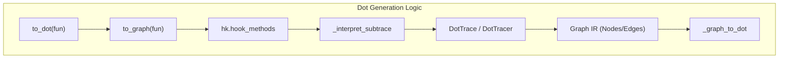
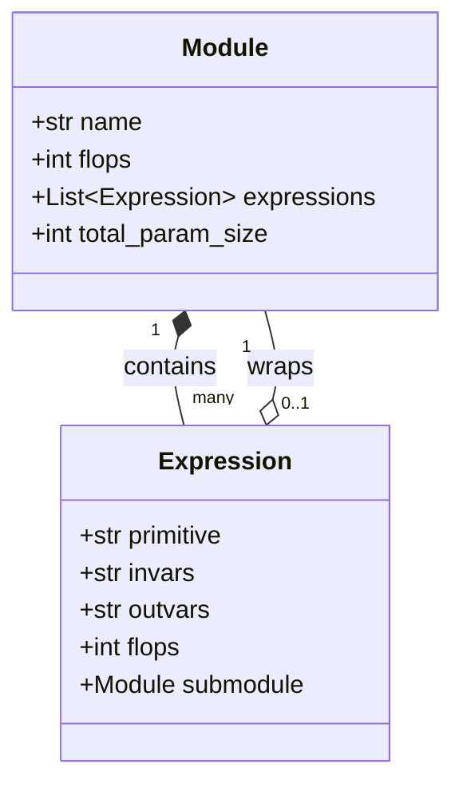

<!-- source: DeepWiki mcp.deepwiki.com · repo google-deepmind/dm-haiku · page 4.3 Visualization Tools · fetched 2026-10-26 -->

# Visualization Tools

<details>
<summary>Relevant source files</summary>

The following files were used as context for generating this wiki page:

- [haiku/_src/dot.py](haiku/_src/dot.py)
- [haiku/_src/dot_test.py](haiku/_src/dot_test.py)
- [haiku/_src/eval_shape.py](haiku/_src/eval_shape.py)
- [haiku/_src/eval_shape_test.py](haiku/_src/eval_shape_test.py)
- [haiku/_src/integration/jaxpr_info_test.py](haiku/_src/integration/jaxpr_info_test.py)
- [haiku/_src/jaxpr_info.py](haiku/_src/jaxpr_info.py)
- [haiku/_src/jaxpr_info_test.py](haiku/_src/jaxpr_info_test.py)
- [haiku/_src/summarise.py](haiku/_src/summarise.py)
- [haiku/_src/summarise_test.py](haiku/_src/summarise_test.py)
- [haiku/benchmarks/BUILD](haiku/benchmarks/BUILD)
- [haiku/benchmarks/README.md](haiku/benchmarks/README.md)
- [haiku/benchmarks/eval_shape.py](haiku/benchmarks/eval_shape.py)
- [haiku/benchmarks/init.py](haiku/benchmarks/init.py)

</details>


This page documents the visualization and inspection tools available in Haiku that help developers understand, debug, and optimize their models. These tools enable you to visualize the computation graph, examine model structure, analyze parameter usage, and inspect JAX expressions.

## Overview

Haiku provides several utilities for model introspection:

1.  **Tabulation (`hk.experimental.tabulate`)**: Summarizes module structure, parameters, and shapes in a tabular format.
2.  **Dot Graph Visualization (`to_dot` / `abstract_to_dot`)**: Converts Haiku functions to Graphviz DOT graphs.
3.  **JAXpr Information (`jaxpr_info`)**: Provides detailed hierarchical information about JAX expressions and FLOP estimates.
4.  **Shape Evaluation (`eval_shape` / `fast_eval_shape`)**: Inspects output shapes without executing full computation.

## Tabulation and Summarization

The `hk.experimental.tabulate` utility (and the underlying `eval_summary`) provides a high-level overview of module execution. It records every method call on a module and extracts metadata like parameter sizes and input/output shapes.

### Key Components
- **`MethodInvocation`**: A record containing the module details, arguments, keyword arguments, and output specifications for a single call [haiku/_src/summarise.py:97-122]().
- **`ModuleDetails`**: Captures the module instance, the method name invoked, and the `ArraySpec` (shape/dtype) of its parameters and state [haiku/_src/summarise.py:73-93]().

### Usage Example
```python
import haiku as hk
import haiku.experimental as hke

def forward(x):
  return hk.nets.MLP([300, 100, 10])(x)

# Tabulate the model
table = hke.tabulate(forward)(jnp.ones([8, 784]))
print(table)
```

Sources: [haiku/_src/summarise.py:167-192](), [haiku/_src/summarise.py:73-93]()

---

## Dot Graph Visualization

The Dot Graph tools convert Haiku functions into Graphviz DOT format, visualizing the flow of operations clustered by module.

### Functions
- **`hk.to_dot`**: Converts a function to a dot graph using concrete inputs [haiku/_src/dot.py:71-98]().
- **`hk.abstract_to_dot`**: Uses JAX's abstract interpretation to generate the graph without concrete values, supporting `jax.ShapeDtypeStruct` [haiku/_src/dot.py:101-136]().

### Implementation Detail
The visualization uses a custom JAX `Trace` called `DotTrace` and a `DotTracer` to intercept JAX primitives during execution [haiku/_src/dot.py:188-216](). It also uses `hk.hook_methods` to create subgraphs for each Haiku module [haiku/_src/dot.py:153-162]().


Sources: [haiku/_src/dot.py:71-136](), [haiku/_src/dot.py:143-175](), [haiku/_src/dot.py:199-216]()

---

## JAXpr Information Visualization

`jaxpr_info` provides a deeper look into the underlying JAX expressions (`jaxprs`) generated by Haiku modules. It is particularly useful for counting FLOPs and understanding how JAX transforms (like `jit` or `grad`) affect the model.

### Data Structures
- **`Module`**: A dataclass containing the module name, FLOPs, nested expressions, and parameter/state info [haiku/_src/jaxpr_info.py:54-77]().
- **`Expression`**: Information about a single JAX primitive call (e.g., `conv_general_dilated`), including its input/output variables and FLOPs [haiku/_src/jaxpr_info.py:80-109]().

### FLOP Estimation
Users can provide a `ComputeFlopsFn` to `make_model_info` to estimate the computational cost of specific JAX equations [haiku/_src/jaxpr_info.py:114-134]().


Sources: [haiku/_src/jaxpr_info.py:54-109](), [haiku/_src/jaxpr_info.py:114-141]()

---

## Shape Evaluation

Haiku provides utilities to determine the shapes of outputs and parameters without performing the actual heavy computation.

### `fast_eval_shape`
This is an optimized version of `jax.eval_shape`. It avoids Python overhead in large models by applying several shortcuts [haiku/_src/eval_shape.py:37-65]():
1.  **`zeros_creator`**: Replaces all parameter/state initializers with zeros to avoid random number generation or complex init logic [haiku/_src/eval_shape.py:26-29]().
2.  **`noop_dropout`**: Replaces `hk.dropout` with an identity function [haiku/_src/eval_shape.py:32-34]().
3.  **RNG folding**: Replaces `jax.random.fold_in` with an identity to save trace time [haiku/_src/eval_shape.py:60]().

### Comparison Table

| Feature | `jax.eval_shape` | `hk.experimental.fast_eval_shape` |
| :--- | :--- | :--- |
| **Primary Use** | General JAX shape tracing | Optimized Haiku model shape tracing |
| **Initializers** | Run normally | Replaced with `jnp.zeros` |
| **Dropout** | Applies mask (if rng provided) | Identity (no-op) |
| **Performance** | Standard | Faster for very large models |

Sources: [haiku/_src/eval_shape.py:37-65](), [haiku/benchmarks/eval_shape.py:1-27]()

---

## Summary of Tools

| Tool | Code Entity | Best For |
| :--- | :--- | :--- |
| **Tabulate** | `hk.experimental.tabulate` | Quick summary of layers and parameter counts. |
| **Dot Graph** | `hk.to_dot` | Visualizing connectivity and module nesting. |
| **JAXpr Info** | `hk.experimental.jaxpr_info` | FLOP counting and inspecting low-level JAX operations. |
| **Fast Eval** | `hk.experimental.fast_eval_shape` | Rapidly getting shapes for huge models. |

Sources: [haiku/_src/dot.py:71-72](), [haiku/_src/jaxpr_info.py:114-115](), [haiku/_src/summarise.py:167-168](), [haiku/_src/eval_shape.py:37-38]()

---

