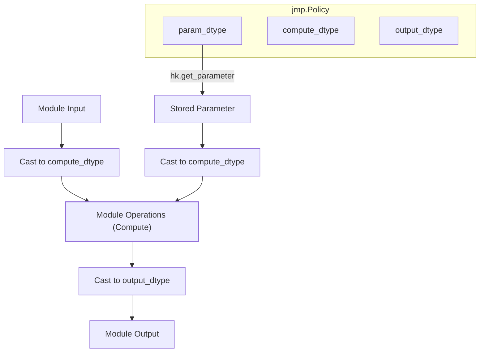
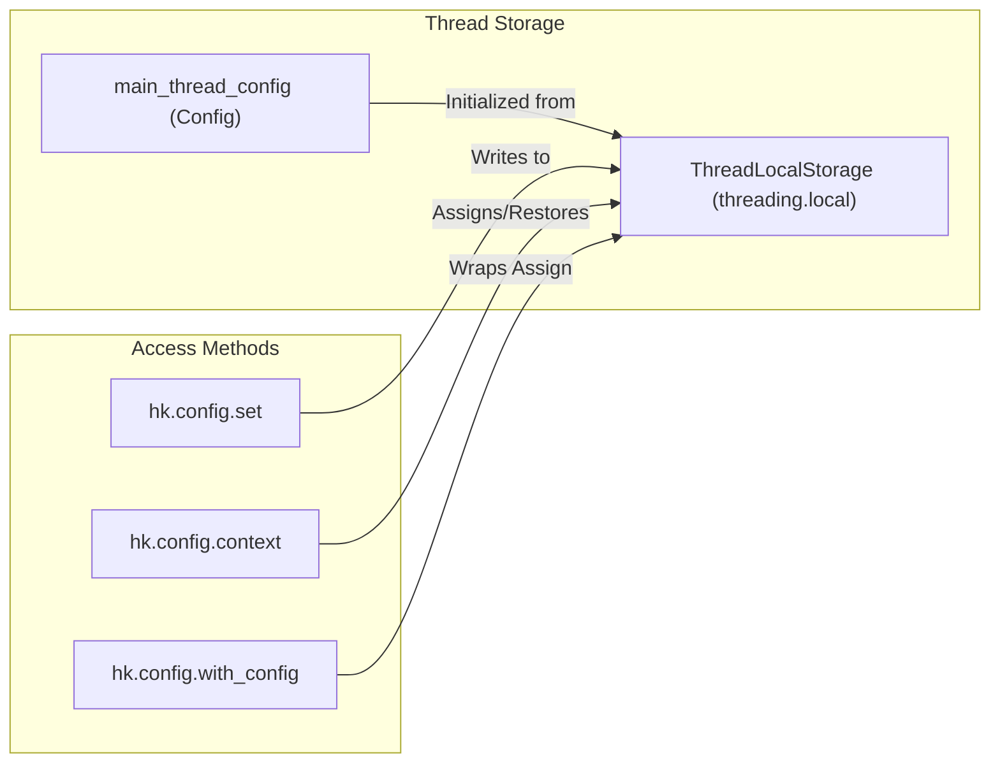

<!-- source: DeepWiki mcp.deepwiki.com · repo google-deepmind/dm-haiku · page 4.4 Mixed Precision and Configuration · fetched 2026-10-26 -->

# Mixed Precision and Configuration

Relevant source files

The following files were used as context for generating this wiki page:

- [docs/ext/coverage_check.py](docs/ext/coverage_check.py)
- [docs/notebooks/visualization.ipynb](docs/notebooks/visualization.ipynb)
- [haiku/_src/config.py](haiku/_src/config.py)
- [haiku/_src/config_test.py](haiku/_src/config_test.py)
- [haiku/_src/mixed_precision.py](haiku/_src/mixed_precision.py)
- [haiku/_src/mixed_precision_test.py](haiku/_src/mixed_precision_test.py)
- [haiku/config.py](haiku/config.py)
- [haiku/experimental/__init__.py](haiku/experimental/__init__.py)
- [haiku/experimental/jaxpr_info.py](haiku/experimental/jaxpr_info.py)
- [haiku/mixed_precision.py](haiku/mixed_precision.py)

Haiku provides a robust system for managing numerical precision across model hierarchies and a centralized configuration system to control library-wide behaviors. The mixed precision system integrates with the `jmp` library to allow granular control over compute, parameter, and output types, while the configuration system manages safety checks, RNG behavior, and module representations.

## Mixed Precision System

Haiku's mixed precision system is built around `jmp.Policy` objects. These policies define how three categories of data are handled within a module:
1.  **Parameters**: The precision in which parameters are stored and created.
2.  **Compute**: The precision used for internal operations.
3.  **Output**: The precision of the values returned by the module.

### Policy Application Logic
Policies are applied to module classes rather than instances. When a policy is set for a class (e.g., `hk.Linear`), Haiku uses a method interceptor to wrap the module's calls, ensuring that inputs are cast to the compute type and outputs are cast to the output type [haiku/_src/mixed_precision.py:145-160]().

**Mixed Precision Data Flow**
The following diagram illustrates how a `jmp.Policy` interacts with a Haiku `Module` during execution.

Sources: [haiku/_src/mixed_precision.py:145-180]()

### Key Functions
*   `hk.mixed_precision.set_policy(cls, policy)`: Globally associates a `jmp.Policy` with a specific `hk.Module` class for the current thread [haiku/_src/mixed_precision.py:145-148]().
*   `hk.mixed_precision.push_policy(cls, policy)`: A context manager that temporarily applies a policy to a class, restoring the previous state upon exit [haiku/_src/mixed_precision.py:192-198]().
*   `hk.mixed_precision.get_policy(cls)`: Retrieves the policy explicitly assigned to a class [haiku/_src/mixed_precision.py:121-142]().
*   `hk.mixed_precision.current_policy()`: Returns the policy active in the current execution context [haiku/_src/mixed_precision.py:105-118]().

### Implementation Detail: The Interceptor
Mixed precision is implemented via `module.intercept_methods_global` [haiku/_src/mixed_precision.py:86-88](). When `set_policy` is first called, an interceptor (`_mixed_precision_interceptor`) is installed. This interceptor checks the class of the module being called against the `_ThreadState` registry to determine if a policy should be applied [haiku/_src/mixed_precision.py:60-95]().

Sources: [haiku/_src/mixed_precision.py:15-95](), [haiku/mixed_precision.py:18-30]()

---

## Global Configuration (`hk.config`)

Haiku maintains a global configuration state via the `Config` dataclass, which is managed per-thread to ensure safety during parallel execution [haiku/_src/config.py:22-36]().

### Configuration Options

| Option | Type | Default | Description |
| :--- | :--- | :--- | :--- |
| `check_jax_usage` | `bool` | `False` | Validates that JAX transforms (e.g., `vmap`) are used correctly within Haiku transformed functions [haiku/_src/config.py:206-210](). |
| `module_auto_repr` | `bool` | `True` | Automatically generates a string representation for modules [haiku/_src/config.py:162-175](). |
| `rng_reserve_size` | `int` | `1` | Number of keys to reserve when calling `next_rng_key()`. Increasing this can improve performance by reducing JAX overhead [haiku/_src/config.py:72-76](). |
| `restore_flatmap` | `bool` | `False` | Determines if legacy checkpoints should be restored as `FlatMap` or plain dicts [haiku/_src/config.py:69-71](). |

### Configuration Scoping
Haiku provides multiple ways to modify these settings:
1.  **Global Set**: `hk.config.set(option=value)` updates the current thread's state permanently [haiku/_src/config.py:86-116]().
2.  **Context Manager**: `with hk.config.context(option=value):` updates settings for a block of code [haiku/_src/config.py:48-81]().
3.  **Decorator**: `@hk.config.with_config(option=value)` wraps a function with specific settings [haiku/_src/config.py:132-139]().

**Configuration State Management**

Sources: [haiku/_src/config.py:121-160]()

---

## Experimental Namespace

The `haiku.experimental` namespace contains features that are under active development. While they are public, their APIs are subject to change.

### Key Experimental Features
*   **JAX Integration Tools**: `jaxpr_info` provides tools for inspecting the underlying JAX expressions generated by Haiku modules [haiku/experimental/jaxpr_info.py:18-36]().
*   **Visualization**: `tabulate` generates a table summary of module execution, including parameter counts and array shapes [haiku/experimental/__init__.py:54]().
*   **Parameter Lifting**: Functions like `lift` and `lift_with_state` allow parameters to be shared or manipulated across transformation boundaries [haiku/experimental/__init__.py:39-43]().
*   **Flax Interop**: The `flax` sub-namespace (or `no_flax` shim) handles interoperability between Haiku and Flax modules [haiku/experimental/__init__.py:58-66]().

Sources: [haiku/experimental/__init__.py:21-110](), [haiku/experimental/jaxpr_info.py:1-36]()

---

