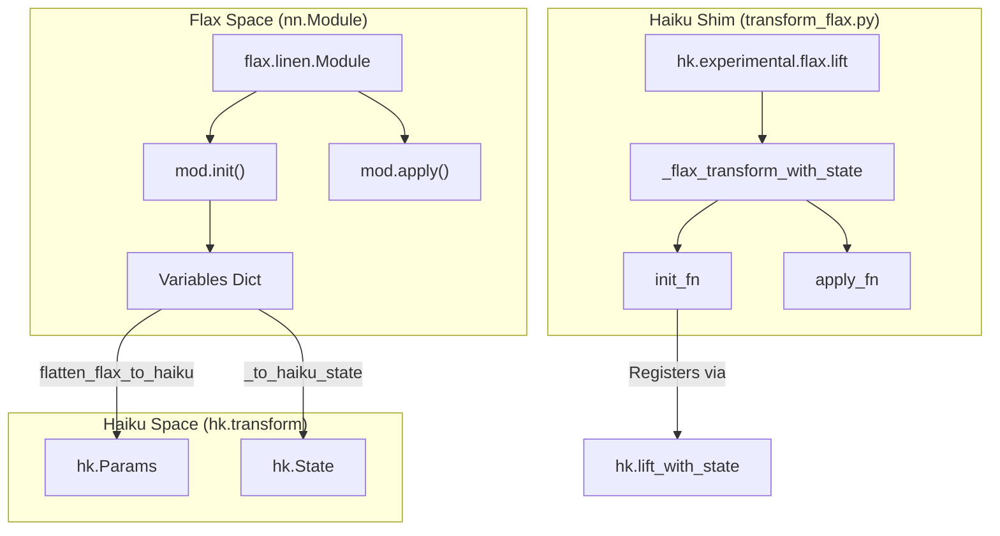
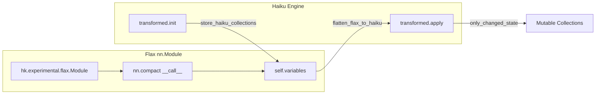

<!-- source: DeepWiki mcp.deepwiki.com · repo google-deepmind/dm-haiku · page 4.5 Flax Interoperability · fetched 2026-10-26 -->

# Flax Interoperability

Relevant source files

The following files were used as context for generating this wiki page:

- [docs/notebooks/flax.ipynb](docs/notebooks/flax.ipynb)
- [haiku/_src/flax/BUILD](haiku/_src/flax/BUILD)
- [haiku/_src/flax/flax_module.py](haiku/_src/flax/flax_module.py)
- [haiku/_src/flax/flax_module_test.py](haiku/_src/flax/flax_module_test.py)
- [haiku/_src/flax/transform_flax.py](haiku/_src/flax/transform_flax.py)
- [haiku/_src/flax/transform_flax_test.py](haiku/_src/flax/transform_flax_test.py)
- [haiku/_src/flax/utils.py](haiku/_src/flax/utils.py)
- [haiku/_src/no_flax.py](haiku/_src/no_flax.py)
- [haiku/_src/no_flax_test.py](haiku/_src/no_flax_test.py)
- [haiku/experimental/flax.py](haiku/experimental/flax.py)
- [requirements-flax.txt](requirements-flax.txt)

Haiku provides a suite of experimental utilities to facilitate interoperability with [Flax](https://github.com/google/flax). These tools allow developers to "lift" Flax modules into Haiku transformations or wrap Haiku modules/functions as Flax `nn.Module` instances. This bi-directional integration enables mixing layers from both libraries within a single JAX program.

## Lifting Flax into Haiku

The primary mechanism for using Flax components inside a Haiku model is `hk.experimental.flax.lift` [haiku/experimental/flax.py:19-25](). This function converts a Flax `nn.Module` into a callable that behaves like a Haiku module, registering Flax's parameters and state within Haiku's management system [haiku/_src/flax/transform_flax.py:149-185]().

### Data Flow and Transformation
When `lift` is called, it internally creates a Haiku-compatible transformation of the Flax module using `_flax_transform_with_state` [haiku/_src/flax/transform_flax.py:186](). This involves mapping Flax's hierarchical variable collections (like `params` and `batch_stats`) into Haiku's flat `Params` and `State` dictionaries.

| Feature | Implementation Detail |
| :--- | :--- |
| **Parameter Mapping** | Flax `params` are flattened into Haiku keys using `/` delimiters [haiku/_src/flax/transform_flax.py:54-67](). |
| **State Mapping** | Non-parameter collections (e.g., `state`) are prefixed with their collection name in Haiku [haiku/_src/flax/transform_flax.py:70-80](). |
| **RNG Handling** | Haiku's `hk.next_rng_key()` is used to provide keys for Flax's `init` and `apply` calls [haiku/_src/flax/transform_flax.py:192-201](). |

**Flax-to-Haiku Entity Mapping**
The following diagram illustrates how Flax internal entities are exposed through the Haiku lifting shim.

Sources: [haiku/_src/flax/transform_flax.py:102-146](), [haiku/_src/flax/utils.py:41-51]()

## Wrapping Haiku as Flax Modules

To use Haiku code inside a Flax-centric project, Haiku provides `hk.experimental.flax.Module` [haiku/_src/flax/flax_module.py:80-109](). This class is a native Flax `nn.Module` that wraps a Haiku `Transformed` or `TransformedWithState` object.

### Module Creation
There are two ways to instantiate a Haiku-in-Flax module:
1.  **Direct Wrapping**: Pass an existing `hk.transform` result to the `Module` constructor [haiku/_src/flax/flax_module.py:87-94]().
2.  **Class Factory**: Use `Module.create(hk_cls, *args)` to wrap a Haiku module class (e.g., `hk.Linear`) directly [haiku/_src/flax/flax_module.py:119-158]().

### State Synchronization
During the Flax `__call__`, the wrapper performs the following:
1.  **Initialization**: If the Flax module is initializing, it runs `transformed.init` and stores the resulting Haiku params/state into Flax variables via `store_haiku_collections` [haiku/_src/flax/flax_module.py:161-164]().
2.  **Application**: It flattens Flax's nested variables back into Haiku's format, executes `transformed.apply`, and then identifies changed state using `only_changed_state` to update Flax's mutable collections [haiku/_src/flax/flax_module.py:166-173]().

**Haiku-to-Flax Entity Mapping**
This diagram shows the structural relationship when a Haiku module is embedded in a Flax model.

Sources: [haiku/_src/flax/flax_module.py:159-175](), [haiku/_src/flax/utils.py:41-51]()

## The `no_flax` Shim

Haiku is designed to be usable even if Flax is not installed in the environment. This is handled by a shim module.

- **`FlaxNotInstalled`**: A placeholder module class that raises a descriptive `ImportError` only when a user attempts to access an attribute of `haiku.experimental.flax` [haiku/_src/no_flax.py:21-31]().
- **`inject_shim_module`**: This function inserts the `FlaxNotInstalled` instance into `sys.modules['haiku.experimental.flax']` [haiku/_src/no_flax.py:34-39]().

This ensures that the core Haiku library remains lightweight while providing clear feedback when optional interoperability features are requested without the necessary dependencies [haiku/_src/no_flax_test.py:41-47]().

Sources: [haiku/_src/no_flax.py:15-39](), [haiku/_src/no_flax_test.py:16-53]()

## Key Implementation Utilities

| Function | Purpose | File |
| :--- | :--- | :--- |
| `flatten_flax_to_haiku` | Converts Flax's nested dictionary structure into Haiku's flat module-delimited structure. | [haiku/_src/flax/utils.py:41-51]() |
| `_from_haiku_state` | Reconstructs Flax's nested variable collections from Haiku's flat state dictionary. | [haiku/_src/flax/transform_flax.py:83-99]() |
| `store_haiku_collections` | Recursively pushes Haiku parameters/state into a Flax `Scope`. | [haiku/_src/flax/flax_module.py:55-66]() |
| `only_changed_state` | Optimization that filters the state dictionary to only include keys where values have changed (identity check). | [haiku/_src/flax/flax_module.py:68-77]() |

Sources: [haiku/_src/flax/utils.py:41-70](), [haiku/_src/flax/transform_flax.py:54-99](), [haiku/_src/flax/flax_module.py:55-77]()

---

