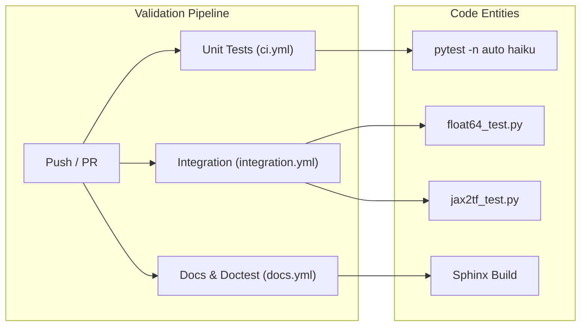

<!-- source: DeepWiki mcp.deepwiki.com · repo google-deepmind/dm-haiku · page 5 Development and Testing · fetched 2026-10-26 -->

# Development and Testing

<details>
<summary>Relevant source files</summary>

The following files were used as context for generating this wiki page:

- [.github/workflows/ci.yml](.github/workflows/ci.yml)
- [.github/workflows/docs.yml](.github/workflows/docs.yml)
- [.github/workflows/integration.yml](.github/workflows/integration.yml)
- [MANIFEST.in](MANIFEST.in)
- [docs/conf.py](docs/conf.py)
- [haiku/_src/integration/doctest_test.py](haiku/_src/integration/doctest_test.py)
- [haiku/_src/integration/jax2tf_test.py](haiku/_src/integration/jax2tf_test.py)
- [haiku/_src/test_utils.py](haiku/_src/test_utils.py)
- [readthedocs.yml](readthedocs.yml)
- [requirements.txt](requirements.txt)
- [setup.py](setup.py)
- [test.sh](test.sh)

</details>


This document provides a high-level overview of the development workflow, testing infrastructure, and CI/CD pipelines for Haiku. It explains how the library ensures correctness through various testing patterns and how the build system manages dependencies and documentation.

## Development Workflow

Haiku's development environment is centered around JAX and its ecosystem. The project uses standard Python tooling for dependency management and package distribution.

```mermaid
graph TD
    subgraph "Environment Setup"
        [setup.py] -->|"defines"| Deps["Dependencies"]
        Deps -->|"Core"| [requirements.txt]
        Deps -->|"JAX"| [requirements-jax.txt]
        Deps -->|"Flax"| [requirements-flax.txt]
        Deps -->|"Test"| [requirements-test.txt]
    end

    subgraph "Local Development"
        [test.sh] -->|"orchestrates"| Venv["Virtual Env"]
        Venv -->|"installs"| Install["pip install ."]
        Install -->|"runs"| pytest["pytest"]
    end

    subgraph "CI/CD"
        GithubActions["GitHub Actions"] -->|"triggers"| CI[".github/workflows/ci.yml"]
        GithubActions -->|"triggers"| Integration[".github/workflows/integration.yml"]
        GithubActions -->|"triggers"| Docs[".github/workflows/docs.yml"]
    end
```

Sources: [setup.py:38-56](), [test.sh:17-44](), [.github/workflows/ci.yml:1-10]()

## Testing Infrastructure

Haiku uses a multi-layered testing strategy to verify functional correctness, JAX transformation compatibility, and documentation accuracy.

| Component | Description | Key Code Entities |
| :--- | :--- | :--- |
| **Unit Tests** | Standard tests for individual modules and utilities. | `pytest` |
| **Integration Tests** | Tests for cross-library compatibility and complex behaviors. | `haiku/_src/integration/` |
| **Transformation Tests** | Utilities to run Haiku code through JAX transforms like `jit` or `vmap`. | `hk.testing.transform_and_run` |
| **Doctests** | Verification of code snippets within docstrings. | `haiku/_src/integration/doctest_test.py` |

### Testing Utilities
The `hk.testing.transform_and_run` utility is the primary tool for unit testing Haiku modules. It automates the `init` and `apply` lifecycle within a test case, allowing developers to write tests in a natural imperative style.

For details, see [Testing Infrastructure](#5.1).

Sources: [haiku/_src/test_utils.py:35-147](), [haiku/_src/integration/doctest_test.py:15-37](), [test.sh:46-56]()

## CI/CD and Build System

Haiku utilizes GitHub Actions for its Continuous Integration pipeline. The build system ensures that every pull request is validated against multiple Python versions and dependency configurations.



### Key Workflows
*   **Unit Testing**: Runs the core test suite using `pytest`. It ignores integration tests to maintain speed.
*   **Integration Testing**: Specifically runs tests in `haiku/_src/integration/`, including specialized environments like `float64` precision which require early JAX flag configuration.
*   **Documentation**: Validates that the Sphinx documentation builds without errors and that all internal links and doctests are valid.

For details, see [CI/CD and Build System](#5.2).

Sources: [.github/workflows/ci.yml:11-37](), [.github/workflows/integration.yml:11-40](), [.github/workflows/docs.yml:11-42](), [test.sh:48-55]()

## Documentation System

Haiku's documentation is built using Sphinx and hosted on ReadTheDocs. The system integrates API references directly from source code docstrings using `autodoc` and `autosummary`.

*   **Configuration**: Managed via `docs/conf.py`.
*   **Math Support**: Uses KaTeX for rendering LaTeX equations.
*   **Notebooks**: `nbsphinx` is used to include Jupyter notebooks as tutorials.
*   **Verification**: The `coverage_check` and `doctest` targets in the `docs/` directory ensure the documentation remains complete and accurate.

Sources: [docs/conf.py:85-99](), [readthedocs.yml:1-26](), [test.sh:58-63]()

---

