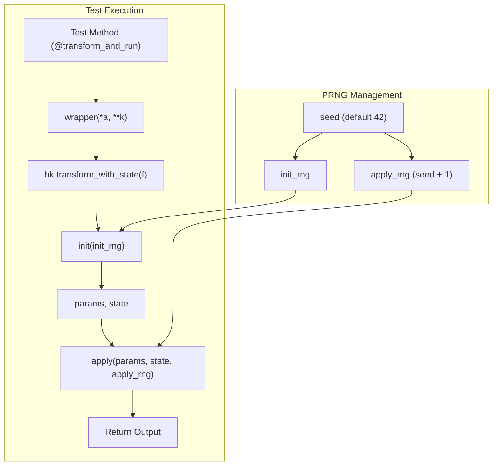
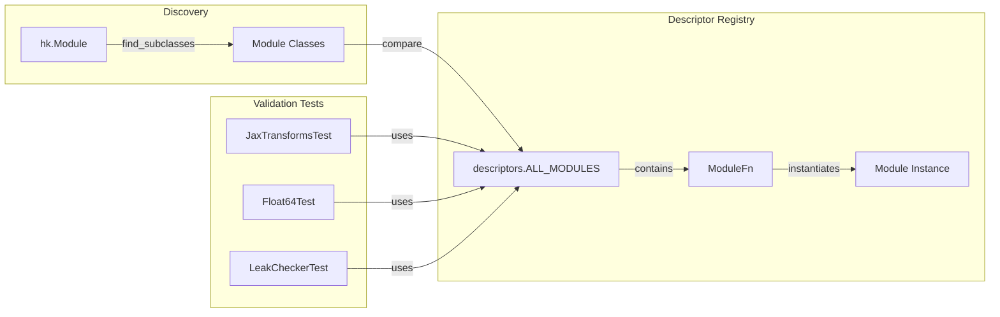

<!-- source: DeepWiki mcp.deepwiki.com · repo google-deepmind/dm-haiku · page 5.1 Testing Infrastructure · fetched 2026-10-26 -->

# Testing Infrastructure

Relevant source files

The following files were used as context for generating this wiki page:

- [docs/conf.py](docs/conf.py)
- [haiku/_src/embed_test.py](haiku/_src/embed_test.py)
- [haiku/_src/initializers.py](haiku/_src/initializers.py)
- [haiku/_src/initializers_test.py](haiku/_src/initializers_test.py)
- [haiku/_src/integration/check_tracer_leaks_test.py](haiku/_src/integration/check_tracer_leaks_test.py)
- [haiku/_src/integration/checkpoint_utils.py](haiku/_src/integration/checkpoint_utils.py)
- [haiku/_src/integration/descriptors_test.py](haiku/_src/integration/descriptors_test.py)
- [haiku/_src/integration/doctest_test.py](haiku/_src/integration/doctest_test.py)
- [haiku/_src/integration/float64_test.py](haiku/_src/integration/float64_test.py)
- [haiku/_src/integration/jax2tf_test.py](haiku/_src/integration/jax2tf_test.py)
- [haiku/_src/integration/jax_transforms_test.py](haiku/_src/integration/jax_transforms_test.py)
- [haiku/_src/test_utils.py](haiku/_src/test_utils.py)
- [haiku/nets.py](haiku/nets.py)

Haiku provides a comprehensive testing infrastructure designed to validate the functional transformation of object-oriented modules, ensure compatibility with JAX transformations, and maintain the integrity of the codebase through automated documentation testing.

### Overview of Testing Patterns

Haiku's testing philosophy centers on bridging the gap between its object-oriented `hk.Module` API and JAX's functional requirements. The infrastructure includes specialized decorators for running Haiku code in tests, integration descriptors for library-wide coverage, and leak detection for JAX tracers.

| Component | Purpose | Key Entity |
| :--- | :--- | :--- |
| **Transform & Run** | Executes Haiku code within a temporary functional context. | `hk.testing.transform_and_run` |
| **Integration Descriptors** | Standardized definitions for all modules to enable bulk testing. | `descriptors.ALL_MODULES` |
| **Tracer Leak Checks** | Ensures JAX tracers do not escape their transformation scope. | `jax_check_tracer_leaks` |
| **Doctest Framework** | Validates that code samples in docstrings are executable and correct. | `doctest_test.py` |

---

### Transform and Run Utility

The most critical utility for unit testing Haiku is `transform_and_run`. It automates the boilerplate of calling `hk.transform`, initializing parameters, and applying the function [haiku/_src/test_utils.py:35-42]().

#### Implementation Details
`transform_and_run` wraps a function, internally calling `hk.transform_with_state` [haiku/_src/test_utils.py:139-139](). It manages two PRNGKeys: one for `init` and one for `apply` [haiku/_src/test_utils.py:133-134]().

**Data Flow in `transform_and_run`:**

**Sources:** [haiku/_src/test_utils.py:35-147](), [haiku/_src/initializers_test.py:31-32]()

---

### Integration Test Descriptors

To ensure that changes to the core Haiku library do not break any existing modules, Haiku uses a "descriptor" system. Descriptors provide a standardized way to instantiate every module in the library with valid shapes and dtypes [haiku/_src/integration/descriptors_test.py:31-32]().

#### Coverage and Validation
The `DescriptorsTest` class uses `find_subclasses` to reflectively find all `hk.Module` implementations in the library and verifies that every module is either covered by an integration descriptor or explicitly ignored [haiku/_src/integration/descriptors_test.py:29-32]().

**System-Wide Integration Flow:**

**Sources:** [haiku/_src/integration/descriptors_test.py:15-32](), [haiku/_src/integration/jax_transforms_test.py:39-40](), [haiku/_src/integration/check_tracer_leaks_test.py:43-44]()

---

### JAX Transformations and Leak Checking

Haiku modules are tested against standard JAX transformations to ensure they behave predictably when `jit`, `vmap`, or `jax2tf` are applied.

#### Tracer Leak Checks
Haiku includes tests that enable `jax_check_tracer_leaks` [haiku/_src/integration/check_tracer_leaks_test.py:37-37](). These tests use `jax.eval_shape` to run module initialization and application, ensuring that no JAX tracers are leaked into global state or captured incorrectly in closures [haiku/_src/integration/check_tracer_leaks_test.py:50-56]().

#### JAX/TF Integration
The `JaxToTfTest` suite validates that Haiku models can be converted to TensorFlow using `jax2tf.convert` [haiku/_src/integration/jax2tf_test.py:72-78](). It compares the outputs of the JAX version (potentially JIT-compiled) against the TensorFlow version (potentially wrapped in `tf.function`) [haiku/_src/integration/jax2tf_test.py:41-53]().

**Sources:** [haiku/_src/integration/check_tracer_leaks_test.py:15-56](), [haiku/_src/integration/jax_transforms_test.py:37-89](), [haiku/_src/integration/jax2tf_test.py:40-84]()

---

### Doctest Framework

Haiku maintains high documentation quality by treating code samples in docstrings as executable tests.

#### Automated Module Discovery
The `DoctestTest` class uses `find_internal_python_modules` to locate every module in the Haiku package [haiku/_src/integration/doctest_test.py:39-39](). It then iterates through all exported symbols in `__all__` [haiku/_src/integration/doctest_test.py:73-73]().

#### Execution Context
Because many Haiku modules require being inside an `hk.transform` to function, the doctest runner wraps each test execution in an `hk.transform_with_state` context [haiku/_src/integration/doctest_test.py:113-115](). This prevents "Haiku modules must be used inside hk.transform" errors during documentation testing.

**Doctest Configuration:**
- **Flags:** Uses `ELLIPSIS` and `NORMALIZE_WHITESPACE` to handle non-deterministic output formatting [haiku/_src/integration/doctest_test.py:44-44]().
- **Globs:** Provides common aliases like `hk`, `jnp`, `jax`, and `nn` (Flax) to the doctest environment [haiku/_src/integration/doctest_test.py:45-56]().

**Sources:** [haiku/_src/integration/doctest_test.py:15-120](), [docs/conf.py:135-158]()

---

### Utility Functions for Tests

Haiku provides several small utilities to simplify parameterized testing:

| Function | Description |
| :--- | :--- |
| `find_internal_python_modules` | Recursively finds all submodules under a root module [haiku/_src/test_utils.py:150-169](). |
| `find_subclasses` | Finds all classes that inherit from a specific base class (e.g., `hk.Module`) [haiku/_src/test_utils.py:172-184](). |
| `combined_named_parameters` | Performs a Cartesian product of multiple parameter sets for use with `@parameterized.named_parameters` [haiku/_src/test_utils.py:187-211](). |
| `named_bools` | Generates `(name, True)` and `(not_name, False)` pairs for testing boolean flags [haiku/_src/test_utils.py:214-216](). |

**Sources:** [haiku/_src/test_utils.py:150-216]()

---

