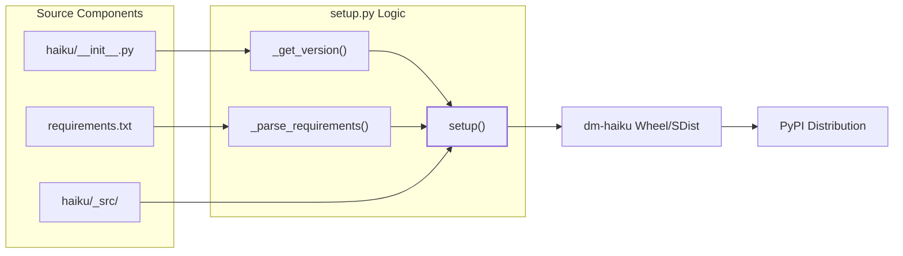

<!-- source: DeepWiki mcp.deepwiki.com · repo google-deepmind/dm-haiku · page 5.2 CI/CD and Build System · fetched 2026-10-26 -->

# CI/CD and Build System

<details>
<summary>Relevant source files</summary>

The following files were used as context for generating this wiki page:

- [.github/workflows/ci.yml](.github/workflows/ci.yml)
- [.github/workflows/docs.yml](.github/workflows/docs.yml)
- [.github/workflows/integration.yml](.github/workflows/integration.yml)
- [CONTRIBUTING.md](CONTRIBUTING.md)
- [MANIFEST.in](MANIFEST.in)
- [WORKSPACE](WORKSPACE)
- [docs/.gitignore](docs/.gitignore)
- [docs/Makefile](docs/Makefile)
- [docs/index.rst](docs/index.rst)
- [docs/requirements.txt](docs/requirements.txt)
- [readthedocs.yml](readthedocs.yml)
- [requirements.txt](requirements.txt)
- [setup.py](setup.py)
- [test.sh](test.sh)

</details>


This page details the automation and infrastructure used to build, test, and distribute Haiku. The system relies on GitHub Actions for continuous integration, Sphinx for documentation generation, and standard Python packaging tools for distribution.

## CI/CD Workflows

Haiku utilizes GitHub Actions to automate testing and documentation verification. These workflows are triggered on every push to the `main` branch and on every pull request [`.github/workflows/ci.yml`:4-9]().

### Continuous Integration (Unit Tests)
The primary CI workflow executes the Haiku test suite across supported environments. It performs the following steps:
1.  **Environment Setup**: Initializes a runner with Python 3.12 [`.github/workflows/ci.yml`:17]().
2.  **Dependency Installation**: Installs core requirements, JAX-specific requirements, Flax interoperability requirements, and testing utilities via `pip` [`.github/workflows/ci.yml`:29]().
3.  **Haiku Installation**: Installs the local version of Haiku in editable mode [`.github/workflows/ci.yml`:30]().
4.  **Test Execution**: Runs `pytest` using `pytest-xdist` for parallel execution (`-n auto`) [`.github/workflows/ci.yml`:37](). Note that integration tests are explicitly ignored in this workflow to keep feedback cycles fast [`.github/workflows/ci.yml`:37]().

### Integration Testing
A dedicated workflow handles integration tests, which are more resource-intensive or require specific global configurations.
-   **Float64 Isolation**: The integration suite isolates `float64_test.py` because it requires setting JAX flags at startup, which can interfere with other tests [`.github/workflows/integration.yml`:37-39]().
-   **Execution**: After the isolated test, the remaining integration tests in `haiku/_src/integration/` are run in parallel [`.github/workflows/integration.yml`:40]().

### Documentation CI
The documentation workflow ensures that the API reference and tutorials remain valid:
-   **Pandoc Requirement**: Uses `pandoc` to handle document conversions [`.github/workflows/docs.yml`:28]().
-   **Coverage Check**: Executes `make coverage_check` within the `docs` directory to ensure all public symbols are documented [`.github/workflows/docs.yml`:38]().
-   **HTML Build**: Verifies that the Sphinx documentation builds successfully into HTML [`.github/workflows/docs.yml`:42]().

### CI/CD Workflow Data Flow

The following diagram illustrates how code changes flow through the CI system.

**Workflow Execution Path**
```mermaid
graph TD
    subgraph "GitHub Actions Triggers"
        PR["Pull Request to main"] --> CI_Trigger["Trigger Workflows"]
        PUSH["Push to main"] --> CI_Trigger
    end

    subgraph "Test Jobs"
        CI_Trigger --> UT["pytest (Unit Tests)"]
        CI_Trigger --> IT["Integration Tests"]
        CI_Trigger --> DOCS["Docs Build"]
    end

    subgraph "Execution Logic (test.sh / workflows)"
        UT --> PYTEST["pytest -n auto haiku --ignore=haiku/_src/integration/"]
        IT --> F64["pytest haiku/_src/integration/float64_test.py"]
        F64 --> IT_ALL["pytest haiku/_src/integration/ (remaining)"]
        DOCS --> MAKE_HTML["make html"]
    end

    PYTEST -.-> [".github/workflows/ci.yml"]
    F64 -.-> [".github/workflows/integration.yml"]
    MAKE_HTML -.-> [".github/workflows/docs.yml"]
```
Sources: [`.github/workflows/ci.yml`:1-38](), [`.github/workflows/integration.yml`:1-41](), [`.github/workflows/docs.yml`:1-43]().

---

## Build System and Packaging

Haiku uses `setuptools` for its build system, defined in `setup.py`.

### Package Configuration
-   **Dynamic Versioning**: The version is extracted directly from `haiku/__init__.py` using a custom `_get_version` function that executes the version line [`setup.py`:21-28]().
-   **Dependency Management**: Dependencies are split into several files to allow for flexible installation:
    -   `requirements.txt`: Core dependencies like `absl-py`, `jmp`, `numpy`, and `tabulate` [`requirements.txt`:1-4]().
    -   `requirements-jax.txt`: JAX-specific requirements [`setup.py`:52]().
    -   `requirements-flax.txt`: Flax for interoperability tests [`setup.py`:53]().
-   **Namespace Packages**: The build uses `find_namespace_packages` but excludes tests and examples from the final distribution [`setup.py`:49]().

### Manifest and Distribution
The `MANIFEST.in` file ensures that non-code files like `LICENSE`, `requirements.txt`, and the `py.typed` marker (for PEP 561 compatibility) are included in the source distribution [`MANIFEST.in`:1-8]().

### Local Development Script
For local developers, `test.sh` provides a reproducible environment setup:
1.  Creates a virtual environment in `/tmp/haiku-env` [`test.sh`:22-30]().
2.  Installs all dependency tiers [`test.sh`:36-40]().
3.  Executes the full suite including `doctest` and `coverage_check` [`test.sh`:61-63]().

**Packaging and Distribution Logic**

Sources: [`setup.py`:15-73](), [`requirements.txt`:1-5](), [`test.sh`:1-64]().

---

## Documentation System

The documentation is built using Sphinx and hosted on Read the Docs.

### Configuration and Tools
The system integrates several Sphinx extensions to handle the hybrid nature of the Haiku codebase (API docs + Jupyter notebooks):
-   **nbsphinx**: Used for executing and rendering the tutorial notebooks found in `docs/notebooks/` [`docs/requirements.txt`:9]().
-   **sphinx-autodoc-typehints**: Ensures Python type annotations are correctly rendered in the API reference [`docs/requirements.txt`:4]().
-   **sphinxcontrib-katex**: Provides LaTeX support for mathematical formulas in neural network descriptions [`docs/requirements.txt`:3]().

### Read the Docs Integration
The `.readthedocs.yml` file configures the remote build environment:
-   **OS**: Uses `ubuntu-22.04` [`readthedocs.yml`:7]().
-   **Python**: Specified as version `3.11` [`readthedocs.yml`:9]().
-   **Installation**: Automatically installs all dependency files (core, JAX, Flax, and docs-specific) before running the Sphinx builder [`readthedocs.yml`:17-21]().

### Documentation Structure
The documentation is organized via `docs/index.rst` into three main categories:
1.  **Basics**: Introduction and transformation concepts [`docs/index.rst`:41-46]().
2.  **API Reference**: Automated documentation of the `haiku` namespace [`docs/index.rst`:48-51]().
3.  **Advanced**: Specialized topics like `jax2tf`, parameter sharing, and visualization [`docs/index.rst`:53-62]().

Sources: [`docs/requirements.txt`:1-11](), [`readthedocs.yml`:1-27](), [`docs/index.rst`:1-95]().

---

