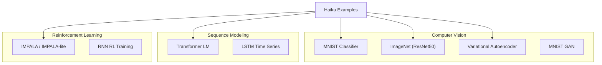
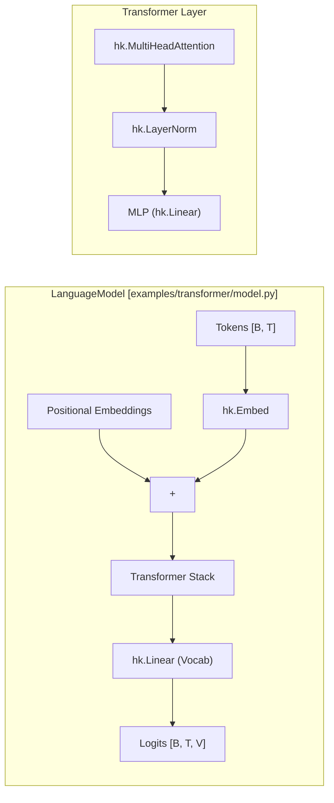

<!-- source: DeepWiki mcp.deepwiki.com · repo google-deepmind/dm-haiku · page 6 Examples · fetched 2026-10-26 -->

# Examples

Relevant source files

The following files were used as context for generating this wiki page:

- [examples/imagenet/BUILD](examples/imagenet/BUILD)
- [examples/imagenet/README.md](examples/imagenet/README.md)
- [examples/imagenet/dataset.py](examples/imagenet/dataset.py)
- [examples/imagenet/train.py](examples/imagenet/train.py)
- [examples/mnist.py](examples/mnist.py)
- [examples/mnist_pruning.py](examples/mnist_pruning.py)
- [examples/transformer/BUILD](examples/transformer/BUILD)
- [examples/transformer/dataset.py](examples/transformer/dataset.py)
- [examples/transformer/model.py](examples/transformer/model.py)
- [examples/transformer/train.py](examples/transformer/train.py)
- [examples/vae.py](examples/vae.py)

This page provides an overview of the example applications and models included in the Haiku codebase. These examples demonstrate how to use Haiku for various machine learning tasks and showcase common patterns for building and training models in JAX.

## Example Overview

Haiku includes several example implementations ranging from basic image classifiers to complex reinforcement learning agents. These examples serve as both tutorials and reference implementations for users.

Sources: [examples/mnist.py:15-135](), [examples/imagenet/train.py:15-186](), [examples/transformer/model.py:15-124](), [examples/vae.py:15-203]()

## Image Classification

Haiku provides several examples for image classification and generation, ranging from the standard LeNet-style MLP on MNIST to a production-ready ResNet50 pipeline for ImageNet.

*   **MNIST Classifier**: A minimal example demonstrating `hk.Sequential` and `hk.transform` for a standard MLP [examples/mnist.py:42-51]().
*   **ImageNet Training**: A high-performance ResNet50 implementation using `hk.nets.ResNet50` [examples/imagenet/train.py:90-93](). It demonstrates mixed-precision training using the `jmp` library and data parallelism with `jax.pmap` [examples/imagenet/train.py:149-186]().
*   **Generative Models**: Includes a Variational Autoencoder (VAE) that uses `hk.next_rng_key()` for stochastic latent sampling [examples/vae.py:114-124]().

For details, see [Image Classification](#6.1).

Sources: [examples/mnist.py:1-135](), [examples/imagenet/train.py:1-186](), [examples/vae.py:1-203]()

## Transformer Models

The transformer example provides a didactic implementation of an autoregressive language model. It showcases how to compose complex modules like `hk.MultiHeadAttention` and `hk.LayerNorm` into a stack.

The training loop demonstrates character-level language modeling on text datasets (e.g., Shakespeare) using `optax` for optimization [examples/transformer/train.py:154-183]().

For details, see [Transformer Models](#6.2).

Sources: [examples/transformer/model.py:39-124](), [examples/transformer/train.py:78-91]()

## Reinforcement Learning Examples

Haiku is extensively used for Reinforcement Learning (RL). The examples include the IMPALA (Importance Weighted Actor-Learner Architecture) algorithm, demonstrating how to bridge Haiku networks with environment loops.

*   **IMPALA-lite**: A simplified actor-learner setup for the "Catch" environment.
*   **Recurrent Agents**: Demonstrates the use of `hk.LSTM` and `hk.dynamic_unroll` for agents with memory.
*   **VQ-VAE**: An example of Vector Quantized Variational Autoencoders, often used in model-based RL or representation learning.

For details, see [Reinforcement Learning Examples](#6.3).

Sources: [examples/vae.py:108-124](), [examples/transformer/model.py:65-88]()

## Common Patterns

The examples highlight several Haiku-specific patterns:

| Pattern | Code Entity | Description |
| :--- | :--- | :--- |
| **Pure Transformation** | `hk.transform` | Converting OO modules to JAX-compatible functions [examples/mnist.py:73](). |
| **Stateful Models** | `hk.transform_with_state` | Managing non-trainable state (e.g., BatchNorm statistics) [examples/imagenet/train.py:96](). |
| **Stochasticity** | `hk.next_rng_key` | Handling internal PRNG state for dropout or VAE sampling [examples/vae.py:118](). |
| **Parameter Partitioning** | `hk.data_structures.partition` | Splitting parameters for selective updates like pruning [examples/mnist_pruning.py:102](). |

Sources: [examples/mnist.py:73-74](), [examples/imagenet/train.py:96-97](), [examples/vae.py:118-124](), [examples/mnist_pruning.py:102-106]()

---

