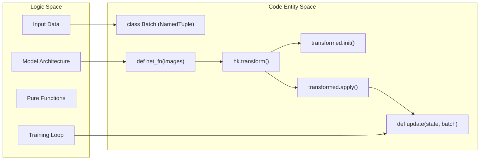
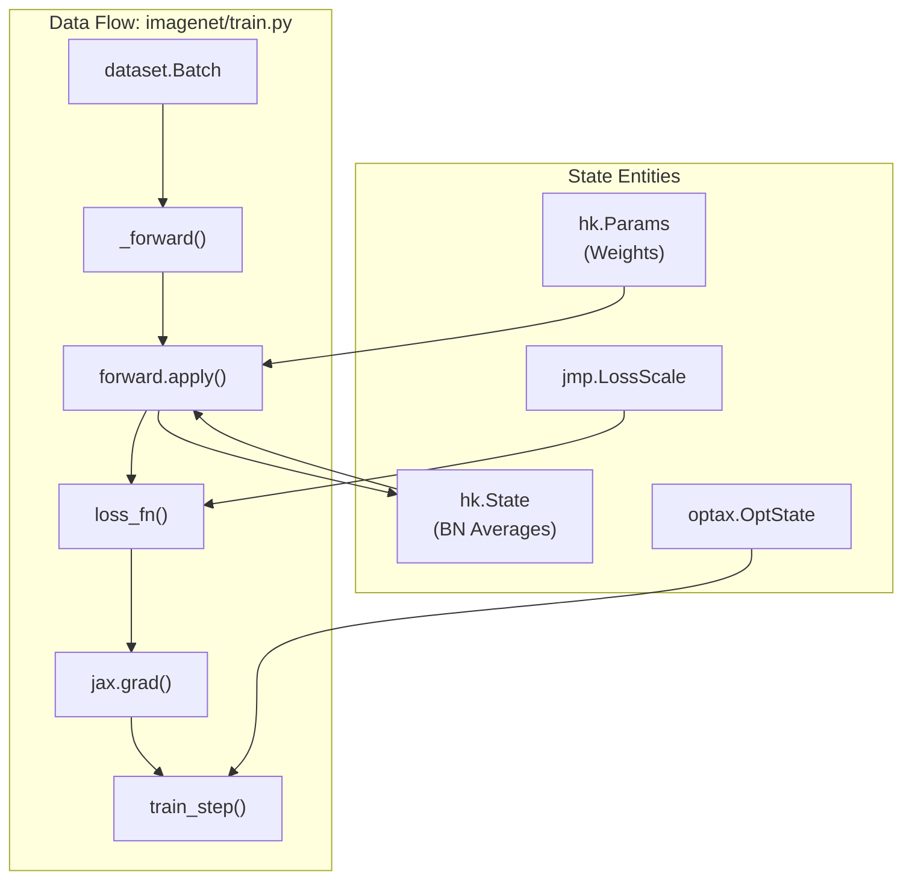

<!-- source: DeepWiki mcp.deepwiki.com · repo google-deepmind/dm-haiku · page 6.1 Image Classification · fetched 2026-10-26 -->

# Image Classification

Relevant source files

The following files were used as context for generating this wiki page:

- [examples/imagenet/BUILD](examples/imagenet/BUILD)
- [examples/imagenet/README.md](examples/imagenet/README.md)
- [examples/imagenet/dataset.py](examples/imagenet/dataset.py)
- [examples/imagenet/train.py](examples/imagenet/train.py)
- [examples/mnist.py](examples/mnist.py)
- [examples/mnist_gan.ipynb](examples/mnist_gan.ipynb)
- [examples/mnist_pruning.py](examples/mnist_pruning.py)
- [examples/vae.py](examples/vae.py)

This document details the implementation of image classification models and generative examples using the Haiku neural network library. It covers examples ranging from simple MNIST classifiers to more complex ImageNet models, including specialized variants like pruning, Variational Autoencoders (VAEs), and Generative Adversarial Networks (GANs).

## Overview of Haiku Classification Models

Haiku provides a clean, object-oriented interface for building image classification models while leveraging JAX's functional programming paradigm. The examples in the codebase demonstrate implementations for:

1.  **MNIST classification**: LeNet-300-100 MLP architecture [examples/mnist.py:42-51]().
2.  **Advanced MNIST**: Network pruning implementation [examples/mnist_pruning.py:170-179]().
3.  **Generative Models**: VAE [examples/vae.py:108-124]() and GAN [examples/mnist_gan.ipynb]().
4.  **ImageNet**: ResNet50 training pipeline [examples/imagenet/train.py:81-93]().

The following diagram bridges the high-level classification concept to specific Haiku code entities:

### Entity Mapping: Classification Pipeline

Sources: [examples/mnist.py:31-51](), [examples/mnist.py:73-106](), [examples/imagenet/train.py:66-96]()

## MNIST Classification Examples

### Basic MNIST Classifier
The basic MNIST example implements a minimal classification pipeline using a LeNet-300-100 MLP [examples/mnist.py:42-51](). It demonstrates the `hk.transform` workflow where object-oriented modules are converted into pure functions for JAX [examples/mnist.py:73]().

The network uses `hk.Sequential` to stack `hk.Flatten` and `hk.Linear` layers [examples/mnist.py:45-50](). Training utilizes `optax.adam` and manages an exponential moving average of parameters (`avg_params`) for more stable evaluation [examples/mnist.py:102-106]().

### MNIST with Pruning
The pruning example implements magnitude-based pruning as described by Zhu & Gupta (2017) [examples/mnist_pruning.py:15]().

**Key Pruning Functions:**
*   `topk_mask`: Generates a binary mask where 1s mark the top fraction of values by magnitude [examples/mnist_pruning.py:34-69]().
*   `zhugupta_func`: A cubic sparsity schedule that increases pruning levels over time [examples/mnist_pruning.py:72-74]().
*   `_create_partitions`: Uses `hk.data_structures.partition` to separate parameters into those to be pruned and those to be ignored (e.g., biases and batch norm) [examples/mnist_pruning.py:77-106](), [examples/mnist_pruning.py:109-112]().

### Generative Models (VAE & GAN)
Haiku's flexibility extends to generative tasks on MNIST:

*   **VAE**: Implements an `Encoder` and `Decoder` as `hk.Module` subclasses [examples/vae.py:63-97](). The `VariationalAutoEncoder` module uses `hk.next_rng_key()` to handle the stochastic reparameterization trick and Bernoulli sampling [examples/vae.py:117-124]().
*   **GAN**: Uses `hk.Conv2DTranspose` in the `Generator` to upsample noise into images and `hk.Conv2D` in the `Discriminator` for classification [examples/mnist_gan.ipynb]().

## ImageNet Classification with ResNet50

The ImageNet example demonstrates a production-grade training pipeline for ResNet50 [examples/imagenet/train.py:15]().

### ResNet Architecture and State
The model uses `hk.nets.ResNet50` and is transformed via `hk.transform_with_state` because ResNet uses `BatchNorm`, which requires tracking moving averages [examples/imagenet/train.py:90-96]().

Sources: [examples/imagenet/train.py:66-70](), [examples/imagenet/train.py:130-145](), [examples/imagenet/train.py:149-191]()

### Training Pipeline Features
*   **Distributed Training**: Uses `jax.pmap` with `axis_name='i'` to shard computation across multiple devices [examples/imagenet/train.py:148](). Gradients are synchronized using `jax.lax.pmean` [examples/imagenet/train.py:166]().
*   **Mixed Precision**: Integrates with the `jmp` library. Policies for parameters, computation, and output are configurable via flags [examples/imagenet/train.py:53-57](), [examples/imagenet/train.py:72-73]().
*   **Dataset Optimization**: The pipeline includes a "double transpose trick" (HWCN format) for TPU performance [examples/imagenet/dataset.py:126-133]() and a `double_buffer` utility to overlap host-to-device transfers with computation [examples/imagenet/dataset.py:168-198]().

## Implementation Comparison

| Feature | MNIST (`mnist.py`) | ImageNet (`train.py`) | VAE (`vae.py`) |
| :--- | :--- | :--- | :--- |
| **Haiku Transform** | `hk.transform` [73] | `hk.transform_with_state` [96] | `hk.transform` [138] |
| **Module Type** | `hk.Sequential` [45] | `hk.nets.ResNet50` [90] | Custom `hk.Module` [63, 83] |
| **Optimizer** | `optax.adam` [74] | `optax.chain` (SGD + Mom) [119] | `optax.adam` [163] |
| **Parallelism** | `jax.jit` [89] | `jax.pmap` [148] | `jax.jit` [146] |
| **Precision** | Float32 | Mixed (F16/BF16/F32) [72] | Float32 |

Sources: [examples/mnist.py](), [examples/imagenet/train.py](), [examples/vae.py]()

## Performance and Scaling
For ImageNet, the example achieves ~77% top-1 accuracy. Scaling is handled by:
1.  **Sharding**: `_shard` function in the dataset loader partitions data across JAX processes [examples/imagenet/dataset.py:204-213]().
2.  **Loss Scaling**: Uses `jmp.LossScale` to prevent gradient underflow when using float16 [examples/imagenet/train.py:76-78]().
3.  **Prefetching**: Uses `tf.data.experimental.AUTOTUNE` for background data loading [examples/imagenet/dataset.py:151]().

Sources: [examples/imagenet/train.py](), [examples/imagenet/dataset.py](), [examples/imagenet/README.md]()

---

