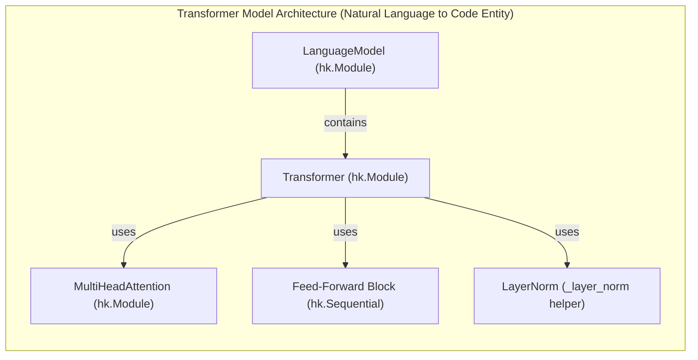
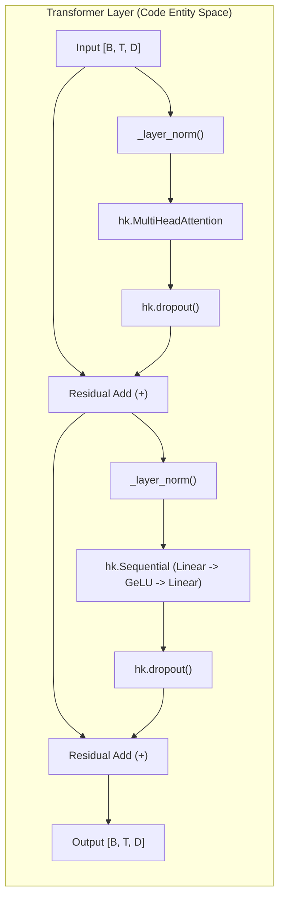
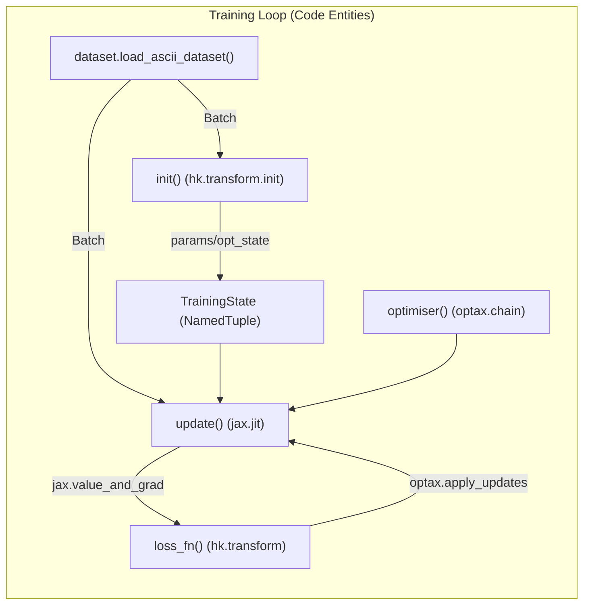

<!-- source: DeepWiki mcp.deepwiki.com · repo google-deepmind/dm-haiku · page 6.2 Transformer Models · fetched 2026-10-26 -->

# Transformer Models

Relevant source files

The following files were used as context for generating this wiki page:

- [examples/transformer/BUILD](examples/transformer/BUILD)
- [examples/transformer/dataset.py](examples/transformer/dataset.py)
- [examples/transformer/model.py](examples/transformer/model.py)
- [examples/transformer/train.py](examples/transformer/train.py)
- [haiku/_src/attention.py](haiku/_src/attention.py)
- [haiku/_src/attention_test.py](haiku/_src/attention_test.py)
- [haiku/_src/integration/checkpoints/MultiHeadAttention.json](haiku/_src/integration/checkpoints/MultiHeadAttention.json)

This page documents the implementation of Transformer models in Haiku, focusing on the example implementation located in the `examples/transformer` directory. This document covers the architecture of the transformer implementation, its components, and how to train a transformer model for language modeling tasks.

## Overview

The Haiku transformer implementation provides a clean, modular approach for building transformer-based models for sequence modeling tasks, particularly language modeling. The implementation follows the architecture described in the "Attention is All You Need" paper but adapted to fit within Haiku's module system.

Sources: [examples/transformer/model.py:38-90](), [examples/transformer/model.py:92-123]()

## Components

### Transformer Module

The core `Transformer` class implements a stack of transformer layers. Each layer contains a multi-head self-attention mechanism, a feed-forward neural network, and includes layer normalization and residual connections.

The `Transformer` class is implemented as a dataclass and inherits from `hk.Module` [examples/transformer/model.py:39](). It has the following parameters:

| Parameter | Description |
|-----------|-------------|
| `num_heads` | Number of attention heads [examples/transformer/model.py:42]() |
| `num_layers` | Number of transformer layers to stack [examples/transformer/model.py:43]() |
| `attn_size` | Size of the attention vectors (key, query, value) [examples/transformer/model.py:44]() |
| `dropout_rate` | Probability with which to apply dropout [examples/transformer/model.py:45]() |
| `widening_factor` | Factor by which the MLP hidden layer widens (default: 4) [examples/transformer/model.py:46]() |

The `__call__` method transforms input embeddings to output embeddings by:
1. Computing a causal mask using `np.tril` for autoregressive modeling [examples/transformer/model.py:59-62]().
2. Iterating through `num_layers`, applying `hk.MultiHeadAttention` and a `hk.Sequential` dense block [examples/transformer/model.py:65-87]().
3. Applying residual connections and `_layer_norm` (which uses `hk.LayerNorm`) at each stage [examples/transformer/model.py:73-89]().

Sources: [examples/transformer/model.py:32-90](), [haiku/_src/attention.py:37-175]()

### Language Model

The `LanguageModel` class wraps the transformer to create a complete autoregressive language model. It handles token embedding, positional embedding, input masking, and output projection to vocabulary logits.

The `LanguageModel` class is also implemented as a dataclass with the following parameters:

| Parameter | Description |
|-----------|-------------|
| `transformer` | The `Transformer` instance to use [examples/transformer/model.py:96]() |
| `model_size` | Size of the embedding vectors [examples/transformer/model.py:97]() |
| `vocab_size` | Size of the vocabulary [examples/transformer/model.py:98]() |
| `pad_token` | Identity of the padding token (used for masking) [examples/transformer/model.py:99]() |

The `__call__` method processes a batch of input tokens by:
1. Creating an input mask where `tokens != self.pad_token` [examples/transformer/model.py:107]().
2. Embedding input tokens using `hk.Embed` [examples/transformer/model.py:112-114]().
3. Adding positional embeddings retrieved via `hk.get_parameter` [examples/transformer/model.py:115-117]().
4. Running the `Transformer` module on the combined embeddings [examples/transformer/model.py:120]().
5. Projecting the final embeddings to vocabulary size using `hk.Linear` [examples/transformer/model.py:123]().

Sources: [examples/transformer/model.py:92-124]()

## Training Implementation

The example implementation in `examples/transformer/train.py` demonstrates how to train a transformer-based language model on a text dataset.

The training implementation includes:

1.  **Forward Pass**: A `forward_pass` function [examples/transformer/train.py:78-91]() that instantiates the `LanguageModel` and `Transformer`.
2.  **Loss Function**: A `loss_fn` decorated with `@hk.transform` [examples/transformer/train.py:101-111]() that computes scalar negative log-likelihood loss, masking out the `PAD_TOKEN`.
3.  **Optimizer**: An `optimiser` function [examples/transformer/train.py:94-98]() using `optax.chain` to combine `optax.clip_by_global_norm` and `optax.adam`.
4.  **Training State**: A `TrainingState` named tuple [examples/transformer/train.py:70-75]() containing `params`, `opt_state`, `rng_key`, and `step`.
5.  **Update Step**: An `update` function [examples/transformer/train.py:129-151]() decorated with `@jax.jit` that uses `jax.value_and_grad` to compute gradients and update parameters.

Sources: [examples/transformer/train.py:70-151]()

## Dataset Handling

The `dataset.py` file provides a simple dataset loader for ASCII text. It tokenizes the text by using ASCII code points as tokens and handles batching and sequence generation for the language modeling task.

Key features of the dataset implementation:
1.  **Vocabulary**: Consists of 128 ASCII characters; code point 0 is reserved as `PAD_TOKEN` [examples/transformer/dataset.py:24-25]().
2.  **Tokenization**: Performed in `load_ascii_dataset` by converting characters to integers via `ord()` [examples/transformer/dataset.py:65]().
3.  **Batching**: The corpus is reshaped into sequences of `sequence_length + 1` to allow for shifted input/target pairs [examples/transformer/dataset.py:68-72]().
4.  **Structure**: The `Batch` named tuple [examples/transformer/dataset.py:30-32]() provides `inputs` (tokens 0 to T-1) and `targets` (tokens 1 to T) [examples/transformer/dataset.py:84]().

Sources: [examples/transformer/dataset.py:24-85]()

## Multi-Head Attention Details

Haiku provides a standard `MultiHeadAttention` module in `haiku/_src/attention.py`.

*   **Initialization**: Takes `num_heads`, `key_size`, and `w_init` [haiku/_src/attention.py:56-110]().
*   **Projections**: Uses `_linear_projection` (wrapped in `@hk.transparent`) to project inputs into query, key, and value heads [haiku/_src/attention.py:139-141, 164-175]().
*   **Attention Calculation**: Uses `jnp.einsum` for the dot-product attention and applies a mask (if provided) by setting masked values to `-1e30` before the softmax [haiku/_src/attention.py:144-153]().
*   **Output**: Flattens the heads and applies a final `hk.Linear` projection [haiku/_src/attention.py:156-162]().

Sources: [haiku/_src/attention.py:37-175]()

---

