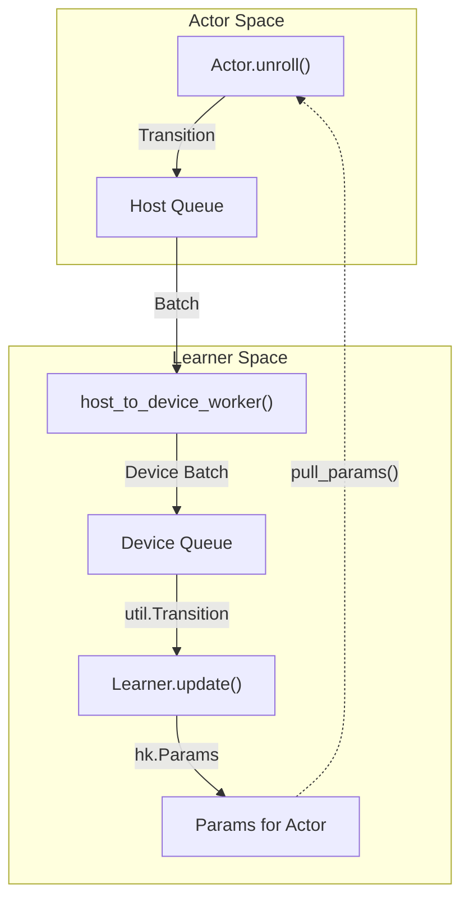
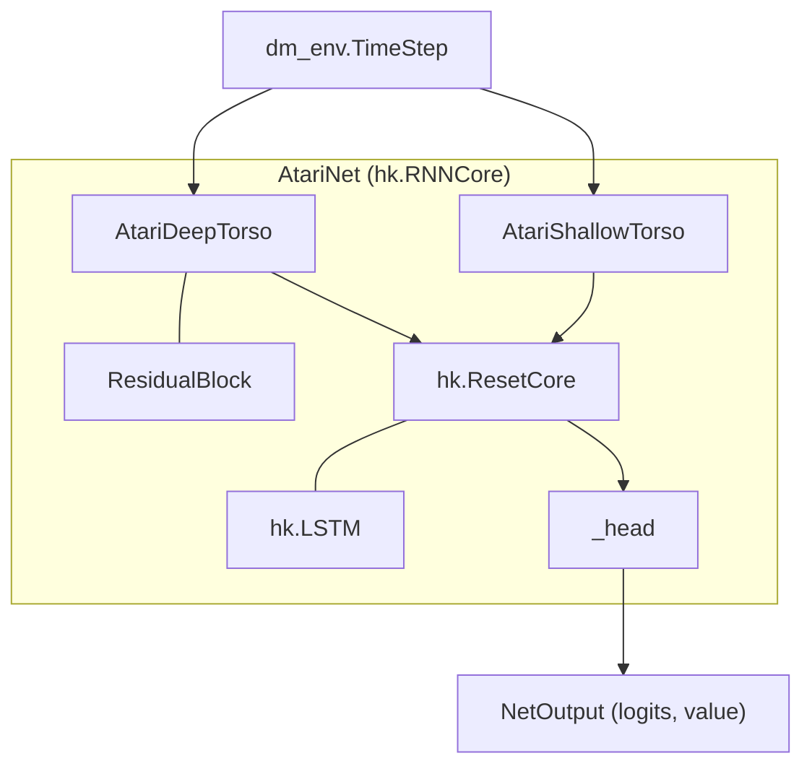

<!-- source: DeepWiki mcp.deepwiki.com · repo google-deepmind/dm-haiku · page 6.3 Reinforcement Learning Examples · fetched 2026-10-26 -->

# Reinforcement Learning Examples

Relevant source files

The following files were used as context for generating this wiki page:

- [examples/BUILD](examples/BUILD)
- [examples/impala/BUILD](examples/impala/BUILD)
- [examples/impala/actor.py](examples/impala/actor.py)
- [examples/impala/agent.py](examples/impala/agent.py)
- [examples/impala/haiku_nets.py](examples/impala/haiku_nets.py)
- [examples/impala/learner.py](examples/impala/learner.py)
- [examples/impala_lite.py](examples/impala_lite.py)
- [examples/rnn/BUILD](examples/rnn/BUILD)
- [examples/rnn/dataset.py](examples/rnn/dataset.py)
- [examples/rnn/train.py](examples/rnn/train.py)
- [haiku/_src/build_defs.bzl](haiku/_src/build_defs.bzl)

Haiku provides several examples of Reinforcement Learning (RL) implementations, ranging from minimal single-process setups to full actor-learner architectures. These examples demonstrate how Haiku modules, particularly recurrent ones, integrate with JAX transformations and RL libraries like `rlax`.

## IMPALA and IMPALA-Lite

The IMPALA (Importance Weighted Actor-Learner Architecture) examples implement the off-policy actor-critic algorithm. Haiku provides two versions: a "Lite" version for quick experimentation and a full version with a decoupled actor-learner architecture.

### IMPALA-Lite
`impala_lite.py` provides a minimal, single-process implementation of IMPALA using the `bsuite` Catch environment [examples/impala_lite.py:15-21](). It uses a simple feed-forward network and handles the V-trace return calculation using `rlax`.

Key components include:
*   **SimpleNet**: A basic `hk.Module` that outputs policy logits and a baseline value from an observation [examples/impala_lite.py:47-66]().
*   **Agent**: Wraps the network apply function and implements the `step` and `loss` functions [examples/impala_lite.py:69-72]().
*   **V-trace Loss**: The `loss` function uses `hk.BatchApply` to process trajectories and `rlax.vtrace_td_error_and_advantage` to compute returns [examples/impala_lite.py:91-125]().

### Full IMPALA Architecture
The full IMPALA implementation is split into specialized modules for actors and learners, allowing for potentially distributed execution.

| Entity | Role | File |
| :--- | :--- | :--- |
| `Actor` | Manages environment interaction and collects trajectories. | [examples/impala/actor.py:25-26]() |
| `Learner` | Performs parameter updates using V-trace loss on batches of trajectories. | [examples/impala/learner.py:51-52]() |
| `Agent` | A stateless interface wrapping the Haiku network for stepping and unrolling. | [examples/impala/agent.py:36-37]() |

#### Actor-Learner Data Flow
The system uses a queue-based mechanism to move data between actors and the learner.

**IMPALA System Architecture**

Sources: [examples/impala/actor.py:94-103](), [examples/impala/learner.py:167-185](), [examples/impala/learner.py:145-158]()

## Haiku Networks for RL

The RL examples utilize specialized Haiku modules designed for the temporal nature of reinforcement learning tasks. These are primarily defined in `haiku_nets.py`.

*   **CatchNet**: A simple `hk.RNNCore` for the Catch environment. Although it is defined as an RNN core, it uses a dummy state to maintain the `RNNCore` interface while acting as a feed-forward network [examples/impala/haiku_nets.py:26-50]().
*   **AtariNet**: A more complex network that supports both ResNet (`AtariDeepTorso`) and convolutional (`AtariShallowTorso`) torsos [examples/impala/haiku_nets.py:133-142](). It optionally wraps an `hk.LSTM` inside an `hk.ResetCore` to handle environment resets during unrolls [examples/impala/haiku_nets.py:141-142]().
*   **Custom Unrolls**: To improve efficiency, these networks often override the `unroll` method to use `hk.BatchApply` instead of `hk.dynamic_unroll` when recurrence is not strictly required or when processing large batches [examples/impala/haiku_nets.py:51-55]().

**RL Network Composition**

Sources: [examples/impala/haiku_nets.py:104-130](), [examples/impala/haiku_nets.py:133-172]()

## RNN Training Example

The character-level language modeling example in `examples/rnn/train.py` demonstrates how to use Haiku's recurrent modules for sequence processing, which is a core component of many RL agents.

### Implementation Details
*   **Network Construction**: Uses `hk.DeepRNN` to stack multiple layers, including `hk.LSTM` and `hk.nets.MLP` [examples/rnn/train.py:55-64]().
*   **Dynamic Unrolling**: The `sequence_loss` function utilizes `hk.dynamic_unroll` to process a time-major batch of sequences [examples/rnn/train.py:72-81]().
*   **Sampling**: Demonstrates how to manually loop over an RNN core using `jax.lax.fori_loop` to generate character-by-character samples [examples/rnn/train.py:95-121]().

Sources: [examples/rnn/train.py:55-64](), [examples/rnn/train.py:78-81](), [examples/rnn/train.py:119-121]()

## VQ-VAE Example

While often used in generative modeling, Vector Quantized Variational Autoencoders (VQ-VAEs) are frequently employed in RL for state representation learning. Haiku includes a VQ-VAE example (`examples/vae.py`) that demonstrates the use of the `hk.nets.VectorQuantizer` module.

The implementation focuses on:
*   **Encoder/Decoder**: Standard convolutional architectures built with `hk.Conv2D`.
*   **Quantization**: Utilizing `hk.nets.VectorQuantizer` to map continuous embeddings to a discrete codebook.

Sources: [examples/vae.py:24-35](), [examples/BUILD:23-36]()

---

