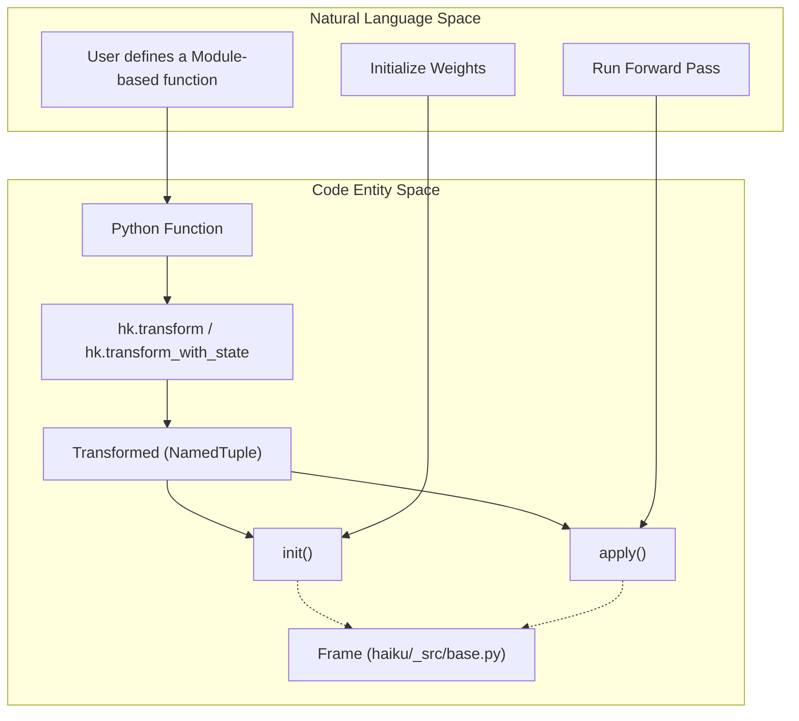
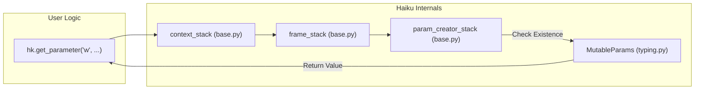

<!-- source: DeepWiki mcp.deepwiki.com · repo google-deepmind/dm-haiku · page 7 Glossary · fetched 2026-10-26 -->

# Glossary

Relevant source files

The following files were used as context for generating this wiki page:

- [docs/api.rst](docs/api.rst)
- [haiku/__init__.py](haiku/__init__.py)
- [haiku/_src/base.py](haiku/_src/base.py)
- [haiku/_src/base_test.py](haiku/_src/base_test.py)
- [haiku/_src/integration/hk_transforms_test.py](haiku/_src/integration/hk_transforms_test.py)
- [haiku/_src/layer_stack.py](haiku/_src/layer_stack.py)
- [haiku/_src/layer_stack_test.py](haiku/_src/layer_stack_test.py)
- [haiku/_src/lift.py](haiku/_src/lift.py)
- [haiku/_src/lift_test.py](haiku/_src/lift_test.py)
- [haiku/_src/module.py](haiku/_src/module.py)
- [haiku/_src/module_test.py](haiku/_src/module_test.py)
- [haiku/_src/multi_transform.py](haiku/_src/multi_transform.py)
- [haiku/_src/multi_transform_test.py](haiku/_src/multi_transform_test.py)
- [haiku/_src/stateful.py](haiku/_src/stateful.py)
- [haiku/_src/stateful_test.py](haiku/_src/stateful_test.py)
- [haiku/_src/transform.py](haiku/_src/transform.py)
- [haiku/_src/transform_test.py](haiku/_src/transform_test.py)

This glossary provides definitions for codebase-specific terms, jargon, and abstractions used within the Haiku library. Haiku is designed as a "bridge" between object-oriented neural network definitions and the functional requirements of JAX.

## Core Concepts

### Frame
A `Frame` is the primary internal data structure that tracks the state of a single Haiku transformation (e.g., during `hk.transform`). It acts as a container for parameters, state, RNG sequences, and the module hierarchy for the current execution context [haiku/_src/base.py:89-103]().

### HaikuContext
The `HaikuContext` manages the lifecycle of `Frame` objects. It is responsible for collecting parameters and state from the current frame and injecting them back into computations [haiku/_src/base.py:164-188](). It ensures that side-effecting operations (like `get_parameter`) are mapped to the correct storage dictionaries.

### Module
The fundamental building block in Haiku. `hk.Module` is a Python class that maintains its own name scope and can contain parameters, state, or other modules [haiku/_src/module.py:465-470](). Haiku uses a metaclass, `ModuleMetaclass`, to intercept method calls and manage naming automatically [haiku/_src/module.py:62-125]().

### Transformation
The process of converting a function that uses Haiku modules into a pair of pure functions: `init` and `apply`.
*   **init**: Returns the initial parameters (and state) for the model [haiku/_src/transform.py:95-100]().
*   **apply**: Executes the model logic using a set of parameters [haiku/_src/transform.py:102-103]().

---

## Technical Terms & Jargon

| Term | Definition | Code Pointer |
| :--- | :--- | :--- |
| **Bundle** | A nested mapping (usually `dict` or `FlatMapping`) representing a collection of parameters or state, indexed by `module_name/parameter_name`. | [haiku/_src/stateful.py:29]() |
| **Creator** | A hook function used to intercept the creation of parameters or state. Often used for custom initialization or logging. | [haiku/_src/base.py:28-31]() |
| **Getter** | A hook function that intercepts requests for existing parameters or state. | [haiku/_src/base.py:61-62]() |
| **Lifting** | The process of taking an inner Haiku transformation and making its parameters visible to an outer transformation. | [haiku/_src/lift.py:133-154]() |
| **PRNGSequence** | A stateful wrapper around `jax.random.PRNGKey` that provides a stream of unique keys via `next_rng_key()`. | [haiku/_src/base.py:42]() |
| **StatePair** | A `NamedTuple` containing `(initial, current)` values for a state variable, used to track updates across `apply` calls. | [haiku/_src/base.py:54]() |
| **Transparent** | A property of a module or function (e.g., `transparent_lift`) where it does not create a new level in the naming hierarchy. | [haiku/_src/module.py:368-369]() |

---

## Architectural Diagrams

### Transformation Lifecycle
The following diagram illustrates how Haiku bridges the gap between the Object-Oriented user code and JAX's Functional requirements.

**Natural Language to Code Entity: Transformation**

**Sources:** [haiku/_src/transform.py:91-120](), [haiku/_src/base.py:89-126]()

### State and Parameter Resolution
When a user calls `hk.get_parameter`, Haiku traverses its internal stacks to find or create the variable.

**Natural Language to Code Entity: Variable Resolution**

**Sources:** [haiku/_src/base.py:56-65](), [haiku/_src/base.py:160-161](), [haiku/_src/typing.py:31]()

---

## Implementation Details

### Parameter Management
Parameters are stored in a `MutableParams` dictionary. During the `init` phase of a transformation, `get_parameter` creates new arrays using the provided `Initializer` [haiku/_src/base.py:34](). During `apply`, Haiku verifies that the parameters already exist in the provided dictionary and returns them; attempting to create new parameters during `apply` results in a `ValueError` [haiku/_src/transform_test.py:76-79]().

### Method Interception
Haiku uses `intercept_methods` and `MethodContext` to allow users to wrap or modify module behavior globally (e.g., for quantization or logging). This is implemented by patching the module methods through the `ModuleMetaclass` [haiku/_src/module.py:62-125]().

### Stateful Control Flow
Standard JAX transformations like `jax.jit` or `jax.grad` are "pure" and do not understand Haiku's internal state (side effects). Haiku provides wrappers (e.g., `hk.jit`, `hk.grad`, `hk.scan`) that explicitly thread the `InternalState` (params, state, and RNG) through the JAX transformation to ensure consistency [haiku/_src/stateful.py:15-28]().

**Sources:**
*   `Frame` and `HaikuContext`: [haiku/_src/base.py:89-204]()
*   `Module` and naming: [haiku/_src/module.py:465-500]()
*   `Transformed` types: [haiku/_src/transform.py:91-120]()
*   Stateful wrappers: [haiku/_src/stateful.py:99-164]()
*   Lifting: [haiku/_src/lift.py:85-131]()