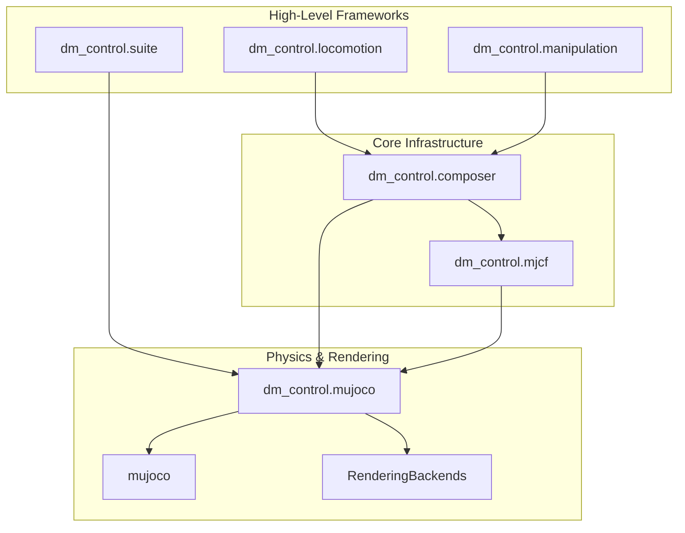
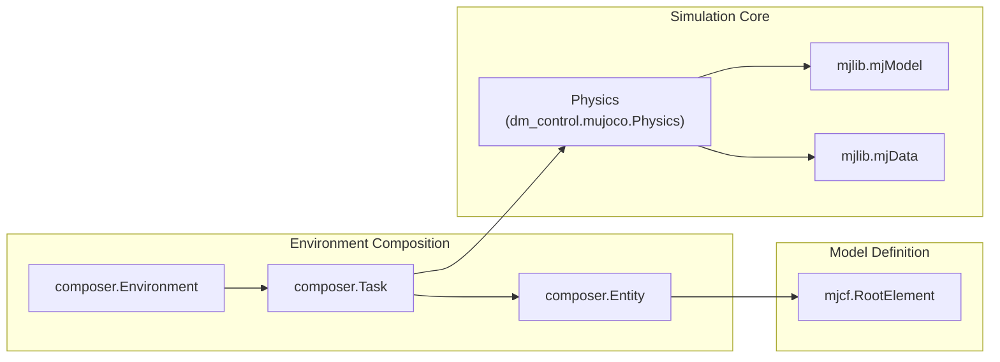

<!-- source: DeepWiki mcp.deepwiki.com · repo google-deepmind/dm_control · page 1 Overview · fetched 2026-10-26 -->

# Overview

Relevant source files

The following files were used as context for generating this wiki page:

- [README.md](README.md)
- [dm_control/mjcf/schema.xml](dm_control/mjcf/schema.xml)
- [dm_control/mjcf/schema_test.py](dm_control/mjcf/schema_test.py)
- [dm_control/mujoco/README.md](dm_control/mujoco/README.md)
- [dm_control/mujoco/tutorial.ipynb](dm_control/mujoco/tutorial.ipynb)
- [dm_control/mujoco/wrapper/README.md](dm_control/mujoco/wrapper/README.md)
- [dm_control/suite/README.md](dm_control/suite/README.md)
- [dm_control/suite/all_domains.png](dm_control/suite/all_domains.png)
- [requirements.txt](requirements.txt)
- [setup.py](setup.py)
- [tutorial.ipynb](tutorial.ipynb)

`dm_control` is Google DeepMind's software stack for physics-based simulation and Reinforcement Learning (RL) environments, powered by the MuJoCo physics engine [setup.py:171-175](), [README.md:1-4](). It provides a high-level Pythonic interface for composing complex scenes, defining RL tasks, and rendering high-quality visual data [README.md:1-34]().

The repository is structured to support everything from low-level physics research to high-level multi-agent locomotion and manipulation [README.md:10-34]().

Sources: [setup.py:171-175](), [README.md:1-34]()

## High-Level Architecture

The framework is organized into layers that transition from raw bindings to high-level environment abstractions [README.md:10-34]().

Sources: [README.md:10-34](), [setup.py:187-203]()

## Major Subsystems

### MuJoCo Python Bindings (`dm_control.mujoco`)
This library provides the foundational interface to MuJoCo [README.md:14-15](). It leverages the official `mujoco` Python package [setup.py:194-194]() and adds the `Physics` class which manages the simulation lifecycle, including `step()`, `reset()`, and named indexing for model elements [dm_control/mujoco/README.md:25-46]().
*   **For details on migration to v1.0 bindings, see [Migration Guide (v1.0)](#1.2).**

Sources: [README.md:14-15](), [setup.py:194-194](), [dm_control/mujoco/README.md:25-46]()

### MJCF Model System (`dm_control.mjcf`)
A library for programmatically composing and modifying MuJoCo MJCF models in Python [README.md:25-26](). It provides a DOM-like structure (`RootElement`) for building scenes without manual XML string manipulation [dm_control/mjcf/schema_test.py:60-75]().

Sources: [README.md:25-26](), [dm_control/mjcf/schema_test.py:60-75]()

### Composer Entity-Component Framework (`dm_control.composer`)
The high-level framework for defining rich RL environments from reusable components [README.md:28-29]().
*   **Entities**: Self-contained components that encapsulate MJCF models and simulation logic [tutorial.ipynb:148-150]().
*   **Arenas**: The surroundings where walkers and objects exist [tutorial.ipynb:156]().
*   **Tasks**: Define observations, rewards, and initialization/termination logic [tutorial.ipynb:150]().

Sources: [README.md:28-29](), [tutorial.ipynb:148-156]()

### Locomotion & Manipulation
Specialized libraries for complex tasks:
*   **Locomotion**: Includes a variety of walkers (CMU Humanoid, Rodent, Ant) and procedurally generated environments like mazes and corridors [tutorial.ipynb:156-164]().
*   **Soccer**: A multi-agent soccer environment built on top of the locomotion framework [README.md:33-33](), [tutorial.ipynb:167]().
*   **Manipulation**: Tasks involving robotic arms (e.g., Kinova Jaco) for lifting and reaching [tutorial.ipynb:169-170]().

Sources: [README.md:31-33](), [tutorial.ipynb:156-170]()

### Control Suite (`dm_control.suite`)
A set of standardized benchmark environments (e.g., Cartpole, Cheetah, Humanoid) used extensively in RL literature [README.md:17-18](), [dm_control/suite/README.md:1-15]().

Sources: [README.md:17-18](), [dm_control/suite/README.md:1-15]()

## Code Entity Mapping

This diagram bridges the natural language concepts to the specific classes and files used in the codebase.

Sources: [tutorial.ipynb:138-170](), [dm_control/mujoco/README.md:25-36](), [dm_control/mjcf/schema_test.py:78-106]()

## Getting Started

To begin using `dm_control`, you must install the package and configure a rendering backend [README.md:53-114]().

*   **Installation**: `pip install dm_control` [README.md:55-59](). Note that editable mode (`-e`) is not supported due to legacy binding generation [README.md:61-75]().
*   **Rendering**: Supports EGL (headless GPU), GLFW (windowed), and OSMesa (software) [README.md:91-94](). Configure via the `MUJOCO_GL` environment variable [README.md:112-114]().

**For detailed setup instructions, rendering backend configurations, and verification steps, see [Installation and Setup](#1.1).**

Sources: [README.md:53-114](), [setup.py:187-203]()

---

